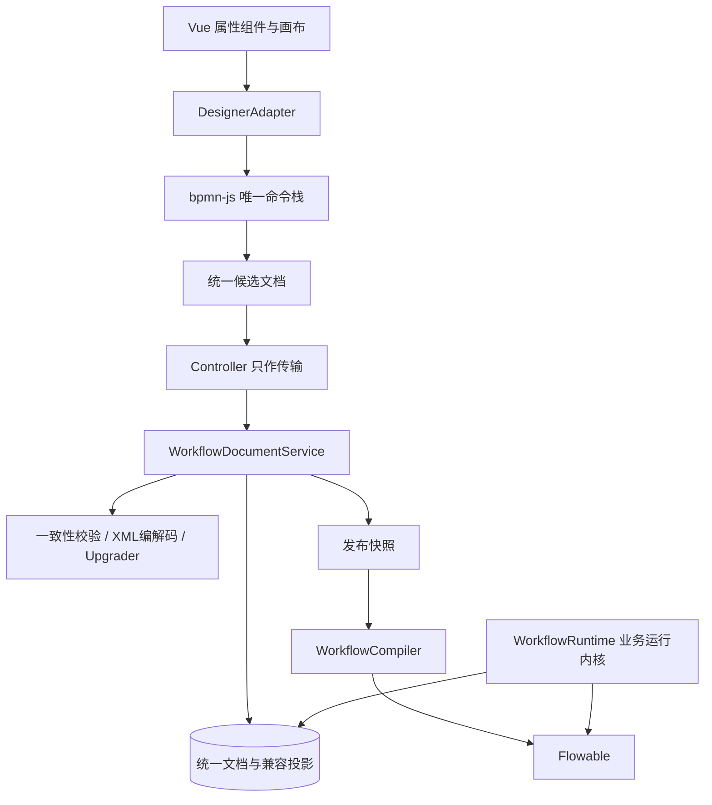

# DevHub Workflow Designer 技术改造设计方案

日期：2026-11-15；状态：架构评审修订稿，尚未实施。本文承接已评审方案 C；不代表新能力已实现。阶段一见[技术验证计划](DevHub工作流设计器阶段一技术验证计划.md)。

## 1. 源码基线与架构

当前 frontend/modules/workflow 使用 WorkflowDesigner.vue、WorkflowCanvas.vue、自研 SVG、业务 JSON 和最多 30 次快照历史；没有 bpmn-js。backend/services/workflow-service 的 WorkflowModel 管理业务语义，WorkflowCompiler 生成 BPMN，WorkflowRuntime 管理草稿、发布、可靠交付及实例。Flowable adapter 使用 Flowable 8.0.0；Java 21、Spring Boot 4.1.2。前端声明 Vue ^3.5.31、Element Plus ^2.13.6、Vite ^8.0.3、TypeScript ^6.0.2；实际安装状态待验证。

## 2. 数据模型决策

| 方案 | 复用与复杂度 | 标准、交换和属性 | 历史与执行 | AI扩展 |
|---|---|---|---|---|
| A JSON权威 | 复用最高；完整图形支持后复杂度上升 | 所有DI和扩展需加入JSON表达；未知内容容易丢失 | 最接近当前编译方式 | 业务schema可扩展 |
| B XML权威 | 需重建读写及投影链，复杂度高 | 标准表达直接；仍受解析器和支持子集限制 | 历史转换与执行安全改动大 | 需要XML和业务契约同步演进 |
| C 统一版本文档 | 复用业务内核；增加统一服务与一致性验证 | 分配字段权威，原子保存完整交换表示 | 显式升级，保留现有冻结版本 | 节点契约与执行器独立演进 |

采用 C：业务 JSON 是业务语义唯一权威，DI 是布局唯一权威，XML 是受控建模和交换表示。统一文档不意味着三份数据均可独立编辑。

文档包含 schemaVersion、model、diagram、exchangeXml、preservedExtensions、provenance。diagram 包含 BPMN DI 的节点边界、标签、连线折点与稳定引用；禁止再保存独立可写的坐标副本。Node.position 只作为现有执行模型的兼容投影，冲突提交拒绝。摘要由服务端生成，仅辅助诊断，不能替代结构化比较。revision、租户和操作者来自服务端信封，不信任XML内的声明。

### 2.1 统一文档服务

WorkflowDocumentService 是唯一文档读写入口，负责加载、保存、revision、JSON/XML一致性、XML生成、升级、导入预检、发布快照装配。Controller只转换请求与响应；Runtime发布入口通过该服务获取快照，不直接改文档。其他模块仅经公开契约调用，不直接写表。文档仓储限制在服务内部；以架构测试检查绕过调用。

保存过程：权限及租户校验 → 安全解析候选XML → 提取并比较业务镜像和DI → 规范化 → revision条件更新 → 同事务写统一文档与兼容投影。表示冲突返回稳定错误码，不以最后写入为准。草稿允许业务未填完，但结构、表示一致性和安全校验不可跳过。发布重新执行完整业务校验并装配冻结快照。

wf_definition.model 是统一服务生成的兼容业务投影，不能独立修改。wf_version.model 是冻结执行投影；wf_version.bpmn 是实际部署产物，不是可编辑源。交换XML与执行XML目的不同：执行XML仅包含受控编译结果，未知扩展不得直接进入部署。文档与全部投影原子写入；引擎与数据库事务的真实原子性仍须故障注入验证。

### 2.2 稳定ID

现有节点ID沿用，满足当前字母开头、字母数字下划线、最长64字符约束；新节点使用字母前缀加随机ID，创建后不可因排序或重命名改变。节点业务ID与BPMN ID首期采用恒等映射。连线新增稳定业务ID并与SequenceFlow ID恒等映射；不以数组下标标识，不再使用flow_下标作为新文档身份。

历史连线在显式升级时分配一次ID并随文档保存。外部ID不符合业务约束时生成候选映射表，同步改写全部已知引用；存在无法安全改写的未知引用则阻止转换。克隆产生新ID，撤销恢复原ID。导入同一文件不能冒用本地定义、租户或revision。

## 3. 节点映射与执行契约

区分 BPMN Element（标准控制流）、DevHub Node Type（业务语义）、Execution Provider（服务端注册执行器）。三者不等同。第一期只迁移现有10类；AI、HTTP、数据节点必须后续提供受控契约、参数schema、授权及执行器，禁止先建无后端入口。

所有节点id/name映射标准属性；kind及完整现有节点字段进入DevHub扩展。流程扩展保留objectType、purpose、mode、entryCapability、matches、terminalActions、copies、withdrawalCapability。namespace URI待正式固化；使用版本无关URI、独立schema版本，不以XML前缀判断身份。

| 类型 | BPMN元素 | 业务扩展与双向规则 | Flowable执行 |
|---|---|---|---|
| START | StartEvent | kind=START，无事件定义；恢复完整节点配置 | 普通启动 |
| END | EndEvent | kind=END，无额外结束事件语义 | 现有流程end监听器进入wfBridge |
| REVIEW | UserTask | people/completion/allowSelf/required/input/timeout等；kind明确区分 | 固定assignee、多实例及create监听器 |
| HANDLE | UserTask | 同人工配置并保留capability/separate | 现有人工办理与业务能力 |
| ACTION | ReceiveTask | capability/input/retries/timeout等；kind=ACTION | wfBridge、可靠job交付、现有推进链 |
| WAIT | ReceiveTask | 同受控配置；kind=WAIT | 等待、回调与trigger机制 |
| CHOICE | ExclusiveGateway | kind；分支field/operator/value与defaultEdge | 固定wfBridge.condition比较器 |
| MERGE | ExclusiveGateway | kind=MERGE，不推断成CHOICE | 排他汇合 |
| FORK | ParallelGateway | kind=FORK，join稳定引用 | 现有结构化并行 |
| JOIN | ParallelGateway | kind=JOIN，验证唯一FORK归属 | 并行汇合 |

JSON→BPMN由固定映射生成；BPMN→JSON读取已支持DevHub扩展并核对标准元素及属性一致性，不执行表达式，不从形状猜测业务类型。缺少kind的UserTask/ReceiveTask须人工选择候选类型，发布前补齐。人工任务保留${wf_actor}、wfBridge.people、SEQUENTIAL顺序多实例及ANY现有完成条件。ACTION/WAIT不得改成ServiceTask。

SequenceFlow保留稳定ID、端点、条件镜像、默认流和DI；表达式仅由服务端固定模板生成。连线名称当前Edge没有字段，需显式扩展契约后支持，不仅存Vue状态。完整节点字段即使暂不适用也不得在往返中静默删除。

## 4. 命令与规则

所有修改进入bpmn-js command stack：节点增删移动、连线增删、业务属性、节点配置、连线条件、流程属性及布局。属性组件只读投影并发送意图，不直接修改Vue JSON。DesignerAdapter将复杂业务配置转换成具有完整execute/revert上下文的组合命令；命令完成及撤销重做后重建只读投影和属性面板。新编辑器禁用旧JSON快照栈，不能与command stack并存。

独立规则层保存交互约束与诊断映射，bpmn-js rules只是前端适配。后端WorkflowValidator继续权威验证100节点/200连线、无循环、选人、能力、条件及并行等规则。前端规则不构成安全边界。保存中的异步导出需冻结编辑序号或检测过期，防止旧导出覆盖新命令。

## 5. XML兼容与保真

已支持DevHub扩展允许编辑并完整语义往返；未知安全扩展只读保留，其内部语义不可编辑；未知执行扩展禁止进入可发布文档。未知不等于安全：必须经过namespace、位置、引用和内容策略分类，不确定默认阻断发布。

首期可编辑：单Process、现有10类对应元素、SequenceFlow及DI。合法但未支持的ServiceTask、子流程、泳池泳道、消息/定时/边界事件等仅进入隔离只读会话；实际可展示清单须Demo验证。脚本、任意Delegate/listener/表达式禁止进入发布文档。DTD、外部实体、外部资源、超限或畸形XML拒绝解析。

未知安全扩展保留策略通过验证后实现：保存所属元素ID、namespace、原始片段和必要namespace声明；只允许按整体原样挂接，不允许编辑内部字段。删除所属元素需明确报告将删除扩展；涉及未知ID引用或无法证明安全的变更阻断。不能假设moddle自动保留所有未知内容。只读来源可原文件下载；编辑输出承诺受支持范围的语义保真，不承诺字节、前缀和空白一致。

导入：安全预检 → 元素分类 → 候选模型/映射/诊断 → 隔离预览 → 用户显式新建或替换 → revision保存。预检不写当前草稿，不部署、不调用外部服务；导入错误不影响现有会话。导入整体替换若不能可靠撤销则建立新会话并保留旧草稿，不伪装普通命令。

## 6. 历史数据升级与数据库

WorkflowDocumentUpgrader显式将旧JSON转换为候选文档，用户确认后通过统一服务按原revision保存；不得加载时自动覆盖。已有position只能标记为历史节点坐标；缺失尺寸、连线路径与DI通过新布局生成并标记generated，不伪称历史恢复。历史发布版本和部署XML保持不可变，转换仅输出副本。

新增迁移给wf_definition与wf_version增加统一文档、格式版本、摘要字段，历史值允许NULL。保留model/bpmn兼容投影定位；不修改历史迁移，不改wf_instance/wf_task/wf_job首期结构。具体SQL类型、容量、索引和迁移号待实施核验。发布继续冻结data_contract_schema，不伪造历史快照。

## 7. 前后端改造边界

前端保留WorkflowCenter、BusinessWorkflowConfiguration、公开API和主题/i18n。designer下新增adapter、document、bpmn/commands、bpmn/rules、components及properties目录。WorkflowCanvas只负责建模实例生命周期与基础事件；业务通过Adapter隔离。属性按Process、HumanTask、ReceiveTask、Gateway、SequenceFlow拆分。复用Element Plus、AppIcon、ManagedDialog；全屏编辑是明确布局例外，列表仍用平台壳。

后端保留WorkflowModel、WorkflowValidator、WorkflowCompiler、WorkflowRuntime、WorkflowBridge和Flowable adapter。增加WorkflowDocumentService、WorkflowDocumentCodec、WorkflowXmlImporter、WorkflowDocumentValidator、WorkflowDocumentUpgrader、WorkflowExtensionPolicy及ImportReport；XML解析留在适配层，Core不依赖Flowable实现。Controller只调用统一服务；Runtime运行行为不重写。

## 8. 安全、阶段与风险

服务端复核身份、租户、操作、目录权限、CSRF、幂等和revision；导入文件不能授予能力。凭据不进入XML、示例和日志。未知扩展不直接执行，任意URL/Java类/脚本不进入编译。旧实例继续使用冻结版本。

阶段一：独立技术Demo，仅验证，不改正式设计器。阶段二：文档契约、统一服务、升级和一致性测试。阶段三：建模内核、命令与规则，迁移10类节点。阶段四：全屏UI、动态属性、主题和响应式。阶段五：数据库、导入导出、真实Flowable及授权回归。未来节点单独立项，不纳入首期完成声明。

每阶段验收必须区分已实现、已验证和待验证：文档层拒绝双源冲突；命令层撤销重做后模型/XML/面板一致；存储层并发失败不部分写入；执行层验证人工、条件、并行、ACTION/WAIT和旧实例；UI层验证中英文、浅深/System与1440×900、1024×768、390×844。执行类型检查、ESLint、构建、操作绑定、XML往返及真实MySQL/Flowable测试。

主要风险：未知扩展丢失、ID引用重写、异步导出竞态、组合命令回滚不完整、历史DI缺失、依赖类型兼容、部署事务边界。均须实测，不能以构建成功替代。当前工作区大量未提交修改，后续只做限定范围增量，不重置、覆盖或清理无关文件。
