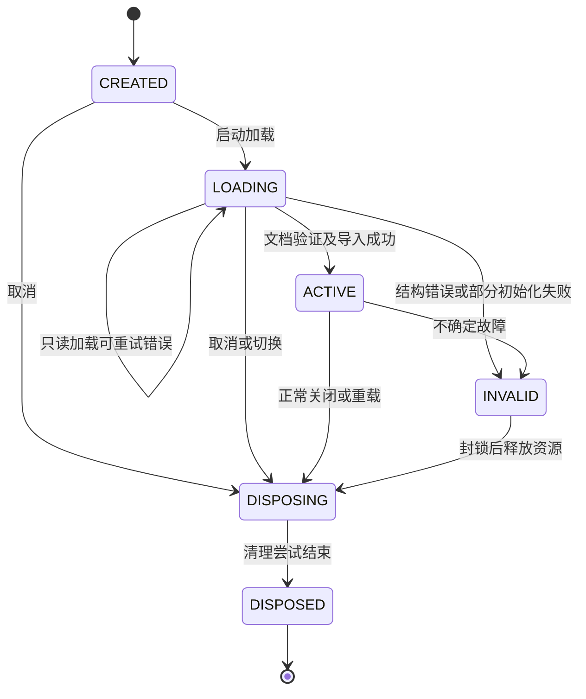
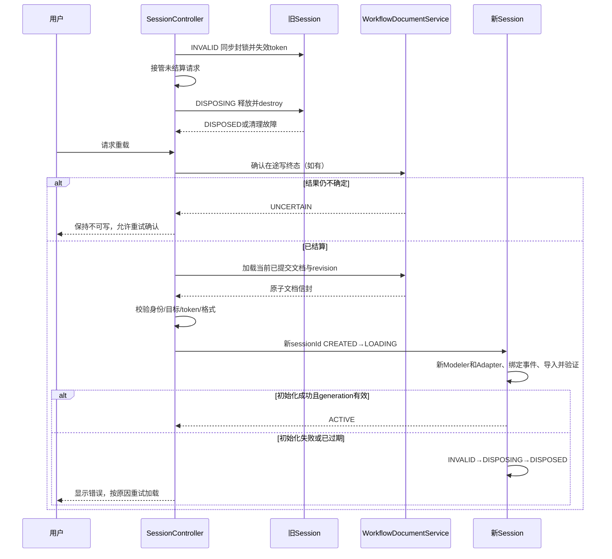

# Workflow Designer Session Lifecycle 架构设计方案

日期：2026-11-15；状态：架构评审稿，仅设计，不表示正式模块已经采用。关联：[改造方案](DevHub Workflow Designer技术改造设计方案.md)、[阶段一计划](DevHub工作流设计器阶段一技术验证计划.md)。

## 1. 背景与证据边界

正式frontend/modules/workflow仍是业务JSON与自研画布；bpmn-js 18.31.1、diagram-js 15.29.0只存在于独立Demo，不能将实验栈描述为正式设计器已升级。后端Flowable 8.0.0及受控业务内核继续保留。

实际阅读：上述设计文档；Demo的MOVE-ONLY-REPORT、CONNECTED-MOVE-REPORT、FAILURE-RECOVERY-REPORT；src/failure-session.ts、tests/failure-injection.spec.ts；正式WorkflowDesigner.vue、api/workflow.ts、WorkflowRuntime.java及已安装销毁源码。

第一道：孤立shape.move限定通过。第二道：一条关联SequenceFlow的move限定通过。第三道：九例会话隔离通过，完整恢复0项；原生handler函数体内异常注入BLOCKED。不能证明任意命令历史安全、自动事务回滚或方案A整体成立。完整DesignerAdapter尚未获批。

## 2. 原则和职责

WorkflowModel是业务语义权威；BPMN DI是布局权威；XML是受控表示；服务端revision控制并发，服务端信封决定身份、租户和定义归属。生命周期组件只管理编辑能力及资源，不获得文档最终权威。诊断XML不作恢复输入。历史快照只用于命令恢复，不能成为独立可编辑文档。

会话与控制器分离：SessionController持有当前会话指针和请求结算登记；一次Session持有一个Modeler、Adapter及资源作用域。旧会话终止不可复活，重载必须创建新sessionId。本文提出接口职责，不新增可运行接口或状态机代码。

## 3. 最小状态机

生命周期采用CREATED、LOADING、ACTIVE、INVALID、DISPOSING、DISPOSED。SAVING为独立操作状态；RELOADING是控制器跨会话流程，不是旧Session复活状态。首次实现保存期间冻结文档修改，避免并行编辑复杂度。

操作状态：IDLE、PREPARING、IN_FLIGHT、UNCERTAIN；服务端冲突另设writeGate=CONFLICT，未结算写设writeGate=UNSETTLED。与生命周期正交。仅ACTIVE+IDLE+writeGate=OPEN可启动写操作。保存成功/确定失败回IDLE；不确定结果进入UNCERTAIN且不可再次写入。网络不确定不自动认定模型损坏，允许只读查看，但必须结算。

## 4. 状态转换表

| 状态 | 进入/退出 | 允许 | 禁止与重试 |
|---|---|---|---|
| CREATED | 分配唯一标识；启动后LOADING | 取消 | 无编辑/保存；不复用已取消实例 |
| LOADING | 获取原子文档信封、校验、导入；成功ACTIVE | 加载进度、取消、只读网络重试 | 禁止业务命令；Modeler已部分变更时失败需新实例 |
| ACTIVE | 初始化成功 | 按操作门禁允许编辑、保存、导出等 | IN_FLIGHT/PREPARING冻结修改；UNCERTAIN/CONFLICT禁止写 |
| INVALID | 完整性或执行不确定故障 | 安全错误说明、请求重载、受控诊断 | 立即封锁全部文档操作，不允许原地重试命令 |
| DISPOSING | 撤销能力、清理作用域 | 查看清理/结算状态 | 不触碰Modeler；逐资源清理，错误不重新开放 |
| DISPOSED | 清理完成或已记录残留故障 | 控制器发起新会话 | 实例终态，不回ACTIVE |

资源释放失败记录cleanupFailed，并阻止受污染宿主复用；逻辑DISPOSED不等于所有外部任务已完成。新会话使用独立DOM与作用域；存在无法隔离的全局资源时重建阻断，标记NEEDS VERIFICATION。

## 5. INVALID触发

必须失效：DI恢复异常、画布派生异常、命令结果不确定、Undo/Redo失败、稳定边界结构/DI/画布投影违反契约、事件循环或重复同步、异步回调未经当前会话门禁写入。

仅观察到命令执行中的暂态差异不立即误判；检测应在已定义操作收敛边界进行。画布与DI一致性指明确投影契约，不要求内部original辅助字段与XML一致。

陈旧回调被成功拒绝属于正常隔离，不导致新会话失效；若它已经修改新会话，则新会话INVALID并停止操作。HTTP 409、403、普通网络失败本身不等于几何损坏，但必须关闭相应写门禁。

## 6. 操作矩阵

| 操作 | ACTIVE且空闲开放 | 保存中/结果不确定/冲突 | INVALID及销毁态 |
|---|---|---|---|
| 新增/删除/移动、属性、连线、Undo/Redo | 可，经统一命令入口 | 禁止 | 禁止 |
| 保存/发布 | 可，经服务端授权 | 禁止重复发起 | 禁止 |
| 导出/依赖当前文档的预演 | 可，经一致性检查 | 首期冻结，避免歧义 | 禁止 |
| 查看错误 | 可 | 可 | 可 |
| 诊断下载 | 明确许可且脱敏 | 同左 | 仅受控摘要；不得下载故障文档作为恢复材料 |
| 重载 | 离开保护后可 | 必须结算不确定写 | 可请求，由控制器编排 |

加载态仅加载、取消和错误重试。按钮禁用不够：palette、context pad、拖拽、键盘、剪贴板、属性、事件回调均需受同一能力门禁约束。失效同步撤销能力，再销毁画布，原始Modeler不对业务组件暴露。全部输入通道封锁能力仍需独立验证。

## 7. 公开销毁API核查与资源清单

实际版本源码：bpmn-js/lib/BaseViewer.js:585的公开destroy调用Diagram.destroy并移除内部容器；diagram-js/lib/Diagram.js:225触发diagram.destroy。Canvas订阅该事件执行自身清理；EventBus也订阅以清理监听。以上为公开入口及实现依据，不调用其内部_destroy方法。BaseViewer.clear只清图且可复用，不代替销毁。

| 资源 | 处理 | 类别/边界 |
|---|---|---|
| Modeler、内部Canvas/EventBus、内部拦截器 | 调用公开destroy一次；finally清理外层作用域 | 主动释放；幂等包装需实现验证，不假设destroy重复调用安全 |
| Vue事件、watch、外部订阅 | dispose清单逐项取消 | 外部资源不由Modeler自动管理 |
| ResizeObserver | disconnect | 若创建则登记归属 |
| 定时器、动画回调 | clear/cancel并撤销回调能力 | 不能假设取消已执行回调 |
| HTTP读取请求 | AbortController尽力取消 | 不代表服务器工作撤销 |
| 已发送写请求 | 移交控制器结算登记 | 不等待它才封锁/移除画布；必须结算后开放新写 |
| importXML/saveXML Promise | 标记generation失效；吸收迟到错误 | 一般Promise不可取消；不再访问旧实例 |
| 命令同步执行 | 在安全catch边界处理 | 不尝试抢占JS同步执行；失效时先撤销能力 |
| Adapter缓存、临时DI/XML | 外部引用清空，等待GC | 不保证物理擦除；不作恢复源 |
| 外层DOM | Modeler内部清理后移除独立宿主 | 不复用旧容器给新会话 |

销毁顺序：同步封锁、失效token → 取消输入/外部事件/观察器 → 尽力取消读取与定时任务 → destroy → 清理引用及宿主 → 记录残留错误。逐项try/finally，不让一个清理失败跳过其他资源。不得为等待异步导出而延迟安全封锁。

## 8. 异步隔离

每次创建使用不可复用sessionId；控制器持有单调generation。异步启动捕获sessionId、generation、definitionId、可信租户上下文标识、editSequence和操作token。

回写前同时检查：仍为当前会话、generation一致、生命周期允许、操作token仍有效、编辑序号匹配。检查与同步回写之间不得再await；有第二个await就重新检查。检查失败仅丢弃，不调用新会话命令、不更新baseline/revision/UI。

事件处理器闭包绑定所属会话，不通过全局“当前Adapter”转发旧事件。所有注册返回对应disposer；旧事件没有能力取得新会话可写引用。

XML导入到候选Modeler，不直接写ACTIVE实例；初始化中迟到结果不能激活已失效会话。导出启动时冻结修改并记录序号；导出期间失效则禁止发送结果。若请求已发送，转交结算而非假装取消。

Promise晚回或拒绝须被处理，防止未处理拒绝及旧实例触碰；Modeler.destroy是否会与未完成importXML产生内部资源竞争为OPEN，须真实测试，不能仅凭generation保护宣称库内部也安全。

## 9. 保存流程与信封

保存流程：检查门禁 → PREPARING冻结编辑 → 取得一致文档及editSequence → 再次校验token → 创建不可变请求信封 → IN_FLIGHT发送 → 服务端校验/提交 → 若会话仍有效，更新revision与保存baseline；否则只更新请求结算登记，禁止写旧或新会话状态。

| 字段 | 持有与校验 |
|---|---|
| definitionId | 前端持有目标；服务端按可信租户查归属并授权 |
| tenantId | 前端只绑定上下文用于隔离；服务端从认证上下文确定，不信任请求任意指定 |
| revision | 前端最后确认版本；服务端条件更新，冲突409 |
| sessionId/generation | 前端生命周期路由，非授权凭证 |
| requestId | 前端在逻辑写创建一次；同一次不确定请求重试不得更换 |
| payload摘要 | 诊断和匹配辅助；服务端重算，不能替代文档验证 |

现有WorkflowRuntime.save按tenant_id/id/revision条件更新，revision=-1创建返回0。mutate以tenant/actor/request_id登记、校验fingerprint并复用已存response；写入与response在TransactionTemplate中处理。真实数据库并发与断网恢复仍需集成测试。

现有前端api/workflow.ts每次write新建UUID，不能用该函数多次调用模拟“同一请求重试”。需要后续公开的稳定请求信封契约，本轮不修改。

## 10. 保存与销毁竞争

| 场景 | 决策 |
|---|---|
| 保存准备中失效，尚未发送 | 撤销token，丢弃结果，不发请求 |
| 已发送后异常/销毁 | 封锁并释放会话；控制器记录UNCERTAIN写，不相信abort结果 |
| 保存成功但响应丢失 | 查询该requestId的最终状态，再读当前文档；不能仅用revision变大猜测本请求成功 |
| 保存失败时会话已销毁 | 仅结算登记；不恢复旧会话，不把错误写到新画布 |
| 旧响应晚于新会话创建 | 不更新新revision、baseline或dirty；可通知控制器重新查询 |
| 两会话使用相同revision保存 | 服务端条件更新决定唯一胜者，另一方409；不自动合并、不换revision覆盖 |
| 无法查明请求结果 | 保持写锁；允许安全错误与重试查询，不激活可写新会话 |

一次GET最新文档不保证此前写请求不会随后提交，因此不能将“读到最新”当作在途写已结束。首期采用定义/租户范围的结算屏障：请求终态确定后再读取原子最新文档信封。其他标签页无法共享该屏障时仍由revision兜底；不可避免的后续外部提交会导致下次保存409，而不是静默覆盖。

## 11. 不确定请求的服务端契约缺口

NEEDS VERIFICATION/OPEN：当前已查代码没有公开requestId结果查询或写终结屏障。仅查看wf_request当前不存在也不能证明未到达请求未来不会执行。

拟议WorkflowDocumentService需要提供受授权的操作结算查询：限定当前租户、账号、definition与requestId；返回最终已提交/最终拒绝/仍不确定。只有服务端能保证不会迟到执行时才返回“最终未提交”。保留幂等记录的期限、actor变更、请求摘要、等待超时须明确。

若暂不提供该契约，可评估经明确授权使用相同requestId及完全相同信封重放来获取结果；这可能执行原请求，不能称只读查询，不能自动重放。现有不自动重试写原则保持。本方案首选公开查询/屏障，未具备前不开放“结果不确定后可写重载”。

## 12. 重载时序

RELOADING属于控制器流程，旧Session只走终态；销毁优先，不等待服务端结算。结算登记在Session之外，保留原请求识别但不保留故障画布为恢复来源。

本地格式及一致性校验失败不反复导入同一损坏会话；权限403停止重试并给出权限反馈；401沿用会话失效入口；404说明定义不可用；网络错误允许有界人工重试。新文档尚未有服务端提交时，重载为授权后创建空候选，不从故障诊断恢复，并明确未保存内容丢失。

读取revision和文档必须同一快照信封，不先查revision再另查正文拼接。加载后若其他编辑者再次保存，后续依赖revision拒绝过期写。首次文档完整性由服务端权威校验，前端再做一致性保护，不能用前端通过替代后端授权。

## 13. 与统一文档服务边界

WorkflowDocumentService为拟议服务，当前尚未实现：负责原子加载/保存、revision、幂等结算、JSON/XML一致性、升级和发布快照。生命周期只控制何时可调用，不自行生成服务端事实。Runtime业务执行、Compiler受控编译及冻结版本不因生命周期重构改变。

发布必须引用已确认保存的revision；发布在途也需同类结算，不把发布响应丢失当失败后新建请求。正式接入前需专项设计，本轮不验证发布事务。

## 14. 用户体验与诊断

失效立即显示“编辑会话已停止，未确认的修改无法继续保存”；显示已知保存状态及重载入口，避免假成功Toast。重载明确读取服务端最新提交而非历史画布；告知未提交内容不会恢复。保存结果不确定单独显示，不显示“保存失败所以服务端未变化”。

错误展示复用现有全局反馈、ManagedDialog、i18n与主题；本轮不增加UI。诊断默认只有错误码、版本、阶段和脱敏ID；XML/Prompt/业务输入可能敏感，不默认下载。诊断权限、容量和保留期限OPEN，非恢复权威。

## 15. 安全与多租户

跨租户/账号切换首先失效旧generation和请求UI能力，旧请求结算不得将详情显示给新身份。不能在新租户下用旧requestId无条件查询；按原授权上下文访问，失权则停止展示。sessionId不授予任何服务端权限。凭据不进入日志、XML或localStorage；CSRF、可信租户、操作授权和幂等校验继续由后端执行。

## 16. 测试策略

| 类别 | 必须证明 |
|---|---|
| 状态转换 | 终态不可复活；INVALID立即封锁所有入口；Saving正交状态无非法组合 |
| 资源 | 正常/重复/部分失败dispose；observer、timer、Vue与外部订阅清理；新旧DOM隔离 |
| Promise | 旧导入/导出成功、拒绝、永不返回；销毁竞态不触碰新会话且无未处理拒绝 |
| 保存竞态 | 发送前失效、发送后销毁、成功丢响应、晚失败、旧响应晚于新会话 |
| 服务端 | 同revision并发、同键同内容、同键不同内容、未到达/在途查询、终结后迟到请求 |
| 重载 | 请求结算后原子读取最新文档；不使用诊断和旧快照；格式失败重试新实例 |
| 安全 | 切租户、撤权、401/403、跨定义requestId、账号切换 |
| 回归 | 前三道证据不变；精确DI断言；全部键盘/拖拽/属性入口门禁 |

浏览器及真实数据库分别取证；销毁不等于回滚，拒绝按钮不等于命令入口封锁。完整性验证需覆盖DI、业务投影、拓扑和导出，并区分诊断输出与用户导出。

## 17. 未决问题

OPEN：公开结算查询/终结屏障；幂等记录保留和重放授权；Modeler未完成导入销毁；所有输入通道统一门禁；destroy抛错后的全局资源；公共插件事件归属；多标签结算；诊断脱敏；发布在途结算；真实已提交文档重载。

NEEDS VERIFICATION：bpmn-js实际插件能否全部遵循生命周期；strict TS既有声明问题；方案A复杂组合/完整历史及原生handler内部异常。上述不由本设计自动关闭。

## 18. 实施阶段与风险

先评审状态机、请求屏障和失效语义；再获批后在隔离Demo实现控制器及资源作用域，并使用可控假服务验证响应乱序（标明模拟）；服务端结算契约需另行授权与真实数据库验证；最后才讨论正式接入。

建议条件性进入独立生命周期最小实现，不批准完整Adapter。风险最高的是把abort误当服务端取消、把旧响应回写新revision、清理不完整和加载晚到写；缺少服务端屏障时实现不得宣称完整重载链路成立。

## 19. 本轮不做

不写状态机/Adapter代码，不改Demo、后端、数据库、依赖或测试，不引入X6、不作最终引擎选型。仅新增本方案与评审摘要，完成后停止。
