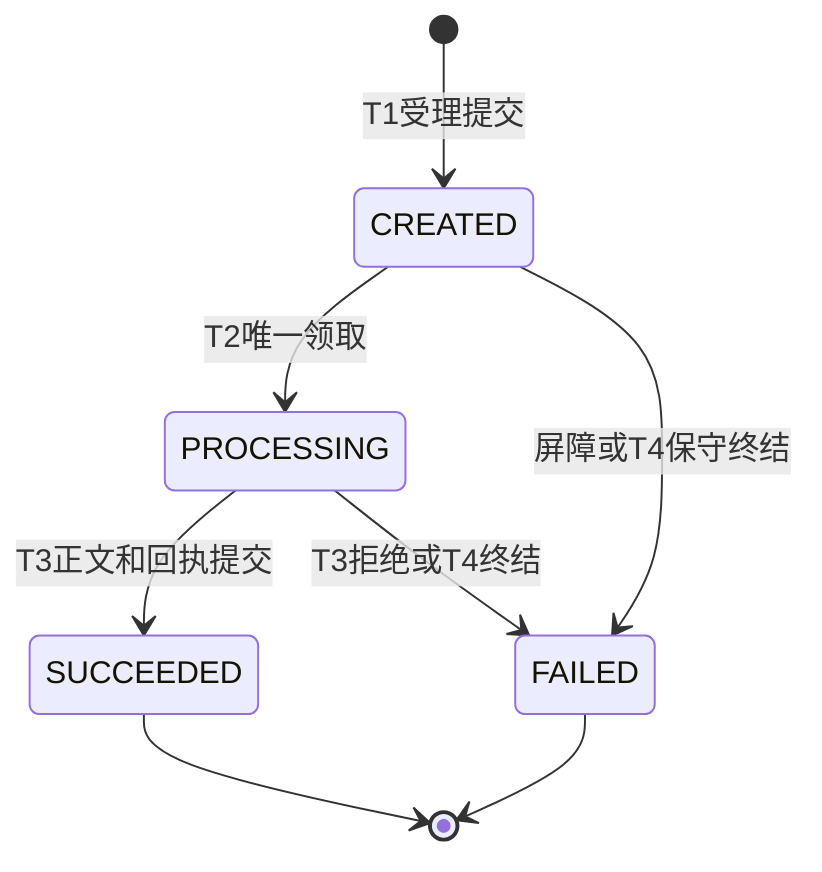
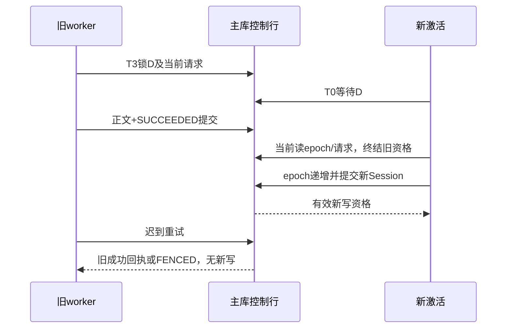

# Workflow Designer 后端正式保存协议 V2.1

日期：2026-11-15；状态：独立复审稿。仅协议设计，未实现、未部署、未执行下述测试。依据V2与其反向评审修订，本文独立描述完整协议。

## 1. 基线、目标与不变量

实际源码：WorkflowController.save 88–92调用WorkflowRuntime.save 263–293；后者直接JdbcTemplate更新model/revision，mutate 1300–1331先锁wf_request再执行work，使用TransactionTemplate（构造56–64）。WorkflowEngineConfiguration 29–53装配DataSource/JdbcTemplate/事务管理器，75–87将数据源与事务管理器交给Flowable。V48迁移定义wf_definition、wf_version、wf_request；V69只增加发布/实例数据契约快照。正式代码没有下述控制行、Session、V2.1请求服务。源码根为backend/services/workflow-service/adapters/flowable。

目标：服务端确定请求终态，隔离旧Session迟到写入，按ID安全重载；非目标：自动协同合并、完整Adapter、重构Flowable执行。业务模型是业务语义权威，BPMN DI是布局权威，XML受控交换；统一文档服务维护revision与兼容投影。发布版本不可变，实例继续读取冻结版本。前端generation隔离仍需保留，不能替代服务端资格。

核心不变量：单定义控制行永久唯一；所有资格/文档写持同一锁到真实commit；资格与请求状态用主库锁定当前读；终态不可覆盖；正文/revision/成功回执原子；旧会话不复活；UNKNOWN仅客户端观察。单Definition内排序不扩展为跨Definition、Flowable或外部系统全局串行化。

## 2. 实体及唯一键

| 实体 | 拟议字段/约束 |
|---|---|
| wf_definition_control | PRIMARY KEY(tenant_id,definition_id)，write_epoch BIGINT默认0、active_session_id可空、lifecycle=RESERVED/LIVE/DELETED；控制行不物理删除、不重置epoch |
| wf_edit_session | tenant/definition/session_id唯一；epoch、owner_actor、ACTIVE/CLOSED/SUPERSEDED；服务器产生session_id |
| wf_save_request_v21 | tenant/definition/save_request_id唯一；不可变actor/session/epoch/expected_revision/protocol/schema/canonical版本/摘要/payload；CREATED/PROCESSING/SUCCEEDED/FAILED；result_revision/error/finished_at |
| wf_control_request_v21 | tenant/definition/control_request_id唯一；不可变规范信封、摘要、终态结果；控制操作只在T0一次提交，不暴露半成功回执 |
| wf_definition | revision、统一文档、model投影；新对象首次提交revision0，尚无正文时GET返回DOCUMENT_NOT_COMMITTED |

请求表索引支持session_id/status/request_id扫描；所有查询带tenant/definition。DI/业务文档不在控制行重复存储。新定义控制行预留不等于已创建业务草稿。

## 3. 控制行首次创建、墓碑和对象操作

唯一初始化例外允许在控制行不存在时先执行原子唯一键插入；不是用缺失行SELECT当锁。只允许授权的“预留/创建定义”控制请求执行，普通save不得偷偷创建控制行。

```sql
-- 完整T0事务内；epoch为服务器常量初始化值，冲突绝不覆盖旧值。
INSERT INTO wf_definition_control
 (tenant_id,definition_id,write_epoch,active_session_id,lifecycle)
 VALUES (:tenant,:definition,0,NULL,'RESERVED')
 ON DUPLICATE KEY UPDATE definition_id=definition_id;
SELECT * FROM wf_definition_control
 WHERE tenant_id=:tenant AND definition_id=:definition FOR UPDATE;
-- 仅使用以上数据库当前读的真实epoch，不使用本地默认0。
```

两个实例首次插同ID，唯一键使冲突方等待；赢家回滚则等待方可插入，赢家提交则等待方读取其真实行。两者随后受observedEpoch及控制键裁决。死锁/超时整体回滚，按同控制键重试，未知commit先查回执。禁止REPLACE、delete+insert和upsert重置epoch。

定义创建、删除、恢复都是T0控制操作：同控制键同信封复用；删除在控制锁内递增epoch、封闭Session并设置DELETED，正文可软删；恢复同ID只在原控制墓碑上递增epoch，按批准规则恢复/创建正文，不能复用旧Session。DELETED/RESERVED不能被普通激活悄悄转LIVE。control行、Session失效依据和请求摘要墓碑永久保留是本版本保守策略；payload可清理。容量优化需另审，不接受自动TTL删除安全依据。

## 4. 精确激活和终结CAS

Session独占有效写资格；新激活需显式接管权限与observedEpoch。T0先锁D，按session_id字节序锁相关Session，再按save_request_id字节序锁相关Request，最后控制回执；同一D串行化避免请求新增穿插。控制键查重复可在D之后先读取（同D已互斥），不得先锁控制键再等待D。

激活：主库当前读比较observedEpoch；同控制键不同信封409；同键已提交返回原结果+当前有效性，不递增。新键observed旧值409，不自动刷新重试。锁内关闭旧Session、终结其非终态请求、epoch+1、新建Session并设置active，写回执提交。BIGINT溢出拒绝，不能回绕。

终结：先确认目标Session存在、tenant/definition/owner与权限匹配，锁定当前读。只有目标ACTIVE且D.active_session_id=sid且D.write_epoch=epoch，执行：

```sql
UPDATE wf_definition_control
 SET write_epoch=write_epoch+1, active_session_id=NULL
 WHERE tenant_id=:t AND definition_id=:d
 AND active_session_id=:sid AND write_epoch=:epoch;
-- 必须影响1行，且同事务目标Session已锁定并验证ACTIVE。
UPDATE wf_edit_session SET status='CLOSED'
 WHERE tenant_id=:t AND definition_id=:d AND session_id=:sid
 AND epoch=:epoch AND status='ACTIVE';
-- 影响1行；否则事务整体失败，不能提交部分资格变化。
```

若A已被B接管（epoch8/activeB），terminate(A,7)不能更新D。若A历史为CLOSED/SUPERSEDED且epoch/归属吻合，验证其请求终结后生成独立历史屏障回执，保持B和epoch8完全不变。A仍ACTIVE但与D不符属于不变量故障，拒绝并写保护，不自动猜测修复。目标不存在或epoch不匹配明确拒绝，不生成伪成功。

不同控制键终结相同已失效目标可生成各自历史回执，不再升epoch。激活与终结争锁：终结先则激活原observedEpoch失配；激活先则旧终结只能历史返回。单独终结再激活必须重新观察epoch；推荐激活原子封旧+授新。

## 5. 保存请求状态机



CREATED=已持久受理但尚未执行；PROCESSING=已领取但可能等待、崩溃或事务执行；不是心跳存活证明。终态SUCCEEDED/FAILED不可逆。客户端UNKNOWN包括响应丢失、查询不可达或请求不存在，不是数据库状态。超时不直接改FAILED，不生成新键。

T2只允许CREATED条件领取，PROCESSING重复返回202，不启动第二worker。CREATED可由恢复器领取（先T2）或保守终结；PROCESSING崩溃恢复采用T4失败终结，不自动再次执行。恢复器可能在活worker进T3之前取消它，这是保守取消语义，不谎称已证明worker死亡；worker随后必须读FAILED停止。

## 6. 保存与控制请求幂等信封

saveRequestId和controlRequestId均为客户端每次逻辑操作产生的UUID，重试保持不变；作用域tenant+definition+请求类别。body/header/path重复提供的ID必须一致。actor来自可信认证，tenant来自可信上下文，客户端不能替换。

保存摘要覆盖tenant、definition、actor、sessionId、epoch、expectedRevision、protocolVersion=2.1、schemaVersion、canonicalizationVersion及document。控制摘要覆盖相同身份、操作类型、targetSessionId/targetEpoch/observedEpoch/takeover、对象创建/删除/恢复等所有结果相关参数，以及protocol/schema/canonical版本。无关字段不接受。

同键同信封：终态复用；同键异信封409 IDEMPOTENCY_CONFLICT。相同摘要不同规范字节仍冲突（payload保留时逐字节核对）；payload清除后按版本化SHA-256摘要和长度比较，安全性依赖抗碰撞假设，不能声称数学无碰撞。可长期保留压缩规范信封以消除该退化，存储/隐私需评审。终态不可重新执行，成功控制重试不升epoch；历史激活回执同时返回currentValid=false时不得被客户端当作当前资格。

## 7. canonicalizationVersion=1精确规则

- 严格UTF-8 JSON；解析前拒绝任意层级重复键、无效Unicode代理项、非法数值、注释和尾逗号。不能先用会吞重复键的普通Map解析再检查。
- 对象键按Unicode标量序列字典序升序；字符串不做NFC/NFD等规范化，保留码点差异。输出非ASCII字符UTF-8原文；双引号/反斜杠转义，控制字符U+0000–001F用小写四位\u转义，无额外空白。
- 缺失与null不同。schema声明的默认值不在摘要规范化中自动补齐；文档规范化若需补齐，必须在首次冻结请求前显式完成，重试使用同一规范信封。
- 数字用任意精度十进制解析；禁止NaN/Infinity。去无意义前导/尾零，以无指数最短十进制表示；负零规范为0，1/1.0/1e0等价。长度上限统一为输入单数字128字符、指数绝对值≤1000、展开后≤2048字符，超限400；这不是DI浮点舍入许可。schema整数epoch/revision限定有符号64位范围，JSON传输采用十进制字符串避免JS安全整数损失；DI坐标按schema范围校验但不截断小数。
- 数组严格保序，包括业务人员和waypoint；未确定是否集合的字段也保序，不能为摘要擅自排序。
- API信封及已知schema未知字段一律拒绝；允许的未知安全扩展只能放schema指定opaque区，以明确字符串/结构表示原样参与，不解释其内部业务语义。未知执行扩展禁止发布。
- schemaVersion及canonicalizationVersion作为规范信封字段参与摘要；协议版本参与域隔离前缀，SHA-256对“workflow-save/control:v2.1\n”+规范UTF-8字节计算，保存字节长度。
- 新请求只接收受支持版本；旧请求按记录的canonical版本重新核对。服务器永久保留该版本解码器或只允许用原始规范字节重放；不能用新算法重算旧记录并覆盖摘要。升级必须显式新增版本，不自动重写历史。

未确定字段语义采取保守规则：不补缺省、不合并null、不排序数组、不Unicode归一、不舍入；需改变时新schema版本。XML若作为交换镜像属于document字符串字段，规范化只处理JSON转义，不自行XML C14N；不同XML文本视不同请求，即使业务等价，避免无证据语义合并。

## 8. 主库当前读与终态CAS

所有影响资格/终态决策必须锁主库行，禁止使用RR普通SELECT快照或T2缓存：

```sql
SELECT * FROM wf_definition_control WHERE tenant_id=:t AND definition_id=:d FOR UPDATE;
SELECT * FROM wf_edit_session WHERE tenant_id=:t AND definition_id=:d AND session_id=:sid FOR UPDATE;
SELECT * FROM wf_save_request_v21 WHERE tenant_id=:t AND definition_id=:d AND save_request_id=:r FOR UPDATE;
UPDATE wf_save_request_v21 SET status='FAILED',error_code=:code,finished_at=CURRENT_TIMESTAMP(6)
 WHERE tenant_id=:t AND definition_id=:d AND save_request_id=:r
 AND status IN ('CREATED','PROCESSING');
```

影响1行表示本事务将非终态转换为FAILED，只有commit后才是终结事实；影响0行必须重新FOR UPDATE读取：终态返回原结果，缺失/非终态异常进入协议故障并整体回滚，不“补写失败”。成功CAS限PROCESSING，且影响行数必须1，否则正文更新所在事务也回滚。

RR反例排除：恢复器早先快照PROCESSING仅作扫描候选，不作决策；worker提交SUCCEEDED后，恢复器取得D锁再对请求FOR UPDATE当前读，只能看到已提交成功，不能覆盖。worker仍持锁则恢复器等待/超时，不得标失败。worker回滚后可锁定看到PROCESSING并失败终结。commit结果不确定必须按同一主库锁读取，不能在catch里无条件FAILED；锁不可获或主库不确定时保持UNKNOWN/写保护。

## 9. T0–T4事务边界

每个事务必须独立顶层完整提交：边界入口拒绝已有事务，或由明确编排在无事务调用栈执行TransactionTemplate；禁止隐式加入外层REQUIRED后提前发成功。若使用REQUIRES_NEW，只允许包住整个T0/T1/T2/T3/T4且调用方不持相关锁，不得仅内层校验锁后外层写正文。推荐先检测外层事务并拒绝，不用REQUIRES_NEW掩盖结构问题。

JdbcTemplate和TransactionTemplate必须绑定同一主库DataSource/事务管理器，启动断言及集成测试核验；无读副本路由。成功HTTP在完整template.execute返回且真实commit成功后构造；commit抛未知结果不得返回FAILED终态。

| 事务 | 当前读锁顺序 | 转换与提交 | 失败 |
|---|---|---|---|
| T0控制 | D→Session按ID→Request按ID→控制回执 | 初始化/激活/精确终结/墓碑，旧请求CAS失败，控制回执同事务 | 整体回滚；未知commit查control key |
| T1受理 | D→Session→Request | 验证权限/epoch，插CREATED不可变payload或复用；无效新键可写FAILED拒绝回执 | SQL异常整回滚，不能猜是否受理 |
| T2领取 | D→Session→Request | CREATED→PROCESSING CAS=1，仅赢家执行 | 0行当前读复用/返回PENDING；SQL异常回滚 |
| T3提交 | D→Session→Request | 最终权限和epoch/状态/revision校验；完整文档及model、rev+1、审计、SUCCEEDED同事务 | 业务拒绝只提交FAILED；SQL/commit异常整回滚或UNKNOWN |
| T4恢复 | D→Session→Request | 当前读，CREATED/PROCESSING保守FAILED CAS；终态不动 | 等锁超时无终结结论；未知commit查请求 |

T3正文UPDATE同时带tenant/id/revision条件，影响1行；请求成功CAS影响1行。若版本不符，不写正文，FAILED/REVISION_CONFLICT提交。业务失败不以向外抛异常使终态一起回滚，先完成事务再生成错误响应。外部HTTP、AI任务、Flowable部署不得混入本保存事务；发布另审但不能绕过D/epoch。

## 10. 锁顺序、批量与重试

单定义D→Session字节序→Request字节序；同D控制回执最后锁。V1 mutate请求先锁不得复用。禁止跨定义写事务，首版批量管理拆成独立单定义事务并不宣称批量全局原子；未来若跨定义必须先按tenant/definition字节序锁全体D再稳定锁下级，另审。

首版每Session未终态受理上限64条（数量，默认64，硬上限64）；T1在D锁内检查，不含终态。单定义只一个ACTIVE写Session，接管已终结旧请求，因此一次T0最多终结64条。首版不分批提交屏障；超过上限的迁移异常数据拒绝激活并人工处置，不能部分完成后返回成功。未来原子封epoch后分批结算需独立协议版本。

锁等待建议默认5秒、允许1–30秒，适用于所有协议事务，同连接会话级配置需归还池前复位；事务预算默认10秒不是允许跳过commit的截止。数值为拟议配置，不是已有配置；超时返回可重试未完成，不自动发新逻辑键。死锁/等待异常强制整个template回滚，不依赖MySQL可能只回滚单语句的默认行为；禁止捕获后继续提交。仅确定已回滚、无外部副作用可同键重试；UNKNOWN先查。恢复器轮询默认1秒、每批候选32条，逐条单定义事务；候选扫描不持请求锁再等D。

## 11. 权限与租户时间语义

激活/接管、T1、T3、终结、请求/控制回执查询均独立校验可信租户成员、actor和对象操作权限；查询不因持有key就授权。Session owner绑定tenant/definition，跨租户相同ID独立。终结他人Session需专用接管权限。

本版本采用“最终T3授权判定时刻”语义：激活后撤权且T3检查已可见则拒绝；检查之后并发撤权可允许本次短事务提交，不宣称撤权commit后立即无写。授权来源必须权威读取，授权缓存一致性需确认。此并发宽限需要产品/安全负责人明确签字接受，未接受则该项BLOCKED，不能上线。

若要求严格原子撤权，需要新增授权版本控制行，所有撤权和写事务按授权作用域→Definition→Session→Request锁序，撤权更新版本并持锁至commit；T3同锁读取版本。涉及多角色/组织作用域锁集、现有授权服务改造，超出本版实现，不能仅再检查权限声称已达到。

## 12. API与重载

拟议路径均/api/workflow/v2.1/definitions/{id}：POST /sessions（controlRequestId/observedEpoch/takeover），PUT /save-requests/{saveRequestId}（不可变保存信封），GET同路径查询状态；POST /sessions/{sid}/terminate（controlRequestId/targetEpoch）；GET /control-requests/{key}；GET /draft按ID原子读取。

成功控制回执含历史结果、epoch/revision、currentValid；失效回执不能授新资格。保存200终态，202 CREATED/PROCESSING；query404 REQUEST_UNKNOWN不代表未执行终态；终结200 COMPLETED仅提交后，503 BARRIER_TIMEOUT不代表完成。409包括REVISION_CONFLICT/FENCING_TOKEN_REJECTED/SESSION_EPOCH_CONFLICT/IDEMPOTENCY_CONFLICT；403 TENANT_ACCESS_DENIED；404 DOCUMENT_NOT_FOUND；410 DOCUMENT_DELETED只向有权知道者返回；401认证失效。敏感响应no-store，CSRF按浏览器可信认证链校验。

重载：本地INVALID并generation失效→可销毁Modeler但保留请求登记→查询/控制屏障或原子接管→控制结果丢失按原键查→取得有效Session后按ID读同一主库快照document/revision/epoch→核对身份和有效性→新Modeler→ACTIVE。只读GET不授资格，也不保证读取后无人合法接管；后续写仍检查epoch。未知控制/保存结果保持写封锁，不从诊断XML、旧画布恢复。初始化失败销毁候选Session，不复活旧会话。



## 13. A–E安全证明

| 命题 | 定义/依赖/事务与线性化点 | 反例排除与未验前提 |
|---|---|---|
| A | N=T0新资格commit后，旧sid/epoch的T3无新正文commit；依赖同D排他锁及最终当前读 | W先锁则N在W后；N先commit则W检查失败。V1旁路/不同主库为反例，必须关闭/排除，尚未实现 |
| B | 已SUCCEEDED的请求永不转FAILED；T3/T4均D→请求当前读及终态CAS | RR候选快照不作决策，CAS0重读；commit不明等锁确认。需真实RR及断连测试 |
| C | 同tenant/definition/saveRequestId最多一次正文提交；T1唯一键、T2唯一领取、T3成功CAS与正文同commit | 并发重复不第二worker；墓碑不删、版本化摘要防重绑；需崩溃及幂等真实测试 |
| D | T0终结commit后目标旧Session所有已到达/未到达请求均不能写 | 资格关闭+epoch不复用，T1/T3重验；未知网络包可到达但无资格；延迟terminate精确CAS不误伤B；需并发测试 |
| E | 单定义保存/激活/终结的有效写事务有D锁顺序 | 只要完整持锁到commit即串行；不覆盖跨定义、引擎及外部副作用；数据源/传播/HA前提未实证 |

所有证明都依赖全部定义写入纳管：当前V1 save、publish、disable不满足，正式切换必须关闭V1草稿写或完整迁移，禁止自动隐式Session兜底。删除/恢复、后台修复和迁移也不能旁路。没有满足前提不得引用条件证明宣布正式安全。

## 14. HA与写保护

DB事务/行锁保证同一主库事务原子及锁排序，不保证复制不丢数据、主库切换或禁止双主。部署必须提供单写主库、已确认commit不丢失、旧主被隔离、锁定读/状态决策访问权威主库、DataSource/事务管理器一致。

发现主角色不明、确认commit丢失、双写可能、数据源错配时进入服务端WRITE_PROTECTED，拒绝激活/保存/终结成功声明，返回503 SERVICE_WRITE_PROTECTED；查询只有确认权威来源才给终态，否则REQUEST_STATUS_UNAVAILABLE。前端UNKNOWN且不开放新资格。需运维确认一致性后恢复，不以应用重启清epoch解决。写保护触发与主角色探测依基础设施，待实测，不能由设计文字代替。

## 15. 真实集成验证规格（均未执行）

标记S=静态规则，M=真实MySQL，C=多实例竞争，F=故障注入，H=基础设施。共用基线rev10/epoch7/activeA；显式屏障暂停到SQL/commit点，不用sleep推测；采集连接/事务、正文、revision、epoch、Session、请求终态及回执。

| # | 标记 | 顺序/故障注入与预期 |
|---|---|---|
| 1 | M/C | W持D，N等待，W提交后N；rev11后epoch8，旧提交必须先于资格 |
| 2 | M/C | 两N同observed7争锁；仅一激活，epoch8，另冲突 |
| 3 | M/C | W持D期间terminate等待；W后成功回执保留，旧资格关闭 |
| 4 | M/C | 屏障后发送旧请求；FENCED，无正文变化 |
| 5 | M/C | T2提交后暂停worker，T4失败终结，再放worker；FAILED不可写 |
| 6 | M/F | T3写未commit杀进程/断连接；回滚正文，T4锁内结算 |
| 7 | M/F | commit成功丢回包；query SUCCEEDED，原键不递增两次 |
| 8 | M/C | RR先扫描PROCESSING，W成功，再T4；FOR UPDATE见SUCCEEDED，CAS不得覆盖 |
| 9 | S/M/C | 同key异payload受理；409，信封不变 |
| 10 | S/M/C | 同key异epoch/sid/revision；409，不重新绑定 |
| 11 | M/C | 空表两实例原子初始化；一D行，读取真实epoch |
| 12 | M/C | 删除恢复同ID后重放旧token；epoch延续、旧写拒绝 |
| 13 | S/M | 新激活后调用V1；必须关闭/拒绝，当前正式实现预期不能满足 |
| 14 | S/M | 内部/后台写旁路检测；所有生产路径覆盖D锁与epoch |
| 15 | M/H | 延迟副本，状态与恢复强制主库；不读旧状态判失败 |
| 16 | M/C | 撤权先于T3判定则拒绝；判定后撤权按批准宽限，不冒称原子 |
| 17 | M/F | 64请求批量终结中途故障；整个T0回滚，无半屏障；第65受理拒绝 |
| 18 | M/C/F | 激活commit丢响应原control键重试；只升一次；改参数409 |
| 19 | M/C | activeB/epoch8下terminate(A,7)；B和epoch不变，历史回执 |
| 20 | S/M/C | 外层REQUIRED/拆分REQUIRES_NEW/数据源错配；必须边界拒绝或测试失败，不伪成功 |
| 21 | F/H | 切主/双主/丢确认commit；不满足前提则写保护，不宣称协议安全 |
| 22 | M/C | 跨定义相反锁序尝试；首版入口拒绝跨定义事务；批准后固定全序 |
| 23 | M/F | 死锁及单语句锁超时；整事务回滚，原键重试或UNKNOWN查询 |
| 24 | S/M | canonical固定测试向量：重复键/null/数字/Unicode/数组/版本；跨实现摘要一致 |

## 16. V2反向评审问题关闭清单

| 反向问题 | 协议修订 | 状态 |
|---|---|---|
| 控制行首次创建/墓碑 | 第3节原子唯一插入+当前读，永久墓碑 | 已通过协议修订解决；仍待MySQL验证 |
| 延迟terminate误伤 | 第4节D与Session精确CAS | 已通过协议修订解决；仍待竞争验证 |
| RR覆盖终态/恢复器判死 | 第8节当前读与终态CAS，T4保守取消 | 已通过协议修订解决；仍待MySQL/故障验证 |
| 保存/控制幂等歧义 | 第6节完整信封与历史有效性 | 已通过协议修订解决；仍待多实例验证 |
| canonical/旧记录清理 | 第7节版本1，永久墓碑 | 已通过协议修订解决；仍待互通向量验证 |
| 事务传播/数据源 | 第9节顶层完整事务与同源要求 | 已通过协议修订解决；仍待配置及MySQL验证 |
| 死锁/大批屏障 | 第10节单定义事务/上限64/整体回滚 | 已通过协议修订解决；仍待故障测试 |
| V1旁路 | 第13节强制关闭/纳管前提 | 当前未解决实现；正式改造前阻断，不能风险豁免 |
| 原子撤权 | 第11节明确判定时刻宽限 | 严格原子撤权暂不实现，产品/安全负责人待指定签字；未接受则BLOCKED |
| HA/主库证明 | 第14节明确写保护条件 | 仍待基础设施确认及故障验证 |

“协议修订解决”只表示定义已明确，不表示实现/评审通过。

## 17. 实施阶段与最终判断

先独立复审本协议，重点CAS/事务/规范向量；再获批隔离真实MySQL协议实现；完成双实例/故障/HA验证后纳管全部写路径；最后才批准正式SessionManager对接。不得直接改Runtime假装已有统一文档服务。

具备进入下一轮独立协议复审的文档条件，不代表已获批进入正式代码或上线。原子撤权风险负责人尚未签字、HA及V1旁路未关闭均保留为发布门禁。本轮不执行代码/迁移/测试。
