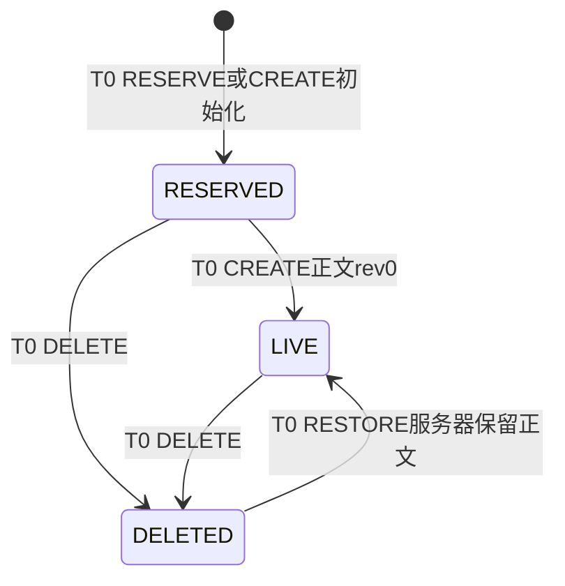
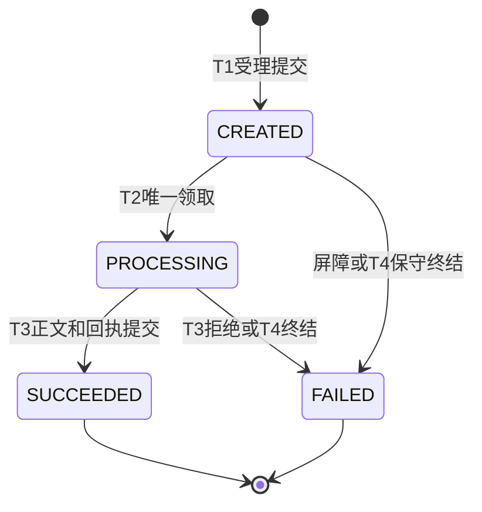
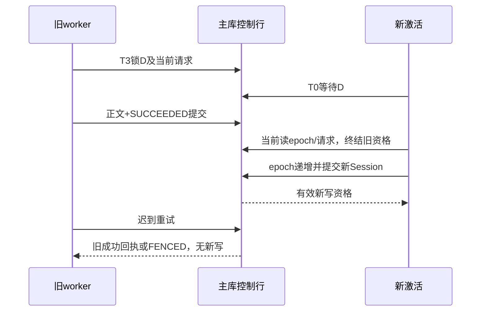

# Workflow Designer 后端正式保存协议 V2.2

日期：2026-11-15；状态：独立复审稿。仅协议设计，未实现、未部署、未执行下述测试。依据V2与其反向评审修订，本文独立描述完整协议。

## 1. 基线、目标与不变量

实际源码：WorkflowController.save 88–92调用WorkflowRuntime.save 263–293；后者直接JdbcTemplate更新model/revision，mutate 1300–1331先锁wf_request再执行work，使用TransactionTemplate（构造56–64）。WorkflowEngineConfiguration 29–53装配DataSource/JdbcTemplate/事务管理器，75–87将数据源与事务管理器交给Flowable。V48迁移定义wf_definition、wf_version、wf_request；V69只增加发布/实例数据契约快照。正式代码没有下述控制行、Session、V2.2请求服务。源码根为backend/services/workflow-service/adapters/flowable。

目标：服务端确定请求终态，隔离旧Session迟到写入，按ID安全重载；非目标：自动协同合并、完整Adapter、重构Flowable执行。业务模型是业务语义权威，BPMN DI是布局权威，XML受控交换；统一文档服务维护revision与兼容投影。发布版本不可变，实例继续读取冻结版本。前端generation隔离仍需保留，不能替代服务端资格。

核心不变量：单定义控制行永久唯一；所有资格/文档写持同一锁到真实commit；资格与请求状态用主库锁定当前读；终态不可覆盖；正文/revision/成功回执原子；旧会话不复活；UNKNOWN仅客户端观察。单Definition内排序不扩展为跨Definition、Flowable或外部系统全局串行化。

## 2. 实体及唯一键

| 实体 | 拟议字段/约束 |
|---|---|
| wf_definition_control | PRIMARY KEY(tenant_id,definition_id)，write_epoch BIGINT默认0、active_session_id可空、lifecycle=RESERVED/LIVE/DELETED；控制行不物理删除、不重置epoch |
| wf_edit_session | tenant/definition/session_id唯一；epoch、owner_actor、ACTIVE/CLOSED/SUPERSEDED；服务器产生session_id |
| wf_save_request_v21 | tenant/definition/save_request_id唯一；不可变actor/session/epoch/expected_revision/protocol/schema/canonical版本/摘要/payload；CREATED/PROCESSING/SUCCEEDED/FAILED；result_revision/error/finished_at |
| wf_control_request_v21 | tenant/definition/control_request_id唯一；不可变规范信封、摘要、终态结果；控制操作只在T0一次提交，不暴露半成功回执 |
| wf_definition | revision、统一文档、model投影；CREATE同T0提交合法空草稿revision0；RESERVED不可编辑 |

请求表索引支持session_id/status/request_id扫描；所有查询带tenant/definition。DI/业务文档不在控制行重复存储。新定义控制行预留不等于已创建业务草稿。

## 3. Definition生命周期：唯一CREATE方案

本版本唯一方案：T0 CREATE原子创建控制行/合法空草稿，revision=0，lifecycle=LIVE；首次用户save expectedRevision=0，禁止-1。空草稿采用当前业务模型的开始/结束等合法结构和安全缺省，可未完成业务能力配置、不可发布；结构合法不等于可执行。新定义请求不隐式激活Session，CREATE成功后显式activate。

RESERVED仅用于显式预留，不能activate/save/publish；不需要预留的CREATE可直接在同T0初始化RESERVED后转LIVE。各转换唯一入口：无行→RESERVED由RESERVE/CREATE；RESERVED→LIVE由CREATE；RESERVED/LIVE→DELETED由DELETE；DELETED→LIVE由RESTORE。LIVE重复CREATE异键返回ALREADY_EXISTS；同键复用历史。禁止普通保存改变生命周期。



T0的唯一初始化例外：授权后原子唯一插入，再锁数据库真实行，不以缺失行SELECT作对象锁。

```sql
BEGIN;
INSERT INTO wf_definition_control(tenant_id,definition_id,write_epoch,active_session_id,lifecycle)
 VALUES(:t,:d,0,NULL,'RESERVED')
 ON DUPLICATE KEY UPDATE definition_id=definition_id;
SELECT * FROM wf_definition_control WHERE tenant_id=:t AND definition_id=:d FOR UPDATE;
-- 查询控制回执、规范信封一致；同键终态直接复用，不执行下述转换。
-- CREATE必须当前RESERVED且正文不存在；不是读取本地epoch0。
INSERT INTO wf_definition(tenant_id,id,revision,model,document,deleted)
 VALUES(:t,:d,0,:safeModel,:safeDocument,FALSE);
UPDATE wf_definition_control SET lifecycle='LIVE',write_epoch=write_epoch+1
 WHERE tenant_id=:t AND definition_id=:d AND lifecycle='RESERVED';
-- 影响行数1；控制成功回执同事务。
COMMIT;
```

两实例同ID唯一插入等待：赢家回滚则后者可插入；赢家提交则读取真实状态/epoch，由控制键和状态裁决。死锁/超时整回滚，未知commit查询原controlRequestId，不换键CREATE。

DELETE：锁D→Session→请求→正文，封闭资格/终结未终态请求、epoch+1；有正文则保留服务器最后已提交正文软删，revision+1，控制DELETED，同事务回执。RESERVED删除可无正文。RESTORE只接受服务器软删保留正文，恢复同一正文内容，revision继续+1，epoch继续+1，active=NULL；无保留正文返回RESTORE_SOURCE_UNAVAILABLE，不从客户端或诊断XML重建。RESERVED删除后无正文则不可RESTORE，只能另ID CREATE。已发布版本和运行实例不删除、不改写。

revision对已存在正文的save/publish/disable/delete/restore严格递增，恢复不回到历史revision；epoch对所有资格/生命周期变化递增，永久不重置。控制墓碑、失效Session和请求幂等依据不物理删除。重复DELETE/RESTORE同键复用历史+当前有效性，异键已处目标态返回明确ALREADY_DELETED/ALREADY_LIVE而不重复递增。旧Session/key授权查询历史；旧终态重放只回执，新请求旧epoch拒绝。软删不删除安全墓碑。

## 4. 精确激活和终结CAS

Session独占有效写资格；新激活需显式接管权限与observedEpoch。T0先锁D，按session_id字节序锁相关Session，再按save_request_id字节序锁相关Request，最后控制回执；同一D串行化避免请求新增穿插。控制键查重复可在D之后先读取（同D已互斥），不得先锁控制键再等待D。

激活：主库当前读比较observedEpoch；同控制键不同信封409；同键已提交返回原结果+当前有效性，不递增。新键observed旧值409，不自动刷新重试。锁内关闭旧Session、终结其非终态请求、epoch+1、新建Session并设置active，写回执提交。BIGINT溢出拒绝，不能回绕。

终结：先确认目标Session存在、tenant/definition/owner与权限匹配，锁定当前读。只有目标ACTIVE且D.active_session_id=sid且D.write_epoch=epoch，执行：

```sql
UPDATE wf_definition_control
 SET write_epoch=write_epoch+1, active_session_id=NULL
 WHERE tenant_id=:t AND definition_id=:d
 AND active_session_id=:sid AND write_epoch=:epoch;
-- 必须影响1行，且同事务目标Session已锁定并验证ACTIVE。
UPDATE wf_edit_session SET status='CLOSED'
 WHERE tenant_id=:t AND definition_id=:d AND session_id=:sid
 AND epoch=:epoch AND status='ACTIVE';
-- 影响1行；否则事务整体失败，不能提交部分资格变化。
```

若A已被B接管（epoch8/activeB），terminate(A,7)不能更新D。若A历史为CLOSED/SUPERSEDED且epoch/归属吻合，验证其请求终结后生成独立历史屏障回执，保持B和epoch8完全不变。A仍ACTIVE但与D不符属于不变量故障，拒绝并写保护，不自动猜测修复。目标不存在或epoch不匹配明确拒绝，不生成伪成功。

不同控制键终结相同已失效目标可生成各自历史回执，不再升epoch。激活与终结争锁：终结先则激活原observedEpoch失配；激活先则旧终结只能历史返回。单独终结再激活必须重新观察epoch；推荐激活原子封旧+授新。

## 5. 保存请求状态机



CREATED=已持久受理但尚未执行；PROCESSING=已领取但可能等待、崩溃或事务执行；不是心跳存活证明。终态SUCCEEDED/FAILED不可逆。客户端UNKNOWN包括响应丢失、查询不可达或请求不存在，不是数据库状态。超时不直接改FAILED，不生成新键。

T2只允许CREATED条件领取，PROCESSING重复返回202，不启动第二worker。CREATED可由恢复器领取（先T2）或保守终结；PROCESSING崩溃恢复采用T4失败终结，不自动再次执行。恢复器可能在活worker进T3之前取消它，这是保守取消语义，不谎称已证明worker死亡；worker随后必须读FAILED停止。

## 6. 保存与控制请求幂等信封

saveRequestId和controlRequestId均为客户端每次逻辑操作产生的UUID，重试保持不变；作用域tenant+definition+请求类别。body/header/path重复提供的ID必须一致。actor来自可信认证，tenant来自可信上下文，客户端不能替换。

保存摘要覆盖tenant、definition、actor、sessionId、epoch、expectedRevision、protocolVersion=2.2、schemaVersion、canonicalizationVersion及document。控制摘要覆盖相同身份、操作类型、targetSessionId/targetEpoch/observedEpoch/takeover、对象创建/删除/恢复等所有结果相关参数，以及protocol/schema/canonical版本。无关字段不接受。

同键同信封：终态复用；同键异信封409 IDEMPOTENCY_CONFLICT。相同摘要不同规范字节仍冲突（payload保留时逐字节核对）；payload清除后按版本化SHA-256摘要和长度比较，安全性依赖抗碰撞假设，不能声称数学无碰撞。可长期保留压缩规范信封以消除该退化，存储/隐私需评审。终态不可重新执行，成功控制重试不升epoch；历史激活回执同时返回currentValid=false时不得被客户端当作当前资格。

## 7. canonicalizationVersion=1精确规则

- 严格UTF-8 JSON；解析前拒绝任意层级重复键、无效Unicode代理项、非法数值、注释和尾逗号。不能先用会吞重复键的普通Map解析再检查。
- 对象键按Unicode标量序列字典序升序；字符串不做NFC/NFD等规范化，保留码点差异。输出非ASCII字符UTF-8原文；双引号/反斜杠转义，控制字符U+0000–001F用小写四位\u转义，无额外空白。
- 缺失与null不同。schema声明的默认值不在摘要规范化中自动补齐；文档规范化若需补齐，必须在首次冻结请求前显式完成，重试使用同一规范信封。
- 数字用任意精度十进制解析；禁止NaN/Infinity。去无意义前导/尾零，以无指数最短十进制表示；负零规范为0，1/1.0/1e0等价。长度上限统一为输入单数字128字符、指数绝对值≤1000、展开后≤2048字符，超限400；这不是DI浮点舍入许可。schema整数epoch/revision限定有符号64位范围，JSON传输采用十进制字符串避免JS安全整数损失；DI坐标按schema范围校验但不截断小数。
- 数组严格保序，包括业务人员和waypoint；未确定是否集合的字段也保序，不能为摘要擅自排序。
- API信封及已知schema未知字段一律拒绝；允许的未知安全扩展只能放schema指定opaque区，以明确字符串/结构表示原样参与，不解释其内部业务语义。未知执行扩展禁止发布。
- schemaVersion及canonicalizationVersion作为规范信封字段参与摘要；协议版本参与域隔离前缀，SHA-256对“workflow-save/control:v2.2\n”+规范UTF-8字节计算，保存字节长度。
- 新请求只接收受支持版本；旧请求按记录的canonical版本重新核对。服务器永久保留该版本解码器或只允许用原始规范字节重放；不能用新算法重算旧记录并覆盖摘要。升级必须显式新增版本，不自动重写历史。

未确定字段语义采取保守规则：不补缺省、不合并null、不排序数组、不Unicode归一、不舍入；需改变时新schema版本。XML若作为交换镜像属于document字符串字段，规范化只处理JSON转义，不自行XML C14N；不同XML文本视不同请求，即使业务等价，避免无证据语义合并。

## 8. 主库当前读与终态CAS

所有影响资格/终态决策必须锁主库行，禁止使用RR普通SELECT快照或T2缓存：

```sql
SELECT * FROM wf_definition_control WHERE tenant_id=:t AND definition_id=:d FOR UPDATE;
SELECT * FROM wf_edit_session WHERE tenant_id=:t AND definition_id=:d AND session_id=:sid FOR UPDATE;
SELECT * FROM wf_save_request_v21 WHERE tenant_id=:t AND definition_id=:d AND save_request_id=:r FOR UPDATE;
UPDATE wf_save_request_v21 SET status='FAILED',error_code=:code,finished_at=CURRENT_TIMESTAMP(6)
 WHERE tenant_id=:t AND definition_id=:d AND save_request_id=:r
 AND status IN ('CREATED','PROCESSING');
```

影响1行表示本事务将非终态转换为FAILED，只有commit后才是终结事实；影响0行必须重新FOR UPDATE读取：终态返回原结果，缺失/非终态异常进入协议故障并整体回滚，不“补写失败”。成功CAS限PROCESSING，且影响行数必须1，否则正文更新所在事务也回滚。

RR反例排除：恢复器早先快照PROCESSING仅作扫描候选，不作决策；worker提交SUCCEEDED后，恢复器取得D锁再对请求FOR UPDATE当前读，只能看到已提交成功，不能覆盖。worker仍持锁则恢复器等待/超时，不得标失败。worker回滚后可锁定看到PROCESSING并失败终结。commit结果不确定必须按同一主库锁读取，不能在catch里无条件FAILED；锁不可获或主库不确定时保持UNKNOWN/写保护。

## 9. T0–T4事务边界

每个事务必须独立顶层完整提交：边界入口拒绝已有事务，或由明确编排在无事务调用栈执行TransactionTemplate；禁止隐式加入外层REQUIRED后提前发成功。若使用REQUIRES_NEW，只允许包住整个T0/T1/T2/T3/T4且调用方不持相关锁，不得仅内层校验锁后外层写正文。推荐先检测外层事务并拒绝，不用REQUIRES_NEW掩盖结构问题。

JdbcTemplate和TransactionTemplate必须绑定同一主库DataSource/事务管理器，启动断言及集成测试核验；无读副本路由。成功HTTP在完整template.execute返回且真实commit成功后构造；commit抛未知结果不得返回FAILED终态。

| 事务 | 当前读锁顺序 | 转换与提交 | 失败 |
|---|---|---|---|
| T0控制 | D→Session按ID→Request按ID→控制回执 | 初始化/激活/精确终结/墓碑，旧请求CAS失败，控制回执同事务 | 整体回滚；未知commit查control key |
| T1受理 | D→Session→Request | 验证权限/epoch，插CREATED不可变payload或复用；无效新键可写FAILED拒绝回执 | SQL异常整回滚，不能猜是否受理 |
| T2领取 | D→Session→Request | CREATED→PROCESSING CAS=1，仅赢家执行 | 0行当前读复用/返回PENDING；SQL异常回滚 |
| T3提交 | D→Session→Request | 最终权限和epoch/状态/revision校验；完整文档及model、rev+1、审计、SUCCEEDED同事务 | 业务拒绝只提交FAILED；SQL/commit异常整回滚或UNKNOWN |
| T4恢复 | D→Session→Request | 当前读，CREATED/PROCESSING保守FAILED CAS；终态不动 | 等锁超时无终结结论；未知commit查请求 |

T3正文UPDATE同时带tenant/id/revision条件，影响1行；请求成功CAS影响1行。若版本不符，不写正文，FAILED/REVISION_CONFLICT提交。业务失败不以向外抛异常使终态一起回滚，先完成事务再生成错误响应。外部HTTP、AI任务、Flowable部署不得混入本保存事务；发布遵循第18节，不得绕过D/epoch。

## 10. 锁顺序、批量与重试

单定义D→Session字节序→Request字节序；同D控制回执最后锁。V1 mutate请求先锁不得复用。禁止跨定义写事务，首版批量管理拆成独立单定义事务并不宣称批量全局原子；未来若跨定义必须先按tenant/definition字节序锁全体D再稳定锁下级，另审。

首版每Session未终态受理上限64条（数量，默认64，硬上限64）；T1在D锁内检查，不含终态。单定义只一个ACTIVE写Session，接管已终结旧请求，因此一次T0最多终结64条。首版不分批提交屏障；超过上限的迁移异常数据拒绝激活并人工处置，不能部分完成后返回成功。未来原子封epoch后分批结算需独立协议版本。

锁等待建议默认5秒、允许1–30秒，适用于所有协议事务，同连接会话级配置需归还池前复位；事务预算默认10秒不是允许跳过commit的截止。数值为拟议配置，不是已有配置；超时返回可重试未完成，不自动发新逻辑键。死锁/等待异常强制整个template回滚，不依赖MySQL可能只回滚单语句的默认行为；禁止捕获后继续提交。仅确定已回滚、无外部副作用可同键重试；UNKNOWN先查。恢复器轮询默认1秒、每批候选32条，逐条单定义事务；候选扫描不持请求锁再等D。

## 11. 权限与租户时间语义

激活/接管、T1、T3、终结、请求/控制回执查询均独立校验可信租户成员、actor和对象操作权限；查询不因持有key就授权。Session owner绑定tenant/definition，跨租户相同ID独立。终结他人Session需专用接管权限。

本版本采用“最终T3授权判定时刻”语义：激活后撤权且T3检查已可见则拒绝；检查之后并发撤权可允许本次短事务提交，不宣称撤权commit后立即无写。授权来源必须权威读取，授权缓存一致性需确认。此并发宽限需要产品/安全负责人明确签字接受，未接受则该项BLOCKED，不能上线。

若要求严格原子撤权，需要新增授权版本控制行，所有撤权和写事务按授权作用域→Definition→Session→Request锁序，撤权更新版本并持锁至commit；T3同锁读取版本。涉及多角色/组织作用域锁集、现有授权服务改造，超出本版实现，不能仅再检查权限声称已达到。

## 12. API与重载

拟议路径均/api/workflow/v2.2/definitions/{id}：POST /sessions（controlRequestId/observedEpoch/takeover），PUT /save-requests/{saveRequestId}（不可变保存信封），GET同路径查询状态；POST /sessions/{sid}/terminate（controlRequestId/targetEpoch）；GET /control-requests/{key}；GET /draft按ID原子读取。

成功控制回执含历史结果、epoch/revision、currentValid；失效回执不能授新资格。保存200终态，202 CREATED/PROCESSING；query404 REQUEST_UNKNOWN不代表未执行终态；终结200 COMPLETED仅提交后，503 BARRIER_TIMEOUT不代表完成。409包括REVISION_CONFLICT/FENCING_TOKEN_REJECTED/SESSION_EPOCH_CONFLICT/IDEMPOTENCY_CONFLICT；403 TENANT_ACCESS_DENIED；404 DOCUMENT_NOT_FOUND；410 DOCUMENT_DELETED只向有权知道者返回；401认证失效。敏感响应no-store，CSRF按浏览器可信认证链校验。

重载：本地INVALID并generation失效→可销毁Modeler但保留请求登记→查询/控制屏障或原子接管→控制结果丢失按原键查→取得有效Session后按ID读同一主库快照document/revision/epoch→核对身份和有效性→新Modeler→ACTIVE。只读GET不授资格，也不保证读取后无人合法接管；后续写仍检查epoch。未知控制/保存结果保持写封锁，不从诊断XML、旧画布恢复。初始化失败销毁候选Session，不复活旧会话。



## 13. A–E安全证明

| 命题 | 定义/依赖/事务与线性化点 | 反例排除与未验前提 |
|---|---|---|
| A | N=T0新资格commit后，旧sid/epoch的T3无新正文commit；依赖同D排他锁及最终当前读 | W先锁则N在W后；N先commit则W检查失败。V1旁路/不同主库为反例，必须关闭/排除，尚未实现 |
| B | 已SUCCEEDED的请求永不转FAILED；T3/T4均D→请求当前读及终态CAS | RR候选快照不作决策，CAS0重读；commit不明等锁确认。需真实RR及断连测试 |
| C | 同tenant/definition/saveRequestId最多一次正文提交；T1唯一键、T2唯一领取、T3成功CAS与正文同commit | 并发重复不第二worker；墓碑不删、版本化摘要防重绑；需崩溃及幂等真实测试 |
| D | T0终结commit后目标旧Session所有已到达/未到达请求均不能写 | 资格关闭+epoch不复用，T1/T3重验；未知网络包可到达但无资格；延迟terminate精确CAS不误伤B；需并发测试 |
| E | 单定义保存/激活/终结的有效写事务有D锁顺序 | 只要完整持锁到commit即串行；不覆盖跨定义、引擎及外部副作用；数据源/传播/HA前提未实证 |

所有证明都依赖全部定义写入纳管：当前V1 save、publish、disable不满足，正式切换必须关闭V1草稿写或完整迁移，禁止自动隐式Session兜底。删除/恢复、后台修复和迁移也不能旁路。没有满足前提不得引用条件证明宣布正式安全。

## 14. HA与写保护

DB事务/行锁保证同一主库事务原子及锁排序，不保证复制不丢数据、主库切换或禁止双主。部署必须提供单写主库、已确认commit不丢失、旧主被隔离、锁定读/状态决策访问权威主库、DataSource/事务管理器一致。

发现主角色不明、确认commit丢失、双写可能、数据源错配时进入服务端WRITE_PROTECTED，拒绝激活/保存/终结成功声明，返回503 SERVICE_WRITE_PROTECTED；查询只有确认权威来源才给终态，否则REQUEST_STATUS_UNAVAILABLE。前端UNKNOWN且不开放新资格。需运维确认一致性后恢复，不以应用重启清epoch解决。写保护触发与主角色探测依基础设施，待实测，不能由设计文字代替。

## 15. 真实集成验证规格（均未执行）

标记S=静态规则，M=真实MySQL，C=多实例竞争，F=故障注入，H=基础设施。共用基线rev10/epoch7/activeA；显式屏障暂停到SQL/commit点，不用sleep推测；采集连接/事务、正文、revision、epoch、Session、请求终态及回执。

| # | 标记 | 顺序/故障注入与预期 |
|---|---|---|
| 1 | M/C | W持D，N等待，W提交后N；rev11后epoch8，旧提交必须先于资格 |
| 2 | M/C | 两N同observed7争锁；仅一激活，epoch8，另冲突 |
| 3 | M/C | W持D期间terminate等待；W后成功回执保留，旧资格关闭 |
| 4 | M/C | 屏障后发送旧请求；FENCED，无正文变化 |
| 5 | M/C | T2提交后暂停worker，T4失败终结，再放worker；FAILED不可写 |
| 6 | M/F | T3写未commit杀进程/断连接；回滚正文，T4锁内结算 |
| 7 | M/F | commit成功丢回包；query SUCCEEDED，原键不递增两次 |
| 8 | M/C | RR先扫描PROCESSING，W成功，再T4；FOR UPDATE见SUCCEEDED，CAS不得覆盖 |
| 9 | S/M/C | 同key异payload受理；409，信封不变 |
| 10 | S/M/C | 同key异epoch/sid/revision；409，不重新绑定 |
| 11 | M/C | 空表两实例原子初始化；一D行，读取真实epoch |
| 12 | M/C | 删除恢复同ID后重放旧token；epoch延续、旧写拒绝 |
| 13 | S/M | 新激活后调用V1；必须关闭/拒绝，当前正式实现预期不能满足 |
| 14 | S/M | 内部/后台写旁路检测；所有生产路径覆盖D锁与epoch |
| 15 | M/H | 延迟副本，状态与恢复强制主库；不读旧状态判失败 |
| 16 | M/C | 撤权先于T3判定则拒绝；判定后撤权按批准宽限，不冒称原子 |
| 17 | M/F | 64请求批量终结中途故障；整个T0回滚，无半屏障；第65受理拒绝 |
| 18 | M/C/F | 激活commit丢响应原control键重试；只升一次；改参数409 |
| 19 | M/C | activeB/epoch8下terminate(A,7)；B和epoch不变，历史回执 |
| 20 | S/M/C | 外层REQUIRED/拆分REQUIRES_NEW/数据源错配；必须边界拒绝或测试失败，不伪成功 |
| 21 | F/H | 切主/双主/丢确认commit；不满足前提则写保护，不宣称协议安全 |
| 22 | M/C | 跨定义相反锁序尝试；首版入口拒绝跨定义事务；批准后固定全序 |
| 23 | M/F | 死锁及单语句锁超时；整事务回滚，原键重试或UNKNOWN查询 |
| 24 | S/M | canonical固定测试向量：重复键/null/数字/Unicode/数组/版本；跨实现摘要一致 |

## 16. 问题关闭与阶段计划

V2反向问题：原子控制行、终结CAS、当前读终态CAS、版本化信封、顶层事务、批量上限的协议规则保留；实现均待真实验证。V2.1反向问题：CREATE/lifecycle由第3节闭合，发布边界由第18节封闭，GET由第19节、UUID/字节由第20节确定。未由设计关闭：生产V1旁路、运行数据库与引擎事务、HA、授权宽限批准。独立提交发布B/C本版不获实施资格。

先独立反向复审，再批准隔离MySQL与Flowable协议实验；通过数据源/事务/故障验证和全写路径准入后，才讨论正式服务改造及前端SessionManager。阶段顺序不因文档内容完整而跳过。

## 17. 本轮边界

本文件是完整独立修订稿，不依赖旧版本作为生效规则。不修改Runtime、Flowable、数据库、前端或Demo。未运行测试；A–I是前提明确的协议证明，不是当前实现安全声明。

## 18. Publish与所有写入口：独立且强制的安全协议

### 18.1 当前事实及三路径选择

WorkflowController.publish→WorkflowRuntime.publish（297–349）→mutate（1300–1331）：旧wf_request锁→wf_definition FOR UPDATE→validate/compile→Flowable createDeployment.deploy→查询processDefinition→插wf_version(model/bpmn/engine_definition/data_contract_schema)→更新published/enabled/revision→请求response。disable在353–368，save在263–293。WorkflowEngineConfiguration 80–87给引擎设置注入DataSource/TransactionManager，这是装配意图，不是实际共享事务连接的运行证据。

A路径（首选、唯一可进入首期实现验证的路径）：嵌入式Flowable部署必须加入与业务JDBC相同的顶层本地事务、同连接资源/事务管理器；真实故障测试证明引擎表和wf_version/回执同时commit/rollback。验证未通过则发布不可用，不以配置相同即认定原子。

B路径（独立提交边界）：准备不可变发布候选→可靠部署命令→引擎持久幂等部署键→对账→D锁内最终发布映射。外部部署可能在Session失效后产生孤儿产物，因此没有部署端栅栏时不能保证“旧Session不再产生引擎部署”；只能保证不再成为业务发布版本。此路径本版不批准实施；必须另审引擎端幂等/栅栏与执行准入。

C路径（B的恢复组成，不是第三种原子性魔法）：部署请求持久状态、唯一部署键、查询/对账和人工恢复。部署key不能只用可重复name或deploymentBuilder.enableDuplicateFiltering冒充原子幂等。超时后查唯一key，若无法证明唯一则隔离候选、禁止执行和重试部署；不得补偿删除可能已有实例的部署。没有引擎端原子唯一键与幂等回执，无法实现跨提交边界“部署最多一次”，此能力BLOCKED。

### 18.2 A路径发布契约

POST /publish-requests/{publishRequestId}绑定可信tenant/actor、definition、当前sessionId/epoch、expectedRevision、protocol/schema/canonical版本。期望revision必须对应已提交草稿，不接受待保存画布。复用保存信封/状态生命周期但独立operation=PUBLISH及唯一请求类别；不同参数409，同键终态复用；UNKNOWN查询原键。

P1/P2为受理/领取，持D→Session→Request。P3完整顶层发布事务：D锁→Session→发布Request→正文→引擎部署/版本行。当前读LIVE/有效sid/epoch/PROCESSING与revision；校验并冻结候选正文及精确source_revision=r；分配definition_version=v（D锁内读取最后版本+1，不用MAX无锁）；固定deploymentKey=tenant/definition/publishRequestId的服务器唯一编码；编译和部署同事务；验证恰好一个目标processDefinition，记录deploymentId、processDefinitionId、版本v及sourceRevision=r、bpmn摘要/编译器版本；插不可变wf_version；将草稿published=v、enabled=true、revision=r+1，并写SUCCEEDED回执，真实commit后响应。

同一发布请求最多一个wf_version，唯一约束(tenant,definition,publish_request_id)、(tenant,definition,version)及processDefinition映射防复用；source_revision不可改。re-publish使用新逻辑请求及当前revision，产生新版本，不能覆盖旧部署；同键不重发。Flowable生成ID而不是业务version决定引擎版本，必须保存实际ID，不能假定两套版本号恒等。

保存/接管/终结/删除/恢复均先争D锁：P3先则部署及映射在接管前提交；接管先则旧发布P3拒绝。P1已经受理不等于P3已获资格；屏障必须同时终结SAVE和PUBLISH非终态请求，总上限64是所有写请求合计，而非每类64。

disable采用同资格/幂等协议，D锁内检查epoch/revision并enabled=false、revision+1；不改不可变版本，不停止既有实例。删除只软删可编辑定义，不自动删除引擎版本。激活/终结可终结未执行发布请求，不在P3持锁时越过部署事务。

### 18.3 失败、恢复与正式门禁

A中部署成功但后续业务SQL失败，必须通过同事务证明引擎部署回滚；若实测留下孤儿，A前提失败，立即禁止发布。commit已成功但响应/部署方法返回未知，主库查询发布回执与映射，成功则复用，不另部署。DBcommit未知时不能删除部署或写FAILED，须P4锁内看当前结果；若回执/映射/引擎状态矛盾则WRITE_PROTECTED，人工对账，不自动修补为成功。

部署缓存/事件监听/外部副作用必须验证commit后可见，禁止外部通知在未提交时发出。人工恢复只对无实例且证实未发布的孤儿在审批后处理，记录审计，不能作为主协议保障。

V1 HTTP save/publish/disable及Runtime内部同名写入口必须关闭或改为统一服务受控委托；只关Controller不足。迁移/修复写需维护窗写保护。发布协议未实现时UI/API返回明确PUBLISH_UNAVAILABLE，禁止后台内部旁路；不能宣布全部工作流写路径已纳管。实例处理仍使用冻结版本，本协议不改变Runtime/Flowable推进逻辑。

## 19. GET /draft统一原子信封

要求MySQL 8.0+、InnoDB、权威主库；具体部署小版本和事务管理器须确认。使用短顶层READ COMMITTED事务、D→Session→正文锁定当前共享读（不得标注会让驱动强制只读副本的readOnly路由）：

```sql
BEGIN;
SELECT lifecycle,write_epoch,active_session_id FROM wf_definition_control
 WHERE tenant_id=:t AND definition_id=:d FOR SHARE;
-- 主库当前读；有权查看当前有效性时才读Session，不泄露其他owner信息。
SELECT session_id,epoch,status,owner_actor FROM wf_edit_session
 WHERE tenant_id=:t AND definition_id=:d AND session_id=:activeSid FOR SHARE;
SELECT revision,document,model,deleted,published,enabled FROM wf_definition
 WHERE tenant_id=:t AND id=:d FOR SHARE;
COMMIT;
```

所有资格及正文写首先D FOR UPDATE，所以共享锁持有期间不能save/接管/delete；返回统一锁区内document/revision/lifecycle/epoch/session有效性，JSON/XML兼容字段不得另查缓存拼接。无D404；RESERVED返回DOCUMENT_NOT_COMMITTED而不授资格；DELETED按授权返回410或防枚举404。Session为空则返回无有效写会话。主库/commit结果不明确返回503，不回退副本。SQL只读结果commit失败可安全重查，但不推定有效写资格。

确定性时序：①GET先D共享，SAVE等待，GET返回r后SAVE可r+1；②SAVE先D排他提交，GET后读r+1；③GET先共享，接管等待，返回epoch7之后可8，前端save7必须FENCED；④接管先commit8，GET读统一8及SessionB；⑤GET先共享，DELETE等待，返回LIVE后可被删，后续写拒绝；⑥DELETE先commit，GET返回DELETED而非旧正文LIVE。无长期锁跨HTTP，GET不授永久资格，返回后接管正常发生。

## 20. UUID、标识排序及规范字节存储

UUID唯一接受小写标准8-4-4-4-12十六进制、RFC variant、version4；拒绝大写、花括号、无连字符及UUID.fromString可能宽松接受的缩写。服务器生成Session/control关联标识同规则。解析为16字节网络序，BINARY(16)存储；不使用UUID_TO_BIN swap参数，不做时间重排。锁顺序按16字节无符号字典序，Java比较每字节&255，与MySQL二进制排序一致。

tenant使用现有可信租户UUID解析为16字节，definition沿用现有允许的ASCII字母数字下划线连字符1–64，大小写敏感，VARBINARY(64)或显式binary比较；不得借数据库默认_ci collation折叠。迁移先查旧数据大小写碰撞/外键及所有查询适配，不能直接上线改变ID语义。不同存储表键类型必须一致。

建议请求表独立列：raw_payload LONGBLOB（可选受控诊断）、canonical_payload LONGBLOB（规范UTF8权威）、digest BINARY(32)、canonical_length BIGINT、protocol/schema/canonical版本、解析的信封键列；MySQL JSON仅非权威查询投影，不用于精确重放。raw/canonical/digest不相互覆盖。首版永久保留规范信封字节和墓碑，raw可按获批隐私期限清理；若未来清canonical只留摘要+长度，抗碰撞风险需安全负责人显式批准，当前不启用该优化。

Java必须原始UTF8流严格重复键检测，再以BigDecimal/BigInteger解析；在对象绑定前执行长度/指数/Unicode检查。Java String.compareTo按UTF16不符合Unicode标量排序，必须按codePoint比较；UTF8解码拒绝非法序列，禁止替换字符吞错误。前端不得先JSON.parse损失大数字后生成权威摘要；优先服务器按原信封计算，前端保留冻结原字节用于重试。canonicalVersion1仍按第7节：数字精确保留十进制、对象键标量排序、字符串不NFC、数组保序、缺失/null区分。协议域隔离升级为v2.2，旧记录保留原域和版本验证器，不能混用。

### 跨实现固定向量（设计，未执行）

| # | 输入/比较 | 预期 |
|---|---|---|
| 1 | {"b":2,"a":1} | 键a,b |
| 2 | {"a":1,"a":2} | 拒绝重复 |
| 3 | {"o":{"k":1,"k":2}} | 拒绝嵌套重复 |
| 4 | {} / {"a":null} | 不同 |
| 5 | 1 / 1.0 | 同数字1 |
| 6 | 1e0 | 1 |
| 7 | -0.0 | 0 |
| 8 | 1.2300e2 | 123 |
| 9 | 1e-3 | 0.001 |
| 10 | 9007199254740993 | 精确保留 |
| 11 | NaN | 拒绝 |
| 12 | 01 | 拒绝 |
| 13 | é / e+U0301 | 不同，不NFC |
| 14 | U0061转义 / a | 相同 |
| 15 | 孤立D800 | 拒绝 |
| 16 | D83D/DE00对 / 😀 | 相同 |
| 17 | 键E000 / 10000 | E000在前 |
| 18 | [1,2] / [2,1] | 不同 |
| 19 | 换行 | 小写四位u000a转义 |
| 20 | / 与转义斜杠 | 相同 |
| 21 | 0.后128个1 | 超128原始字符拒绝 |
| 22 | 1e1001 | 指数越界拒绝 |
| 23 | schema1 / schema2 | 不同信封 |
| 24 | canonical1 / canonical2 | 不自动等价 |
| 25 | UUID大小写 | 大写拒绝，不别名化 |
| 26 | 同key异epoch/actor | 冲突 |
| 27 | 未知顶层键/尾逗号/非法UTF8 | 拒绝 |
| 28 | U0000 | 转义保留不截断 |
| 29 | UUID缩写/无连字符 | 拒绝 |
| 30 | UUID字节7f与80 | 无符号7f先 |
| 31 | definition A/a | 不同键或迁移阻断，不默默合并 |
| 32 | JSON列重排与canonical BLOB | 摘要只按BLOB |
| 33 | 旧v2.1回执在v2.2部署查询 | 按记录域/版本复用，不重算覆盖 |

## 21. A–I补充证明与边界

A–E仍按第13节，且CREATE/DELETE/RESTORE、P3及disable全部先D锁；若发布被关闭，则不把关闭能力称为已实现发布。H/I补齐生命周期和读取契约，不能由保存证明替代。

| 命题 | 精确定义、前提/线性化点 | 反例及排除、未验证假设 |
|---|---|---|
| F | 新T0资格commit后旧Session不能提交业务可见新发布版本；A路径P3全程D锁及同事务 | P3先则发布在接管前；接管先则P3资格失败。B孤儿部署不算业务发布但仍有引擎风险，B本版BLOCKED；需引擎原子实测 |
| G | 一个发布请求的source_revision、version、deployment/processDefinition映射不可重绑 | 同事务唯一约束及不可变版本排除重复；引擎独立提交可留孤儿，未证明A前禁用；需双实例/故障注入 |
| H | GET不拼接不同控制状态和正文状态 | D共享锁与全部写D排他互斥，S/正文当前读同保护区；commit后失效不违背快照一致性；需MySQL共享锁/路由验证 |
| I | 删除恢复不复活旧sid/request/epoch | D永久墓碑、epoch/revision递增、旧终态只回执、RESTORE active空；重置表或旁路为反例须禁止；需删除/崩溃实测 |

F不保证任意数据库外执行系统状态全局串行；G不保证远程部署天然最多一次；实例启动/回调/历史版本执行资格继续由Runtime及Flowable负责，发布映射正确不能替代执行层验证。

## 22. V2.2真实验证规格（未执行）

共用真实MySQL8+/InnoDB、两实例、显式SQL屏障及主库观察；不得以sleep代替顺序。每例检查D/lifecycle/epoch、正文/revision、Session、请求/回执、wf_version与引擎部署/定义/实例。下表引擎“无变化”指该用例不应产生新部署。

| # | 事务屏障/SQL观察点 | 预期业务DB / Flowable |
|---|---|---|
| 1 | 两CREATE同ID插D竞争 | 一个LIVE/rev0；引擎无变化 |
| 2 | CREATE插正文前后未commit杀进程 | 整体回滚或完整LIVE，不半状态；无部署 |
| 3 | 首存T3与接管T0争D | save先rev1再接管或旧save拒绝；无部署 |
| 4 | DELETE争T3 D | 删除封旧、软删rev递增；无新增部署 |
| 5 | RESTORE后重放旧key/token | 历史回执或FENCED、rev/epoch不倒退；无部署 |
| 6 | SAVE与P3同revision争D | 一方版本检查胜出；只合格发布有映射/部署 |
| 7 | P3持D暂停，接管等待/反序 | 旧发布在新资格前或拒绝；无接管后旧发布 |
| 8 | P3与DELETE争D | 发布先后删或删除先拒绝发布；历史版本不变 |
| 9 | deploy后业务SQL失败注入 | A路径引擎及业务全回滚，否则A失败并禁用发布 |
| 10 | P3 commit后丢响应 | 回执+映射+部署同时存在，原键查回不重部署 |
| 11 | 同publish key并发重试 | 同结果，一个wf_version/部署 |
| 12 | 同publish key改参数 | 409，映射/部署无新增 |
| 13 | 两实例执行同部署请求 | 仅领取赢家P3，唯一映射；引擎无重复 |
| 14 | GET持D共享，SAVE等待 | 完整旧信封，后save新rev；无部署 |
| 15 | GET/接管两顺序 | 完整旧或新epoch/session，非混合；无部署 |
| 16 | GET/DELETE两顺序 | 完整LIVE或授权DELETED；无部署 |
| 17 | Java/SQL UUID二进制固定序 | 锁序完全一致；无部署 |
| 18 | 第20节全部canonical向量 | 拒绝/规范字节一致、摘要可重放；无部署 |
| 19 | 外层REQUIRED/拆分REQUIRES_NEW | 边界拒绝；不得提前回成功或留下部署 |
| 20 | V1 HTTP/内部Runtime直接调用 | 关闭/受控委托；不得旁路写或deploy |
| 21 | 副本延迟/主不可达 | 不读副本终态，写保护；无新部署 |
| 22 | HA切主丢确认commit/双主 | 若不能保障则阻止服务，不宣称通过；核对引擎同资源恢复 |
| 23 | 64写请求屏障、第65入队 | 一次原子终结、65拒绝、无后续旧部署 |
| 24 | deadlock/lock timeout在中途 | 整事务回滚、查询UNKNOWN；引擎不得部分提交 |
| 25 | 延迟terminate(A7)在B8之后 | B/epoch不变，无引擎变化 |
| 26 | RR候选PROCESSING后P3/T3成功，恢复器锁D | 当前读成功不改FAILED；发布映射不动 |
| 27 | B路径模拟独立deploy后崩溃 | 记录孤儿/阻断发布；不能声称A通过 |

MySQL/Multi-instance/故障/HA均为待执行；canonical可先独立互通验证。所有生产事务同源、顶层commit回执、授权判定宽限、WRITE_PROTECTED适用于全部写路径及发布，不仅save。

## 23. 复审门禁

V2.1生命周期、GET/字节契约问题在本文定向修订；独立发布路径B/C仍BLOCKED，不用补偿承诺掩盖。只有A共享事务经真实运行证明且发布协议复审通过才可实施发布；否则V1发布及内部旁路关闭。安全/产品需批准独占接管、撤权宽限、软删恢复语义，运维需确认主库/HA。文档完成仅允许提交下一轮独立反向复审，不批准正式改造或上线。
