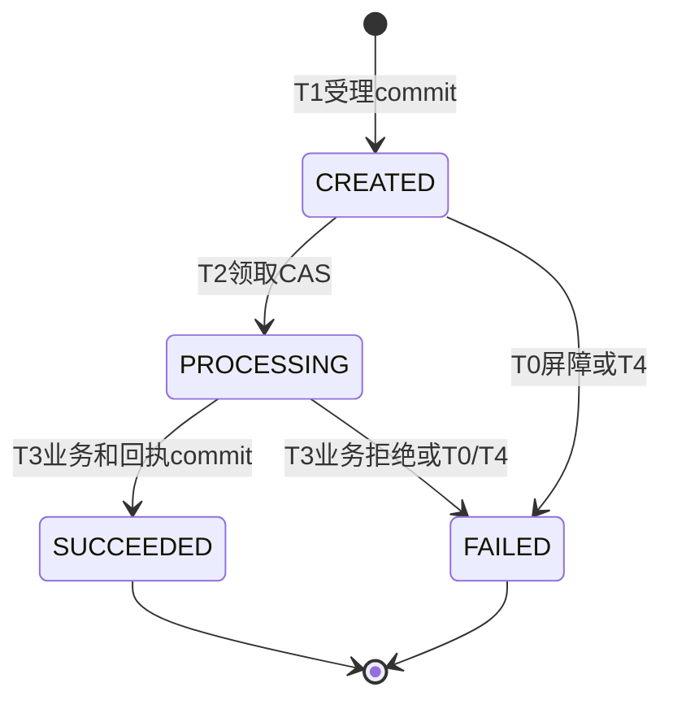
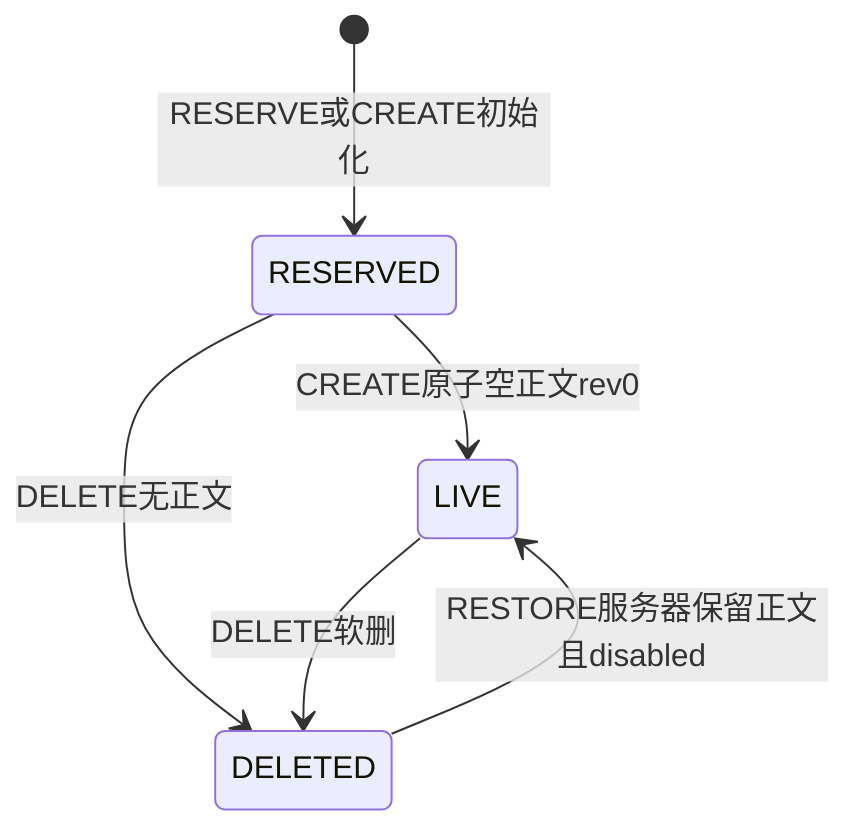

# Workflow Designer 后端正式保存协议 V2.3

日期：2026-11-15；状态：独立反向复审稿，仅设计。未实现、未运行测试或服务，不批准正式改造或上线。本稿独立生效，不以旧版歧义规则作为补充。

## 1. 现状、原则及修订原因

当前源码：WorkflowController.save/publish/disable（88–107）直接调用WorkflowRuntime对应方法；Runtime.save263–293、publish297–349、disable353–368、mutate1300–1331为旧事务实现。WorkflowEngineConfiguration29–53、80–87给JDBC与Flowable传入DataSource/TransactionManager；仅配置关联，不是实际事务原子性证明。V48表没有本文控制行/Session/统一账本。现有V1请求成功幂等、revision条件SQL、可信租户继续作为基础；不能将V2.3描述为已有能力。

业务模型是业务语义权威，BPMN DI是布局权威，XML受控交换；发布版本不可变，Flowable及Runtime执行架构保留。SessionId/generation只隔离前端回调，UNKNOWN仅客户端观察，不能代替服务端epoch。修订针对V2.2 P0-01/02统一写请求与DISABLE，P1摘要域/RESTORE/授权/部署准入及P2参数边界。

## 2. 核心不变量与数据结构

D为永久控制行，S为编辑Session，W为统一write_request，B为正文/业务记录，E为引擎资源。所有写最终事务从主库D排他锁开始，持锁至真实commit；同一Definition事务不跨定义，后台及内部调用不得旁路。成功文档/revision/回执同事务；终态不可覆盖。主库当前读决定资格，不能用RR候选快照或T2缓存。

| 实体 | 键及字段 |
|---|---|
| definition_control | PK(tenant_id,definition_id)；lifecycle RESERVED/LIVE/DELETED、write_epoch、active_session_id；永不物理删除或重置 |
| edit_session | PK(tenant,definition,session_id)，owner_actor、epoch、ACTIVE/CLOSED/SUPERSEDED；服务器UUID |
| write_request | PK(tenant_id,definition_id,operation,request_id)，operation固定SAVE/PUBLISH/DISABLE；actor、sid、epoch、expected_revision、protocol/schema/canonical版本、canonical_payload、digest、length、raw可选；status、created_at、claimed_at、finished_at、error_code、receipt |
| control_request | PK(tenant,definition,control_request_id)，operation RESERVE/CREATE/DELETE/RESTORE/ACTIVATE/TERMINATE，不可变信封/摘要及终态回执 |
| definition | revision、document、model投影、enabled、published、deleted；单行原子写 |
| definition_version | tenant/definition/version唯一、publish_request_id唯一、source_revision、冻结正文/BPMN摘要、deploymentId/processDefinitionId、编译器版本；不可更新覆盖 |

W受理后不可变：所有身份/操作/版本/正文/摘要字段。仅status及一次领取/终态时间、错误/receipt按状态机变化。状态/回执终态后不可修改。canonical字节和墓碑首版永久保留，raw诊断可按安全批准清理；不能通过删记录重用旧请求。

operation+requestId共同构成逻辑请求ID：相同UUID跨SAVE/PUBLISH/DISABLE是三个不同命名空间请求，绝不能相互复用回执；每个命名空间内不同信封冲突。controlRequestId命名空间不含operation，因此同控制键换操作必须冲突。

## 3. 状态机、事务及全类型锁序



所有三种operation均可领取/终结；PROCESSING不表示worker仍存活。重复PROCESSING返回202，不启动第二worker。T4可保守取消尚未进T3的worker，不声称worker已死亡；迟到worker锁内读FAILED后停止。超时/断连只是UNKNOWN，不能直接写FAILED。

统一顺序：D→S按UUID无符号16字节序→W按(operation ASCII字节序,requestId无符号字节序)→B→必要E。operation锁序DISABLE、PUBLISH、SAVE。控制回执在D锁后查重，T0最终写回执在业务锁后；同D串行，任何入口禁止先锁回执/W再等D。不存在分表锁序例外。跨定义操作首版拆单定义事务，不承诺整体原子。

| 事务 | 当前读/转换 | commit与异常 |
|---|---|---|
| T0控制 | D→全部目标S→全类型W→B；资格/生命周期、非终态FAILED与控制回执 | 整体commit才授资格/屏障；超时不报成功 |
| T1受理 | D→S→精确W；核对权限、LIVE/epoch、计数、信封 | 新CREATED或直接FAILED拒绝；同键复用；SQL失败整回滚 |
| T2领取 | D→S→W FOR UPDATE；CREATED→PROCESSING CAS=1 | 仅赢家继续；其他读当前状态；不得重复worker |
| T3执行 | D→S→W→B→E；最终权限/epoch/status/revision；操作自身业务 | 业务+SUCCEEDED原子；业务拒绝提交FAILED；SQL异常整回滚/未知 |
| T4恢复 | D→S→W→需核对的B/E | 当前读终态复用；非终态保守FAILED；发布特殊不一致写保护 |

统一SQL：
```sql
SELECT * FROM definition_control WHERE tenant_id=:t AND definition_id=:d FOR UPDATE;
SELECT * FROM edit_session WHERE tenant_id=:t AND definition_id=:d AND session_id=:s FOR UPDATE;
SELECT * FROM write_request WHERE tenant_id=:t AND definition_id=:d
 AND operation=:op AND request_id=:r FOR UPDATE;
UPDATE write_request SET status='FAILED',error_code=:e,finished_at=CURRENT_TIMESTAMP(6)
 WHERE tenant_id=:t AND definition_id=:d AND operation=:op AND request_id=:r
 AND status IN ('CREATED','PROCESSING');
```

CAS1仅在commit后成为终态；0则重新锁定当前读：终态复用，缺失或仍非终态属于协议错误，整体回滚。成功CAS限PROCESSING且影响1，否则业务更新回滚。worker已commit成功，恢复器当前读见SUCCEEDED绝不覆盖；worker仍持D则等待，超时保持未知；worker回滚后才能锁定结算。RR先扫描PROCESSING只是候选，不能在获锁后继续用旧一致性快照。

## 4. 统一屏障、恢复器及64上限

所有屏障/DELETE/接管先封资格，再按固定锁序终结全部operation：
```sql
SELECT operation,request_id FROM write_request
 WHERE tenant_id=:t AND definition_id=:d AND session_id=:s AND epoch=:e
 AND status IN ('CREATED','PROCESSING')
 ORDER BY operation,request_id FOR UPDATE;
-- 逐行按上述带全主键和状态的CAS，保留SUCCEEDED/FAILED。
```

T1计数在D锁内CURRENT读，范围tenant+definition+session，跨SAVE/PUBLISH/DISABLE，CREATED/PROCESSING计入，终态不计入。硬上限64，首版不可调高；第65个新逻辑请求返回429 REQUEST_LIMIT且可登记FAILED（不占非终态），客户端该键重试返回原失败。同键已有记录不重新计数或占额。D串行使两个并发受理不能同时跨阈值。一个ACTIVE写Session，接管在同T0已清旧非终态，故一次屏障最多64；异常遗留超64则拒绝激活并写保护，不分批返回成功。

恢复器每1秒扫描最多32候选（拟议默认，单位秒/条），不先锁候选再等D；逐个独立T4。CREATED可通过正常T2领取或保守FAILED；PROCESSING默认T4失败终结，须有重启恢复窗口/人工触发避免无故取消，心跳仅调度不作安全证据。PUBLISH若观察矛盾按第8节，不套普通失败。

资格关闭和终结全部W同T0，不分批commit。尚未到达的旧请求T1/T3都校验旧epoch，不能受理可执行记录。查询所有已知请求终态仍不替代Session屏障。锁等待默认5秒（1–30秒可配置），事务预算10秒仅运维限制，不得超时后放锁继续操作；死锁/锁超时整个事务回滚，不能依赖MySQL单语句回滚。确定回滚才同键重试，commit未知先查。

## 5. 完整DISABLE协议

API：PUT /api/workflow/v2.3/definitions/{id}/write-requests/DISABLE/{requestId}。信封必须包含operation=DISABLE、requestId、可信tenant/actor绑定、definition、sessionId、epoch、expectedRevision、protocolVersion=2.3、schemaVersion=1、canonicalizationVersion=1、parameters={reason:非空字符串}。reason最长2000 Unicode标量；null/缺失拒绝。HTTP Idempotency-Key若提供须等于路径key。

T1在D/S/W锁内校验disable权限及当前LIVE/Session、统一额度，冻结信封CREATED。T2唯一领取PROCESSING。T3再次独立检查disable权限（首期语义映射现有workflow:publish，但操作身份仍为disable）、owner/sid/epoch/PROCESSING/expectedRevision。锁B后执行UPDATE definition SET enabled=false,revision=revision+1 WHERE tenant/id/revision且deleted=false，影响1；published指针保持原值，不改wf_version、不触发Flowable部署、不影响已运行实例；终态SUCCEEDED含oldRevision/newRevision、enabled=false、published、时间和请求身份。0行当前读区分冲突/删除，不部分提交。

已disabled也允许新逻辑DISABLE，仍需权限和当前revision，成功revision+1并审计；相同逻辑请求重复不再加1。如此避免“是否变更”导致回执歧义。DISABLE后禁止新实例启动；恢复执行资格唯一方式是当前有效Session显式PUBLISH产生新版本，首版没有独立ENABLE。

所有状态查询用GET同路径，返回CREATED/PROCESSING/终态及原回执，不把当前revision当原结果。超时UNKNOWN按同operation/key查询或受控同信封重试；T4按全类型规则结算，不能直接网络FAILED。迟到worker最终重验状态，不能再执行。与SAVE/PUBLISH/DELETE/RESTORE/接管同D锁排序，抢先者commit后后者重查revision/epoch/lifecycle，不存在独立disable旁路。

## 6. SAVE与PUBLISH的操作契约

共同信封字段及规范规则见第10节；API统一/write-requests/{operation}/{requestId}。SAVE parameters={document}，T1/T3需save权限；T3锁B，校验统一文档业务JSON/DI/XML镜像及schema，UPDATE正文/model兼容投影+revision+1与SUCCEEDED同commit。草稿可业务未配置完成，但结构/安全/一致性必须通过；不执行外部服务。

PUBLISH parameters={}，不接受客户端未提交正文；expectedRevision绑定锁内已提交文档。T1需publish权限，T3/P3最终独立校验publish权限（不是save权限），LIVE/owner/epoch/PROCESSING/revision。只有SAVE权限不能发布，Session有效不授业务权限。受理后撤权且P3已可见则FAILED/PERMISSION_REVOKED；检查后并发撤权宽限见第12节，未经审批不启用。

P3持D→S→W→B→E至真实commit，分配业务version，冻结source_revision，编译并部署。记录(tenant,definition,version)唯一、(tenant,definition,operation,requestId)唯一、实际deploymentId/processDefinitionId、编译器版本及冻结BPMN摘要。部署一个目标流程，实际引擎版本不假定等于业务version。业务映射不可修改重绑。正文published=newVersion、enabled=true、revision+1，成功回执同事务。新逻辑re-publish生成新版本；同键仅复用。

## 7. 生命周期与独立T0控制请求

CREATE/RESERVE/DELETE/RESTORE/ACTIVATE/TERMINATE不进入W：它们是单短T0控制事务，没有T2 worker，控制结果与业务变化同commit；未知结果查询controlRequestId。它们终结W时仍必须扫描全部类型，同D串行不能绕过屏障。控制回执键tenant/definition/controlId不含operation，同键异操作409。

| operation/API尾路径 | 信封除公共身份版本/键外的参数 | 前置/权限 | 成功/失败 |
|---|---|---|---|
| RESERVE POST /control/RESERVE | parameters={} | create权限；无对象 | RESERVED/epoch0，无正文；已存在异键冲突 |
| CREATE POST /control/CREATE | parameters={initialSchemaVersion:1} | create权限；无行或RESERVED | LIVE+合法空草稿rev0，epoch+1；ALREADY_EXISTS |
| DELETE POST /control/DELETE | parameters={targetRevision,observedEpoch,reason} | delete权限，LIVE/RESERVED匹配 | DELETED/epoch+1、正文软删rev+1；冲突不改 |
| RESTORE POST /control/RESTORE | parameters={targetRevision,observedEpoch,reason} | restore权限、DELETED有保留正文 | LIVE disabled、epoch/rev+1、active空；无来源拒绝 |
| ACTIVATE POST /control/ACTIVATE | parameters={observedEpoch,takeover} | edit激活权限/显式接管另授权，LIVE | 封旧全部W，服务器新sid/epoch+1；旧观察冲突 |
| TERMINATE POST /control/TERMINATE | parameters={targetSessionId,targetEpoch,reason} | owner终结或管理员接管权限 | 当前目标CAS封闭或历史屏障；不存在/归属错拒绝 |

控制信封顶层operation/controlRequestId/tenant/definition/actor/protocolVersion/schemaVersion/canonicalizationVersion/parameters全部必填；参数表列举为封闭schema，reason同disable。RESERVE/CREATE服务器构造初始正文，不接受任意客户端对象事实。错误回执不抛异常回滚已决定的业务拒绝；授权前请求不登记，查不到不等于终态。每项使用D→S→W→B→控制回执写入，当前读；同键返回历史结果和currentValid/currentLifecycle，异键错误不重复资格变化。commit未知原控制键查询，不能换键猜测。



唯一初始化例外：授权后INSERT D(tenant,definition,epoch0,RESERVED) ON DUPLICATE KEY UPDATE definition_id=definition_id，然后SELECT D FOR UPDATE真实值；不以缺失行SELECT代替锁。两实例唯一键等待后读真实状态，不能本地默认epoch0。CREATE同T0插空合法但不可发布草稿rev0、设LIVE+epoch1；首存expectedRevision0。RESERVED不激活/保存/发布；无正文删除后不能恢复，换新ID创建。

DELETE清active、升epoch，终结全部旧W，保留服务器最后正文软删、enabled=false、published=0并rev+1；历史版本与运行实例不动。RESTORE仅使用保留正文内容，enabled=false、published=0、active空、rev/epoch+1；旧published仅在不可变版本历史查询中存在，不恢复指针。必须显式重新PUBLISH才可新启动。Runtime新实例匹配必须D.lifecycle=LIVE、正文未删、enabled=true、published>0且对应发布映射完整；DELETED或disabled均排除。既有实例继续冻结版本，不因恢复切换。

TERMINATE只在D.active=sid且epoch匹配且目标S ACTIVE时CAS D epoch+1/active空并S CLOSED。目标已被B接管则只返回A历史屏障，绝不改B/当前epoch。错归属或ACTIVE但D不符写保护。不同控制键重复终结旧目标可历史回执，不升epoch。所有rev/epoch最大9223372036854775807，递增前检查；溢出拒绝且保持全部原状态，不能截断/回绕。墓碑永久保留。

## 8. Flowable A路径独立实验准入（未执行）

首期唯一候选A：嵌入式部署与业务表共享同一真实顶层本地事务/受控资源，P3持D到commit。B独立提交、C补偿对账继续未批准。配置同DataSource/TransactionManager只是第一层证据，不等于同物理连接/事务参与，不等于故障原子性证明。

必须准入规格：记录Spring事务/真实连接资源标识、引擎传播及TransactionSynchronization；引擎部署表和wf_version/W/definition必须共同提交回滚。不得仅看deploy返回值。验证缓存、异步Job、监听器、外部消息在未commit前不可对其他实例产生已发布可执行副作用；禁止同步外部副作用绕过事务。

| 实验 | 显式屏障/预期 | 失败决策 |
|---|---|---|
| deploy后版本INSERT失败 | 在部署返回后、SQL前注入；引擎和业务全回滚 | 有孤儿即A失败 |
| deploy后definition UPDATE失败 | SQL错误迫使整P3回滚；无成功回执/部署 | 不自动补偿 |
| commit成功丢响应 | 主库同key回执+映射+部署唯一一致 | 不重部署 |
| commit失败客户端超时 | 获取D当前读核对，不能网络判FAILED | 未知保持写保护 |
| 映射/引擎不一致 | 人工制造隔离实验矛盾 | P4 WRITE_PROTECTED，不覆盖终态 |
| 缓存提前暴露 | 第二实例/新连接在commit前查缓存/启动 | 产生可执行可见性即A失败 |
| Job/监听器提前可见 | 暂停commit，观察任务/外部事件 | 不能隐藏副作用 |
| 双实例同发布 | 同W唯一领取，P3 D互斥 | 一个部署/映射 |
| 发布与各写竞争 | SAVE/DISABLE/DELETE/接管分别争D | 明确先后，旧资格后无deploy |

P4唯一观察来源：权威主库W终态、wf_version映射及同资源引擎持久deployment/processDefinition记录；引擎缓存不能作终态权威。锁D→S→W后只读核对E，若SUCCEEDED但映射缺失/不符、PROCESSING却出现持久部署或映射、同key多部署，进入定义及发布服务WRITE_PROTECTED，不盲写FAILED/重试/删除。没有部署或映射且非终态、确定原事务已结束后，方可CAS FAILED。所有观察查询必须匹配tenant、definition、request唯一部署标识，而非仅名称。

解除保护必须由指定运维+业务管理员审批，保留现场，确认主库权威、事务结果及不可变映射一致，单独受控修复协议/维护窗审计；本版不授权自动修复、重绑或删除部署。无法唯一判断保持保护。A任何准入项失败立即停止发布实现，不切B/C，不事后补偿替代证明，无引擎侧fencing不允许旧Session创建孤儿部署。

## 9. 主库GET、事务和HA

GET /draft：MySQL8+ InnoDB主库短顶层READ COMMITTED事务，D FOR SHARE→授权Session FOR SHARE→正文FOR SHARE，tenant/id过滤；lifecycle/epoch/session有效性/document/revision同保护区。所有写D FOR UPDATE，读期间SAVE/接管/DELETE等待；写先commit则读新组合。GET后接管正常发生，前端最终写仍校验epoch。无D404，RESERVED DOCUMENT_NOT_COMMITTED，DELETED授权410/防枚举404；不返回隐藏正文或其他owner信息。GET不授永久资格，主库/commit错误503，不回退副本。

所有T0–T4/控制/发布/GET都要求同权威DataSource/事务管理器、顶层真实事务；入口拒绝外层事务，禁止短内层REQUIRES_NEW校验后外层写。完整REQUIRES_NEW仅在单独批准且调用者无相关锁时评估，本版默认拒绝。template.execute真实commit成功后才发成功HTTP，外层REQUIRED返回不等于commit。连接池隔离/锁超时改动必须归还前复位。

单主、不丢已确认提交、无双写旧主、强制主库当前读为基础设施前提；不确定即WRITE_PROTECTED，503，客户端UNKNOWN，不能授新资格。跨库部署/主从延迟不由行锁解决。发布资格不代表实例执行全局一致。

## 10. UUID、canonical字节与完整摘要域

小写标准v4 RFC variant UUID，拒绝大写/缩写/花括号/无连字符；16字节网络序BINARY16，无UUID swap。锁排序按无符号字节。tenant可信UUID二进制；definition ASCII字母数字下划线连字符1–64、大小写敏感VARBINARY64；旧表迁移先查collation别名和关联，不默改历史ID。

canonicalizationVersion1：严格UTF8流，对象绑定前拒绝任何重复key/非法Unicode代理项；对象键Unicode标量序排序（Java不能默认UTF16比较），无Unicode归一；字符串保留码点，控制字符用小写四位u转义，双引号/反斜杠转义，斜杠不额外转义；无空白。缺失与null区分；封闭schema缺失必填/null不允许字段拒绝，不能规范化补默认。数组保序，未知schema字段拒绝。允许的opaque安全扩展字符串原样参与，不承诺未知执行扩展可发布。

数值任意精度十进制解析BigDecimal/BigInteger，数字去尾零、无指数最短十进制，负零=0；原token≤128字符，指数绝对值≤1000，展开≤2048，超限拒绝。rev/epoch以十进制字符串传输，不经JS Number；DI数字不截断。规范信封UTF8用BLOB永久保存，SHA256 BINARY32、字节长度、protocol/schema/canonical版本独立列；raw可选诊断BLOB，MySQL JSON只查询投影。canonical是唯一摘要输入，raw不覆盖它。

固定摘要输入=ASCII域前缀+单字节LF(0A)+canonical UTF8，SHA-256。完整前缀逐个固定：
- SAVE：`workflow-designer/v2.3/write/SAVE/canonical/1`
- PUBLISH：`workflow-designer/v2.3/write/PUBLISH/canonical/1`
- DISABLE：`workflow-designer/v2.3/write/DISABLE/canonical/1`
- 控制：`workflow-designer/v2.3/control/{OP}/canonical/1`，OP为第7节六种大写枚举之一，逐字ASCII替换，无花括号。

operation和requestId也进入规范信封。保存完整信封键为actor/canonicalizationVersion/definition/epoch/expectedRevision/operation/parameters/protocolVersion/requestId/schemaVersion/sessionId/tenant，按前述键排序；版本字段为整数1、protocol字符串2.3、epoch/revision字符串，UUID字符串严格格式，其余按schema。禁止额外空白/结束LF进入canonical，域与JSON之间只有一个LF。相同key同operation同字节复用，换operation是不同W主键/域；相同control key换OP冲突。

旧请求按记录的协议域/canonical版本和规范信封验证，不用当前规则重算覆盖；发布新增canonical版本必须保留旧验证器。首版不清canonical/墓碑，若未来仅保留摘要+长度需单独安全批准抗碰撞假设，不能悄悄启用。

### 完整黄金字节/摘要规格

以下JSON代码块的UTF8内容恰为canonical_payload，无结尾LF；`inputHex`给域+LF+JSON全部字节，`sha256`为该输入计算的固定值。这是文档生成时的静态哈希计算，不是跨实现测试或协议验证结果。

#### SAVE完整信封，document为canonical测试schema片段，不代表生产业务校验通过

```json
{"actor":"00000000-0000-4000-8000-000000000001","canonicalizationVersion":1,"definition":"D","epoch":"7","expectedRevision":"10","operation":"SAVE","parameters":{"document":{"title":"审批"}},"protocolVersion":"2.3","requestId":"00000000-0000-4000-8000-000000000002","schemaVersion":1,"sessionId":"00000000-0000-4000-8000-000000000003","tenant":"00000000-0000-4000-8000-000000000004"}
```

`inputHex`: `776f726b666c6f772d64657369676e65722f76322e332f77726974652f534156452f63616e6f6e6963616c2f310a7b226163746f72223a2230303030303030302d303030302d343030302d383030302d303030303030303030303031222c2263616e6f6e6963616c697a6174696f6e56657273696f6e223a312c22646566696e6974696f6e223a2244222c2265706f6368223a2237222c2265787065637465645265766973696f6e223a223130222c226f7065726174696f6e223a2253415645222c22706172616d6574657273223a7b22646f63756d656e74223a7b227469746c65223a22e5aea1e689b9227d7d2c2270726f746f636f6c56657273696f6e223a22322e33222c22726571756573744964223a2230303030303030302d303030302d343030302d383030302d303030303030303030303032222c22736368656d6156657273696f6e223a312c2273657373696f6e4964223a2230303030303030302d303030302d343030302d383030302d303030303030303030303033222c2274656e616e74223a2230303030303030302d303030302d343030302d383030302d303030303030303030303034227d`

`sha256`: `9ab339eae383b2d4e80e796e11852e2c4edf638a79996b19575803ccf80d9143`

#### PUBLISH完整有效信封

```json
{"actor":"00000000-0000-4000-8000-000000000001","canonicalizationVersion":1,"definition":"D","epoch":"7","expectedRevision":"10","operation":"PUBLISH","parameters":{},"protocolVersion":"2.3","requestId":"00000000-0000-4000-8000-000000000002","schemaVersion":1,"sessionId":"00000000-0000-4000-8000-000000000003","tenant":"00000000-0000-4000-8000-000000000004"}
```

`inputHex`: `776f726b666c6f772d64657369676e65722f76322e332f77726974652f5055424c4953482f63616e6f6e6963616c2f310a7b226163746f72223a2230303030303030302d303030302d343030302d383030302d303030303030303030303031222c2263616e6f6e6963616c697a6174696f6e56657273696f6e223a312c22646566696e6974696f6e223a2244222c2265706f6368223a2237222c2265787065637465645265766973696f6e223a223130222c226f7065726174696f6e223a225055424c495348222c22706172616d6574657273223a7b7d2c2270726f746f636f6c56657273696f6e223a22322e33222c22726571756573744964223a2230303030303030302d303030302d343030302d383030302d303030303030303030303032222c22736368656d6156657273696f6e223a312c2273657373696f6e4964223a2230303030303030302d303030302d343030302d383030302d303030303030303030303033222c2274656e616e74223a2230303030303030302d303030302d343030302d383030302d303030303030303030303034227d`

`sha256`: `a1b75fb13b9799b7ae8362e52fbac9566e7449fdbd316853c5be8e43e528c2f8`

#### DISABLE UTF8和转义完整信封

```json
{"actor":"00000000-0000-4000-8000-000000000001","canonicalizationVersion":1,"definition":"D","epoch":"7","expectedRevision":"10","operation":"DISABLE","parameters":{"reason":"停用\"检查\"\\路径"},"protocolVersion":"2.3","requestId":"00000000-0000-4000-8000-000000000002","schemaVersion":1,"sessionId":"00000000-0000-4000-8000-000000000003","tenant":"00000000-0000-4000-8000-000000000004"}
```

`inputHex`: `776f726b666c6f772d64657369676e65722f76322e332f77726974652f44495341424c452f63616e6f6e6963616c2f310a7b226163746f72223a2230303030303030302d303030302d343030302d383030302d303030303030303030303031222c2263616e6f6e6963616c697a6174696f6e56657273696f6e223a312c22646566696e6974696f6e223a2244222c2265706f6368223a2237222c2265787065637465645265766973696f6e223a223130222c226f7065726174696f6e223a2244495341424c45222c22706172616d6574657273223a7b22726561736f6e223a22e5819ce794a85c22e6a380e69fa55c225c5ce8b7afe5be84227d2c2270726f746f636f6c56657273696f6e223a22322e33222c22726571756573744964223a2230303030303030302d303030302d343030302d383030302d303030303030303030303032222c22736368656d6156657273696f6e223a312c2273657373696f6e4964223a2230303030303030302d303030302d343030302d383030302d303030303030303030303033222c2274656e616e74223a2230303030303030302d303030302d343030302d383030302d303030303030303030303034227d`

`sha256`: `bc720f1e23047088a4fff7f85ce6de9c146964c75266878f0e0405c1c5938959`

### 补充向量分类（规格，未运行）

| 类别/编号 | 输入与预期 |
|---|---|
| 完整E1 | 黄金SAVE原信封同operation/key重发：规范字节/摘要相同，不第二提交 |
| 完整E2 | 黄金同UUID跨三operation：不同主键/域/摘要，不共享回执 |
| 完整E3 | SAVE/PUBLISH或PUBLISH/DISABLE相同parameters={}：域/operation仍不同；SAVE/DISABLE schema拒绝，不能当可受理业务 |
| 完整E4 | 原键修改expectedRevision、sid、epoch：各自冲突 |
| 完整E5 | 原始完整信封倒序键：canonical与黄金一致 |
| 完整E6 | 域v2.3改v2.4：摘要不同，当前新请求版本不支持拒绝 |
| 语义S1 | {}与{a:null}不同；空字符串与null不同；生产字段必填规则单独校验 |
| 语义S2 | 1/1.0/1e0同1，-0同0；超大整数9007199254740993不舍入 |
| 语义S3 | 1.2300e2→123、1e-3→0.001；é与e+0301不同 |
| 语义S4 | Unicode转义a/直接a相同；代理对😀相同，孤立代理拒绝 |
| 语义S5 | 键E000在10000前；UTF8中文和反斜杠/引号见黄金DISABLE |
| 语义S6 | [1,2]与[2,1]不同；换行规范u000a；/和转义/同值；U0000不截断 |
| schemaB1 | 原token128个1允许canonical，129个1拒绝；可用schema整数范围另限制 |
| schemaB2 | 1e-1000、1e1000满足token/展开界限；1e±1001拒绝 |
| schemaB3 | 0.加126个1恰128字符允许，127个1为129拒绝；不截高精度 |
| schemaB4 | NaN/01/重复及嵌套重复key/未知顶层键/尾逗号/非法UTF8拒绝 |
| schemaB5 | UUID大写/缩写拒绝；7f字节排序先80；definition A/a不同 |
| schemaB6 | 同control key从ACTIVATE换TERMINATE，409，不是两个命名空间 |
| 存储B7 | JSON列投影重排不能影响BLOB摘要；旧域/canonical版本按原记录复用 |

这些条目保留V2.2 33组覆盖并补完整信封、跨类型和边界；完整黄金向量不把语义片段误称完整合法业务文档。所有跨实现向量实际Java/浏览器计算仍待单元验证。

## 11. API、错误与恢复交接

统一PUT/GET /api/workflow/v2.3/definitions/{id}/write-requests/{operation}/{requestId}；控制POST /control/{operation}及GET /control-requests/{controlId}；GET /draft。认证/租户由服务器上下文，CSRF沿现有链，no-store。成功保存回执包含operation/key、原resultRevision、finishedAt，不返回当前rev冒充原结果。200终态、202 REQUEST_PENDING、404 REQUEST_UNKNOWN（不能当已拒绝）、409 REVISION_CONFLICT/FENCING_TOKEN_REJECTED/IDEMPOTENCY_CONFLICT、403权限拒绝、503 WRITE_PROTECTED/状态不可达。

前端逻辑请求冻结key及规范输入，超时UNKNOWN封锁新写；旧响应通过sessionId/generation不得改新会话。失效后控制器结算W和控制键，屏障commit后按ID原子读最新文档，新Modeler/Session，不使用诊断XML。历史查询只证明原请求结果，不授新资格。所有入口（含键盘/拖拽/内部调用）须统一服务门禁，不能仅按钮禁用。

## 12. 授权矩阵及时间边界

| 操作 | 独立授权 | 阶段 |
|---|---|---|
| SAVE | WorkflowDefinition.save / workflow:edit | T1和T3最终 |
| PUBLISH | WorkflowDefinition.publish / workflow:publish | T1和P3最终 |
| DISABLE | WorkflowDefinition.disable / workflow:publish | T1和T3最终 |
| DELETE/RESTORE | 独立新操作及权限，禁止借edit自动放行 | T0锁内最终 |
| CREATE/RESERVE | 独立创建操作，主体/对象范围复核 | T0最终 |
| ACTIVATE/接管 | 编辑资格+接管他人专用权限 | T0最终 |
| TERMINATE | 自己终结或管理终结权限 | T0最终 |
| W/控制回执查询 | 独立诊断/读取资格、owner范围、当前tenant | 每次查询，不仅凭key |

未知结果查询不要求仍拥有原始publish执行权，但必须仍为有效成员且拥有该对象请求结果读取权，撤权不得泄露正文；无读取权则拒绝，管理员受控诊断。恢复器服务身份只能核对/取消，不能替代被撤权用户重新执行发布/保存。

本版最终授权判定时刻宽限：判定前撤权可见则拒绝；判定后并发撤权仍可能本次commit。不能声称原子撤权，需产品/安全批准，未获批不启用。严格撤权若要求跨授权控制锁同步，需另审授权→D锁集，不能仅再查一次权限假装原子。

## 13. A–I安全命题与线性化

| 命题 | commit线性化点/前提及反例排除 |
|---|---|
| A旧资格不写新正文 | T0新资格与T3同D排他；W先则在新资格前结束，T0先则旧T3当前读拒绝 |
| B成功不改失败 | T3/T4/T0当前读W及终态CAS；RR扫描仅候选，已成功当前读不可覆盖 |
| C同逻辑保存最多一次 | 唯一全键、T2单领取、T3正文+成功CAS同commit、永久墓碑；跨OP不共享逻辑key |
| D屏障封全旧请求 | T0终结统一W全部OP并永久关闭epoch，未到包T1/T3拒绝；总额度64 |
| E单定义有效写有序 | 所有控制/业务写完整持D锁至commit；不推导跨定义/外部系统全局串行 |
| F旧Session不发布新版本 | P3同D且最终publish授权/epoch；A原子路径待验证，B/C禁止 |
| G映射不重绑 | wf_version/部署/W同commit与唯一映射；引擎独立提交为反例，准入失败则禁用 |
| H读非混合信封 | GET D共享→S→B当前读，写先D排他；返回后接管不改变已返回快照正确性 |
| I删除恢复不复活 | 永久墓碑/单调rev epoch、RESTORE disabled/published0，旧终态只回执 |

当前正式V1/内部Runtime写不满足前提，必须关闭或纳管，否则以上不能用于宣布系统安全。全部命题仍需真实验证，配置关联不作部署原子证明。

## 14. 实验规格及全局一致性复核

真实MySQL8+/InnoDB、两应用实例、独立Flowable隔离环境，显式SQL/commit屏障，不用sleep判断。必须观察D/S/W/B/版本及引擎记录。规格未执行：

1 CREATE双实例/中途崩溃/同控制键未知commit；2 首存与接管；3 DELETE与旧请求、RESTORE重放及实例启动默认禁用；4 三类混合64和65；5 W同键异参数及跨OP同UUID；6 RR旧快照与T4、T2迟到worker；7 SAVE/PUBLISH/DISABLE/控制竞争；8 第8节全部Flowable故障；9 GET与save/接管/delete；10 外层事务/同源连接/锁超时整回滚；11 V1 HTTP/内部Runtime/直接RepositoryService负向调用；12 UUID/canonical黄金向量；13 主从延迟/切主/双主写保护；14 最终授权撤销竞争；15 64批量中途故障；16 删除恢复rev/epoch溢出。

| 复核项 | 当前性质/剩余证据 |
|---|---|
| T0–T4全操作覆盖和唯一commit点 | 已由协议定义；需要源码核查、MySQL实验 |
| 跨类型锁序/统一终结/最终重验/终态不可变 | 已由协议定义；需要多实例、故障实验 |
| UNKNOWN查询/64总量 | 已由协议定义；需要单元、真实MySQL/多实例 |
| GET统一保护区 | 已由协议定义；需要MySQL锁与路由验证 |
| V1/内部/后台/修复/直接引擎调用门禁 | 协议要求；需要全源码审查、负向调用与维护窗制度 |
| PUBLISH A资格 | 未验证；需要Flowable故障注入、资源/缓存/Job观察 |
| RESTORE无旧执行资格 | 协议定义；需要Runtime接入审查与真实实例验证 |
| 没有其他账本外写路径 | 协议要求；需要静态门禁与运行审计，不能凭文档证明 |
| 权限/独占接管/墓碑隐私 | 需要产品/安全批准 |
| 主库HA/写保护 | 需要运维批准和基础设施故障验证 |

## 15. V2.2复审问题关闭矩阵

| 问题 | 修改位置及原因 | 关闭依据/剩余验证 |
|---|---|---|
| P0-01 | 第5节DISABLE独立完整契约，避免一句引用 | 协议定义闭合；待复审/单元/DB |
| P0-02 | 第2–4节统一W和总量，去分表歧义 | 同表全序/扫描/CAS；待多实例/故障 |
| P1-01 | 第10节固定域+operation+完整黄金输入/摘要 | 静态值可复算；未做跨实现互通 |
| P1-02 | 第7节DELETE/RESTORE disabled/published0 | 不恢复旧执行资格；待业务批准/Runtime测试 |
| P1-03 | 第6/12节P3独立publish最终权限 | Session不授业务权；撤权宽限待批准 |
| P1-04 | 第8节A门槛/P4权威核对/保护解除 | A未验证，B/C未批准，不自动补偿 |
| P2-01 | 第7/10节控制参数、溢出及完整字节 | 待状态/字节/边界测试 |

## 16. 交付与实施限制

本稿具备提交下一轮独立反向复审的设计条件，不是协议通过或实施批准。待确认：产品的显式接管、disabled恢复/重复disable语义；安全的权限映射、撤权宽限、永久信封隐私；运维单主/连接/HA及保护解除。没有运行任何测试、构建、服务或数据库操作；没有改旧文档、代码、Demo、测试、迁移、依赖。完成后停止。
