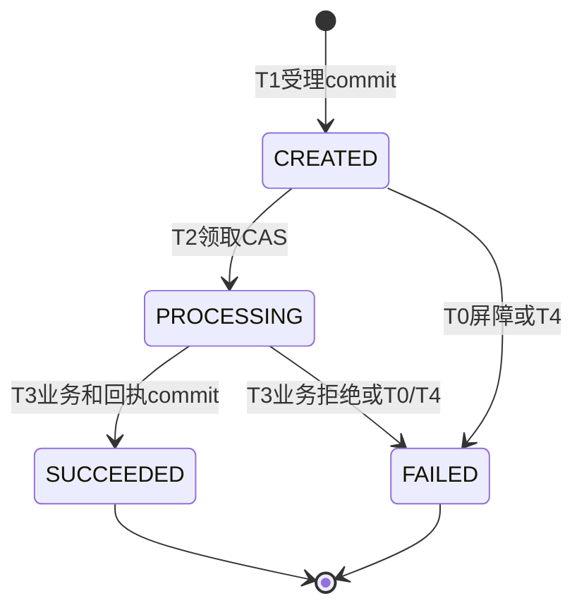
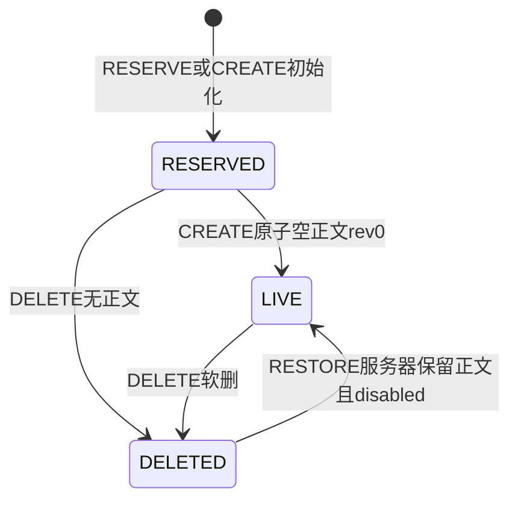
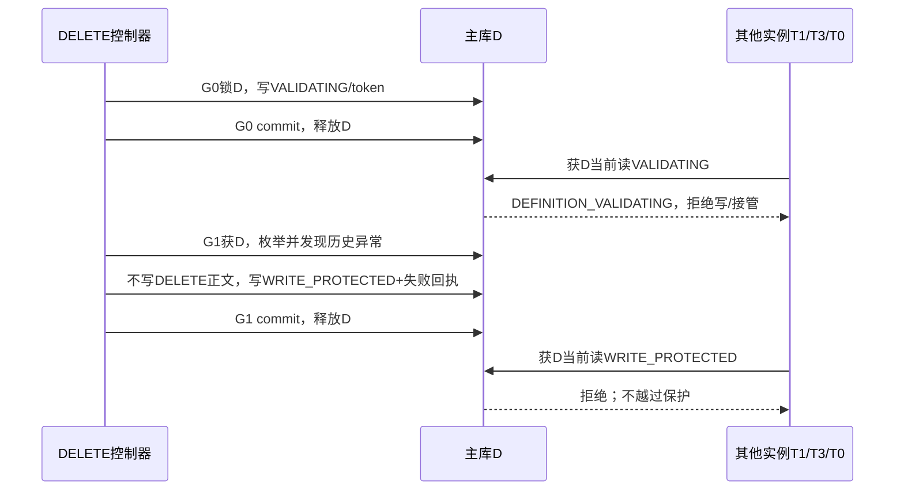

# Workflow Designer 后端正式保存协议 V2.5

日期：2026-11-15；状态：基于V2.4的局部修订稿，仅文档新增。未进行实验、测试、构建或部署，不构成正式实现或上线授权。未实现、未运行测试或服务，不批准正式改造或上线。本稿独立生效，不以旧版歧义规则作为补充。

## 1. 现状、原则及修订原因

当前源码：WorkflowController.save/publish/disable（88–107）直接调用WorkflowRuntime对应方法；Runtime.save263–293、publish297–349、disable353–368、mutate1300–1331为旧事务实现。WorkflowEngineConfiguration29–53、80–87给JDBC与Flowable传入DataSource/TransactionManager；仅配置关联，不是实际事务原子性证明。V48表没有本文控制行/Session/统一账本。现有V1请求成功幂等、revision条件SQL、可信租户继续作为基础；不能将V2.5描述为已有能力。

业务模型是业务语义权威，BPMN DI是布局权威，XML受控交换；发布版本不可变，Flowable及Runtime执行架构保留。SessionId/generation只隔离前端回调，UNKNOWN仅客户端观察，不能代替服务端epoch。修订针对V2.2 P0-01/02统一写请求与DISABLE，P1摘要域/RESTORE/授权/部署准入及P2参数边界。

## 2. 核心不变量与数据结构

D为永久控制行，S为编辑Session，W为统一write_request，B为正文/业务记录，E为引擎资源。所有写最终事务从主库D排他锁开始，持锁至真实commit；同一Definition事务不跨定义，后台及内部调用不得旁路。成功文档/revision/回执同事务；终态不可覆盖。主库当前读决定资格，不能用RR候选快照或T2缓存。

| 实体 | 键及字段 |
|---|---|
| definition_control | PK(tenant_id,definition_id)；lifecycle RESERVED/LIVE/DELETED、write_epoch、active_session_id；永不物理删除或重置 |
| edit_session | PK(tenant,definition,session_id)，owner_actor、epoch、ACTIVE/CLOSED/SUPERSEDED；服务器UUID |
| write_request | PK(tenant_id,definition_id,operation,request_id)，operation固定SAVE/PUBLISH/DISABLE；actor、sid、epoch、expected_revision、protocol/schema/canonical版本、canonical_payload、digest、length、raw可选；status、created_at、claimed_at、finished_at、error_code、receipt |
| control_request | PK(tenant,definition,control_request_id)，operation RESERVE/CREATE/DELETE/RESTORE/ACTIVATE/TERMINATE，不可变信封/摘要及终态回执 |
| definition | revision、document、model投影、enabled、published、deleted；单行原子写 |
| definition_version | tenant/definition/version唯一、publish_request_id唯一、source_revision、冻结正文/BPMN摘要、deploymentId/processDefinitionId、编译器版本；不可更新覆盖 |

W受理后不可变：所有身份/操作/版本/正文/摘要字段。仅status及一次领取/终态时间、错误/receipt按状态机变化。状态/回执终态后不可修改。安全墓碑不可用于重新执行；canonical正文是否及多久保留按第17节审批，不默认永久保留敏感全文。

operation+requestId共同构成逻辑请求ID：相同UUID跨SAVE/PUBLISH/DISABLE是三个不同命名空间请求，绝不能相互复用回执；每个命名空间内不同信封冲突。controlRequestId命名空间不含operation，因此同控制键换操作必须冲突。

## 3. 状态机、事务及全类型锁序



所有三种operation均可领取/终结；PROCESSING不表示worker仍存活。重复PROCESSING返回202，不启动第二worker。T4可保守取消尚未进T3的worker，不声称worker已死亡；迟到worker锁内读FAILED后停止。超时/断连只是UNKNOWN，不能直接写FAILED。

统一顺序：D→S按UUID无符号16字节序→W按(operation ASCII字节序,requestId无符号字节序)→B→必要E。operation锁序DISABLE、PUBLISH、SAVE。控制回执在D锁后查重，T0最终写回执在业务锁后；同D串行，任何入口禁止先锁回执/W再等D。不存在分表锁序例外。跨定义操作首版拆单定义事务，不承诺整体原子。

| 事务 | 当前读/转换 | commit与异常 |
|---|---|---|
| T0控制 | D→全部目标S→全类型W→B；资格/生命周期、非终态FAILED与控制回执 | 整体commit才授资格/屏障；超时不报成功 |
| T1受理 | D→S→精确W；核对权限、LIVE/epoch、计数、信封 | 新CREATED或直接FAILED拒绝；同键复用；SQL失败整回滚 |
| T2领取 | D→S→W FOR UPDATE；CREATED→PROCESSING CAS=1 | 仅赢家继续；其他读当前状态；不得重复worker |
| T3执行 | D→S→W→B→E；最终权限/epoch/status/revision；操作自身业务 | 业务+SUCCEEDED原子；业务拒绝提交FAILED；SQL异常整回滚/未知 |
| T4恢复 | D→S→W→需核对的B/E | 当前读终态复用；非终态保守FAILED；发布特殊不一致写保护 |

统一逐主键锁定SQL（批量算法见第17节，不以排序结果证明物理锁序）：
```sql
SELECT * FROM definition_control WHERE tenant_id=:t AND definition_id=:d FOR UPDATE;
SELECT * FROM edit_session WHERE tenant_id=:t AND definition_id=:d AND session_id=:s FOR UPDATE;
SELECT * FROM write_request WHERE tenant_id=:t AND definition_id=:d
 AND operation=:op AND request_id=:r FOR UPDATE;
UPDATE write_request SET status='FAILED',error_code=:e,finished_at=CURRENT_TIMESTAMP(6)
 WHERE tenant_id=:t AND definition_id=:d AND operation=:op AND request_id=:r
 AND status IN ('CREATED','PROCESSING');
```

CAS1仅在commit后成为终态；0则重新锁定当前读：终态复用，缺失或仍非终态属于协议错误，整体回滚。成功CAS限PROCESSING且影响1，否则业务更新回滚。worker已commit成功，恢复器当前读见SUCCEEDED绝不覆盖；worker仍持D则等待，超时保持未知；worker回滚后才能锁定结算。RR先扫描PROCESSING只是候选，不能在获锁后继续用旧一致性快照。

## 4. 统一屏障、恢复器及64上限

Session屏障范围为目标sid/epoch；DELETE屏障范围为整个tenant+definition所有历史Session及全部非终态W，不限当前ACTIVE。锁D后按第17节算法收集主键并逐条当前读锁定。合规新受理/worker/控制操作此时都等待D，发现旁路变化不能忽略。

关闭资格（拟议D/S状态更新）、结算全部历史W、软删除正文及控制回执在同一个T0提交；不允许先提交失效再分批结算并报DELETE成功。发现历史非终态总数>64、W没有归属S、epoch不符或多个ACTIVE等异常，不执行任何DELETE业务变更，在同一持D事务写持久WRITE_PROTECTED；不可提交事务按第19节保护屏障处理，阻止全部写并人工核查。保护标志写入失败不能声称已保护，按第19节处理。迁移/历史缺陷不以“应不存在”免检。

T1计数在D锁内CURRENT读，范围tenant+definition+session，跨SAVE/PUBLISH/DISABLE，CREATED/PROCESSING计入，终态不计入。硬上限64，首版不可调高；第65个新逻辑请求返回429 REQUEST_LIMIT且可登记FAILED（不占非终态），客户端该键重试返回原失败。同键已有记录不重新计数或占额。D串行使两个并发受理不能同时跨阈值。一个ACTIVE写Session，接管在同T0已清旧非终态，在正常不变量下屏障最多64；DELETE还须检查全历史非终态总数，超过则保护而非漏扫。因此正常屏障最多64；异常遗留超64则拒绝激活并写保护，不分批返回成功。

恢复器每1秒扫描最多32候选（拟议默认，单位秒/条），不先锁候选再等D；逐个独立T4。CREATED可通过正常T2领取或保守FAILED；PROCESSING默认T4失败终结，须有重启恢复窗口/人工触发避免无故取消，心跳仅调度不作安全证据。PUBLISH若观察矛盾按第8节，不套普通失败。

资格关闭和终结全部W同T0，不分批commit。尚未到达的旧请求T1/T3都校验旧epoch，不能受理可执行记录。查询所有已知请求终态仍不替代Session屏障。锁等待默认5秒（1–30秒可配置），事务预算10秒仅运维限制，不得超时后放锁继续操作；死锁/锁超时整个事务回滚，不能依赖MySQL单语句回滚。确定回滚才同键重试，commit未知先查。

## 5. 完整DISABLE协议

API：PUT /api/workflow/v2.5/definitions/{id}/write-requests/DISABLE/{requestId}。信封必须包含operation=DISABLE、requestId、可信tenant/actor绑定、definition、sessionId、epoch、expectedRevision、protocolVersion=2.5、schemaVersion=1、canonicalizationVersion=1、parameters={reason:按第23节校验的字符串}。reason最长2000 Unicode标量；null/缺失拒绝。HTTP Idempotency-Key若提供须等于路径key。

T1按第17节历史重放顺序先查已存在W，只有新执行才在D/S/W锁内校验disable权限及当前LIVE/Session、统一额度并冻结信封CREATED。T2唯一领取PROCESSING。T3再次独立检查disable权限（首期语义映射现有workflow:publish，但操作身份仍为disable）、owner/sid/epoch/PROCESSING/expectedRevision。锁B后执行UPDATE definition SET enabled=false,revision=revision+1 WHERE tenant/id/revision且deleted=false，影响1；published指针保持原值，不改wf_version、不触发Flowable部署、不影响已运行实例；终态SUCCEEDED含oldRevision/newRevision、enabled=false、published、时间和请求身份。0行当前读区分冲突/删除，不部分提交。

已disabled也允许新逻辑DISABLE，仍需权限和当前revision，成功revision+1并审计；相同逻辑请求重复不再加1。如此避免“是否变更”导致回执歧义。DISABLE后禁止新实例启动；恢复执行资格唯一方式是当前有效Session显式PUBLISH产生新版本，首版没有独立ENABLE。

所有状态查询用GET同路径，返回CREATED/PROCESSING/终态及原回执，不把当前revision当原结果。超时UNKNOWN按同operation/key查询或受控同信封重试；T4按全类型规则结算，不能直接网络FAILED。迟到worker最终重验状态，不能再执行。与SAVE/PUBLISH/DELETE/RESTORE/接管同D锁排序，抢先者commit后后者重查revision/epoch/lifecycle，不存在独立disable旁路。

## 6. SAVE与PUBLISH的操作契约

共同信封字段及规范规则见第10节；API统一/write-requests/{operation}/{requestId}。SAVE parameters={document}，T1/T3需save权限；T3锁B，校验统一文档业务JSON/DI/XML镜像及schema，UPDATE正文/model兼容投影+revision+1与SUCCEEDED同commit。草稿可业务未配置完成，但结构/安全/一致性必须通过；不执行外部服务。

PUBLISH parameters={}，不接受客户端未提交正文；expectedRevision绑定锁内已提交文档。T1需publish权限，T3/P3最终独立校验publish权限（不是save权限），LIVE/owner/epoch/PROCESSING/revision。只有SAVE权限不能发布，Session有效不授业务权限。受理后撤权且P3已可见则FAILED/PERMISSION_REVOKED；检查后并发撤权宽限见第12节，未经审批不启用。

P3持D→S→W→B→E至真实commit，按第17节永久next_version分配业务version，冻结source_revision，编译并部署。记录(tenant,definition,version)唯一、(tenant,definition,operation,requestId)唯一、实际deploymentId/processDefinitionId、编译器版本及冻结BPMN摘要。部署一个目标流程，实际引擎版本不假定等于业务version。业务映射不可修改重绑。正文published=newVersion、enabled=true、revision+1，成功回执同事务。新逻辑re-publish生成新版本；同键仅复用。

## 7. 生命周期与独立T0控制请求

CREATE/RESERVE/DELETE/RESTORE/ACTIVATE/TERMINATE不进入W：除DELETE第19节G0持久准备外，它们是单短T0控制事务，没有T2 worker，控制结果与业务变化同commit；未知结果查询controlRequestId。它们终结W时仍必须扫描全部类型，同D串行不能绕过屏障。控制回执键tenant/definition/controlId不含operation，同键异操作409。

| operation/API尾路径 | 信封除公共身份版本/键外的参数 | 前置/权限 | 成功/失败 |
|---|---|---|---|
| RESERVE POST /control/RESERVE | parameters={} | create权限；无对象 | RESERVED/epoch0，无正文；已存在异键冲突 |
| CREATE POST /control/CREATE | parameters={initialSchemaVersion:1} | create权限；无行或RESERVED | LIVE+合法空草稿rev0，epoch+1；ALREADY_EXISTS |
| DELETE POST /control/DELETE | parameters={targetRevision,observedEpoch,reason} | delete权限，LIVE/RESERVED匹配 | DELETED/epoch+1、正文软删rev+1；冲突不改 |
| RESTORE POST /control/RESTORE | parameters={targetRevision,observedEpoch,reason} | restore权限、DELETED有保留正文 | LIVE disabled、epoch/rev+1、active空；无来源拒绝 |
| ACTIVATE POST /control/ACTIVATE | parameters={observedEpoch,takeover} | edit激活权限/显式接管另授权，LIVE | 封旧全部W，服务器新sid/epoch+1；旧观察冲突 |
| TERMINATE POST /control/TERMINATE | parameters={targetSessionId,targetEpoch,reason} | owner终结或管理员接管权限 | 当前目标CAS封闭或历史屏障；不存在/归属错拒绝 |

控制信封顶层operation/controlRequestId/tenant/definition/actor/protocolVersion/schemaVersion/canonicalizationVersion/parameters全部必填；参数表列举为封闭schema，reason同disable。RESERVE/CREATE服务器构造初始正文，不接受任意客户端对象事实。错误回执不抛异常回滚已决定的业务拒绝；授权前请求不登记，查不到不等于终态。每项使用D→S→W→B→控制回执写入，当前读；同键返回历史结果和currentValid/currentLifecycle，异键错误不重复资格变化。commit未知原控制键查询，不能换键猜测。



唯一初始化例外：授权后INSERT D(tenant,definition,epoch0,RESERVED) ON DUPLICATE KEY UPDATE definition_id=definition_id，然后SELECT D FOR UPDATE真实值；不以缺失行SELECT代替锁。两实例唯一键等待后读真实状态，不能本地默认epoch0。CREATE同T0插空合法但不可发布草稿rev0、设LIVE+epoch1；首存expectedRevision0。RESERVED不激活/保存/发布；无正文删除后不能恢复，换新ID创建。

DELETE清active、升epoch，终结全部旧W，保留服务器最后正文软删、enabled=false、published=0并rev+1；历史版本与运行实例不动。RESTORE仅使用保留正文内容，enabled=false、published=0、active空、rev/epoch+1；旧published仅在不可变版本历史查询中存在，不恢复指针。必须显式重新PUBLISH才可新启动。Runtime新实例匹配必须D.lifecycle=LIVE、正文未删、enabled=true、published>0且对应发布映射完整；DELETED或disabled均排除。既有实例继续冻结版本，不因恢复切换。

TERMINATE只在D.active=sid且epoch匹配且目标S ACTIVE时CAS D epoch+1/active空并S CLOSED。目标已被B接管则只返回A历史屏障，绝不改B/当前epoch。错归属或ACTIVE但D不符写保护。不同控制键重复终结旧目标可历史回执，不升epoch。所有rev/epoch最大9223372036854775807，递增前检查；溢出拒绝且保持全部原状态，不能截断/回绕。墓碑永久保留。

## 8. Flowable A路径独立实验准入（未执行）

首期唯一候选A：嵌入式部署与业务表共享同一真实顶层本地事务/受控资源，P3持D到commit。B独立提交、C补偿对账继续未批准。配置同DataSource/TransactionManager只是第一层证据，不等于同物理连接/事务参与，不等于故障原子性证明。

必须准入规格：记录Spring事务/真实连接资源标识、引擎传播及TransactionSynchronization；引擎部署表和wf_version/W/definition必须共同提交回滚。不得仅看deploy返回值。验证缓存、异步Job、监听器、外部消息在未commit前不可对其他实例产生已发布可执行副作用；禁止同步外部副作用绕过事务。

| 实验 | 显式屏障/预期 | 失败决策 |
|---|---|---|
| deploy后版本INSERT失败 | 在部署返回后、SQL前注入；引擎和业务全回滚 | 有孤儿即A失败 |
| deploy后definition UPDATE失败 | SQL错误迫使整P3回滚；无成功回执/部署 | 不自动补偿 |
| commit成功丢响应 | 主库同key回执+映射+部署唯一一致 | 不重部署 |
| commit失败客户端超时 | 获取D当前读核对，不能网络判FAILED | 未知保持写保护 |
| 映射/引擎不一致 | 人工制造隔离实验矛盾 | P4 WRITE_PROTECTED，不覆盖终态 |
| 缓存提前暴露 | 第二实例/新连接在commit前查缓存/启动 | 产生可执行可见性即A失败 |
| Job/监听器提前可见 | 暂停commit，观察任务/外部事件 | 不能隐藏副作用 |
| 双实例同发布 | 同W唯一领取，P3 D互斥 | 一个部署/映射 |
| 发布与各写竞争 | SAVE/DISABLE/DELETE/接管分别争D | 明确先后，旧资格后无deploy |

P4及所有PUBLISH终态查询/重复PUT必须先执行第17节完整一致性矩阵，再决定复用；不能先返回FAILED掩盖残留部署。权威持久观察仅主库W、不可变业务映射、引擎deployment/processDefinition；库外副作用需独立准入观测，不能由表状态否定。

解除保护必须由指定运维+业务管理员审批，保留现场，确认主库权威、事务结果及不可变映射一致，单独受控修复协议/维护窗审计；本版不授权自动修复、重绑或删除部署。无法唯一判断保持保护。A任何准入项失败立即停止发布实现，不切B/C，不事后补偿替代证明，无引擎侧fencing不允许旧Session创建孤儿部署。

## 9. 主库GET、事务和HA

GET /draft：MySQL8+ InnoDB主库短顶层READ COMMITTED事务，D FOR SHARE→授权Session FOR SHARE→正文FOR SHARE，tenant/id过滤；lifecycle/epoch/session有效性/document/revision同保护区。所有写D FOR UPDATE，读期间SAVE/接管/DELETE等待；写先commit则读新组合。GET后接管正常发生，前端最终写仍校验epoch。无D404，RESERVED DOCUMENT_NOT_COMMITTED，DELETED授权410/防枚举404；不返回隐藏正文或其他owner信息。GET不授永久资格，主库/commit错误503，不回退副本。

所有T0–T4/控制/发布/GET都要求同权威DataSource/事务管理器、顶层真实事务；入口拒绝外层事务，禁止短内层REQUIRES_NEW校验后外层写。完整REQUIRES_NEW仅在单独批准且调用者无相关锁时评估，本版默认拒绝。template.execute真实commit成功后才发成功HTTP，外层REQUIRED返回不等于commit。连接池隔离/锁超时改动必须归还前复位。

单主、不丢已确认提交、无双写旧主、强制主库当前读为基础设施前提；不确定即WRITE_PROTECTED，503，客户端UNKNOWN，不能授新资格。跨库部署/主从延迟不由行锁解决。发布资格不代表实例执行全局一致。

## 10. UUID、canonical字节与完整摘要域

新request/control/session ID为小写标准v4 RFC variant UUID；可信历史身份按第23节兼容，禁止一刀切v4。新ID拒绝大写/缩写/花括号/无连字符；16字节网络序BINARY16，无UUID swap。锁排序按无符号字节。tenant可信UUID二进制；definition ASCII字母数字下划线连字符1–64、大小写敏感VARBINARY64；旧表迁移先查collation别名和关联，不默改历史ID。

canonicalizationVersion1：严格UTF8流，对象绑定前拒绝任何重复key/非法Unicode代理项；对象键Unicode标量序排序（Java不能默认UTF16比较），无Unicode归一；字符串保留码点，控制字符用小写四位u转义，双引号/反斜杠转义，斜杠不额外转义；无空白。缺失与null区分；封闭schema缺失必填/null不允许字段拒绝，不能规范化补默认。数组保序，未知schema字段拒绝。允许的opaque安全扩展字符串原样参与，不承诺未知执行扩展可发布。

数值任意精度十进制解析BigDecimal/BigInteger，数字去尾零、无指数最短十进制，负零=0；原token≤128字符，指数绝对值≤1000，展开≤2048，超限拒绝。rev/epoch以十进制字符串传输，不经JS Number；DI数字不截断。规范信封UTF8用BLOB存储（保留期限待第17节审批），SHA256 BINARY32、字节长度、protocol/schema/canonical版本独立列；raw可选诊断BLOB，MySQL JSON只查询投影。canonical是唯一摘要输入，raw不覆盖它。

固定摘要输入=ASCII域前缀+单字节LF(0A)+canonical UTF8，SHA-256。完整前缀逐个固定：
- SAVE：`workflow-designer/v2.5/write/SAVE/canonical/1`
- PUBLISH：`workflow-designer/v2.5/write/PUBLISH/canonical/1`
- DISABLE：`workflow-designer/v2.5/write/DISABLE/canonical/1`
- 控制：`workflow-designer/v2.5/control/{OP}/canonical/1`，OP为第7节六种大写枚举之一，逐字ASCII替换，无花括号。

operation和requestId也进入规范信封。保存完整信封键为actor/canonicalizationVersion/definition/epoch/expectedRevision/operation/parameters/protocolVersion/requestId/schemaVersion/sessionId/tenant，按前述键排序；版本字段为整数1、protocol字符串2.5、epoch/revision字符串，UUID字符串严格格式，其余按schema。禁止额外空白/结束LF进入canonical，域与JSON之间只有一个LF。相同key同operation同字节复用，换operation是不同W主键/域；相同control key换OP冲突。

旧请求按记录的协议域/canonical版本和规范信封验证，不用当前规则重算覆盖；发布新增canonical版本必须保留旧验证器。墓碑与canonical正文分层保留见第17节；未经批准不以永久正文留存作为正式实现默认策略。

### 完整黄金字节/摘要规格

以下是规范字节的静态计算，不是协议测试。

#### SAVE

```json
{"actor":"00000000-0000-4000-8000-000000000001","canonicalizationVersion":1,"definition":"D","epoch":"7","expectedRevision":"10","operation":"SAVE","parameters":{"document":{"title":"审批"}},"protocolVersion":"2.5","requestId":"00000000-0000-4000-8000-000000000002","schemaVersion":1,"sessionId":"00000000-0000-4000-8000-000000000003","tenant":"00000000-0000-4000-8000-000000000004"}
```

域：`workflow-designer/v2.5/write/SAVE/canonical/1`；域后一个LF，canonical无结束LF。

`inputHex`: `776f726b666c6f772d64657369676e65722f76322e352f77726974652f534156452f63616e6f6e6963616c2f310a7b226163746f72223a2230303030303030302d303030302d343030302d383030302d303030303030303030303031222c2263616e6f6e6963616c697a6174696f6e56657273696f6e223a312c22646566696e6974696f6e223a2244222c2265706f6368223a2237222c2265787065637465645265766973696f6e223a223130222c226f7065726174696f6e223a2253415645222c22706172616d6574657273223a7b22646f63756d656e74223a7b227469746c65223a22e5aea1e689b9227d7d2c2270726f746f636f6c56657273696f6e223a22322e35222c22726571756573744964223a2230303030303030302d303030302d343030302d383030302d303030303030303030303032222c22736368656d6156657273696f6e223a312c2273657373696f6e4964223a2230303030303030302d303030302d343030302d383030302d303030303030303030303033222c2274656e616e74223a2230303030303030302d303030302d343030302d383030302d303030303030303030303034227d`

`sha256`: `783694ae6f7970073a85449c3e67942c68adf82f02ca069da1e8703d6d37a06a`

#### PUBLISH

```json
{"actor":"00000000-0000-4000-8000-000000000001","canonicalizationVersion":1,"definition":"D","epoch":"7","expectedRevision":"10","operation":"PUBLISH","parameters":{},"protocolVersion":"2.5","requestId":"00000000-0000-4000-8000-000000000002","schemaVersion":1,"sessionId":"00000000-0000-4000-8000-000000000003","tenant":"00000000-0000-4000-8000-000000000004"}
```

域：`workflow-designer/v2.5/write/PUBLISH/canonical/1`；域后一个LF，canonical无结束LF。

`inputHex`: `776f726b666c6f772d64657369676e65722f76322e352f77726974652f5055424c4953482f63616e6f6e6963616c2f310a7b226163746f72223a2230303030303030302d303030302d343030302d383030302d303030303030303030303031222c2263616e6f6e6963616c697a6174696f6e56657273696f6e223a312c22646566696e6974696f6e223a2244222c2265706f6368223a2237222c2265787065637465645265766973696f6e223a223130222c226f7065726174696f6e223a225055424c495348222c22706172616d6574657273223a7b7d2c2270726f746f636f6c56657273696f6e223a22322e35222c22726571756573744964223a2230303030303030302d303030302d343030302d383030302d303030303030303030303032222c22736368656d6156657273696f6e223a312c2273657373696f6e4964223a2230303030303030302d303030302d343030302d383030302d303030303030303030303033222c2274656e616e74223a2230303030303030302d303030302d343030302d383030302d303030303030303030303034227d`

`sha256`: `91fb6a4d4289064b1eadc666b01a2ffd15001d29a28efa41f96b7bda892a1b02`

#### DISABLE

```json
{"actor":"00000000-0000-4000-8000-000000000001","canonicalizationVersion":1,"definition":"D","epoch":"7","expectedRevision":"10","operation":"DISABLE","parameters":{"reason":"停用\"检查\"\\路径"},"protocolVersion":"2.5","requestId":"00000000-0000-4000-8000-000000000002","schemaVersion":1,"sessionId":"00000000-0000-4000-8000-000000000003","tenant":"00000000-0000-4000-8000-000000000004"}
```

域：`workflow-designer/v2.5/write/DISABLE/canonical/1`；域后一个LF，canonical无结束LF。

`inputHex`: `776f726b666c6f772d64657369676e65722f76322e352f77726974652f44495341424c452f63616e6f6e6963616c2f310a7b226163746f72223a2230303030303030302d303030302d343030302d383030302d303030303030303030303031222c2263616e6f6e6963616c697a6174696f6e56657273696f6e223a312c22646566696e6974696f6e223a2244222c2265706f6368223a2237222c2265787065637465645265766973696f6e223a223130222c226f7065726174696f6e223a2244495341424c45222c22706172616d6574657273223a7b22726561736f6e223a22e5819ce794a85c22e6a380e69fa55c225c5ce8b7afe5be84227d2c2270726f746f636f6c56657273696f6e223a22322e35222c22726571756573744964223a2230303030303030302d303030302d343030302d383030302d303030303030303030303032222c22736368656d6156657273696f6e223a312c2273657373696f6e4964223a2230303030303030302d303030302d343030302d383030302d303030303030303030303033222c2274656e616e74223a2230303030303030302d303030302d343030302d383030302d303030303030303030303034227d`

`sha256`: `0a20dfa95dd56472f73f8bee5821ab8fefacbe53ed37ad63331e5818414341b8`

### 补充向量分类（规格，未运行）

| 类别/编号 | 输入与预期 |
|---|---|
| 完整E1 | 黄金SAVE原信封同operation/key重发：规范字节/摘要相同，不第二提交 |
| 完整E2 | 黄金同UUID跨三operation：不同主键/域/摘要，不共享回执 |
| 完整E3 | SAVE/PUBLISH或PUBLISH/DISABLE相同parameters={}：域/operation仍不同；SAVE/DISABLE schema拒绝，不能当可受理业务 |
| 完整E4 | 原键修改expectedRevision、sid、epoch：各自冲突 |
| 完整E5 | 原始完整信封倒序键：canonical与黄金一致 |
| 完整E6 | 域v2.5改v2.5：摘要不同，当前新请求版本不支持拒绝 |
| 语义S1 | {}与{a:null}不同；空字符串与null不同；生产字段必填规则单独校验 |
| 语义S2 | 1/1.0/1e0同1，-0同0；超大整数9007199254740993不舍入 |
| 语义S3 | 1.2300e2→123、1e-3→0.001；é与e+0301不同 |
| 语义S4 | Unicode转义a/直接a相同；代理对😀相同，孤立代理拒绝 |
| 语义S5 | 键E000在10000前；UTF8中文和反斜杠/引号见黄金DISABLE |
| 语义S6 | [1,2]与[2,1]不同；换行规范u000a；/和转义/同值；U0000不截断 |
| schemaB1 | 原token128个1允许canonical，129个1拒绝；可用schema整数范围另限制 |
| schemaB2 | 1e-1000、1e1000满足token/展开界限；1e±1001拒绝 |
| schemaB3 | 0.加126个1恰128字符允许，127个1为129拒绝；不截高精度 |
| schemaB4 | NaN/01/重复及嵌套重复key/未知顶层键/尾逗号/非法UTF8拒绝 |
| schemaB5 | UUID大写/缩写拒绝；7f字节排序先80；definition A/a不同 |
| schemaB6 | 同control key从ACTIVATE换TERMINATE，409，不是两个命名空间 |
| 存储B7 | JSON列投影重排不能影响BLOB摘要；旧域/canonical版本按原记录复用 |

这些条目保留V2.2 33组覆盖并补完整信封、跨类型和边界；完整黄金向量不把语义片段误称完整合法业务文档。所有跨实现向量实际Java/浏览器计算仍待单元验证。

## 11. API、错误与恢复交接

统一PUT/GET /api/workflow/v2.5/definitions/{id}/write-requests/{operation}/{requestId}；控制POST /control/{operation}及GET /control-requests/{controlId}；GET /draft。认证/租户由服务器上下文，CSRF沿现有链，no-store。成功保存回执包含operation/key、原resultRevision、finishedAt，不返回当前rev冒充原结果。200终态、202 REQUEST_PENDING、404 REQUEST_UNKNOWN（不能当已拒绝）、409 REVISION_CONFLICT/FENCING_TOKEN_REJECTED/IDEMPOTENCY_CONFLICT、403权限拒绝、503 WRITE_PROTECTED/状态不可达。

前端逻辑请求冻结key及规范输入，超时UNKNOWN封锁新写；旧响应通过sessionId/generation不得改新会话。失效后控制器结算W和控制键，屏障commit后按ID原子读最新文档，新Modeler/Session，不使用诊断XML。历史查询只证明原请求结果，不授新资格。所有入口（含键盘/拖拽/内部调用）须统一服务门禁，不能仅按钮禁用。

## 12. 授权矩阵及时间边界

| 操作 | 独立授权 | 阶段 |
|---|---|---|
| SAVE | WorkflowDefinition.save / workflow:edit | T1和T3最终 |
| PUBLISH | WorkflowDefinition.publish / workflow:publish | T1和P3最终 |
| DISABLE | WorkflowDefinition.disable / workflow:publish | T1和T3最终 |
| DELETE/RESTORE | 独立新操作及权限，禁止借edit自动放行 | T0锁内最终 |
| CREATE/RESERVE | 独立创建操作，主体/对象范围复核 | T0最终 |
| ACTIVATE/接管 | 编辑资格+接管他人专用权限 | T0最终 |
| TERMINATE | 自己终结或管理终结权限 | T0最终 |
| W/控制回执查询 | 独立诊断/读取资格、owner范围、当前tenant | 每次查询，不仅凭key |

未知结果查询不要求仍拥有原始publish执行权，但必须仍为有效成员且拥有该对象请求结果读取权，撤权不得泄露正文；无读取权则拒绝，管理员受控诊断。恢复器服务身份只能核对/取消，不能替代被撤权用户重新执行发布/保存。

本版最终授权判定时刻宽限：判定前撤权可见则拒绝；判定后并发撤权仍可能本次commit。不能声称原子撤权，需产品/安全批准，未获批不启用。严格撤权若要求跨授权控制锁同步，需另审授权→D锁集，不能仅再查一次权限假装原子。

## 13. A–I安全命题与线性化

| 命题 | commit线性化点/前提及反例排除 |
|---|---|
| A旧资格不写新正文 | T0新资格与T3同D排他；W先则在新资格前结束，T0先则旧T3当前读拒绝 |
| B成功不改失败 | T3/T4/T0当前读W及终态CAS；RR扫描仅候选，已成功当前读不可覆盖 |
| C同逻辑保存最多一次 | 唯一全键、T2单领取、T3正文+成功CAS同commit、永久墓碑；跨OP不共享逻辑key |
| D屏障封全旧请求 | T0终结统一W全部OP并永久关闭epoch，未到包T1/T3拒绝；总额度64 |
| E单定义有效写有序 | 所有控制/业务写完整持D锁至commit；不推导跨定义/外部系统全局串行 |
| F旧Session不发布新版本 | P3同D且最终publish授权/epoch；A原子路径待验证，B/C禁止 |
| G映射不重绑 | wf_version/部署/W同commit与唯一映射；引擎独立提交为反例，准入失败则禁用 |
| H读非混合信封 | GET D共享→S→B当前读，写先D排他；返回后接管不改变已返回快照正确性 |
| I删除恢复不复活 | 永久墓碑/单调rev epoch、RESTORE disabled/published0，旧终态只回执 |

当前正式V1/内部Runtime写不满足前提，必须关闭或纳管，否则以上不能用于宣布系统安全。全部命题仍需真实验证，配置关联不作部署原子证明。

## 14. 实验规格及全局一致性复核

真实MySQL8+/InnoDB、两应用实例、独立Flowable隔离环境，显式SQL/commit屏障，不用sleep判断。必须观察D/S/W/B/版本及引擎记录。规格未执行：

1 CREATE双实例/中途崩溃/同控制键未知commit；2 首存与接管；3 DELETE与旧请求、RESTORE重放及实例启动默认禁用；4 三类混合64和65；5 W同键异参数及跨OP同UUID；6 RR旧快照与T4、T2迟到worker；7 SAVE/PUBLISH/DISABLE/控制竞争；8 第8节全部Flowable故障；9 GET与save/接管/delete；10 外层事务/同源连接/锁超时整回滚；11 V1 HTTP/内部Runtime/直接RepositoryService负向调用；12 UUID/canonical黄金向量；13 主从延迟/切主/双主写保护；14 最终授权撤销竞争；15 64批量中途故障；16 删除恢复rev/epoch溢出。

| 复核项 | 当前性质/剩余证据 |
|---|---|
| T0–T4全操作覆盖和唯一commit点 | 已由协议定义；需要源码核查、MySQL实验 |
| 跨类型锁序/统一终结/最终重验/终态不可变 | 已由协议定义；需要多实例、故障实验 |
| UNKNOWN查询/64总量 | 已由协议定义；需要单元、真实MySQL/多实例 |
| GET统一保护区 | 已由协议定义；需要MySQL锁与路由验证 |
| V1/内部/后台/修复/直接引擎调用门禁 | 协议要求；需要全源码审查、负向调用与维护窗制度 |
| PUBLISH A资格 | 未验证；需要Flowable故障注入、资源/缓存/Job观察 |
| RESTORE无旧执行资格 | 协议定义；需要Runtime接入审查与真实实例验证 |
| 没有其他账本外写路径 | 协议要求；需要静态门禁与运行审计，不能凭文档证明 |
| 权限/独占接管/墓碑隐私 | 需要产品/安全批准 |
| 主库HA/写保护 | 需要运维批准和基础设施故障验证 |

## 15. V2.2复审问题关闭矩阵

| 问题 | 修改位置及原因 | 关闭依据/剩余验证 |
|---|---|---|
| P0-01 | 第5节DISABLE独立完整契约，避免一句引用 | 协议定义闭合；待复审/单元/DB |
| P0-02 | 第2–4节统一W和总量，去分表歧义 | 同表全序/扫描/CAS；待多实例/故障 |
| P1-01 | 第10节固定域+operation+完整黄金输入/摘要 | 静态值可复算；未做跨实现互通 |
| P1-02 | 第7节DELETE/RESTORE disabled/published0 | 不恢复旧执行资格；待业务批准/Runtime测试 |
| P1-03 | 第6/12节P3独立publish最终权限 | Session不授业务权；撤权宽限待批准 |
| P1-04 | 第8节A门槛/P4权威核对/保护解除 | A未验证，B/C未批准，不自动补偿 |
| P2-01 | 第7/10节控制参数、溢出及完整字节 | 待状态/字节/边界测试 |

## 16. 交付与实施限制

本稿具备提交下一轮独立反向复审的设计条件，不是协议通过或实施批准。待确认：产品的显式接管、disabled恢复/重复disable语义；安全的权限映射、撤权宽限、永久信封隐私；运维单主/连接/HA及保护解除。没有运行任何测试、构建、服务或数据库操作；没有改旧文档、代码、Demo、测试、迁移、依赖。完成后停止。

## 17. V2.5定向收敛规则

### 17.1 DELETE全Definition枚举与真实锁序

事务使用主库READ COMMITTED，D先排他锁，任何Session/W新增或修改也必须先D。收集该Definition全部历史S主键（不按ACTIVE过滤），应用以UUID16无符号字节排序后逐完整PK SELECT FOR UPDATE，核验tenant/definition/sid。然后查询该Definition所有status IN(CREATED,PROCESSING)的W主键，不按sid/epoch过滤；在应用按(operation ASCII,requestId16字节)排序，逐完整W主键SELECT FOR UPDATE。所有引用S必须已锁并归属一致，孤立/重复资格异常进入保护，不能补造S。

收集使用普通RC查询仅作ID枚举，D锁阻止合规集合变化；逐点锁后必须重新验证状态，候选已变或新非终态出现说明旁路/不变量异常，按第19节保护处理。最终复查Definition非终态主键集合与已结算集合一致，才允许DELETE正文、资格和回执一起commit。永久终态只查询历史不再更新。

建议索引：S PK(t,d,sid)，W PK(t,d,operation,requestId)，W辅助(t,d,status,operation,requestId)及(t,d,sid,epoch,status,operation,requestId)。全Definition扫描使用前两列t,d；Session屏障使用t,d,sid,epoch。主键列均采用既定二进制类型，operation固定ASCII二进制枚举。EXPLAIN需确认逐点锁唯一键等值、枚举索引前缀有效、扫描规模有界；filesort只影响枚举成本，不提供锁顺序保证。RR范围/gap锁、外键隐式锁、索引维护及旁路写均可能引入等待，必须目标MySQL多实例验证。

所有场景禁止先W等D；跨Definition首版分事务。Session接管/terminate可按目标范围结算，但必须检查不存在异常历史非终态残留；DELETE严格全Definition。全历史S可能很多，枚举不设截断LIMIT漏数据；若超过事务预算，DELETE失败保护，不分批报成功。历史数据修复需单独维护协议。

### 17.2 P4完整一致性裁决矩阵

先获得D→S→W并等待原事务释放锁，再按可信tenant/definition/operation/request唯一关联观察E和映射M。名称不唯一不能当部署标识；先排除其他tenant和请求，仅相同可信业务键的多个命中算重复，无法可靠关联则保护。锁不可得/主库不明确：保持UNKNOWN/等待，不做下表终态决策。

下表“保护”统一含WRITE_PROTECTED、禁止继续执行/历史正常回执、人工核查、无自动修复；解除需运维+业务管理员批准，主库权威及W/E/M唯一一致、事务结算、缓存/Job/副作用审计证据，若需数据修复必须另审。不是删除部署后默认解除。

| W | 部署E/映射M | 允许动作 | 自动修复/人工 |
|---|---|---|---|
| CREATED | 无/无 | 可正常唯一T2领取，或T4策略FAILED | 不自动重部署；正常无需人工 |
| CREATED | 有/无或有 | 保护，不领取/复用 | 无；人工 |
| CREATED | 无/有 | 保护 | 无；人工 |
| PROCESSING | 无/无 | 确定原事务结束后CAS FAILED | 不升成功；无需人工除异常原因 |
| PROCESSING | 有/无 | 保护 | 无；人工 |
| PROCESSING | 无/有 | 保护 | 无；人工 |
| PROCESSING | 有/有 | 保护，不擅自升SUCCEEDED | 无；人工 |
| SUCCEEDED | 唯一完整一致 | 返回历史成功，不再执行 | 无；正常无需人工 |
| SUCCEEDED | 无/有 | 保护，缺部署 | 无；人工 |
| SUCCEEDED | 有/无 | 保护，缺映射 | 无；人工 |
| SUCCEEDED | 无/无 | 保护 | 无；人工 |
| FAILED | 无/无 | 返回历史失败，不再执行 | 无；正常无需人工 |
| FAILED | 有/无或有 | 保护，不能失败回执掩盖孤儿 | 无；人工 |
| FAILED | 无/有 | 保护 | 无；人工 |
| 任意 | 多E同业务键 | 保护 | 无；人工 |
| 任意 | deployment与processDefinition/M对应错误 | 保护 | 无；人工 |

E完整还要求编译BPMN摘要、tenant、流程key/版本映射符合回执；M完整要求source_revision、业务version、publish key不重绑。数据库持久一致不能证明邮件/HTTP、其他实例缓存、异步Job和监听器从未提前暴露；A准入独立故障实验仍强制，B/C未批准。

### 17.3 历史终态重放与新执行分流

重复PUT：认证可信tenant/actor→对象请求读取权限→锁D→锁信封绑定历史S（允许已关闭）→按全键查W当前读→核对owner绑定和完整规范信封。W存在且信封不同409，不以当前epoch失效掩盖冲突。终态先做操作一致性检查（PUBLISH按矩阵），授权后返回原回执及currentWriteValid=false/true，不修改终态，不启动worker。A成功后B接管，A原key同信封仍获得原成功（读取权未撤销时），不是FENCED。

W非终态：返回202 CREATED/PROCESSING；若Session已失效，应按受控T4/屏障结算而非创建新执行。FAILED始终历史失败；未知key GET404 REQUEST_UNKNOWN不能推断已取消。只有W不存在的新PUT才检查当前LIVE/ACTIVE/epoch、操作执行权限和额度并受理；关闭Session的新key可登记FAILED拒绝或直接拒绝，必须明确无业务执行。

GET与重复PUT终态重放使用相同对象请求读取权、tenant/owner范围与字段裁剪；PUT另需原信封完全相同，GET不接受body来重新绑定请求。两者都不凭sid/key授权，不返回敏感正文/人员/Prompt，默认回执仅状态、原revision、时间、错误码和当前资格布尔；读取权撤销403或防枚举404，不泄露历史回执。新请求执行权限与历史读取权分离。

### 17.4 独立永久业务版本计数

裁决采用D.next_version BIGINT正整数（下一可分配号），初始1，永久保存，DELETE/RESTORE不重置。MAX(history)+1可在D锁内安全但依赖历史完整且扫描/归档耦合，不采用。迁移由维护窗校验历史最大版本后设置max+1，冲突/缺失拒绝启用。

P3在任何deploy前锁D检查next_version∈[1,9223372036854775806]，取v=next_version并UPDATE next_version=v+1；与部署/映射/W成功同事务。最大可发布version为9223372036854775806，9223372036854775807为耗尽哨兵，耗尽拒绝且不部署。分配或后续SQL失败整个A事务回滚；commit未知先查询，不盲目重用计数。若A回滚后发现部署残留则准入失败/保护，不能拿回滚号重绑孤儿。

RESTORE published0后仍取永久next_version，历史v不覆盖；并发P3按D排序且expectedRevision重验。当前Runtime以published+1分配是V1不兼容路径，必须关闭/迁移，不得照搬。

### 17.5 完整控制schema、空文档及黄金向量

控制顶层所有键必填且禁止null：actor/tenant为第23节可信兼容UUID字符串，definition为ASCII标识，operation为六种枚举，controlRequestId为小写v4 UUID，protocolVersion固定字符串2.4，schemaVersion与canonicalizationVersion固定数字1，parameters为封闭对象。无额外字段。control key唯一(t,d,controlRequestId)，换operation或任何参数409。

| OP | parameters完整schema |
|---|---|
| RESERVE | {} |
| CREATE | {initialSchemaVersion:1}，固定数字1，不接受客户端空正文 |
| DELETE | {targetRevision:string,observedEpoch:string,reason:string} |
| RESTORE | 同DELETE |
| ACTIVATE | {observedEpoch:string,takeover:boolean}，禁止对象/字符串代boolean |
| TERMINATE | {targetSessionId:UUID,targetEpoch:string,reason:string} |

所有rev/epoch字符串为0或非零开头十进制，无正号/空白/前导零，范围0..MAX；targetRevision仅有正文对象允许0..MAX，RESERVED DELETE使用明确字符串"NONE"哨兵（不等同null/缺失，不能用作LIVE正文）。reason按第23节Unicode White_Space 15.1规则判定，最多2000 Unicode标量，不trim改字节；空串/null/缺失均拒绝。RESERVE与CREATE并发同D，RESERVE先则CREATE转LIVE，CREATE先则RESERVE异key ALREADY_EXISTS；同控制key异OP始终409。

CREATE初始schema见第21节完整定义，model.edges.id与diagram.edges.id为同一稳定键；本节不再保留无edge.id的旧模板。CREATE请求只选initialSchemaVersion，不提交模型/XML。第21节完整响应示例给权威core与服务端派生XML，二者同T0提交或整体失败。

控制黄金输入/字节/摘要：下列JSON为完整规范信封，字节inputHex含固定域+单LF+canonical，无结尾LF；静态计算不作运行实验。

#### 控制黄金 ACTIVATE

```json
{"actor":"00000000-0000-4000-8000-000000000001","canonicalizationVersion":1,"controlRequestId":"00000000-0000-4000-8000-000000000002","definition":"D","operation":"ACTIVATE","parameters":{"observedEpoch":"7","takeover":true},"protocolVersion":"2.5","schemaVersion":1,"tenant":"00000000-0000-4000-8000-000000000004"}
```

域：`workflow-designer/v2.5/control/ACTIVATE/canonical/1`；域后一个LF，canonical无结束LF。

`inputHex`: `776f726b666c6f772d64657369676e65722f76322e352f636f6e74726f6c2f41435449564154452f63616e6f6e6963616c2f310a7b226163746f72223a2230303030303030302d303030302d343030302d383030302d303030303030303030303031222c2263616e6f6e6963616c697a6174696f6e56657273696f6e223a312c22636f6e74726f6c526571756573744964223a2230303030303030302d303030302d343030302d383030302d303030303030303030303032222c22646566696e6974696f6e223a2244222c226f7065726174696f6e223a224143544956415445222c22706172616d6574657273223a7b226f6273657276656445706f6368223a2237222c2274616b656f766572223a747275657d2c2270726f746f636f6c56657273696f6e223a22322e35222c22736368656d6156657273696f6e223a312c2274656e616e74223a2230303030303030302d303030302d343030302d383030302d303030303030303030303034227d`

`sha256`: `c0e64fb3e7147baec6a305b13ff947a3556051e469b71b0f61a5452ff1d32eeb`

#### 控制黄金 TERMINATE

```json
{"actor":"00000000-0000-4000-8000-000000000001","canonicalizationVersion":1,"controlRequestId":"00000000-0000-4000-8000-000000000002","definition":"D","operation":"TERMINATE","parameters":{"reason":"关闭","targetEpoch":"7","targetSessionId":"00000000-0000-4000-8000-000000000003"},"protocolVersion":"2.5","schemaVersion":1,"tenant":"00000000-0000-4000-8000-000000000004"}
```

域：`workflow-designer/v2.5/control/TERMINATE/canonical/1`；域后一个LF，canonical无结束LF。

`inputHex`: `776f726b666c6f772d64657369676e65722f76322e352f636f6e74726f6c2f5445524d494e4154452f63616e6f6e6963616c2f310a7b226163746f72223a2230303030303030302d303030302d343030302d383030302d303030303030303030303031222c2263616e6f6e6963616c697a6174696f6e56657273696f6e223a312c22636f6e74726f6c526571756573744964223a2230303030303030302d303030302d343030302d383030302d303030303030303030303032222c22646566696e6974696f6e223a2244222c226f7065726174696f6e223a225445524d494e415445222c22706172616d6574657273223a7b22726561736f6e223a22e585b3e997ad222c2274617267657445706f6368223a2237222c2274617267657453657373696f6e4964223a2230303030303030302d303030302d343030302d383030302d303030303030303030303033227d2c2270726f746f636f6c56657273696f6e223a22322e35222c22736368656d6156657273696f6e223a312c2274656e616e74223a2230303030303030302d303030302d343030302d383030302d303030303030303030303034227d`

`sha256`: `a265e41c6bfb15c999495d2ad84a4fd466ca8ef6b487cb6b10cc5177d6ef2210`

#### 控制黄金 CREATE

```json
{"actor":"00000000-0000-4000-8000-000000000001","canonicalizationVersion":1,"controlRequestId":"00000000-0000-4000-8000-000000000002","definition":"D","operation":"CREATE","parameters":{"initialSchemaVersion":1},"protocolVersion":"2.5","schemaVersion":1,"tenant":"00000000-0000-4000-8000-000000000004"}
```

域：`workflow-designer/v2.5/control/CREATE/canonical/1`；域后一个LF，canonical无结束LF。

`inputHex`: `776f726b666c6f772d64657369676e65722f76322e352f636f6e74726f6c2f4352454154452f63616e6f6e6963616c2f310a7b226163746f72223a2230303030303030302d303030302d343030302d383030302d303030303030303030303031222c2263616e6f6e6963616c697a6174696f6e56657273696f6e223a312c22636f6e74726f6c526571756573744964223a2230303030303030302d303030302d343030302d383030302d303030303030303030303032222c22646566696e6974696f6e223a2244222c226f7065726174696f6e223a22435245415445222c22706172616d6574657273223a7b22696e697469616c536368656d6156657273696f6e223a317d2c2270726f746f636f6c56657273696f6e223a22322e35222c22736368656d6156657273696f6e223a312c2274656e616e74223a2230303030303030302d303030302d343030302d383030302d303030303030303030303034227d`

`sha256`: `38dacbc55ee90481eb699a3bab94bf23a50f296da8cf53f6793ee928c0a3aa2b`

#### 控制黄金 RESERVE

```json
{"actor":"00000000-0000-4000-8000-000000000001","canonicalizationVersion":1,"controlRequestId":"00000000-0000-4000-8000-000000000002","definition":"D","operation":"RESERVE","parameters":{},"protocolVersion":"2.5","schemaVersion":1,"tenant":"00000000-0000-4000-8000-000000000004"}
```

域：`workflow-designer/v2.5/control/RESERVE/canonical/1`；域后一个LF，canonical无结束LF。

`inputHex`: `776f726b666c6f772d64657369676e65722f76322e352f636f6e74726f6c2f524553455256452f63616e6f6e6963616c2f310a7b226163746f72223a2230303030303030302d303030302d343030302d383030302d303030303030303030303031222c2263616e6f6e6963616c697a6174696f6e56657273696f6e223a312c22636f6e74726f6c526571756573744964223a2230303030303030302d303030302d343030302d383030302d303030303030303030303032222c22646566696e6974696f6e223a2244222c226f7065726174696f6e223a2252455345525645222c22706172616d6574657273223a7b7d2c2270726f746f636f6c56657273696f6e223a22322e35222c22736368656d6156657273696f6e223a312c2274656e616e74223a2230303030303030302d303030302d343030302d383030302d303030303030303030303034227d`

`sha256`: `106a3b536a5b6d63cb3fbb7d937478e397d49209e5bdd90db88f1fd180cd85f4`

#### 控制黄金 DELETE

```json
{"actor":"00000000-0000-4000-8000-000000000001","canonicalizationVersion":1,"controlRequestId":"00000000-0000-4000-8000-000000000002","definition":"D","operation":"DELETE","parameters":{"observedEpoch":"7","reason":"删除","targetRevision":"10"},"protocolVersion":"2.5","schemaVersion":1,"tenant":"00000000-0000-4000-8000-000000000004"}
```

域：`workflow-designer/v2.5/control/DELETE/canonical/1`；域后一个LF，canonical无结束LF。

`inputHex`: `776f726b666c6f772d64657369676e65722f76322e352f636f6e74726f6c2f44454c4554452f63616e6f6e6963616c2f310a7b226163746f72223a2230303030303030302d303030302d343030302d383030302d303030303030303030303031222c2263616e6f6e6963616c697a6174696f6e56657273696f6e223a312c22636f6e74726f6c526571756573744964223a2230303030303030302d303030302d343030302d383030302d303030303030303030303032222c22646566696e6974696f6e223a2244222c226f7065726174696f6e223a2244454c455445222c22706172616d6574657273223a7b226f6273657276656445706f6368223a2237222c22726561736f6e223a22e588a0e999a4222c227461726765745265766973696f6e223a223130227d2c2270726f746f636f6c56657273696f6e223a22322e35222c22736368656d6156657273696f6e223a312c2274656e616e74223a2230303030303030302d303030302d343030302d383030302d303030303030303030303034227d`

`sha256`: `6ecdf7eadbbcb395fd8ad000650ad67a7be61265ad2564690085059a850a5ce3`

#### 控制黄金 RESTORE

```json
{"actor":"00000000-0000-4000-8000-000000000001","canonicalizationVersion":1,"controlRequestId":"00000000-0000-4000-8000-000000000002","definition":"D","operation":"RESTORE","parameters":{"observedEpoch":"8","reason":"恢复","targetRevision":"11"},"protocolVersion":"2.5","schemaVersion":1,"tenant":"00000000-0000-4000-8000-000000000004"}
```

域：`workflow-designer/v2.5/control/RESTORE/canonical/1`；域后一个LF，canonical无结束LF。

`inputHex`: `776f726b666c6f772d64657369676e65722f76322e352f636f6e74726f6c2f524553544f52452f63616e6f6e6963616c2f310a7b226163746f72223a2230303030303030302d303030302d343030302d383030302d303030303030303030303031222c2263616e6f6e6963616c697a6174696f6e56657273696f6e223a312c22636f6e74726f6c526571756573744964223a2230303030303030302d303030302d343030302d383030302d303030303030303030303032222c22646566696e6974696f6e223a2244222c226f7065726174696f6e223a22524553544f5245222c22706172616d6574657273223a7b226f6273657276656445706f6368223a2238222c22726561736f6e223a22e681a2e5a48d222c227461726765745265766973696f6e223a223131227d2c2270726f746f636f6c56657273696f6e223a22322e35222c22736368656d6156657273696f6e223a312c2274656e616e74223a2230303030303030302d303030302d343030302d383030302d303030303030303030303034227d`

`sha256`: `886113a1e97575b4675ef82e11fd7d6e0b2f88aa0de68dc5e95466241309babc`

六向量为各自独立场景；若在同Definition重用同controlRequestId跨OP则409，而非全部可顺次执行。所有参数域规范遵循第10节，旧历史按记录原域/版本验证，不把v2.3历史重算v2.5。

### 17.6 权限时效与分层保留（外部审批门禁）

SAVE候选workflow:edit、PUBLISH候选workflow:publish、DISABLE候选workflow:publish并独立操作身份；DELETE/RESTORE/CREATE/RESERVE/ACTIVATE/接管/TERMINATE/历史结果读取的新权限目录全部待产品及安全负责人批准，不能描述为正式目录已存在。最终判定来源必须权威且有批准缓存新鲜度；未定义的缓存延迟不得当撤权已即时生效。T1/T3/T0按第12节时间语义，检查后并发撤权宽限待签字；未批准即正式实施BLOCKED。

数据分层建议：①最小墓碑：tenant/d/op/key、owner绑定、sid/epoch、schema/canonical/协议版本、摘要/长度、终态与原revision/非敏感错误，维持不可执行资格；②历史回执：裁剪非敏感元数据；③canonical正文：可能包含个人信息、Prompt，作为受限加密BLOB按批准期限保存，不默认永久；④raw仅短期受控诊断，默认不采集正文日志。

保留责任人：产品数据owner确定用途/期限，安全及隐私负责人批准范围/删除例外，运维执行加密、访问审计、密钥删除和清理。期限未批准不允许正式启用敏感正文收集/长期存储；隔离实验仅合成数据。

canonical正文获批删除后墓碑不删除、不重新执行；GET只能返回裁剪回执/正文不可读取状态。重复PUT可按记录旧canonical版本对来文重算摘要+长度比对后回裁剪终态，依赖SHA256抗碰撞，需安全负责人明确批准；未批准则返回410 REQUEST_BODY_UNAVAILABLE且不执行，不假称同信封已验证。规范验证器必须保留；不得为校验而永久重新保存用户重发敏感正文。合规要求连身份信息删除时，可用受控不可逆标识/密钥销毁方案，但不能删掉旧epoch拒绝依据；该变更须隐私+安全评审，未解决保持保护，不静默风险接受。

## 18. 分类门槛、追踪与交付结论

文档可定义：全Definition枚举、逐主键锁、完整P4、重放分流、永久next_version、控制schema及黄金。必须实验：目标MySQL真实锁序/EXPLAIN、DELETE全历史异常、worker/T4、commit丢响应、Flowable共同事务/缓存/Job/监听/外部副作用、多实例HA及旧主隔离、历史重放、P4全矩阵。外部审批：权限映射、撤权宽限、正文保留/删除、WRITE_PROTECTED解除及运维责任。三类互不替代。

补充实验规格但不执行：历史S1残留+当前S2下DELETE；65条跨历史异常保护；filesort与逐PK锁对照；FAILED有E/M禁止历史复用；A成功B接管A同键PUT/GET及撤读取权；RESTORE后next_version不复用；六控制黄金跨Java互算；body删除后墓碑拒执行与读取裁剪。原有三类统一状态机、A路径门槛和B/C禁用均保留。

V2.3变更冲突声明：永久保留完整敏感canonical正文不再视为默认批准规则，改分层保留/删除后墓碑不执行与经审批摘要核对；这是隐私要求导致的显式收敛，不放松最多一次。CREATE固定模板是协议schema新增设计，现有统一文档尚未实现，需schema实验验证；不能借文档模板声称编解码器可用。

文档修订完成，待独立复审。未运行测试、构建、服务或数据库；未改代码、Demo、旧文档或依赖，不批准实现或上线。

## 19. R01：DELETE异常保护的原子边界

选择A加强版：持D检查、保护与DELETE提交分支互斥；不采用“回滚D再另事务保护”的B窗口。新增D.protection_state=NORMAL/VALIDATING/WRITE_PROTECTED及validation_token；所有T0–T4及其他定义写在D当前读后检查，只有NORMAL可正常写，VALIDATING仅匹配token的DELETE检查事务可推进，WRITE_PROTECTED仅审批维护通道可处理。token由服务器生成，不是用户资格。

为覆盖检查进程崩溃，DELETE分两短阶段，但业务删除仍单个T0：G0锁D/S/W核对DELETE身份/目标版本及控制幂等，持久VALIDATING+token并提交，不修改正文/Session/W终态。它是持久排他检查资格，不是DELETE成功屏障。控制请求保留PENDING_VALIDATION及token，查询只能返回202，不能授新写资格。G1使用同控制键/token再锁D，全部历史枚举/锁定/校验后，异常分支只写WRITE_PROTECTED和控制FAILED回执、提交；正常分支同T0封资格、结算W、软删、回执SUCCEEDED、将保护NORMAL一起提交。G1业务修改前先完成全部可检测前置检查，不能边改边发现历史缺陷。

因此“撤销DELETE但保留保护”的首选实现不是回滚整事务再提交，而是不进入业务修改分支；若业务修改之后才有可捕获的非SQL校验异常，可在D锁取得后、业务写之前建立JDBC savepoint，rollback到savepoint撤销仅后续业务，D锁和VALIDATING保留，再写保护并提交。不能假定所有锁都随savepoint释放或保留；D锁在savepoint之前取得，是否驱动支持/事务仍可提交必须实验确认。首版不依赖savepoint成功：SQL错误、rollback-only、死锁、断连一律整G1回滚，G0已提交VALIDATING仍在，所有实例拒新写。恢复器不得自动NORMAL，只允许重入相同DELETE token或转WRITE_PROTECTED。

G0崩溃未commit时没有检查资格也未开始历史检查，其他写仍按正常协议；若要求在任何本地怀疑出现前就阻全实例不可由本协议保证。G0 commit后无论进程崩溃或G1回滚，持久VALIDATING封锁无空窗。不能把“本地发现异常”时间当数据库已保护线性化点，保护线性化点是G0 commit，DELETE成功点是G1正常commit，两者区分。



| 故障 | 数据库状态/动作 | 可声称结论 |
|---|---|---|
| G0锁超时/失败 | 无成功token，不启动G1；原控制键查 | 未保护/未删除，不授新资格 |
| G0commit未知 | 查D/control主库；不可确认则服务端写保护 | UNKNOWN，不猜NORMAL |
| G1检查异常可提交 | 保留G0资格，提交WRITE_PROTECTED | 保护commit后全实例拒写 |
| G1 SQL/死锁/整回滚 | G0 VALIDATING仍已提交 | 已持久封锁，等待受控恢复 |
| G1保护commit失败 | 已提交G0屏障仍保留；可能保护已成功需查 | 不解除VALIDATING，不报DELETE成功 |
| G0后进程崩溃 | VALIDATING持续 | 无自动超时开放，不可用但安全 |
| DB不可达/主角色不明 | 所有定义写fail-closed；无权威读不继续 | 依赖单主/旧主隔离，不能靠本地缓存放行 |

检查清单：RESERVE/CREATE/ACTIVATE/TERMINATE/RESTORE/DELETE新请求、T1/T2/T3、普通T4、SAVE/PUBLISH/DISABLE内部调用均在D锁后检查保护；读回执可裁剪读，P4矛盾只能保护。GET/draft返回保护状态，不授资格。审批恢复通道锁D并审计token/操作者/证据，不自动清保护，不允许绕过引擎映射完整性。旧版本实例不检查此字段则必须关闭，缓存NORMAL不能替代D当前读；网络分区旧主写须HA fencing，本协议不证明双主安全。

变化说明：原T0控制“只一个短事务、没有中间态”对DELETE改为持久G0准备资格+单业务T0 G1；这是R01必要的局部显式例外，不改变W状态机、D/S/W锁序或DELETE业务原子性。控制请求新增PENDING_VALIDATION→SUCCEEDED/FAILED，终态不可逆，同键重入不发第二token；其他控制仍单事务。必须独立复审该新增状态，不把它当已实现。

## 20. R02：410不是失败重试授权

响应HTTP410，code=REQUEST_BODY_UNAVAILABLE，operation/requestId、requestExists=true、executionMayHaveOccurred=true、automaticRetryAllowed=false、newKeyRetryAllowed=false、resolution=GET_RECEIPT_OR_MANUAL；不含敏感正文。410表示无法按获批策略核对历史body，不等于未执行、不改变W终态。摘要+长度只有获批抗碰撞等价判定，不是原始字节数学相等。

GET原operation/key：读取授权后返回status、originalResultRevision、finishedAt、receiptRedacted=true、bodyVerification=UNAVAILABLE及可显示错误；若权限不足403/防枚举404，主库不明503。query404 REQUEST_UNKNOWN不代表原业务未执行。不得因GET不可用丢弃原请求登记。

客户端状态：PENDING→UNKNOWN（丢响应）→RECEIPT_UNVERIFIABLE（410）；该状态不是FAILED，保存原key/业务意图标识并封锁自动重试/换key。GET确认SUCCEEDED→CONFIRMED_SUCCEEDED；确认FAILED→CONFIRMED_FAILED；仍不可确认→MANUAL_REQUIRED。原键无法正文比对时不再PUT重试，查询/人工核验才是恢复途径。用户确认新业务意图必须独立交互说明原操作可能已发生、展示已知回执、显式确认新后果；新key客户端审计replacesAttempt=false、relatedPriorRequestId及intent=NEW_EXPLICIT_INTENT（本版不将其擅自加入封闭请求信封，服务端新字段需另定schema），不能伪装原请求重试。审计关系不授业务权限。

例如PUBLISH成功后body清理，PUT410，客户端必须GET成功版本并停止；不能新key再发版。DISABLE/DELETE同理；查询失败保持待核验，无定时自动换key。业务方确需再次禁用/发布/删除，只有明确新意图且重新获得当前revision/epoch/权限，才走新逻辑请求。旧Session失效不能因新意图跳过激活屏障。

## 21. R03：CREATE schema1唯一三表示契约

schema1的权威core固定为{schemaVersion,model,diagram,preservedExtensions}。model所有既有业务字段保留，新增model.edges[].id为稳定标识，必填唯一；diagram.edges[].id和BPMN SequenceFlow id严格等于该id，形状id等于model.nodes.id；端点from/to在model为语义权威，diagram端点只是镜像，冲突拒绝。坐标仅diagram权威，model不持独立position可写值。

CREATE稳定start/end/flow_start_end由服务器schema1模板生成，客户端不得提供正文或ID。后续编辑新ID可由受控建模命令生成并提交，服务器验证唯一/稳定引用；复制必须新ID，排序不改ID，重连保留边ID但修改model端点并同步DI/XML，删除按ID同时删除三表示，新增以同一ID建立三表示。服务端只接受一致候选，不按数组下标猜测；不存在的引用拒绝。

持久document={core,exchangeXml,coreDigest,xmlDigest,codecVersion}，codecVersion固定"1"；exchangeXml必填服务器从core生成，CREATE请求不带XML。生成/解析校验失败G1/T0整体不提交正文/LIVE（CREATE仍单T0，不采用DELETE G0），保留成功前状态；未知commit按控制键查。派生XML可使用标准引擎无关BPMN/DI及DevHub schema1扩展，不能凭空加入执行监听器。正式发布XML仍由受控Compiler生成，不以交换XML直接deploy。

摘要范围：控制幂等摘要是控制信封（含initialSchemaVersion，不含派生输出）；业务coreDigest=SHA256(ASCII“workflow-designer/core/schema/1”+LF+canonical core)，xmlDigest=SHA256(exchangeXml精确UTF8)用于交换产物校验；不是第二业务语义权威。SAVE请求冻结完整document时其canonical摘要包含所有提交字段，服务器重新生成/验证core与派生XML，不信任客户端digest。CREATE成功回执含原coreDigest及codecVersion，即使未来读副本/模板升级也不能重算覆盖原回执。schema1与codec1历史读取保留，升级显式新schema/codec版本，禁止静默改变模板。

以下为完整CREATE请求和成功响应规格，值不是生产运行结果；所有core字段类型/必填性按该唯一模板及既有WorkflowModel语义，其他schema1文档允许相同字段结构的受控值，新增未知字段拒绝。执行业务完整性在发布校验，空名称/对象/能力允许草稿不可发布。

CREATE请求（无文档/XML，全部键必填）：
```json
{"actor":"00000000-0000-4000-8000-000000000001","canonicalizationVersion":1,"controlRequestId":"00000000-0000-4000-8000-000000000002","definition":"D","operation":"CREATE","parameters":{"initialSchemaVersion":1},"protocolVersion":"2.5","schemaVersion":1,"tenant":"00000000-0000-4000-8000-000000000004"}
```

成功回执/按ID读取的完整document示例：
```json
{"activeSessionId":null,"controlRequestId":"00000000-0000-4000-8000-000000000002","definition":"D","document":{"codecVersion":"1","core":{"diagram":{"edges":[{"from":"start","id":"flow_start_end","to":"end","waypoints":[{"x":76,"y":58},{"x":240,"y":58}]}],"shapes":[{"height":36,"id":"start","width":36,"x":40,"y":40},{"height":36,"id":"end","width":36,"x":240,"y":40}]},"model":{"copies":[],"edges":[{"defaultEdge":false,"field":null,"from":"start","id":"flow_start_end","operator":null,"to":"end","value":null}],"entryCapability":"","matches":[],"mode":"APPROVAL","name":"","nodes":[{"allowSelf":false,"capability":null,"completion":"ALL","id":"start","input":{},"join":null,"kind":"START","name":"start","people":[],"required":[],"retries":2,"separate":true,"timeoutSeconds":86400},{"allowSelf":false,"capability":null,"completion":"ALL","id":"end","input":{},"join":null,"kind":"END","name":"end","people":[],"required":[],"retries":2,"separate":true,"timeoutSeconds":86400}],"objectType":"","purpose":"","terminalActions":{},"withdrawalCapability":null},"preservedExtensions":[],"schemaVersion":1},"coreDigest":"cea290bc0470fc5b65b5041ef7cea20db2aef8f19a72d0071abd4651636cafe5","exchangeXml":"<?xml version=\"1.0\" encoding=\"UTF-8\"?><bpmn:definitions xmlns:bpmn=\"http://www.omg.org/spec/BPMN/20100524/MODEL\" xmlns:bpmndi=\"http://www.omg.org/spec/BPMN/20100524/DI\" xmlns:dc=\"http://www.omg.org/spec/DD/20100524/DC\" xmlns:di=\"http://www.omg.org/spec/DD/20100524/DI\" xmlns:devhub=\"urn:devhub:workflow:schema:1\" id=\"Definitions_D\" targetNamespace=\"urn:devhub:workflow\"><bpmn:process id=\"Process_D\" isExecutable=\"false\"><bpmn:extensionElements><devhub:core>{\"diagram\":{\"edges\":[{\"from\":\"start\",\"id\":\"flow_start_end\",\"to\":\"end\",\"waypoints\":[{\"x\":76,\"y\":58},{\"x\":240,\"y\":58}]}],\"shapes\":[{\"height\":36,\"id\":\"start\",\"width\":36,\"x\":40,\"y\":40},{\"height\":36,\"id\":\"end\",\"width\":36,\"x\":240,\"y\":40}]},\"model\":{\"copies\":[],\"edges\":[{\"defaultEdge\":false,\"field\":null,\"from\":\"start\",\"id\":\"flow_start_end\",\"operator\":null,\"to\":\"end\",\"value\":null}],\"entryCapability\":\"\",\"matches\":[],\"mode\":\"APPROVAL\",\"name\":\"\",\"nodes\":[{\"allowSelf\":false,\"capability\":null,\"completion\":\"ALL\",\"id\":\"start\",\"input\":{},\"join\":null,\"kind\":\"START\",\"name\":\"start\",\"people\":[],\"required\":[],\"retries\":2,\"separate\":true,\"timeoutSeconds\":86400},{\"allowSelf\":false,\"capability\":null,\"completion\":\"ALL\",\"id\":\"end\",\"input\":{},\"join\":null,\"kind\":\"END\",\"name\":\"end\",\"people\":[],\"required\":[],\"retries\":2,\"separate\":true,\"timeoutSeconds\":86400}],\"objectType\":\"\",\"purpose\":\"\",\"terminalActions\":{},\"withdrawalCapability\":null},\"preservedExtensions\":[],\"schemaVersion\":1}</devhub:core></bpmn:extensionElements><bpmn:startEvent id=\"start\"><bpmn:outgoing>flow_start_end</bpmn:outgoing></bpmn:startEvent><bpmn:endEvent id=\"end\"><bpmn:incoming>flow_start_end</bpmn:incoming></bpmn:endEvent><bpmn:sequenceFlow id=\"flow_start_end\" sourceRef=\"start\" targetRef=\"end\"/></bpmn:process><bpmndi:BPMNDiagram id=\"Diagram_D\"><bpmndi:BPMNPlane id=\"Plane_D\" bpmnElement=\"Process_D\"><bpmndi:BPMNShape id=\"Shape_start\" bpmnElement=\"start\"><dc:Bounds x=\"40\" y=\"40\" width=\"36\" height=\"36\"/></bpmndi:BPMNShape><bpmndi:BPMNShape id=\"Shape_end\" bpmnElement=\"end\"><dc:Bounds x=\"240\" y=\"40\" width=\"36\" height=\"36\"/></bpmndi:BPMNShape><bpmndi:BPMNEdge id=\"Edge_flow_start_end\" bpmnElement=\"flow_start_end\"><di:waypoint x=\"76\" y=\"58\"/><di:waypoint x=\"240\" y=\"58\"/></bpmndi:BPMNEdge></bpmndi:BPMNPlane></bpmndi:BPMNDiagram></bpmn:definitions>","xmlDigest":"b47e9721045d3839b4bf5455aaee2e677973f8381b3b20e12312a547a95c6e8c"},"enabled":false,"epoch":"1","lifecycle":"LIVE","operation":"CREATE","published":"0","revision":"0","status":"SUCCEEDED"}
```

此示例固定schema1/codec1：devhub:core是core的受控镜像，标准BPMN节点/端点/DI必须与其一致，不是另一个可写权威；解析不一致拒绝。core字段中的名称必须映射BPMN name；本初始模板start/end名称固定，序列化器需输出相应name以满足镜像契约，示例XML的无name应按固定模板规则视为id缺省名称，不允许任意文档沿用该缺省。该初始缺省约定仅schema1模板；非模板缺名按正式codec校验。namespace/descriptor及XML安全解析是新schema协议要求，当前代码未实现，需单独复审/实验，不能宣称已有能力。

## 22. R04：身份删除与不可执行墓碑

分别处理body清除、回执裁剪、主体删除、墓碑拒执行和查询授权，不把“不能查人”当“可重新执行”。主体删除事件必须锁授权范围及D按批准全序使相关Session失效，或通过已批准账号失效准入拒绝；跨Definition治理另审，不让后台任务反锁破坏D顺序。

最小拒执行墓碑保留tenant/definition/op/key、终态存在标记、不可重复执行标记、失效epoch/协议版本；删去actor可显示身份、正文、人员/Prompt、可反查身份映射及明文审计详情。必要关联使用独立受控不可逆标识，是否仍属个人信息由隐私评估，不能自称匿名。原摘要也可能可关联敏感输入，保留或销毁由审批决定；若摘要销毁，则同键只能拒执行，不提供“信封相同”声明，不可重新插CREATED。

身份删除后无原主体授权，不返回历史业务回执；新账号不得凭同UUID/key冒用旧actor。管理员仅在有批准合规目的及数据范围时查询裁剪状态；无法授权403/防枚举404，已验证key存在但body/身份不可核验可410 REQUEST_HISTORY_RESTRICTED，均禁止重执行/自动换key。系统先查安全墓碑拒执行，再决定可否显示详情；身份删除不能删除唯一键墓碑。若法律要求连不可关联墓碑也必须删除，必须同时有可证明永久拒绝旧会话/旧协议及该key命名空间重用的策略；未设计/批准则标记合规阻断，不以简单删行宣称同时满足所有保证。

保留期限、最小字段、密钥销毁、审批角色（产品数据owner、安全/隐私、运维执行）均待外部批准。正文不可读取与墓碑可查询可分离，前者不解除最多一次。DELETE业务对象不是自动删除所有审计/请求身份，不能把生命周期删除当隐私删除完成。

## 23. R05：Unicode空白和历史UUID兼容

reason使用Unicode15.1 White_Space集合固定码点：0009–000D、0020、0085、00A0、1680、2000–200A、2028、2029、202F、205F、3000。非空且至少一个码点不属于该集合，长度≤2000 Unicode标量；禁止孤立代理，禁止控制字符0000–0008/000E–001F/007F。U+FEFF不属于White_Space，但本协议单独禁止出现在reason中以避免不可见理由。前后合法White_Space允许，绝不trim/NFC改变字节。" "、NBSP、换行全空白非法；" 审批 "合法且保留空格；"\uFEFF"非法；零宽200B不属于该集合，单独200B虽符合此算法但不可见风险由UI提示，不能不同语言擅自trim。

新requestId/controlRequestId/new sessionId由本协议产生小写标准v4 RFC variant，格式严格8-4-4-4-12。tenant/actor/owner和历史Session UUID接受服务器已登记的标准128位UUID版本，不限v4；规范网络16字节身份不改变，展示规范小写；历史原文本/旧canonical版本按旧验证规则，不用新规则拒掉全部历史。非标准旧ID不能静默改写，维护窗审计映射/冲突报告，保留旧只读验证器或人工处理；无法唯一关联则保护，不自动绑定另一主体。

UUID别名输入：新请求键大写/缩写拒绝；可信服务器身份可从原登记值解析，但必须唯一且可追溯，不能客户端任意伪造历史UUID。跨语言锁序始终16字节unsigned，版本兼容不改变排序。没有进行现有身份数据审计，本版不能宣称迁移已完成。

## 24. R01–R05关闭矩阵及待验证

| 问题 | 修订位置 | 文档规则/剩余 |
|---|---|---|
| R01 P0 | §19 | 持久VALIDATING G0+持D G1保护，显式DELETE控制中间态；需独立复审、MySQL崩溃/commit未知及全实例准入验证 |
| R02 P1 | §20 | 410待核验状态、原key保留、GET/人工与新意图审计；需前端契约测试及产品批准 |
| R03 P1 | §21 | edge.id唯一关联、core权威/派生XML/两摘要、完整请求响应；需schema/codec独立复审，未实现 |
| R04 P2 | §22 | 身份删除后拒执行不泄露历史、摘要销毁降级 | 隐私/安全审批，若墓碑法定删除无法满足则阻断 |
| R05 P2 | §23 | 固定White_Space及FEFF策略、新键v4与历史UUID兼容 | 跨实现向量及身份数据审计待执行 |

MySQL待验：G0/G1失败保持VALIDATING、锁保持/可选savepoint、DELETE全历史异常、T3/T4、历史重放及计数/版本。Flowable A待验：部署/业务共同回滚提交、缓存/Job/监听/外部副作用、P4全矩阵，B/C仍未批准。HA/多实例待验：旧主fencing、保护全实例可见性、DB不可达fail-closed、缓存不能越门禁。外部审批：权限/撤权宽限、410新意图交互、CREATE新schema、保留/身份删除、保护解除职责。

相对V2.4显式变化：DELETE控制新增持久准备状态而非回滚后另保护；正文清理410不允许自动新意图；统一文档明确core+派生XML且边ID；身份删除可拒执行而无历史读取；Unicode/UUID分流。未改变D/S/W锁序、W四态、OP命名空间、next_version及P4不自动修复原则。DELETE控制状态新增是必要局部例外，不能隐藏成原控制单事务未变化。

未解决/阻断：G0/G1设计及schema1/codec1尚未独立复审，静态文档不能证明驱动/引擎安全；若任何实例绕保护或HA不满足则正式实施P0阻断。隐私要求删除全部拒执行依据且无替代策略为合规P0阻断。文档修订完成，待独立复审；没有实验/实现/上线授权，完成后停止。
