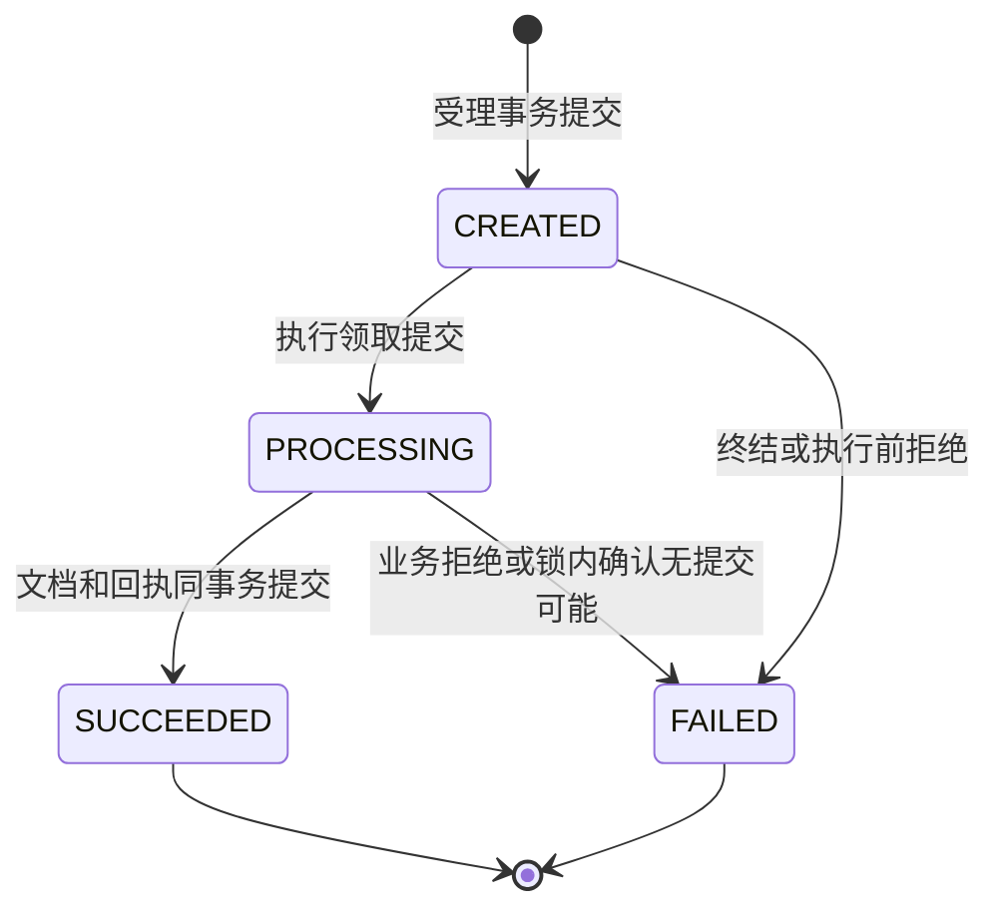
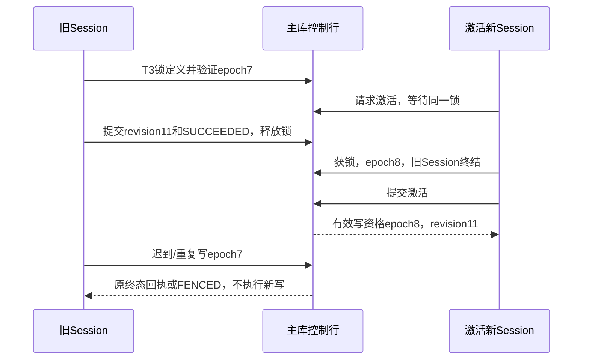
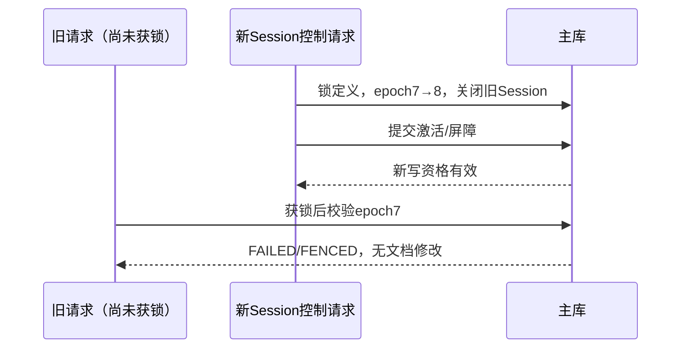

# Workflow Designer 后端正式保存协议 V2

日期：2026-11-15；状态：协议设计稿，未实现、未部署、未进行真实数据库验证。依据[正式链路审计](Workflow Designer 正式保存链路与 SessionManager 契约审计报告.md)。本轮仅新增本文。

## 1. 现状、目标及非目标

当前WorkflowController.save（WorkflowController.java 88–92）直接调用WorkflowRuntime.save（263–293），JdbcTemplate以同条SQL修改model/revision，mutate（1300–1331）以TransactionTemplate执行请求成功响应和业务写入。V48迁移的wf_definition只有JSON草稿，wf_request只有fingerprint/response，没有请求状态、编辑会话或epoch。当前读取Runtime.definitions（196–201）是LIMIT 100列表。V2不是对已实现能力的描述。

目标：持久化可查询请求状态，明确UNKNOWN恢复；用数据库事务锁和服务器世代使旧会话不再可提交；提供按ID原子草稿与终结屏障。保留业务模型权威、DI权威、统一文档服务职责、租户隔离和revision。非目标：自动合并、协同编辑、完整Adapter、引擎替换、实例执行重构。正式V2首期采用单Definition单有效写会话，显式接管而非后台读取自动踢掉其他用户。

## 2. 核心不变量与线性化点

1. 所有定义写和会话激活/终结都先锁同一主库行(tenant_id,definition_id)，锁持有到事务完成；禁止先查token再在另一事务写文档。
2. 有效Session必须同时匹配服务器active_session_id、write_epoch、owner及ACTIVE状态。epoch由服务器单调递增，不由客户端授予。
3. 保存成功的文档、revision、请求SUCCEEDED回执同事务提交；保存失败终态在未写文档的已提交事务中记录，不能仅靠抛异常回滚请求记录。
4. SUCCEEDED/FAILED不可逆；同键同信封仅查询/复用，不再次写。请求历史不是第二文档权威。
5. 新Session写入资格的生效点是激活事务提交；HTTP超时/响应到达都不是该点。
6. 终结屏障的生效点是定义锁内使旧Session不可写并终结非终态请求的事务提交。调用超时不能声称屏障成功。

## 3. 数据模型（拟议）

建议独立V2请求表，不直接改变旧wf_request既有语义；新增迁移，旧记录不伪造失败状态。

| 实体 | 核心字段与约束 |
|---|---|
| Definition控制行 | tenant_id/definition_id复合主键；write_epoch BIGINT、active_session_id、deleted标志；不因删除或重建重用epoch |
| 编辑Session | tenant/definition/session_id、epoch、owner_actor、ACTIVE/CLOSED/SUPERSEDED、activated_at/closed_at；session_id服务器生成且不可复用 |
| V2保存请求 | tenant/definition/request_id复合唯一键；actor、session_id、epoch、expected_revision、protocol/schema版本、canonical_digest、status、result_revision、error_code、created/finished时间 |
| 请求payload | 受限文档或受控存储引用，便于CREATED恢复；与摘要绑定，不允许只存可变客户端指针 |
| 激活/终结操作回执 | tenant/definition/control_request_id唯一；owner、参数摘要、session结果或屏障回执；防止控制接口重试反复递增epoch |
| Definition文档 | 统一文档及model兼容投影、revision同事务维护；交换XML受控生成；发布bpmn仍为部署快照 |

控制行独立于草稿正文，使新定义没有草稿时也能锁定。显式创建定义先预留控制行和空候选身份，再首次保存expectedRevision=-1；读取尚无已提交正文返回DOCUMENT_NOT_COMMITTED。删除保留控制墓碑，禁止旧请求通过重建同ID复活。

文档容量、错误长度、保留期限必须实施时中文说明，不能无限保留敏感正文。终态payload可按策略清除，但幂等摘要/墓碑不得在旧请求仍可重放时直接删除；若使用期限，必须同时有服务器可验证的请求有效期/永久session失效及拒绝策略，不能靠客户端时间。

## 4. 保存请求状态机

CREATED、PROCESSING、SUCCEEDED、FAILED为持久状态；UNKNOWN仅客户端观察状态，不写入服务器终态。查询不存在也不代表FAILED。

| 状态 | 含义 | 恢复 |
|---|---|---|
| CREATED | 已登记不可变请求，可能执行 | 可领取一次或被屏障终结 |
| PROCESSING | 已领取，可能等待/执行事务；不证明事务仍存活 | 重复提交返回202，不另起执行；恢复器只能锁定义后判定 |
| SUCCEEDED | 文档与回执已提交 | 同键返回原revision，不返回当前revision冒充原结果 |
| FAILED | 请求被永久拒绝且未来不能写 | 同键同信封返回原失败；需改内容必须创建新逻辑请求 |
| UNKNOWN | 客户端未获确切结果 | 原键查询或受控原键重试；不得换键猜测 |

超时不改变服务器状态。进程崩溃：受理前无记录，查询UNKNOWN；受理后CREATED可由同步重试/恢复器领取；PROCESSING执行事务中崩溃由数据库回滚并释放锁，状态停留PROCESSING；恢复器获取定义锁后复查请求，若仍非终态且当前无提交事务，标记FAILED/EXECUTION_INTERRUPTED，禁止自动重执行该请求。客户端若要重试业务需先确认终态再显式新逻辑请求。不能根据超时或心跳过期绕过活事务锁判失败。

若事务已提交但进程未响应，记录已经SUCCEEDED，查询恢复即可。恢复器与原worker都必须在定义锁内再读status；恢复器标记FAILED后，迟到worker不能继续执行。数据库无法明确提交结果时返回UNKNOWN并查询，不另写失败覆盖潜在成功。

## 5. 幂等契约

requestId客户端为一次逻辑写生成UUID，作用域tenant+definition；actor与session/epoch作为绑定字段，当前身份必须有查询/重试权限。重复requestId参数摘要不同返回IDEMPOTENCY_CONFLICT，不覆盖记录。摘要覆盖protocol/schema、definition、owner、session/epoch、expectedRevision及规范化文档；服务器规范化和计算，保留算法版本。顺序无语义集合如何规范化须契约化，不简单依赖任意Map遍历顺序。

成功/失败终态的重复请求仅返回原回执；过期epoch不阻止授权查询既有回执，但不能开启新执行。先核对可信身份和已存在请求归属，再复用结果；新请求必须校验有效Session。授权撤销可拒绝查询，不能泄露他人保存正文。

PROCESSING重复只返回202和查询地址，不等待另一事务时擅自执行。相同键不同body始终409。请求受理、执行领取与终态是多事务协议，需要状态恢复器，不宣称单事务覆盖整个HTTP生命周期。

## 6. Definition级栅栏与激活

激活由POST控制接口显式发起，必须携带controlRequestId和observedEpoch，防止延迟到达的旧激活请求盲目接管刚建立的新Session。仅同意显式接管的授权用户可请求；服务端锁控制行，比较observedEpoch，然后递增write_epoch，关闭旧Session，终结其CREATED/PROCESSING请求，创建新Session，写控制回执并提交。返回新session/epoch及同锁读取的最新revision。

重复控制键先复用控制回执，不再递增epoch；若该Session后来失效，返回历史结果并标记当前无效，不重新激活。新控制键但旧observedEpoch返回SESSION_EPOCH_CONFLICT，不自动刷新后重试接管。epoch溢出拒绝激活，不回绕。

为什么可以终结PROCESSING：所有最终保存事务在持有同一控制行锁时才可能写。激活获得锁意味着此前持锁保存已提交/回滚。尚未获得锁的旧worker在激活提交后获得锁，只能读到新epoch或终态FAILED，不能写。若锁等待超时，激活事务回滚，不授予新会话资格。

多实例只依赖同一主库事务锁，不依赖JVM锁或可过期分布式锁。数据库故障切换必须保证已确认提交不丢失、单写主库且无双主；若基础设施不满足，不得声称协议证明覆盖该部署。

## 7. 终结屏障

POST session/terminate采用controlRequestId、目标sessionId/epoch。锁定义控制行后锁目标Session及请求行（按requestId固定顺序），将当前目标Session关闭并使epoch递增/active清空；只关闭旧目标时不能关闭后来新Session。终结目标非终态请求为FAILED/SESSION_TERMINATED，保留已成功请求原回执，记录屏障回执与结算摘要并提交。

受理、领取、执行、屏障均遵守定义→Session→请求的锁顺序。屏障获得锁后，所有旧请求既不会在受理路径中新插可执行记录，也不会在最终写路径成功；网络中尚未到达的旧请求仍会被session/epoch拒绝。因此屏障不必枚举未知网络包，也不能声称网络已清空；保证的是它们无提交资格。

terminate响应202仅表示等待/已受理，不是完成；200且barrierStatus=COMPLETED必须在事务提交后生成回执。锁等待超时503/BARRIER_TIMEOUT仍未完成，客户端不激活新写会话。激活接口可将“终结旧Session+创建新Session”作为同事务原子操作，不要求两个独立HTTP调用之间无竞争。

终结与激活回执支持按控制键查询，处理响应丢失。仅GET旧请求状态不能代替屏障；多个已知请求终态也不能排除未知旧请求，除非旧Session写资格已被关闭。

## 8. API契约（拟议路径，非现有接口）

所有请求使用认证会话、CSRF及可信租户上下文；URL不接受任意tenantId授权。敏感响应no-store。sessionId与epoch不是权限凭据，每次复核成员和对象操作权限。

| 方法/路径 | 请求 | 响应与语义 |
|---|---|---|
| POST /api/workflow/v2/definitions/{id}/sessions | controlRequestId、observedEpoch、takeover确认 | 201/200：sessionId、epoch、revision、controlRequestId；提交后才有效 |
| PUT /api/workflow/v2/definitions/{id}/save-requests/{requestId} | sessionId、epoch、expectedRevision、schemaVersion、document | 200终态回执或202 CREATED/PROCESSING；Idempotency-Key若同时提供必须等于路径requestId |
| GET /api/workflow/v2/definitions/{id}/save-requests/{requestId} | 无body | 200：status、resultRevision、finishedAt、errorCode；404 REQUEST_UNKNOWN不等于终态 |
| POST /api/workflow/v2/definitions/{id}/sessions/{sid}/terminate | controlRequestId、epoch | 200屏障回执或未完成错误；不误关新Session |
| GET /api/workflow/v2/definitions/{id}/control-requests/{key} | 无body | 控制回执与当前有效性；结果丢失后查询 |
| GET /api/workflow/v2/definitions/{id}/draft | 可携当前sessionId/epoch作写资格核对 | 原子document、revision、schema、当前epoch/session状态；只读GET本身不授予写资格 |

保存示例：requestId=UUID，sessionId=服务器返回值，epoch=7，expectedRevision=10，document={schemaVersion:1,model:业务模型,diagram:DI,...}。成功回执status=SUCCEEDED、resultRevision=11、finishedAt=服务器时间；重试仍返回11，即使当前草稿已为12。PROCESSING不携伪造成功revision。

草稿读取用主库单行一致性查询返回正文/兼容投影/revision，同一服务端快照；不从不同查询拼接。不存在404 DOCUMENT_NOT_FOUND；已软删410 DOCUMENT_DELETED仅向有权获知对象者返回；无权限403或统一404按现有防枚举策略固化，不泄露存在性。实际项目策略待安全评审。尚未提交正文409 DOCUMENT_NOT_COMMITTED。鉴权失败401。读到最新只保证查询时刻，后续其他合法接管仍会令Session失效。

业务码：409 REVISION_CONFLICT、IDEMPOTENCY_CONFLICT、FENCING_TOKEN_REJECTED、SESSION_EPOCH_CONFLICT；202 REQUEST_PENDING；404 REQUEST_UNKNOWN；200状态REQUEST_SUCCEEDED/REQUEST_FAILED；403 TENANT_ACCESS_DENIED；503 BARRIER_TIMEOUT/REQUEST_STATUS_UNAVAILABLE。FAILED是持久请求状态，不等同任意5xx。现有VERSION_CONFLICT迁移需版本边界，不直接改V1码。

## 9. 事务边界与锁顺序

T0激活/终结：定义锁→Session→旧请求→控制回执，原子更换epoch及终结资格。

T1受理：定义锁→Session→请求；验证授权/有效epoch；插CREATED及受限payload，同键则返回状态。无效session的新request可记录FAILED/FENCED回执（经身份及容量校验），绝不插CREATED。幂等冲突保留原记录。

T2领取：同锁顺序；CREATED→PROCESSING后提交；仅成功领取者进入执行；重复请求不启动第二worker。

T3执行：定义锁→Session→请求，重新检查终态、epoch、owner、expectedRevision、文档一致性及授权。成功同事务写document/model投影、revision+1、审计和SUCCEEDED回执；业务拒绝只写FAILED回执，提交后再构造HTTP错误/回执，不能抛异常使失败记录一起回滚。

结构/权限预检可以在锁外减小耗时，但最终资格与提交必须锁内复核。锁内不得外部HTTP、长时间AI调用或生成不可回滚副作用。DB更新异常使T3整体回滚；后续恢复事务需重新锁定义再确认请求仍非终态，方可FAILED，不把未知commit异常直接判失败。

V1 save当前直接mutate，不能继续绕过V2锁/epoch。正式切换必须关闭V1草稿写入或令其经过同一资格协议；publish、disable、删除、后台修复等所有Definition写路径必须有同一控制锁和失效策略。兼容期间只给V1自动生成隐式Session会破坏保证，禁止这样兜底。实例执行表不纳入编辑epoch。

## 10. 关键时序

## 11. 安全性证明与故障恢复

设N为新激活事务提交，W为旧Session任何保存提交。两者必须获得同一定义排他锁并持有至事务结束：若W先持锁，N只能在W结束后获得锁，因此W在N前；若N先持锁并提交，W随后最终校验读到不同epoch/关闭Session或FAILED，不能提交文档。因此不存在W在N之后成功写文档的顺序。请求受理检查不能替代最终T3检查。复用历史SUCCEEDED回执不构成N之后新提交。

证明条件：所有写路径遵守协议、主库行锁真实生效、没有绕过SQL、没有旧版本实例继续运行、事务管理器与数据源一致、主库切换不丢已确认提交。任何条件不成立必须阻止上线，不能仅凭设计文档声称当前已安全。

会话本地INVALID并不立即等于服务器失效：服务端失效以屏障/激活提交为准。前端销毁之后屏障尚未提交，旧请求可能先提交；新会话必须等待并加载最终最新草稿。数据库长事务/实例失联会导致等待，不用超时强行越过锁；可运维终止连接，确认回滚后再继续。超时可牺牲可用性但不得伪授新资格。

## 12. 竞争场景验证矩阵

| 场景/原时序风险 | V2处理 | 最终保证 |
|---|---|---|
| 1 A保存与B激活并发 | 同控制锁排序 | A先提交B读新值；B先激活A拒绝 |
| 2 A事务中B读草稿 | GET可读旧已提交，但不授资格；B激活等待A | 可写B必须在屏障后读取快照 |
| 3 A超时实际提交 | 请求SUCCEEDED与正文同事务 | 原键查询回执，不重复递增 |
| 4 A失败响应丢失 | 业务FAILED持久；技术崩溃恢复锁内结算 | UNKNOWN不猜测，终态后才新请求 |
| 5 同键同body重复 | 唯一键+终态复用/处理中202 | 最多一次文档提交 |
| 6 同键改body | 服务器摘要冲突409 | 原请求不可变 |
| 7 执行实例崩溃 | DB事务回滚释放锁，恢复器同锁检查 | 无半文档/半成功回执；PROCESSING不永久冒充活跃 |
| 8 多服务实例 | 同主库复合控制行锁 | 不依赖JVM本地锁 |
| 9 屏障期间收到旧保存 | T1/T3均竞争定义锁，屏障后校验拒绝 | 不漏掉排队或未到达请求 |
| 10 新Session后旧重试 | 同键终态查询，非终态已FAILED；新键旧epoch拒绝 | 新资格后无旧提交 |
| 11 激活成功响应丢失/旧激活迟到 | 控制键复用、observedEpoch条件接管 | 不重复升epoch，不盲目踢掉更新会话 |
| 12 屏障锁等待超时 | 整体回滚、回执查询/人工重试 | 不开放新Session写入 |

必须增加真实MySQL进程崩溃、commit回包丢失、双实例锁等待、恢复器竞争、读副本延迟、V1旁路、删除重建和权限撤销测试。Mock不能替代这些证据。

## 13. 数据库变更与现有架构限制

仅提出建议：新增控制/Session/V2请求/控制回执表及统一文档字段，保留旧wf_request/发布历史语义，逐步迁移，不修改历史迁移。复合主键和所有查询带tenant。索引支持Session非终态请求扫描，避免全表锁；定义锁下请求批量终结规模需要上限。

当前TransactionTemplate可承载短事务，但需要新增显式状态服务与恢复器、独立V2事务边界。不能直接把CREATED/PROCESSING塞入现有mutate再靠异常自动回滚完成协议。实际InnoDB、隔离级别、同源JdbcTemplate与事务管理器、锁顺序、主从路由必须核验；无可靠主库锁不满足保证。

发布可能包含Flowable部署，不得为省事把长时间引擎交互塞入控制锁而不评估死锁和事务。V2正式保存可先独立交付，但定义级所有写入必须纳管或关闭，才允许开放新Session。

## 14. 前端SessionManager要求

逻辑保存固定requestId与不可变payload；超时/取消/连接断开进入UNKNOWN并冻结写，不生成新键重试。查询终态或受控原键重试，不把UNKNOWN换成FAILED。旧会话回调sessionId/generation检查继续保留，但不承担服务器隔离。

INVALID后同步封锁本地操作，销毁资源；控制器持有请求登记。调用终结或原子激活，若超时则查询controlRequestId，不盲目发新激活。COMPLETED后按ID读取当前文档并核对Session有效性，再创建新Modeler；后续被其他接管则下次写FENCED并再次隔离。新Session不加载诊断XML、故障画布或缓存猜测文档。

服务端会话token只有API资格，不能视为权限；租户/账号切换时旧响应不可写入新会话，查询仍需原授权上下文。真实前端改造前置条件是正式屏障、状态查询、epoch写检查、按ID读取及V1旁路封闭通过集成测试。

## 15. 分阶段实施与开放风险

阶段1：评审独占写Session/显式接管策略、字段和错误码、控制请求幂等、数据源锁保证。阶段2：新增控制行与V2请求状态服务/恢复器，真实DB故障测试。阶段3：将保存及全部定义写纳入锁/epoch，关闭旁路；按ID原子读取。阶段4：HTTP丢包、多实例、UNKNOWN、权限/租户和删除重建验证。阶段5：仅获批后对接前端SessionManager，再讨论正式设计器。

OPEN：独占会话接管权限与产品交互、会话长期空闲的过期策略、终态墓碑保留、恢复器容量/锁超时、发布部署事务、角色撤销与提交授权的同步策略、主库HA保证。会话过期必须数据库锁内生效，不能前端时钟判过期后立即授新资格。

## 16. 评审结论

本设计在第11节列明的数据库与全写路径约束下，给出新Session写资格生效后旧Session无成功提交可能的顺序证明；不是现有正式系统已满足该保证。设计稿完成，不构成实现/上线验收。若不能关闭V1或其他旁路、不能保证主库事务锁，必须判定协议实现BLOCKED，禁止宣布正式安全。
