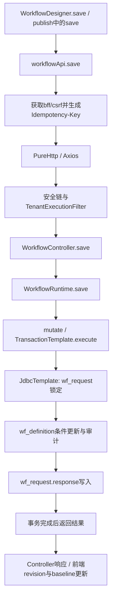

# Workflow Designer 正式保存链路与 SessionManager 契约审计报告

日期：2026-11-15；性质：只读源码审计。最终评审结论：**需要先补充后端契约**。不批准完整设计器接入，不认定方案A整体通过。

## 1. 审计摘要与证据范围

正式系统具有数据库条件更新的revision乐观锁、事务内成功响应幂等记录、可信租户与操作权限检查。正式系统不具备本次检索范围内的公开请求状态查询、请求终结屏障和definition级服务端写入栅栏。旧编辑会话销毁不能阻止已经进入服务端的保存随后提交。

已完整阅读：Workflow Designer Session Lifecycle架构设计方案与评审摘要、实际命名为DevHub Workflow Designer技术改造设计方案的文档、Demo SESSION-MANAGER-REPORT及前三道门槛报告。实际正式链路是Vue JSON设计器，不是已接入bpmn-js的正式实现。

本轮没有运行测试、构建、服务或数据库查询，仅搜索/读取源码。所有“已具备”指已定位生产实现，不等于当前部署和真实数据库验证通过。数据库实际隔离级别、事务管理器运行实例及部署产物一致性标为未证实。

路径简称：FE=frontend；WF=backend/services/workflow-service/adapters/flowable/src/main/java/com/appnexus/workflow/adapter/flowable；SEC=backend/services/platform-service/adapters/security/src/main/java/com/appnexus/platform/security。下述行范围为当前工作区一基行号。

## 2. 正式保存调用链

没有独立Application Service或Repository/Mapper层：Controller直接调用Runtime；Runtime直接持有JdbcTemplate。WorkflowEngineConfiguration装配JdbcTemplate(DataSource)及注入PlatformTransactionManager，不得虚构Repository。

### 关键证据索引

| 文件、方法、范围 | 能证明 | 不能证明 |
|---|---|---|
| FE/modules/workflow/src/WorkflowDesigner.vue run/save/publish，154–193 | busy单组件并发门禁；保存与发布前保存都调用注入API；响应更新revision/baseline | 不具备sessionId/generation；未持久化逻辑请求身份 |
| 同文件 confirmLeave/beforeUnload，346–375 | busy阻止路由离开；dirty提示；卸载移除beforeunload | 不能阻止浏览器关闭、网络超时或强制卸载后保存完成 |
| FE/apps/admin/src/api/workflow.ts write/save，5–25、save映射 | CSRF读取；每次write生成UUID；PUT /api/workflow/definitions/{id} | 多次API调用不保持同一requestId；无状态查询 |
| FE/apps/admin/src/utils/http/index.ts，5、43–74 | timeout=10000毫秒、withCredentials；租户版本头；旧租户响应/错误拒绝；无自动写重试 | Axios超时不撤销服务端事务；无definition会话隔离 |
| FE/apps/admin/src/utils/tenantContext.ts，10–14 | 切租户等待本页在途写计数；请求finally减少计数 | 超时后计数归零不能证明服务器请求结束 |
| SEC/TenantExecutionFilter.java，50–85 | 身份/租户/成员来自可信会话或验证Bearer属性；版本头仅陈旧保护；注入WorkflowContext | 不是definition编辑会话栅栏，不能撤销已通过过滤器的事务 |
| SEC/WebSecurityConfiguration.java，97–108、109–150；SEC/SessionController.java csrf入口 | Bearer链与浏览器会话链分开；浏览器获取CSRF，应用链保留框架CSRF | 未执行真实认证/CSRF回归；Bearer免CSRF不等于无认证 |
| WF/WorkflowController.java Draft/save，21–22、88–92；context/reply，200–235 | body只有revision/model；id来自路径；请求头UUID验证；可信上下文；异常映射；no-store | 无document/session/token参数或请求结算入口 |
| WF/WorkflowRuntime.java，56–64；WF/WorkflowEngineConfiguration.java，43–52 | 注入事务管理器，new TransactionTemplate；JdbcTemplate绑定注入DataSource | 运行时事务管理器与数据源实际匹配需集成核验 |
| WF/WorkflowRuntime.java save，263–293 | edit授权、id格式、草稿大小、事务内model/revision条件更新 | 不接受或校验统一文档/XML镜像，不检查编辑session |
| 同文件 require/identifier，1291–1299、1390–1392 | 活跃成员/权限；definitionId为1–64位字母数字下划线连字符 | 格式校验不替代数据库tenant归属；save完整业务校验留到发布 |
| 同文件 mutate，1300–1331 | UUID、fingerprint、请求主键锁、成功response与work同事务 | 无持久失败终态或终结屏障 |

前端run捕获异常后显示错误、finally解除busy，没有UNKNOWN分类。不能断言代码明确写了FAILED状态，但它未保留“保存结果不确定”的写锁，超时后可重新保存。旧响应可回写原组件revision与当前model对应baseline；没有文档会话代际校验。租户层防护已存在，不能将其说成完全无旧响应保护。

## 3. 数据库事务与revision

生产保存顺序：require/edit与输入检查 → mutate调用tx.execute → INSERT wf_request ON DUPLICATE KEY → SELECT请求行FOR UPDATE → 校验fingerprint/复用response → INSERT或UPDATE wf_definition → revisionAudit → UPDATE wf_request.response → callback返回 → TransactionTemplate完成事务 → Runtime返回 → Controller构造HTTP响应。

已定位应用提交边界为TransactionTemplate.execute（1303起，1331结束），不是手工Connection.commit。框架执行真实commit的位置不在仓库业务源码内；无外层事务时通常在execute返回前提交，传播/外层事务及真实管理器需核验。本轮不能宣称已做运行时提交故障测试。

| 表/迁移 | 当前结构和用途 |
|---|---|
| V48__workflow_application.sql 3–12 wf_definition | 主键tenant_id/id，revision默认0，model LONGTEXT，enabled/published；草稿无bpmn、统一document字段 |
| 同迁移14–19 wf_version | tenant/definition/version主键；冻结model、bpmn、engine_definition、发布人时间 |
| 同迁移21–28 wf_instance | 引用definition_version及实例snapshot，不读取当前草稿替换执行模型 |
| 同迁移47–51 wf_request | 主键tenant_id/actor/request_id；fingerprint、nullable response、created_at；没有status/failure/final_revision/fence字段 |
| V69__workflow_data_contract_snapshots.sql 1–3 | wf_version及wf_instance增加data_contract_schema；不是统一设计文档 |

保存的model和revision在同一条SQL中更新，没有“先改model再递增revision”的SQL窗口。不存在草稿bpmn/document部分提交问题，因为这些字段尚未实现；不能据此说三表示已原子管理。发布在Runtime.publish 297–349中锁wf_definition、校验、编译部署、插wf_version、更新published/revision；引擎部署与业务表跨资源原子性仍未证实。

SQL条件tenant_id/id/revision及受影响行数1保证同版本写唯一胜者；真实事务/连接正确装配是前提。没有查到事务隔离级别显式配置，实际MySQL隔离与存储引擎未证实，不擅自按默认值作运行结论。

全backend生产Java/迁移检索wf_definition写入，集中于WorkflowRuntime.save/publish/disable；测试有直接SQL但不是生产入口。未找到独立WorkflowDocumentService，当前Controller并未经过拟议统一服务。检索未发现其他生产模块直接写草稿；不等于外部脚本或数据库账号绝无旁路。

## 4. 幂等与重试

幂等作用域为tenant+actor+requestId；相同键跨不同操作者不共享。fingerprint覆盖SAVE、definitionId、revision和WorkflowJson序列化model，服务端计算摘要。

| 场景 | 源码结论 |
|---|---|
| 同键同内容重复 | 已提交response存在则直接返回，不执行work |
| 同键不同内容 | IDEMPOTENCY_CONFLICT 409 |
| 成功响应丢失，同键重试 | 在权限仍允许、同actor/tenant及相同信封条件下返回原结果；正式前端缺少保持原键入口 |
| 原请求处理中重复 | 请求唯一键与FOR UPDATE使竞争事务等待；无公开PENDING响应，锁超时/死锁错误需真实DB验证 |
| work失败 | 异常退出事务，幂等行和文档更新一起回滚；没有单独持久FAILED记录 |
| 成功model但response未提交 | 按同数据源/事务装配设计不会独立提交；事务管理器错配、故障恢复未实测 |

同一个失败请求以后可再次执行，因为失败记录通常随事务回滚消失；因此“查询不到记录”不能证明请求从未到达，也不能证明未来不会执行。仅持久成功响应不是全生命周期终态协议。权限校验在mutate前，撤权后重复请求不保证返回旧成功响应，应重新授权。

## 5. 请求终态确认：GAP

检索范围：WorkflowController全部路由、WorkflowRuntime、workflow-contracts、全backend的wf_request引用、前端WorkflowApi/适配。没有requestId状态查询API、请求终结接口或屏障。

wf_request.response证明已提交成功结果可幂等复用；记录插入和work同事务意味着其他请求一般不能用它稳定观察PENDING；FAILED不持久。未知请求没有终结墓碑，迟到请求仍可能开始。无证据证明“不存在未来可执行同一请求”。因此请求状态查询、可靠失败终态、请求终结屏障均GAP。

草稿save为同步JDBC调用，没有在该路径发现队列/异步草稿提交。WorkflowWorker.run（16–22）调用maintain/dispatch处理执行实例job，不是保存请求队列；不能把它当保存终结机制。即使无队列，HTTP排队/锁等待/网络迟到仍足以构成在途写。

## 6. 服务端写入栅栏：GAP

正式Draft参数只有revision/model；wf_definition/wf_request无编辑sessionId/generation/fencingToken，save SQL无token条件。未找到服务端编辑租约或epoch授予/终结路径。

X-Tenant-Context-Version是租户上下文陈旧请求门禁，不是按definition的编辑栅栏；已经通过过滤器的旧请求不会因Modeler销毁而自动终止。revision只拒绝版本已经变化的请求，不因编辑会话失效而拒绝。

## 7. 重载与一致性

WorkflowController.definitions 73–75 → Runtime.definitions 196–201：带租户过滤，单条SELECT同时返回id/revision/model/enabled/published，LIMIT 100。Controller no-store。WorkflowCenter.vue 161–163装入列表，197从列表查editing；WorkflowDesigner初始化从传入definition.model解析。没有按definitionId的最新草稿详情API，编辑列表可能在打开前已过时且超100条目标缺失。

返回行中的revision/model来自同一SQL结果，不是两个独立查询拼接；在正常非脏读事务配置下代表读取时可见提交状态，但实际隔离级别未证实。no-store减少HTTP缓存，读取链没有发现应用缓存；浏览器已加载列表本身是旧快照。一次读取不保证之后旧保存不会提交。

版本列表Runtime.versions 373–379仅返回冻结model和版本元信息，不返回bpmn；Runtime.definition 811–820按实例tenant/definition/version从wf_version读取模型。草稿编辑与重载不修改历史wf_version或旧实例；发布生成新版本，旧实例仍引用原版本。不能混淆当前草稿revision与发布version。

成功丢响应后可再次读取当时最新草稿，但不能凭内容或revision唯一归因于原requestId，更不能排除仍在途的后续提交。

## 8. Mock与正式能力差异矩阵

正式现状仅使用指定四种分类；缺口另列。

| 能力 | Mock已验证 | 正式现状 | 证据 | 差距 |
|---|---|---|---|---|
| requestId | 稳定逻辑信封 | 部分具备 | api/workflow.ts write；Controller context | 前端每次调用新键，缺少跨重试登记 |
| 幂等键唯一性 | 重复不提交 | 已具备 | V48 47–51；mutate 1300–1331 | tenant/actor作用域，真实锁竞争待验 |
| 请求状态查询 | 可控PENDING/终态 | 不具备 | Controller路由、wf_request schema | 无公开状态契约 |
| 请求终态确认 | 终态不可逆 | 部分具备 | mutate成功response | 仅成功复用；无失败/未知终结 |
| 请求终结屏障 | PENDING阻塞重载 | 不具备 | 无终结API/墓碑 | 不能排除迟到请求 |
| revision乐观锁 | 唯一胜者 | 已具备 | save 283–292 | 不等于会话栅栏 |
| 服务端fencingToken | server.grant/commit | 不具备 | Draft、schema、save SQL | 无epoch或租约 |
| 旧请求拒绝 | token过期拒绝 | 部分具备 | save条件；TenantExecutionFilter 73–76 | 仅版本/租户陈旧，非旧编辑会话 |
| 原子文档提交 | revision+正文 | 部分具备 | save/mutate | JSON原子；统一文档未实现 |
| 最新文档重载 | 终结后原子read | 部分具备 | definitions SELECT及前端列表 | 无按ID强读取、屏障 |
| tenantId隔离 | Mock可信tenant | 已具备 | Filter、Controller context、SQL | 部署/多租户反向测试本轮未运行 |
| 事务一致性 | 单步内存提交 | 部分具备 | TransactionTemplate/JdbcTemplate | 运行管理器/数据源/隔离及引擎事务未证实 |

## 9. 风险场景推演

1. **成功丢响应**：事务可已提交，前端10秒超时只显示错误、解除busy。再次API调用生成新键，旧revision会409；同原键同内容才可复用成功结果。没有安全结算查询。
2. **失败丢响应**：事务回滚且失败记录未持久；客户端不能区分服务器未收到、失败、仍等待。不得猜测FAILED终态。
3. **迟到提交**：revision10，A已到服务器但延迟，B读取10并编辑，A UPDATE匹配10成功为11。现有系统允许该时序；没有definition fencingToken阻止A。
4. A不会直接覆盖B浏览器内存，但B的编辑基线已过时，服务器当前正文变成A内容。B随后基于10保存会409；这是冲突检测，不是迟到写预防。
5. A/B同revision在途：先获得可成功条件更新的一方提交11，另一方条件不匹配或遇到数据库竞争异常；不会两个都按10正常成功。失败HTTP具体表现依数据库等待/异常处理，未实测。
6. **重复键**：同内容同权限下复用；改内容拒绝。失败原请求重试可重新执行，缺少不可逆失败终态。
7. **重载时仍在途**：GET返回10不能阻止A稍后11；必须屏障或写栅栏，不可仅以最新SELECT作安全激活条件。
8. **切租户/撤权**：前端计数/版本门禁、服务端可信租户/成员/权限和响应过滤已存在；客户端超时后本地计数不代表旧事务结束。已通过授权的在途事务与撤权原子性未证实。

## 10. 最小正式契约建议（仅设计）

保留现有revision和幂等核心，后续统一文档服务收拢save/publish/disable相关定义写入。无需先重构Runtime实例执行，也不要求新增通用队列。

- **保存信封**：稳定requestId、definitionId、expectedRevision、不可变文档、服务端授予的可选writeEpoch；sessionId仅关联诊断。tenant/actor来自可信上下文。前端逻辑保存创建一次键，不自动新键重试未知结果。
- **查询**：受授权requestId查询，绑定原tenant/actor/definition；返回存在性、PENDING/SUCCEEDED/FAILED、最终revision/提交时间/失败码。不存在应REQUEST_UNKNOWN，不能视为未执行终态。
- **终结与栅栏**：优先评审定义行锁内递增服务端writeEpoch的最小设计；授予/失效与所有定义写同一锁顺序，save在最终写入事务内校验epoch。递增要等待已持锁提交者完成，并让排队/迟到旧epoch写失败。返回屏障结果必须在事务提交后。仅在过滤器入口检查token不够。
- **失败终态**：若引入独立请求登记，需明确受理、业务事务、终态记录之间的崩溃恢复协议；不能简单把PENDING独立提交后无对账。失败墓碑如何与迟到请求、token拒绝一致必须设计。
- **重载**：屏障结算后按definitionId读取同一快照的当前文档/revision/epoch；缺失404；服务端no-store与权限复核。不读取客户端诊断XML。
- **幂等与授权**：返回旧成功结果仍需安全授权；epoch过期同键已成功请求的查询/幂等回执与新写拒绝顺序应明确。epoch不是权限凭证，不能由客户端任意提高。

具体接口路径/DTO未定，本轮不修改API。定义级epoch会影响多标签编辑会话，是否采用独占租约、按请求终结或共享编辑epoch需评审，不预设排他编辑策略。

错误契约建议：HTTP409+REVISION_CONFLICT、FENCING_TOKEN_REJECTED；HTTP403+TENANT_ACCESS_DENIED；HTTP404+DOCUMENT_NOT_FOUND；请求查询HTTP200返回业务状态REQUEST_PENDING/REQUEST_SUCCEEDED/REQUEST_FAILED；REQUEST_UNKNOWN表示未知而非终态，可HTTP404或200状态但必须统一。查询基础设施故障为5xx，不能伪装REQUEST_FAILED。现有VERSION_CONFLICT等码不得未经契约迁移直接改名。

## 11. 缺口优先级

| 优先级 | 缺口 | 关闭证据 |
|---|---|---|
| P0 | 无定义级在途终结/迟到写保护 | 真数据库A迟到/B重载/同锁及崩溃测试 |
| P0 | 无请求结果查询和不可逆失败/未知终态 | 成功/失败丢响应及迟到请求测试 |
| P0 | 统一文档服务及JSON/DI/XML原子契约未实现 | 服务层唯一入口、表示一致性及事务测试 |
| P1 | 稳定前端逻辑requestId、UNKNOWN封锁、旧会话响应隔离 | 真实HTTP竞态，不用Mock结果替代 |
| P1 | 按ID读取原子草稿、列表100限制 | 无缓存/并发重载与404授权反向测试 |
| P1 | 实际事务管理器/数据源/隔离、锁超时、部署事务 | 配置审查及MySQL故障注入 |
| P1 | 多标签、撤权/切租户、epoch授予策略及幂等保留 | 契约与安全反向测试 |
| P2 | 查询等待策略、诊断、容量与清理优化 | 指标和生命周期策略，不删除仍可重放请求证据 |

## 12. 最终评审结论

**需要先补充后端契约。** 正式系统已有乐观锁和成功请求幂等，但不足以证明安全拒绝旧会话迟到保存。可以据本报告讨论最小接口，但不得直接接入完整设计器或宣称正式系统拥有Mock屏障/栅栏。

BLOCKED/未证实：运行数据库隔离、事务管理器真实连接、死锁/超时具体异常、真实引擎部署原子性、运行部署与源码一致。它们不影响确认源码中缺少公开屏障和编辑栅栏的结论。

## 13. 工作区保护

仅新增本报告。执行前git status及全部已跟踪/未忽略未跟踪文件哈希保存在/tmp/session-audit-baseline.json；覆盖此前六文件：frontend/infra/ui/README.md、src/ManagementTable.vue、src/templates.css（后两者位于infra/ui），frontend/modules/organization/src/Management.vue、frontend/modules/print/src/PrintFlowWorkspace.vue、PrintManagement.vue。未改Demo、测试、迁移、API、依赖或锁文件。完成后按基线复核并在交付回复记录结果；不对其他任务并发修改执行恢复。
