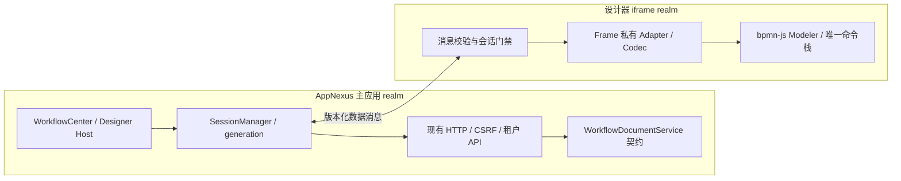
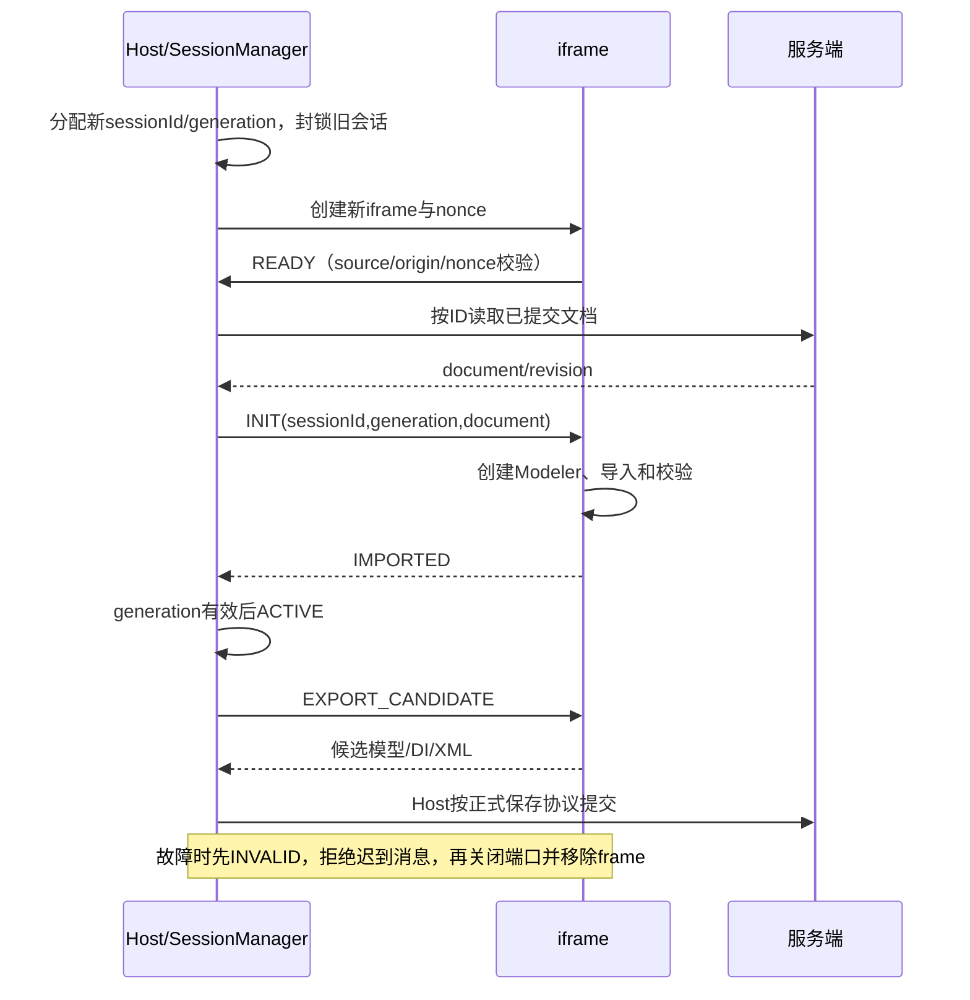

# Workflow Designer 设计器内核隔离架构重新评估

日期：2026-11-15；性质：静态架构评估。结论：**A——架构方向明确，可进入独立最小验证 Demo 设计**。A 只允许隔离验证，不批准正式代码修改、合并或部署。

## 1. 现状与证据

### 正式应用

当前正式 `frontend/modules/workflow/src/WorkflowDesigner.vue` 使用 `WorkflowModel` JSON 和自研 `WorkflowCanvas.vue`；保存、预演、校验、发布通过注入的 `WorkflowApi` 完成。该模块没有创建 bpmn-js Modeler。`WorkflowCenter.vue` 持有设计器组件并注入定义和 API；Admin 的 HTTP 封装承载 CSRF、会话及租户上下文。

后端 `WorkflowModel.java` 承载业务语义，`WorkflowCompiler.java` 按受控节点类型生成 BPMN，`WorkflowRuntime.java` 管理草稿 revision、发布快照和 Flowable 运行。ACTION / WAIT 的现有执行语义是 ReceiveTask。本次隔离评估不改变这些职责。

### 独立实验

bpmn-js 仅在 `frontend/experiments/workflow-bpmn-demo`。`src/approva-port.ts` 将原始 Modeler 和通用 `get(name)` 返回调用方，因此 Modeling、Moddle、CommandStack、EventBus 等底层能力可被取得。第三阶段测试已实际观察到：保留的 Modeler 引用在 `destroy()` 后仍能通过公开 Modeling API 修改旧对象并导出 XML。销毁清理画布资源，但不会撤销已有 JavaScript 引用。

当前实验版本 bpmn-js 18.31.1、diagram-js 15.29.0 的源码直接依赖 `document`、DOM 元素、SVG 和浏览器事件。此为源码依据；不代表已经验证全部插件或部署组合。

### 尚未验证

正式设计器迁移、iframe CSP/sandbox/部署路径、键盘和辅助技术、主题/响应式、超大流程消息性能、未完成 `importXML` 与 iframe 销毁竞争、正式保存协议及服务端屏障均未验证。既有 DI 失败断言也仍然存在，不能用隔离容器掩盖。

## 2. 三种架构比较

| 维度 | A：进程内封装 | B：Web Worker | C：独立 iframe |
|---|---|---|---|
| 对象能力隔离 | 仅约束经 facade 的合作代码；泄漏引用可绕过 | Worker realm 不共享普通对象，但完整 Modeler 依赖 DOM | 父应用只交换数据，不持有 Modeler 引用；最强结构边界 |
| 故障终止 | destroy 移除画布，不使裸引用失效 | terminate 停止 Worker 执行 | 移除 iframe 可终止子 realm；服务端请求仍独立 |
| 旧引用与异步 | 需要每处门禁，漏一处可绕过 | Worker 内任务可终止，外部副作用不撤销 | 新旧 realm 分离，迟到消息需 session/generation 校验 |
| 多实例 | 需自行维护对象图隔离 | 可按 Worker 隔离计算 | 每个 iframe 对应独立会话 |
| 数据通信 | 直接调用成本低 | 需结构化传输 | 通过 JSON/XML/MessagePort，需评估大文档成本 |
| 性能 | 最低开销 | 纯计算适合 | 多一层 realm、DOM 与序列化开销，待测 |
| 扩展维护 | 插件容易取得内核能力 | DOM 插件需重写 | 插件限制在内核；Host 只能使用消息协议 |
| 部署限制 | 最少 | worker-src、模块路径 | frame-src、sandbox、origin、认证与资源路径需验证 |
| 适用结论 | 不足以满足强隔离目标 | 不适合承载完整 Modeler | 最值得做隔离验证 |

Worker 不能直接承载完整 bpmn-js Modeler：Canvas 创建 DOM/SVG 并依赖浏览器事件。若迁入 Worker，需要替换渲染层并设计新的画布通信，不属于小范围复用。Worker 可单独用于纯 JSON 校验或摘要计算，但不能隔离主线程 Modeler。

进程内 facade 可作为 iframe 内部的代码组织规则，不能被视为防止同 realm 裸引用泄漏的安全边界。

## 3. 推荐架构与所有权

建议以 **iframe 作为下一阶段隔离验证候选**。主 Vue 应用持有 iframe 宿主、SessionManager、MessagePort 和保存请求；子 frame 独占 bpmn-js、Moddle、Modeling、CommandStack、EventBus 与画布。Host 不取得子窗口内部对象，不向子 frame 传递服务端凭据。



| 模块 | 所有权与职责 |
|---|---|
| Host | 路由、权限展示、Session 生命周期、保存/发布请求、revision、迟到响应过滤；不持有 Modeler |
| Frame Bootstrap | 一次握手、验证 source/origin/nonce、创建 Modeler 及消息桥 |
| Frame Bridge | 消息 schema、sequence、session/generation 门禁、稳定错误码 |
| Frame Adapter | 唯一内核访问点、命令、DevHub 属性与 DI/XML 转换 |
| 后端服务 | WorkflowModel、租户/权限、revision、正式保存、发布和 Flowable 执行权威 |

业务模型权威仍是 DevHub `WorkflowModel`；BPMN DI 是布局权威；XML 是受控交换和编译载体。Flowable 继续执行，不接管业务语义。ACTION / WAIT 保持 ReceiveTask。iframe 不改变正式保存协议，不绕过后端 revision 和权限校验。

## 4. 消息协议草案

消息仅传可验证的 JSON/字符串/字节数据，不传对象引用、函数、DOM、事件对象或可执行代码。

```json
{
  "protocol": "devhub.workflow.designer",
  "version": 1,
  "sessionId": "UUID",
  "generation": 12,
  "requestId": "UUID",
  "sequence": 7,
  "type": "EXPORT_CANDIDATE",
  "payload": {}
}
```

响应携带相同身份字段及 `RESULT` / `ERROR`。接收端验证协议版本、sessionId、generation、sequence、操作 schema 和 payload 大小；重复 requestId 同内容返回同回执，同 ID 异内容拒绝。message requestId 只提供桥接层幂等，不替代后端保存幂等。

| 消息 | 方向 | 语义 |
|---|---|---|
| INIT | Host → Frame | 传入服务端已提交文档、schema 与会话身份；仅 LOADING 可接受 |
| READY / IMPORTED | Frame → Host | 返回初始化、Codec 版本和验证结果 |
| APPLY_INTENT | Host → Frame | 类型化编辑意图，不接受任意 API 方法名 |
| UNDO / REDO | Host → Frame | 操作唯一 CommandStack |
| VALIDATE / EXPORT_CANDIDATE | Host → Frame | 返回校验或候选文档，不保存、不发布 |
| DOCUMENT_CHANGED | Frame → Host | dirty、editSequence、摘要；不自动写后端 |
| INVALIDATE / DISPOSE | Host → Frame | 关闭能力并清理；Host 随后移除 iframe |
| FAULT / ERROR | Frame → Host | 稳定错误码、阶段和脱敏诊断 |

错误码包括 `SESSION_NOT_ACTIVE`、`STALE_GENERATION`、`SEQUENCE_INVALID`、`SCHEMA_UNSUPPORTED`、`DOCUMENT_INVALID`、`COMMAND_FAILED`、`FRAME_DISPOSED`、`PAYLOAD_LIMIT`、`IDEMPOTENCY_CONFLICT`。未知字段或版本默认拒绝，不静默忽略。

初始化时先校验精确 `event.source`、origin、一次性 nonce 和目标 iframe，再建立专属 `MessageChannel`。不得以 `targetOrigin="*"` 作为生产默认。协议 major 不兼容则拒绝并销毁；minor 仅允许扩展可忽略字段，但仍须通过字段白名单。Frame 静态加载受信 Moddle descriptor，不能根据用户 XML 动态注册可执行扩展。

## 5. 初始化、编辑、导出和故障时序



旧 frame 异步导入/导出完成时再检查 generation，不能激活新会话。故障时 Host 同步封锁本地操作，标记 generation 过期；发送 DISPOSE 只是尽力清理，随后关闭端口和移除 frame。重载必须从服务端已提交文档创建新 frame，不使用故障画布或诊断 XML。销毁 iframe 不撤销已经发送的服务端写请求，UNKNOWN 仍由后端请求状态/栅栏处理。

保存和发布仍由 Host 调用现有认证/API；Frame 不接触 CSRF、Cookie、tenant 权威或服务凭据。Host 仅接受当前 session/generation 的响应更新 revision/dirty 状态。

## 6. CSP、sandbox 与基础设施风险

同源静态 iframe 便于部署资源，但不是对同源主页面脚本的安全沙箱；主应用 XSS 可能访问同源 frame DOM。`sandbox="allow-scripts allow-same-origin"`不应未经威胁评估直接宣称强隔离。去掉 `allow-same-origin` 会产生 opaque origin，并影响模块资源、Cookie、CORS 和 origin 校验。独立 origin 可以强化浏览器边界，但须设计静态资源托管、消息精确目标、认证与跨源策略。

必须检查 `frame-src`、`frame-ancestors`、sandbox 属性、应用子路径、字体/图标资源、主题语言上下文、焦点/键盘/读屏和 CSP。当前部署 CSP 与认证链尚未全面审计，均为待验证。AppNexus 有普通 iframe frame 与打印 sandbox bridge，但它们是其他用途，不构成可直接复用的工作流安全协议。

## 7. 保存协议和 Flowable 边界

iframe 解决的是客户端对象引用隔离，不解决后端迟到请求、幂等、revision、权限或 Flowable 部署事务。现有 V2.5 保存协议仍待独立复审；服务端写入栅栏和请求终结屏障未实现。Flowable A 同资源事务路径尚无真实故障证明，B/C未批准。不能因iframe销毁而将UNKNOWN标为失败或换新requestId。

## 8. ApprovaPlat 移植成果

可保留：atomicProperties 多子命令归组实验、十类标准元素映射草案、Moddle descriptor样例、DI非整数原始证据和异常注入位置。

需重验：组合命令故障后将 Frame 置失败、旧消息与迟到 Promise、双 iframe 隔离、Flowable 属性 XML 往返、完整业务 Codec、DI 移动/撤销及主题焦点。

不直接移植：RuoYi API/Store/权限/下载组件、整套 PropertiesPanel、通用插件接口、JSON镜像Codec。`atomicPropertiesModule`只组织CommandStack历史，不保证原子回滚。

## 9. 阶段建议与准入标准

架构方向明确，下一步允许创建**独立最小 iframe 验证 Demo**，只验证运行时隔离与消息协议，不接正式路由/API。至少通过：

1. Host公开接口不返回 Modeler/Modeling/Moddle/CommandStack。
2. 两 iframe的XML、模型、历史与事件相互隔离。
3. 移除旧 frame 后旧端口、迟到消息和Promise不能影响新会话。
4. 错误origin/source/nonce、重放sequence、异版本、未知字段和超限消息拒绝。
5. 故障后禁止导出候选；可信重载只从服务端来源。
6. 实测CSP/sandbox/同源与部署子路径。
7. 桌面、窄屏、移动端主题/焦点/键盘验收。
8. 原有DI失败断言保留并如实报告。
9. 保存UNKNOWN和Flowable A实验继续作为独立服务端门禁。

该结论**不批准正式集成**，也不意味着bpmn-js最终选型已完成。当前建议保留bpmn-js作为DOM建模内核候选，不建议为隔离问题迁移X6或把完整Modeler搬入Worker。

## 10. 本轮保护记录

开始Git状态274项；基线记录于`/tmp/kernel-arch-baseline.json`，覆盖仓库已跟踪及未忽略未跟踪文件，不包含ignored内容与外部仓库。只新增本评估文档；未创建Demo、安装依赖、运行测试/构建/服务或数据库操作。结束哈希核对1134个既有文件无变化。完成后停止。

## 11. 强制边界裁决补充

最终推荐独立 origin 的 sandbox iframe；同源 iframe 仅作为生命周期对照，不能证明强制对象能力隔离。父页持有的 WindowProxy 不得允许访问子 realm 对象，必须验证跨源访问被浏览器拒绝。iframe 不是独立 OS 进程保证，移除也不是任意代码抢占 API；无限循环、旧 WindowProxy、迟到消息及未完成导入均需真实验证。Host 先撤销消息能力再移除 frame，不以等待 DISPOSE 回执作为安全前提。Frame 使用无主应用凭据的独立静态 origin，并评审 CSP connect-src、frame-ancestors、sandbox、导航和 Worker/ServiceWorker 能力；不允许直接访问业务保存 API。opaque origin 场景不能仅凭 origin=null 认证，必须绑定精确 source、nonce 和专属端口。内核插件仍互信，本方案不隔离插件与内核。
