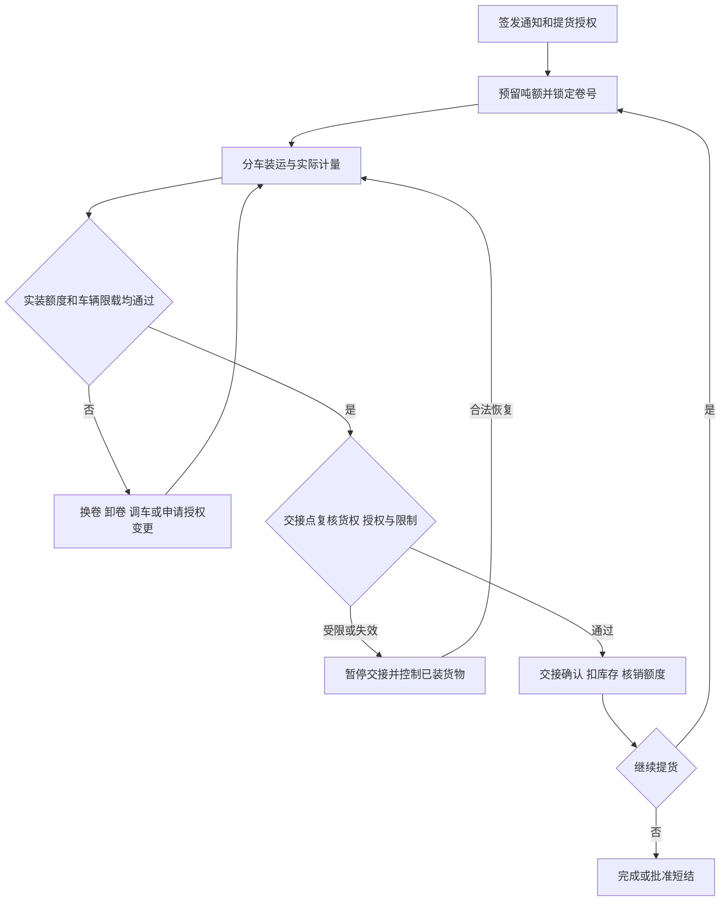
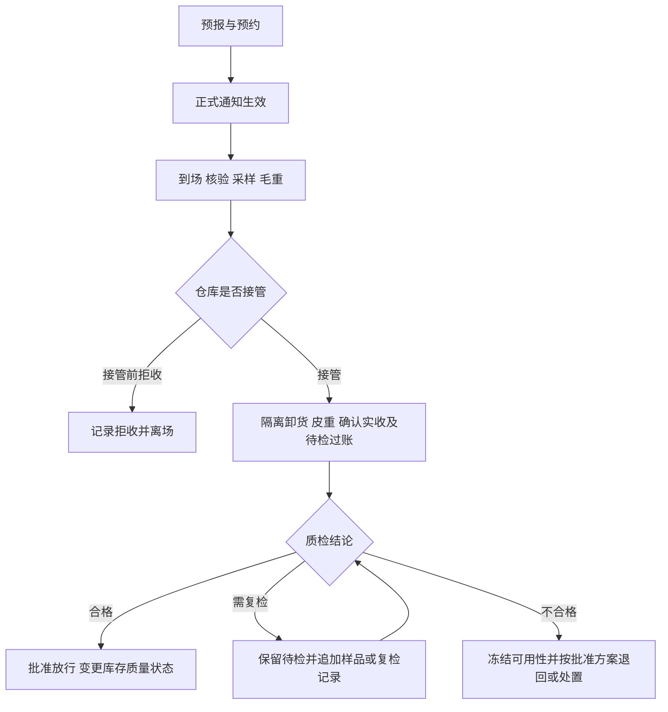

# 多品类仓储系统设计方案

公共模型以履约、库存、货权、数量证据、质量及作业为边界。品类和现场方式通过策略选取追溯粒度、计量证据及作业模板。案例用于验证这些组合。

平台对象复用及工程归属见[大宗供应链仓储服务与平台集成设计](大宗供应链仓储服务与平台集成设计.md)。

## 1. 业务范围与职责图

**设计判断。** 将收发履约、实物库存、货权监管、现场作业和计量质量各自建模。它们在同一笔业务中回答不同问题：仓库承诺做什么、货物在哪里、谁有权指令、现场做到哪一步、依据哪些证据确认。出仓履约提供一笔业务的完整视图，授权余额、卷号占用、冻结和库存账分别由各自的权威对象维护。

方案以中国境内第三方现货仓为背景，覆盖自营和外部仓协同。普通仓储采用“仓库签收接管即登记受控实物库存，质量放行后才进入可发范围”的口径。出仓采用合同约定的交接点，汽运示例取受控门岗交接，船运可取装船交接。运输承运、贸易结算、法定登记及交易所仓单系统通过接口协作。示例中的货权登记、质量放行和交接时点均需写入仓储合同或业务规则。

| 业务域 | 能力及权威事实 | 独立业务生命周期 | 协作边界 |
|---|---|---|---|
| 仓储履约 | 入仓、出仓指令，执行范围，分批收发，接管及交接确认 | 有。签发、部分履约、完成、关闭 | 汇总授权、分配、车船进度和实绩。通过确认命令发起过账 |
| 提货授权 | 有权方签发的仓库、提货人、货物、货权版本、期限、额度及撤销 | 有。可独立签发、改版、暂停、撤销和核销 | 在出仓通知允许范围内派发额度。最终交接消费授权 |
| 实物库存 | 位置、库存身份、数量、可用状态、实物占用、过账流水和在途余额 | 有。占用、释放、过账、冲销 | 使用履约确认、质量结论及批准调整作为入账依据 |
| 货权与监管 | 货主、卷捆或混储份额、权利变更依据、仓单引用、有效限制 | 有。登记、过户、质押、冻结、解除 | 向分配及门岗提供权利范围和限制版本。货权变更可在实物不动时完成 |
| 现场作业 | 预约、到场、卸装、移位、上架、盘点、转换、门岗执行 | 有。可派工、暂停、改派、复核 | 车船次串联任务和货物。不因任务完成直接生成账务 |
| 计量与质量 | 设备原始读数、有效计量版本、样品、检测结论及其适用范围 | 分别独立。可复磅、复检、作废及替换 | 收发和结算分别引用实际采用的版本。质量向库存提交状态变更 |
| 库存调拨 | 来源仓、目的仓、在途保管责任、部分签收及差异处置 | 有。发起、发运、部分签收、差异结清 | 复用两端收发。以在途库存承接调出和调入 |
| 主数据与策略 | 仓库拓扑、品规、单位换算、追溯与作业策略版本 | 有。草稿、发布、生效、停用 | 提供匹配结果与版本快照。执行中依然读取当前安全限制 |

一期可采用模块化单体，共用关系数据库，按模块限定写入入口。单次放行、过户、内部调拨过账涉及多个模块时，应用服务在同一事务内调用各模块的业务命令。查询侧按 `fulfillment_id` 汇总指令、授权、占用、计量、车船次和库存流水，并展示各权威对象的版本。第三方仓通过明确约定的控制接口和事件回执接入，控制权归属见第 7 节。

## 2. 代表性场景与核心过程

**设计判断。** 优先确认三类时点：仓库何时接管实物、货物何时具备发运资格、货物何时交给提货人或承运人。预约、称重和装车各自产生可核验的现场事实，只有达到合同约定的交接条件才产生相应的收发确认。

### 钢卷控吨自提

货主签发一张热卷出仓通知，授权上限 100 t，按整卷、两车自提。示例中通知与授权一对一，提货单可由通知及其授权记录生成。若两车由不同提货人接货或分别需要撤销，签发两张独立提货授权，子级额度由通知统一控制。

| 步骤 | 发起与确认 | 依据与账务 |
|---|---|---|
| 通知生效 | 有权指令方签发，仓库按约定受理 | 校验货主、货权范围、仓库、规格、期限、100 t 上限。尚无实物占用 |
| 预留与配货 | 调度先预留吨额，再选卷并绑定车次 | 授权按吨占用，库存按卷号独占。预留转车次占用时只转归属，余额不重复扣减 |
| 拣卷与装车 | 库工扫码，装车复核人核对实际卷号 | 记录现场位置或装车暂存位。实物仍在仓库保管账内 |
| 称重与复核 | 磅房形成有效磅单，调度复核分摊和车次额度 | 分别校验载货量和车辆限载，按实际称量重算吨额。超额转异常处理 |
| 门岗交接 | 门岗核验实际卷号、车辆、提货人和有效放行条件 | 当前货权、限制和授权全文复核通过后，提交交接、实发扣账、货权实物余额扣减及额度核销 |
| 余量处理 | 货主或授权方批准续提、增量或短结 | 续提使用剩余额度。撤车释放未发占用。短结注销未用额度，保留已出记录 |

### 煤炭汽运待检入仓

货主预报 120 t，承运人预约三车。仓库受理正式通知后，前两车卸入隔离堆位，毛重分别为 54 t 和 55 t，卸后皮重分别为 15 t 和 16 t，各计净重 39 t。仓库签收 78 t 并入账为待检，两车组成同一验收批次，样品按采样方案分别留样或制成复合样。第三车可独立分批处理。

仓库接管和数量定稿可有时间差。卸入隔离区时先记录接管事件。取得有效皮重后完成数量过账，期间看板独立显示“已接管待定量”，关账时必须对清该队列。需要过账估量的仓库应使用可冲回的暂估流水，并明确精确量到达后的差额处理。接管前拒收仅保留现场和拒收记录。接管后拒收须走隔离、退货或批准处置，凭实际退回交接扣账。质量放行时把待检库存转为合格库存，并保留原收货确认与检验版本。

### 其他场景验证

| 场景 | 发起、确认与依据 | 占用、放行与过账 |
|---|---|---|
| 煤炭船运 | 货主或代理按航次发通知，码头登记舱、卸货段和交接时间。计量员按合同采用水尺或皮带秤，质检员按验收批次采样 | 每个批准交接段可独立确认。水尺结果覆盖多个舱或作业段时，计量分摊必须能回到原报告和分配依据 |
| 散粮混仓 | 仓库提出混储，货主按合同同意，质检确认相容粮种、等级及储存条件 | 每笔接管登记来源批和货主份额，经批准后合入筒仓堆批。配货同时占用实物量与该货主份额，损耗按批准口径分摊 |
| 消费品按箱入库按件出库 | 收货员按箱扫描，拣货员按件复核，换算使用品规包装版本 | 10 箱 × 24 件过账 240 件，发 7 件后余 233 件。若管理封箱状态，拆箱更新包装层级，基础件数不变 |
| 在库过户 | 出让方向仓库提交依据，受让方及仓库按合同确认，必要时取得监管同意或外部登记结果 | 生效时转货权份额、递增权利版本。旧授权和旧作业进入待复核，货物原位 |
| 同仓移位 | 仓库发起并扫描源位、货物、目的位 | 同一保管及库存核算边界内做库位成对过账。跨该边界走出入仓及在途流程，即使物理距离很近 |
| 盘点 | 仓库发布范围和基准水位，盘点员实盘，复核人员确认差异 | 支持范围内短暂停动，或按逐条实盘时点回放期间流水。先串查错放和在途作业，再批准调账 |
| 跨仓调拨 | 调拨方发起，源仓确认交承运人，目的仓按批接管签收 | 源仓转入在途，目的仓从在途转入在库。短收保留在途待查，退回按真实路线确认，损失经批准结清 |

## 3. 核心业务对象与聚合

**设计判断。** 将必须在同一次写入中成立的约束放在同一个聚合或同一个事务中。授权需要独立撤销，磅单需要复用和换版，监管指令可跨多笔履约生效，这些对象各自维护生命周期。履约根保留可审计的关联合同、执行引用和确认结果，聚合查询提供完整业务视图。

| 聚合及业务标识 | 状态与内部对象 | 约束、写入边界和上下游 |
|---|---|---|
| 入仓履约 `receipt_id` | 草稿、已生效、收货中、完成、关闭、撤销。含通知行、分批收货确认和拒收记录 | 控制分批累计及超收批准。确认引用车船、验收批和计量版本。同一确认行一次入账，已确认数量可追溯冲销 |
| 出仓履约 `dispatch_id` | 草稿、已生效、执行中、完成、短结、撤销。含通知行、签发额度分配登记、分次实发确认 | 通知根串行控制子授权额度与通知总上限。确认与配货、车次、授权有明确关联。一笔履约可展开全部实绩和可再分配额度 |
| 提货授权 `authorization_id` | 待签、有效、暂停、撤销、到期、核完。含授权行、版本、吨额占用及核销流水 | 维护签发人、提货人、货权版本、适用范围、上限及期限。父通知控制派发，授权根控制本授权的预留和核销 |
| 车船作业 `trip_id` | 已预约、到场、作业中、待交接、已交接、取消。含装卸任务和按授权行分组的实装明细 | 同一车可服务多个授权。维护车次配额、车辆或航次限制、作业进度和装载事实，由单一交接协调命令复核整车 |
| 库存身份与分配 `stock_id`、`allocation_id` | 序列单元或堆批余额，含质量状态和位置。分配有预配、有效、暂停、释放、耗用状态 | 库存管理唯一卷号锁或数量锁。占用与余额在受影响库存行上原子更新。授权占用通过分配关联，同库时成对提交 |
| 权利账户 `title_account_id`、权利变更 `title_change_id` | 按卷捆或份额登记。变更经提交、核验、批准、生效或驳回 | 转出与转入成对记账。生效时更新范围版本，阻断旧授权。权利账户可跟踪在库、在途及争议份额，交付扣减仓储权利账 |
| 监管限制 `restriction_id`、仓单登记 `warrant_id` | 限制待核验、已受控、解除。仓单有签发、变更、注销及外部状态 | 监管方或授权主体发令，仓库反馈执行状态。限制按货物、份额、货主、仓库及操作类型匹配，重叠限制逐条解除 |
| 计量批次 `measurement_id` | 待称、计量完整、有效、替换或作废。含设备原始记录、磅单版本、分摊 | 原始读数追加保存。有效磅单由计量员确认，记录设备、时间、毛皮净重、复磅依据。一次计量可关联车船次或计量段 |
| 验收检验 `inspection_id` | 待采样、检测、待复检、已判定。含验收批、样品链、指标和结论版本 | 验收批可跨车。质量负责人明确覆盖的收货行、批次和数量，库存只转移该覆盖范围的状态 |
| 调拨 `transfer_id` | 已批准、发运中、部分到达、差异处理中、结清 | 每个调出行生成对应在途批。调入、退回、损失结清累计不得超出可核对在途量 |
| 盘点与库存转换 `count_id`、`transform_id` | 盘点有基准、观察、复核、批准。转换有投入、产出、损耗及批准 | 各自保留现场证据，库存依据批准结果过账。受影响的占用、权利份额及限制由原维护方参与同一执行命令 |

**额度模型。** 每个通知控制行设有效上限 `L`，子授权行设上限 `A`，车次按授权行设作业上限 `V`。对每一级维护已出量 `S` 和仍有效的未出占用 `R`，可再配量为 `L/A/V − S − R`。车次占用向上汇总，同一额度预留只在当前执行节点出现一次。通知另维护已派发给子授权的剩余额度，签发条件为“通知已出量 + 各有效子授权尚可兑现的额度 + 通知层尚未下沉的占用 ≤ 通知上限”。生成子授权时将对应父级预留转移到子级。关闭子授权只回收未兑现额度，已经核销的历史量继续计入父级。异常待复核量单列，保持原有效占用并禁止继续交接，直到批准的修复事务完成。

**货权与监管。** 卷捆货权绑定不可复用的库存身份。混储使用堆批物理余额、货主份额账及来源投入记录，按相同基础单位对清“实物余额 = 各货主份额 + 经批准暂挂的待认领或差异份额”。暂挂部分不可分配。混仓出库按货主份额和当前限制核销，来源按合同认可的方法追溯。自然损耗按批准的比例、责任或实测依据记实物损耗与份额损耗。质押或冻结范围内的损耗、转移、混批和分切须先取得相应处置依据，受限范围在新身份上持续可查。

货主享有约定的货物权益，仓库保管方负责实物控制，签发方须有当前指令权，监管方控制限制的设立和解除，提货人仅在有效授权内接货。普通在库过户依赖合同、权利依据及相关主体确认。系统分别记录外部权利生效、仓库收到指令、仓库控制生效和内部记账时间。外部权利已生效而仓库尚待核实时，受影响货物进入受控挂起。中国境内普通仓储适用的参考包括《民法典》第 907–910 条关于验收、交付凭证及仓单项下提取权转让，第 441 条规定仓单等权利凭证出质时的设立规则。交易所业务须按具体交易所、品种、交割库资格及当期规则接入，其外部状态由相应系统确认。 [最高人民法院发布的《中华人民共和国民法典》](https://www.court.gov.cn/zixun/xiangqing/233181.html) · [工信部公开的《民法典》全文](https://tjca.miit.gov.cn/zwgk/zcwj/flfg/art/2020/art_20cf1a2e1b854924b5caa744c8045d1f.html)

业务对象 ID 用于稳定关联。单据编号用于展示、签发和人工检索，编号连同签发主体及版本引用。库存流水 ID 标识独立账务事实，多个流水可属于同一过账组，冲销流水引用原流水。

## 4. 单据与凭证归属

**设计判断。** 四张候选单据可以作为基本业务文档。通知承担签发指令，确认承担接管或交接实绩。只要业务需要独立撤销、复核、核算或复用，就把相应授权、任务或计量质量证据建成有自身生命周期的对象。打印和电子签章使用对象的受控版本生成。

| 单据、任务或凭证 | 所属过程与对象 | 签发或确认 → 使用方 | 生效与生命周期 | 库存影响及独立条件 |
|---|---|---|---|---|
| 入仓预报、预约 | 到货协同，预报和时段预约 | 货主、承运人 → 仓库调度 | 提报、接受、改约、取消 | 无。可分别存在，一张预报可多车预约 |
| 入仓通知单 | 正式接货指令，入仓履约 | 有权签发方 → 仓库 | 身份、范围、时间、版本有效，达到合同约定受理条件后执行 | 无。预报可沿用来源编号，保留正式签发动作 |
| 入仓确认单 | 接管与实收，入仓履约确认 | 仓库及约定交接方 → 货主、库存、结算 | 已接管且数量证据齐备，可分批签发、受控更正 | 增加在库，按规则进入待检或合格。多次交接分别确认 |
| 出仓通知单 | 发运指令，出仓履约 | 有权签发方 → 仓库、调度 | 校验货权范围、期限、规格和上限，按约定受理后执行 | 无。可携带一对一授权的签发事实 |
| 提货单 | 提货权凭证，提货授权 | 有权授权方 → 提货人、仓库门岗 | 签发、激活、暂停、撤销、到期、核销 | 签发无库存影响。仅一对一且范围、版本、期限、撤销同步时，可由通知和授权记录直接出具。拆单、换提货人、异步撤销或独立签章时单独签发 |
| 配货、装卸、移位、门岗任务 | 现场作业，车船或库内任务 | 仓库调度 → 库工、磅房、门岗 | 派发、执行、复核、完成或取消 | 配货触发实际占用，移位确认触发库位过账，装卸任务保存现场事实。独立派工或可重试步骤保留任务 |
| 磅单 | 计量，计量批次的有效版本 | 计量员 → 收发、结算 | 原始读数齐备、审核有效、复磅替换或作废 | 无直接影响。多张确认可引用同一磅单的不同分摊行 |
| 质检单 | 验收检验，样品与判定 | 质检机构或岗位 → 仓库、货主 | 采样、检测、复检、批准结论 | 批准质量转换时改变待检和可发。独立维护跨车检验及复检 |
| 出仓确认单 | 实际交接，出仓履约确认 | 仓库与约定交接方 → 库存、货主、结算 | 取得交接事件并通过最终审核，可分批签发、冲销 | 扣实物、消耗占用、核销授权。每次实际交接可独立核算 |
| 仓单、过户凭证、冻结及解除回执 | 货权与监管 | 保管人、有权主体或外部登记方 → 货主、监管方、仓库 | 各按合同及适用规则签发、生效、变更、注销或解除 | 仓单和过户登记维护权利，冻结影响可用。按法律及监管生命周期独立保存 |
| 盘点报告、调整凭证、转换确认 | 盘点、调整、批次转换 | 盘点员举证，授权岗审批 → 库存与货权 | 观察、复核、批准、过账、必要时冲销 | 报告本身无影响。批准后的调整或转换产生流水及谱系 |

## 5. 策略配置

**设计判断。** 分开配置库存身份、资源锁定和现场步骤。重量误差阈值、抽样比例和包装换算可参数化。汽运双次称重与船运按舱交接涉及不同任务和证据，适合使用独立模板。最终交接的权限、货权、限制、数量和幂等门禁由平台统一执行。

| 策略 | 匹配粒度与优先级 | 可配置与覆盖边界 |
|---|---|---|
| 库存与追溯 | 在库存明细首次创建时匹配。库区＋品规 → 仓库＋品规 → 仓库＋品类 → 品类默认 | 仓库、库区控制堆位或筒仓适用性。商品控制炉批、卷捆、箱托、效期及基础单位。货主可要求更细，存量按迁移流程调整 |
| 分配与占用 | 按授权的商品行及配货池匹配。仓库＋品规＋业务类型＋方式 → 仓库＋品类＋业务类型 → 仓库＋品类 → 品类默认 | 决定提前锁吨、锁批、锁卷、先进先出或效期优先。货主限制混配或指定货权范围。订单可缩小候选库区、批号和卷号 |
| 作业流程 | 指令选择业务类型骨架，车船次按仓库＋业务类型＋方式匹配模板，作业或验收批按商品风险追加适用任务 | 可配置过磅、采样、复检、上架、装载复核、签收和门岗步骤。多品类共车合并共用任务，分别执行商品行质量和交接约束 |

规则发布时检查同优先级重叠、单位不兼容、缺失强制任务、无法匹配的库区及混储相容性。每套策略设显式默认。默认缺失或存在冲突时，指令可保存草稿，待配置完善后生效。策略按 `effective_from` 发布，通知、车船次、作业批及库存身份分别记录采用版本。已进入执行的作业沿用原模板，变更需审批并重验已完成步骤的证据。当前冻结、权利状态和授权撤销实时适用。存量粒度变化需先冻结受影响的分配入口、盘清库存与权利，将旧身份逐条映射到新身份，再通过转换过账切换，并保留旧追溯链。

| 示例 | 库存与占用 | 作业模板 |
|---|---|---|
| A 钢材仓热卷 | 在炉批下管理卷号和实重，先锁吨再锁整卷 | 汽运预约、扫码装车、双次称重、门岗交接 |
| B 港口煤仓 | 堆位或堆批管理，按吨和货主份额占用 | 同品类汽运双次磅、船运按舱及计量段。采样按验收批 |
| C 粮食筒仓 | 筒仓堆批加份额账，按质量等级限制混储 | 接管后隔离待检，获批后并仓，检测覆盖入仓批和混批 |
| D 综合仓 | 钢卷按卷锁定，消费品按托箱追溯和按件扣账 | 同仓不同品类使用独立商品任务。混装一车共享预约、磅单和门岗，每个授权行单独分摊核销 |

## 6. 数据模型与库存影响

**设计判断。** 用不可变流水记录库存、权利和额度的变化，以事务内同步更新的余额支持现场决策。数量必须带用途、单位和依据。同一次交接可以同时保存 40.200 t 实重、41.000 t 理重、40.200 t 库存过账量及基于合同计算的结算量，各自可以被独立核对。

### 核心实体

| 实体 | 主外键及关键字段 | 关键约束 |
|---|---|---|
| `warehouse`, `location`, `sku`, `unit_conversion` | 仓库 → 库区 → 库位、堆位或筒仓。品规、基础单位、包装或理重换算版本 | 位置归属、容量和可混储属性可核验。换算记录精度、舍入和版本 |
| `fulfillment`, `fulfillment_line`, `confirmation`, `confirmation_line` | 履约行及确认行 FK。货主、方向、仓库、计划量、审批上限、策略版本、交接时间和采用的证据 | 确认行关联原履约行。签发版本不可覆盖。冲销关联原确认 |
| `authorization`, `authorization_line`, `quota_entry` | 引用出仓行和货权范围版本。授权上限、有效期、提货人、预留、释放及核销 | 父子范围和额度单调收窄。唯一业务事件防重复扣减 |
| `trip`, `trip_load_line`, `allocation` | 车次关联多个授权行。装载行记录卷号、批次、计划量、实装量和计量分配 | 一卷同一时刻最多一个有效实物占用。数量锁累计不得超过可分配余额 |
| `stock_identity`, `stock_balance`, `stock_entry` | 库存身份包含可组合的品规、批、炉批、卷捆和包装身份。余额按身份、位置、状态核算。流水关联确认、过账组及原流水 | 连续余额不得为负，成对转移数量守恒。关账按流水序号核对 |
| `title_account`, `title_entry`, `restriction`, `warrant_ref` | 货主、仓储范围、库存身份或份额、变更依据、权利版本、限制主体和外部引用 | 转移成对，份额分配不得超支，限制有可核验解除依据 |
| `raw_weighing`, `weigh_ticket`, `weight_share` | 设备、车船或计量批次、毛皮净重、有效版本。分摊行关联装载或确认行 | 原始读数不可覆盖，分摊和必须等于实际采用净重 |
| `acceptance_lot`, `sample`, `inspection_result` | 验收批与收货行多对多，样品归属验收批。判定记录覆盖范围和版本 | 同一验收范围按有效结论执行，复检版本变更须重新判断库存可用性 |
| `transfer_leg`, `count_observation`, `transformation_line` | 在途批关联源确认和目的确认。盘点记录库位及实际观察时点。转换记录投入、产出、损耗与谱系 | 调拨差异可分段结清。转换按基础单位校验守恒或显式记录换算及损耗 |

落库时，业务及关联表统一使用租户边界和相应外键，创建及更新账号来自可信认证上下文，使用 `BINARY(16)`。时间由数据库按 UTC 生成，使用 `TIMESTAMP(6)`。业务事件发生时间和入账时间另存。维护流水更正时使用追加记录。

| 数量 | 用途与口径 |
|---|---|
| 计划量 | 通知或车次计划，记录单位和是否为实重、理重或件数 |
| 现场计量值 | 保存原始值和设备单位，磅单统一给出毛、皮、净及精度，可追溯复磅 |
| 实收实发量 | 交接双方采用的数量，引用计量版本和对应分摊 |
| 库存过账量 | 库存基础单位，质量状态转换使用相同单位，双计量品同时保留卷数和重量 |
| 提货核销量 | 按授权明确的口径，如实重吨或理重吨。独立校验可核销额 |
| 结算量 | 保存合同公式、检验版本和换算证据。例如粮食按约定水分折算，折算结果用于结算。若合同同时按折算量控制提货，还须单独声明授权口径 |

整车多品规优先采用分项实测。无法分项称量且合同允许时，可以按卷实测、理重或包装基准比例分摊。分摊算法、精度及尾差归属须确定并可复算。整车净重 52.000 t，两提货单以 30:20 分摊可得到 31.200 t 和 20.800 t，分别校验授权，车辆以整车计量及其适用的载重、总重和必要轴荷规则独立复核。

### 库存影响矩阵

`q` 表示相应用途的批准量。可发量按“合格且位于可执行位置、权利符合、未限制、未被其他作业占用”的库存集合计算，重叠条件按货物或份额去重。

| 动作 | 位置 | 在库 | 在途 | 待检 | 可发 | 实物占用 | 货权账 | 提货额度 |
|---|---|---:|---:|---:|---|---|---|---|
| 签发通知或授权 | 无 | — | — | — | — | — | — | 划拨子授权上限 |
| 接管待检过账 | 入隔离位 | +q | — | +q | — | — | 按生效依据登记，或暂挂 | — |
| 质量放行 | 仍在原位或经移位 | — | — | −q | 符合条件时增加 | — | — | — |
| 配货或撤配 | — | — | — | — | 减少或恢复 | 锁定或释放 | 份额可用性占用或恢复 | 预留或释放 |
| 冻结或在库过户 | — | — | — | — | 按当前权利重新计算 | 受影响作业暂停，处置后释放或转配 | 冻结状态或转移份额 | 旧授权停止兑现，按处置释放未用占用 |
| 放行交接 | 移出控制位置 | −q | — | — | 从剩余集合重算 | 核销实际交接占用 | 减少在库仓储权利余额 | 占用转实发核销 |
| 同仓移位 | 源 −q、目标 +q | 净零 | — | 随货 | 按目标位重算 | 合规时随身份保留 | 不变 | — |
| 调拨发运、调入 | 源出、目标入 | 源 −q、目标 +实收 | 发运 +q、调入 −实收 | 目标可待检 | 目标按状态加入 | 源作业耗用 | 权利在保管位置间迁移 | 内部调拨额度按实绩核销 |
| 盘差、混批、分切 | 按批准结果更新 | 经批准差额或损耗 | 仅在途差异影响 | 随批状态 | 重算 | 先解除或受控迁移 | 同步损耗、份额和谱系 | 有关车次重算，按原授权处理 |

每日对账按过账组核对确认行、库存流水、权利流水及额度流水。独立检查卷号唯一性、混储实物与份额、调拨“调出＝调入＋退回＋批准损失＋在途余额”、实发与授权核销的口径差异。数量差异应能回到计量、换算或批准记录。

## 7. 接口、异常与一致性

**设计判断。** 用业务命令表达签发、冻结、确认和批准。关键命令在权威对象上重验，列表或看板的读模型可用于调度。涉及现实交接时，用门岗和仓库受控事件确定交接边界，并保留设备与系统状态的对账能力。

| 命令示例 | 主要输入和执行责任 |
|---|---|
| `POST /receipts/{id}/issue`、`/accept` | 指令版本、来源与接管事件。履约校验范围，库存按实际采用凭证过账 |
| `POST /dispatches/{id}/authorizations` | 授权行、额度、期限、提货人和权利版本。通知根校验派发上限 |
| `POST /trips/{id}/allocate`、`/reweigh`、`/cancel` | 卷批、授权分组、数量、计量和版本。锁定或释放库存与额度，实装异常单列 |
| `POST /trips/{id}/handover` | 门岗证据、实际货物、人员车辆、计量分摊、交接事件。复核全部条件并原子提交实发、库存、货权及额度 |
| `POST /measurements/{id}/approve`、`POST /inspections/{id}/decide` | 原始读数、样品、结论、覆盖范围。权威模块签发版本，触发下游复核 |
| `POST /restrictions`、`POST /restrictions/{id}/lift`、`POST /title-changes/{id}/effective` | 权威指令、范围、外部依据和执行时间。更新控制状态及版本，通知受影响作业 |
| `POST /transfers/{id}/settle-difference`、`POST /counts/{id}/approve-adjustment` | 差异明细、责任依据、原流水及审批人。权威账同步完成批准过账 |

- **准入。** 每个命令使用统一权限模型声明对象与操作，校验租户、仓库、货主范围及字段权限。签发、批准、质检、门岗及账务更正使用各自的操作权限和适用的岗位分离要求。
- **并发。** 在固定顺序锁定通知和授权额度、车次、货权监管控制范围、库存身份或余额。冻结、过户和交接共同使用相交的控制范围并比较版本。货主级或仓库级冻结也要覆盖相关交接，不能只锁卷号行。并发配货以权威余额和唯一占用约束决定成功方。
- **幂等与恢复。** 身份、租户、命令和请求键共同确定幂等范围，相同键及内容返回原结果，同键不同内容返回冲突。业务过账再以来源确认行及动作序号去重。过账流水与 Outbox 同事务，外部事件按来源和事件 ID 去重，并按对象版本处理乱序。调用超时先查原结果，再使用同键重试。
- **现实交接。** 仓库在实际跨越受控交接点前进行最后核验。门岗放行准备记录绑定车次、实际货物、权利版本、有效时间及单次令牌，新增冻结可使待交接令牌失效。门岗在交接点在线消费令牌并提交交接事件。若设备或人工状态不明，保持该车受控，凭出口传感器、录影或签收证据认定交接事实。已实际交接的异常进入追溯处置，按真实事件时间记账，不自动恢复可用库存。
- **外部仓。** 合同明确谁掌握实体门岗、指令生效及确认时间。冻结指令带版本、范围和关联号，外仓回执至少区分收到、已限制实物、无法执行及已交接。平台收到待核验的冻结即暂停有关新放行；外仓在本地门岗应用限制，在最终交接前在线核验平台授权。断连时相关受控出仓挂起，恢复后补传事件并对账。只有回传、无法控制门岗的仓库需列为人工监管流程，回执与控制能力经过验收后方可纳入自动放行。
- **更正。** 已确认业务通过追加更正或冲销凭证处理，校验原流水、已更正累计和货物真实去向。未交接撤车可释放占用。交接后退货采用返仓接管确认，原实发历史保留。

### 四组具体验证

| 场景 | 拦截与责任 | 恢复及最终记账 |
|---|---|---|
| **钢卷 100 t，两车复磅超吨** | A 车锁 51 t，B 车锁 49 t，共占 100 t。A 复磅为 53 t 时，重算总占用 102 t，授权根拒绝新增 2 t，A 车记录 53 t 实测并暂停，原占用保留。若 A 车辆载货限值为 52 t，车辆门禁也独立拒绝 | 示例用 51 t 的合规组卷替换 A 车，或把 A 调至合规车辆并把 B 改配 47 t。后一方案在同一事务释放 B 原 49 t、锁定实际可配的 47 t 整卷并调整 A 占用为 53 t。按 53、47 分别实发扣账，额度归零。若最后只剩 2 t 而最小整卷 3 t，可短结或由有权方批准至少增 1 t。计量容差仅用于约定的证据校验。可超提额度必须明示签发，仍受通知与车辆限制 |
| **配货后冻结或过户后提交旧授权** | 卷 `C08` 为 24 t，已锁卷、占吨，尚未交接。监管限制版本升至 `F8`，或货权由甲转乙使版本 `T12→T13`。门岗按实际卷号复核，冻结范围命中或授权权利版本过期均拒绝交接 | 控制待发车辆，必要时卸回隔离位并记录移位。冻结未解除可用其他合规卷换配，旧锁及吨占用按结果释放。过户在权利账上甲 −24 t、乙 +24 t，实物库存不动。乙或有权人重新签发后重配。拦截期间无出仓扣账 |
| **移位后误报盘亏** | 20 t 卷从 `L01` 移至 `L02`。盘点基准流水 500 在 `L01`，移位流水 501 早于 `L01` 实盘时点。复核用该时点的账面数 0，按卷号查到 `L02` 并实物核验 | 差异归类为基准时差。若实物错位则补做经批准的移位确认。已正确过账时保留 `L01 −20`、`L02 +20` 的唯一移位组，全仓总量不变。只有复核确认真实丢失后才批准盘亏，并同步处置占用、限制和权利差异 |
| **调拨实收小于调出** | 源仓发运 80 t，目的仓确认 77 t。调拨对象保留 3 t 在途待查，目的仓不能按计划量自动补收 | 源仓在库 −80、在途 +80。目的仓在库 +77、在途 −77。后续补到或退回时按真实接管清账。若批准认定 3 t 运输损失，在途 −3，记损失理由及责任引用，同步处置相关权利份额，索赔转外部结算 |

## 8. 一期实施范围

**设计判断。** 以同一套实物、货权和授权闭环覆盖四个品类。各仓只启用已经达成合同和现场共识的模板。先验证交接、冻结、计量和差异处置，再扩大自动化设备及外部权利系统覆盖。

| 交付层次 | 过程及对象 |
|---|---|
| 一期必做 | 仓库拓扑、品规和计量单位，预报预约、正式通知、分批接货及出仓确认，授权签发拆分及撤销，车船次装运，磅单及质检版本，库存及在途账，卷号和份额账，过户及冻结，移位、盘点、调拨、批准调整，完整权限与审计 |
| 一期按仓启用 | 汽运双次磅、船运水尺或皮带秤凭证、留样复检、消费品箱托拆零、散粮混储、钢卷分切和混堆拆批。分切或混批模板启用时必须同步执行投入产出损耗、原占用处置及受限范围继承 |
| 后续扩展 | 交易所标准仓单直连、融资机构自动回执、门岗及地磅设备直控、动态装载优化、规模化点位盘点、复杂质价结算与索赔集成 |

| 验收场景 | 通过标准 |
|---|---|
| 通知与授权 | 一张通知拆多张提货单、多次交接。撤车、到期、短结和增量后额度可复算，并发超配只有符合余额的请求成功 |
| 计量与质量 | 两车组成一个煤炭验收批，待检入账、复检、部分放行可追证。多品规共车分摊守恒并核销至各授权 |
| 货权与监管 | 冻结与交接并发时结果符合受控交接时点。外仓断连可挂起。旧授权过户后无法消费，所有受影响卷和份额可追踪 |
| 库内与调拨 | 误报盘亏可利用流水和位置复核消除。调拨短收可以补到、退回或批准结清。混批和分切可追溯至投入及损耗 |
| 一致性与权限 | 重复或乱序请求无重复扣账。跨货主查询、越权签发和未经批准的调整被拒；库存、货权、授权及在途按证据对清 |

评审需由**仓库**确认接管与交接点、可控门岗、过磅和盘点方式，由**货主或签发方**确认货权生效依据、授权吨位口径、整卷容差与短结、混储损耗和结算折算规则，由**监管方**确认适用限制、外部权利生效依据、放行回执以及冻结货物的移位、转换和盘亏处置权限。每个启用仓库应把这些决定固化为合同条款、策略版本或验收记录。

一期专项设计见[钢卷控吨出仓详细设计](钢卷控吨出仓详细设计.md)。
