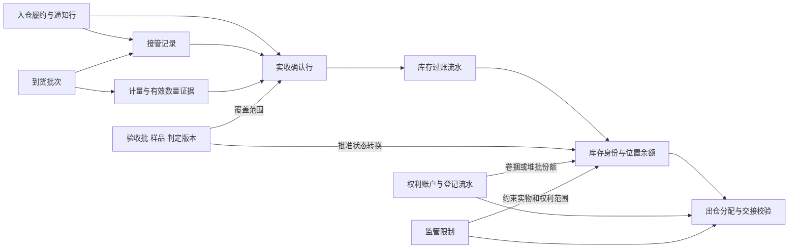

# 大宗供应链仓储整体模型评审稿

**状态：整体模型已确认。** M01–M08 作为一期设计基线。各仓现场条件及合同例外按第 5 节确认。实施详见[进仓流程详细设计](进仓流程详细设计.md)。

相关资料见[多品类仓储系统设计方案](多品类仓储系统设计方案.md)及[一期钢卷控吨出仓详细设计](钢卷控吨出仓详细设计.md)。钢卷详设用于回查库存身份、货权和可发条件。

平台对象复用及工程归属见[大宗供应链仓储服务与平台集成设计](大宗供应链仓储服务与平台集成设计.md)。

## 1. 业务边界

**设计判断。** 将指令、保管事实、实物数量、权利和质量分别维护。待检煤炭已经在仓库控制下，净重、在库余额、可识别的货权及可发资格仍可能在不同时间成立。模型允许这些事实分别发生，并通过同一笔履约串联。

| 业务域或能力 | 权威事实与维护方 | 对其他能力的约束 | 生命周期 |
|---|---|---|---|
| 仓储履约 | 有权方签发通知，仓库受理并确认接管、实收或交出 | 确定执行范围和累计履约量，实收确认发起库存过账 | 独立。签发、部分履约、完成、关闭 |
| 现场作业 | 仓库记录车次、装卸、实际位置、移位、隔离及门岗证据 | 提供现场事实。保管责任按约定交接点确认 | 独立。可调度、暂停、复核 |
| 实物库存 | 库存模块维护身份、位置、已过账数量、质量状态及实物占用 | 定量后形成实物账。按质量、权利、限制和占用计算可发量 | 独立。可转移、占用、调整、冲销 |
| 货权与监管 | 权利运营方核对货主、货物范围、份额及生效依据，监管方发起有权限制，仓库确认控制 | 权利记录及有效限制参与配货及交接复核 | 独立。登记、过户、冻结、解除 |
| 计量 | 磅房维护原始读数、有效磅单和采用版本 | 为实收、实发及结算提供可核对的数量证据 | 独立。称重、复磅、换版 |
| 质量 | 质检方维护验收批、样品和结论，仓库按批准依据执行状态转换 | 结论仅适用明确的批次和数量范围 | 独立。采样、判定、复检 |
| 提货授权 | 有权人签发，授权能力维护提货范围、额度和核销 | 最终交出须同时满足授权、实物及权利监管约束 | 独立。签发、暂停、撤销、核销 |
| 贸易及结算 | 外部贸易或结算方维护合同及计价量 | 提供签发和登记依据。消费已确认数量及质检证据 | 独立。合同变动和结算更正各自留痕 |

## 2. 核心对象与关系

**设计判断。** 履约负责通知与累计实收，接管和实收确认归同一履约过程。车次、计量、验收批、库存和权利独立维护，通过稳定标识关联。这样一个到货批次可有多个数量证据，一个验收范围可覆盖多个到货批次，货权可以在实物原位时登记或转移。

| 关系 | 业务约束 |
|---|---|
| 通知行 → 接管、实收确认 | 一条通知行可分到货批次多次履约。同一接管记录可对应多条实收行，实收行必须追溯通知和到货批次。累计控制使用批准的实收口径 |
| 到货批次 → 数量证据 → 实收行 | 证据可以是重量、点数、理算或经批准的外部报告。实收引用采用版本及分摊行。更正保留新旧依据 |
| 验收批 → 实收行或数量范围 | 一批可覆盖多车。实收行也可按数量拆到不同验收批，覆盖量可复核。样品归验收批，保留采样来源 |
| 实收行 → 库存流水 → 库存身份 | 每次确认对应可追踪的库存过账组，确认行与过账动作唯一。暂定实物识别可在卸货时建立，定量后才进入正式数量余额 |
| 库存身份 ↔ 权利账户 | 按库存身份或保管份额关联。已过账实物由已登记份额和待登记份额覆盖，对账差异单独处置。权利生效、内部登记、库存过账分别留时间 |
| 提货授权、限制作业 ↔ 实物及权利 | 授权绑定当前权利范围和有效期限。配货占用由库存维护，额度由授权维护，交接前按实际货物重验冻结、权利和授权 |

仓储履约 ID 用于串联全过程。通知和确认单号用于签发检索。磅单版本、质检版本、权利登记流水及库存流水各自标识其证据或变动。

## 3. 场景验证：煤炭汽运待检入仓

**示例假设。** 同一货主、同一品规，正式通知计划 120 t。先到两车，各自卸入可独立识别的隔离堆位，两车组成同一验收批。毛重和卸后皮重分别为 54/15 t、55/16 t，净重各 39 t。按仓库签署接管记录承担保管，按有效计量定量，暂不启用估量过账。货权依据随后核验通过，质检较晚出结论。此处时点和数量仅用于验证模型。

| 时点 | 谁确认、依据什么 | 权威记录与累计结果 |
|---|---|---|
| T0 通知生效 | 有权指令方签发，仓库按约定受理 | 履约记录 120 t 计划及可执行范围。库存、待检、货权已登记和可发均为 0 t |
| T1 接管 | 库管根据卸入隔离位、车次及交接凭据签署接管 | 两车实物已受控，分别保存接管时间和实物位置。净重未定时显示两笔「已接管待定量」，跨日纳入待核对清单 |
| T2 实收确认 | 收货员采用有效毛重和皮重，确认两笔 39 t。样品与车次关联到同一验收批 | 履约累计实收 78 t，计划未收 42 t。质检状态待判定。实收用于保管数量确认，质量验收由质检结论表达 |
| T2 库存入账 | 库存采用两笔确认行及对应磅单版本 | 在库 +78 t、待检 +78 t。两笔确认各与自身过账同一事务提交。货权待登记 78 t，可发 0 t |
| T3 货权登记 | 货权经办人按仓储及贸易依据核验主体和范围 | 货主登记 78 t，待登记归零。在库与待检均为 78 t，可发 0 t。外部生效时间和内部登记时间分别记录 |
| T4 质量放行 | 质检方批准覆盖两车的结论，仓库执行状态转换 | 在库仍为 78 t，待检 −78 t，合格 +78 t。货权、位置及限制均满足、无占用时，可发 78 t |

五个时点应分别留证。示例把实收确认和库存入账放在同一事务，任一写入失败则该笔确认不生效，已发生的接管仍保留。若权利依据先到，可先保存依据，等范围和数量可核对后登记对应余额。若质检先通过而权利仍待登记，合格库存继续不可发。多次确认的重试使用同一来源标识，避免重复入账。

| 关键分支 | 模型如何处理 |
|---|---|
| 接管后迟迟未取得皮重 | 履约继续跟踪实物位置和待定量时长。过期进入复核队列。需要跨期估量时，由待确认的暂估口径决定是否另立账务 |
| 接管前拒收 | 留下到场及拒收原因。没有仓库接管、库存或货权数量影响 |
| 已接管且入账后不合格 | 质检判定覆盖对应吨位，库存继续隔离。批准退回后按实际交出扣库存，同步按权利依据处置对应登记或待登记份额 |
| 只有一车的样品有效 | 保留另一车待检，先放行可准确划界且符合批准条件的 39 t。两车已混放且无法物理区分时，按共同受控范围处理 |
| 有效磅单被替换 | 原始证据及原确认仍可追溯。待确认阶段重新选用版本。已过账按批准更正联动库存及相关权利份额，必要时暂停出仓 |
| 超计划或身份不符但实物已接管 | 保留实际接管与受控位置，挂起正常实收确认。由有权方批准补充通知、偏差接收或安排退回，避免实物脱离保管记录 |

## 4. 已确认的评审口径

| 编号 | 基线 |
|---|---|
| M01 接管 | 仓库签认实际控制的货物时记录时间、位置和范围。部分卸货按实际控制范围记录。净重未定时登记已接管待定量 |
| M02 跨日暂估 | 默认只登记受控实物并纳入交接班和跨日核对。正式数量余额及可兑现的货权份额等定量后建立 |
| M03 实收确认 | 有效数量证据齐备后按可识别范围分批确认。按质量策略进入待检、合格或已批准免检状态 |
| M04 库存权威 | 每仓明确唯一库存权威。自营同库时实收确认与待检过账原子提交。外仓持有权威账时，平台凭可追溯的过账回执核验入账，回执缺失保留待核验，相关数量不可配货 |
| M05 货权登记 | 默认依据独立核验，可与过账同批完成。外部权利生效与内部登记分记。货主或范围未核实的数量挂待登记并禁止配货 |
| M06 质检范围 | 验收范围可以跨到货批次。检验或验收规则允许且实物可定位时，按适用范围放行。复检重验受影响库存和未交接作业，已交接部分转追溯处置 |
| M07 数量差异 | 分别记录实测、实收、库存过账和结算量。超收须批准接受或退回。过账后实际退回在交出时扣库存及对应份额，实物变动和计量更正凭证过账，商业折算留在结算 |
| M08 移位及混批 | 允许保持原身份、隔离及限制的受控移位。混批或转换单独审批，须证明来源、份额和限制可延续。限制无法划界时控制全部可能受影响的实物 |

## 5. 各仓确认条件及适用例外

| 对应项 | 启用前确认 | 适用例外及执行条件 |
|---|---|---|
| M01 | 仓库、货主和承运方确认接管点、签认岗位、证据及部分卸货责任 | 部分卸货范围单列，定量须有适用证据 |
| M02 | 仓库、财务和货主确认关账清单及待定量复核期限 | 需要暂估时按仓库或合同确认依据、审批、结清期限和更正方式。暂估不可发、不可兑现 |
| M03 | 仓库、货主及质检方确认确认单签字含义和适用范围 | 联合验收按合同确认。若先凭独立接管数量凭证过账，最终确认引用原流水并避免重复过账 |
| M04 | 仓库和平台确认账本权威、回执字段、失败补传及对账责任 | 外仓可仅上报现场事实，前提是平台为约定的库存权威，仓库执行采用平台状态 |
| M05 | 货主、仓库及适用监管方确认权利文件、主体核验和生效条件 | 合同明确以质量验收为权利生效条件，或须等待外部确认时，按该条件登记 |
| M06 | 仓库及质检方确认采样范围、分位能力、结论适用量和复检控制 | 来源或风险不一致时逐车判定。先并堆须经批准并明确混后受控范围 |
| M07 | 仓库、货主和结算方确认通知上限、超收审批、退回责任及折算公式 | 计量更正或实际损耗按批准凭证处理。结算折算不自动影响实物及货权账 |
| M08 | 仓库、货主和监管方确认移动许可、目标位条件、混批审批和受限范围继承 | 有原位监管要求时原位控制。混后无法划界时按共同受控范围处理 |
