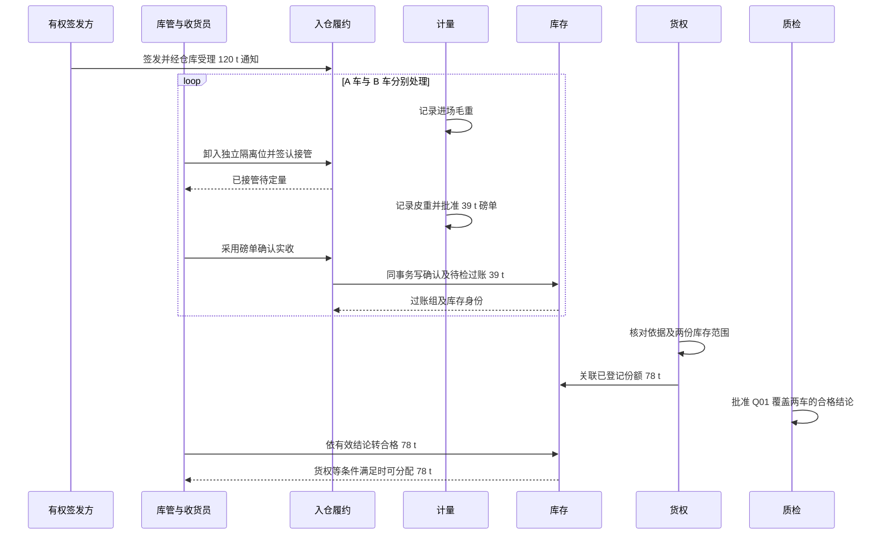

# 进仓流程详细设计

本设计以[已确认的整体模型](大宗供应链仓储整体模型评审稿.md) M01–M08 为依据。进仓主线按接收指令、接管、数量确认、库存入账、货权登记和可用性判定组织。数量可在接管时确定，也可在接管后依据有效证据补齐。检验有要求时进入待检，无检验要求时记录质量门槛不适用。库存、权利及监管准入适用于所有模板。

平台对象复用及工程归属见[大宗供应链仓储服务与平台集成设计](大宗供应链仓储服务与平台集成设计.md)。

## 1. 履约对象和状态

同一通知允许多个到货批次和多次确认。到货批次是可独立识别的交接范围，可对应车辆、船舱段或直接交付批次。通知状态表达履约进度，接管、过账、货权和质量分别保存事实及其时间。通知完成后仍可查到待登记、待检或受控处置记录。

| 对象和标识 | 主要状态及关系 | 权威维护方 |
|---|---|---|
| 入仓通知及行 | 草稿、已生效、接收中、完成、关闭、撤销。存仓库、品规、计划及批准接收上限、签发版本，关联预报或预约 | 履约。按通知行串行核对累计实收及上限 |
| 到货批次与接管记录 | 待到货、接收中、已接管、拒收。定量进度独立保存。接管行记录受控位置、货物范围、证据和签认人 | 现场与履约。部分接管单列，已有接管须处理去向 |
| 计量记录、数量证据与分摊 | 数量证据可来自称重、点数、扫码、理算或经批准的外部报告。保留原始记录、单位、适用范围、版本和分摊依据 | 计量。磅单定稿或换版独立提交 |
| 实收确认行与过账组 | 实收行引用来源通知、接管范围、实际采用的数量证据及分摊、数量和库存身份。结果为已入账或按外仓模式待核验 | 履约与库存。每个确认行分别关联过账来源，避免重复消费计量份额 |
| 库存身份及状态余额 | 按策略确定身份粒度、位置、正式在库量、质量准入及受控状态。同一验收批可覆盖不同库位 | 库存。分位、移位及过账保存流水 |
| 货权登记及监管限制 | 待登记份额、已登记账户、权利依据、外部生效及内部登记时间。限制独立生效 | 货权监管。份额账户关联实际库存身份及数量 |
| 验收批、样品和结果 | 待采样、检测、已判定、复检。结论版本明确适用库存身份、确认行及数量 | 质量。仓库根据已批准结论执行质量状态转换 |

## 2. 策略选择与通用约束

| 策略 | 匹配层级与结果 | 适用示例 |
|---|---|---|
| 交接与作业 | 通知按仓库和业务类型确定接收范围。到货批次按交接方式匹配模板，约定签认、复核和交接证据 | 汽运卸货接管，船运按交接段，整托直接签收 |
| 数量证据与单位 | 确认行按品规、交付方式和合同选定计量或点数证据，固定过账基础单位、精度及换算版本 | 实重、理重、箱件换算或外部计量报告 |
| 库存身份与质检 | 库存明细按库区、品规和保管要求选定批次、序列或包装身份。验收范围按质量要求独立形成 | 堆批隔离、逐件序列识别、已批准免检 |
| 货权与过账 | 仓库确定唯一库存权威，业务及合同确定权利登记条件和联合验收例外 | 同库原子提交、外仓回执；按身份或份额登记 |

策略选择保存版本。订单或合同可在仓库能力内收紧要求。质量门槛的结果应区分已通过、待判定、未通过及经批准不适用。可分配范围同时满足已过账、货权已核验、质量条件已满足、位置可发、无限制及可用余额充足。现场模板可增减步骤，接管须可追溯、数量须有证据、权利及限制须有效、过账须幂等。

## 3. 验证实例：煤炭汽运待检

通知计划及批准上限为 120 t。已预约三车，先走通前两车。A 车毛重 54 t、皮重 15 t，B 车毛重 55 t、皮重 16 t。两车各 39 t，卸入隔离位 P01、P02，按采样方案纳入验收批 Q01。该模板的基础计量单位取千克，精度按仓库计量能力确认。

| 步骤 | 发起、核验及提交 | 计划未收 | 正式在库／待检 | 权利登记／待登记 | 可发 |
|---|---|---:|---:|---:|---:|
| 通知生效 | 签发方授权，仓库受理。预约只占时段 | 120 t | 0／0 | 0／0 | 0 |
| 两车接管 | 签认人员记录车次、实际位置、接管范围和时点。净重未定显示两笔受控实物 | 120 t | 0／0 | 0／0 | 0 |
| A 车实收及过账 | 有效净重 39 t，结论待检；确认及流水同事务 | 81 t | 39／39 t | 0／39 t | 0 |
| B 车实收及过账 | 同口径确认 39 t，分别保留两车来源 | 42 t | 78／78 t | 0／78 t | 0 |
| 货权登记 | 经办人核验主体、依据及对应库存份额，记权利生效及登记时间 | 42 t | 78／78 t | 78／0 t | 0 |
| 质量放行 | 批准覆盖 Q01 两车的合格结论并执行转换 | 42 t | 78／0 t | 78／0 t | 78 t，假定位置可发且无限制和占用 |

第三车可继续履约。关闭剩余 42 t 须说明原因并经授权，已发生的接管与后续质量处置仍须结清或有明确接续记录。阶段性实收确认单逐车出具，载明数量、磅单版本及质量待检状态。接管签认、磅单和质检单各自保留原始证据与签署记录。

## 4. 事务边界、接口和数量约束

第一方接口使用 /api。下列为完整流程目标契约，当前已实现路径及范围见第 7 节。跨进程合作接口另行版本化。服务端使用可信租户及操作主体，校验仓库、货主及岗位权限。关键写入携带请求键、预期版本与来源证据标识。

| 命令 | 入参及提交边界 |
|---|---|
| POST /api/inbound-notices/{id}:issue | 签发版本、执行范围及批准上限。生效后方可正常作业。紧急接管单独留证并待补录授权 |
| POST /api/inbound-deliveries/{id}:take-custody | 通知行、受控位置、接管范围及签认凭证。写接管事件，不自动生成正式库存过账 |
| POST /api/inbound-measurements/{id}:approve | 证据类别、原始记录、适用范围、数量、单位和分摊依据。保存有效版本与原始记录引用 |
| POST /api/inbound-receipts | 接管行、通知行、有效数量证据及分摊、实收数量及接收位。锁定通知行和所用接管、计量份额及库存记录，重验累计上限、范围、有效版本和剩余额度，原子写确认、待检余额、库存流水、幂等回执及 Outbox |
| POST /api/title-registrations | 权利依据、主体、候选库存份额、权利生效时间。锁定库存权利范围，重验已过账受控量及待登记量，更新权利账与关联状态 |
| POST /api/acceptance-lots/{id}:release | 已批准结论及覆盖范围。重验有效版本、实际位置和剩余待检量，同事务写质量状态流水和执行结果，原在库量保持不变 |
| GET /api/inbound-notices/{id} | 查看计划、实收、待定量事件、过账状态、货权、质量和例外。执行主从资源及字段保护 |

接管事实独立提交。单笔确认及过账失败时两者回滚，保留原接管和计量记录。幂等键相同且内容一致时返回原结果，异文冲突。确认来源和过账动作另设唯一约束，数量证据分摊的累计消费不超出有效证据。并发写入采用固定加锁顺序，锁内重读权威状态。质量放行、限制变更及出仓分配复用同一库存控制边界。可发量按满足全部条件的实际库存或份额计算。

数据以接管行、确认行、库存身份、验收覆盖行、权利份额和库存流水串联。记录计划量、实测值、实收量、过账量、登记量及结算量各自的单位和依据。新自有表首次创建须包含四个中文注释审计列，账号 BINARY(16)，时间 TIMESTAMP(6) 并由数据库按 UTC 生成。业务发生及账务处理时间另存。模块内按业务输入端口、领域规则、定向存储端口及事务适配器分工。

### 服务归属、引用字段与调用阶段

进仓主数据核验入口 `InboundReceiptReferences.resolve` 已由组合应用装配。下表描述它在各进仓写用例中的使用位置。仓储责任归 `backend/services/bulk-warehousing-service`，由 `monolith-app` 装配。入站控制器调用仓储 `api`，应用用例经窄端口取得主数据结果；集成适配器调用主数据公开契约。仓储领域仅消费规范化引用与版本，仓储存储适配器写本模块表。

| 阶段及归属 | 落库引用与调用顺序 |
|---|---|
| 签发通知 · 仓储履约 | 统一操作准入 → 主数据精确查询启用 `warehouseId`、`ownerPartnerId` → 商品身份解析 → 仓储签发。行保存 `productId`、`stockIdentityKind` 及所选 `specificationId` 或 `skuId`，另存主数据版本与 `baseUnitId`。无规格商品使用商品粒度 |
| 接管 · 仓储现场及履约 | 按当前角色授权 → 位置解析校验 `warehouseId`、`storageAreaId` 与 `locationId` 及其预期版本 → 保存已核验的 `storageAreaId`、`locationId`、接管时点及证据。能力或状态异常时进入受控异常接管并保留实际位置证据，正常过账等待复核 |
| 实收及过账 · 仓储履约与库存 | 核验确认权限 → 加锁重读通知及接管范围 → 校验商品、位置和采用单位依据 → 核对计量份额、上限及版本 → 同事务保存确认、库存和 Outbox。保存来源单位、数量、目标基础单位、规则或包装版本及换算快照。库存身份沿用确认行的规范化商品引用 |
| 货权登记 · 仓储货权 | 统一操作准入 → 按已有伙伴契约核实 `ownerPartnerId` → 匹配具体库存身份、权利凭证与数量 → 更新份额。伙伴启用只证明档案有效，权利依据仍须业务确认 |
| 质量放行 · 仓储质量与库存 | 统一操作准入 → 读取验收范围、有效判定及当前库存 → 更新质量状态 → 依据现有位置、权利、限制及占用重算可发。沿用来源商品和计量快照 |

签发及正常过账的关键主数据版本须在执行时复核。同库装配下，若要求主数据在过账提交前保持有效，补充的主数据执行校验须在同一事务接入其受控锁或版本保护，并在实现时验证与主数据维护用例的加锁顺序。当前只读引用入口在调用方事务中读取并校验版本，单独调用时建立只读事务。单独调用所得证据应由正式过账在自己的事务内重新核验。历史接管和确认采用留存证据。档案停用或版本不兼容时挂起新的正常操作，已有接管通过授权处置结清。主数据引用以 UUID 和快照长期追溯，仓储业务表不复制档案正文。

## 5. 分支及恢复

| 情况 | 处置与结果 |
|---|---|
| 接管前拒收、部分卸货 | 接管前仅记录到场及拒收。已卸部分按实际控制范围登记。整车净重无法证明已卸量时保持待定，取得有效分段计量后确认 |
| 跨日待定与批准暂估 | 跨日按车和位置核对实物。经仓或合同批准时单列暂估。若估 40 t、实测 39 t，按已选模式冲回 40 t 并确认 39 t，或以等效差额更正结清。暂估不得形成可发量或可兑现份额 |
| 联合验收 | 按合同明确最终签发条件。先凭独立接管数量凭证过待检账的，最终确认引用原过账，校验范围及数量，防止重复入账 |
| 超收、接管后拒收 | 超批准上限则挂起确认，保留受控实物。接受超量须增量审批。已入账后判为不合格时保持隔离，实际退回交接时扣账并处置对应权利份额 |
| 磅单更正或质检复检 | 已过账计量更正基于批准的差额流水，并联动份额核对。复检挂起受影响范围及未交接作业，已交出部分进入追溯 |
| 质检先通过、权利未登记 | 库存可转合格，对未登记份额仍阻断分配。权利登记成功后重算可发 |
| 外仓权威账 | 允许显示实收已确认、入账待核验。回执匹配外仓、确认行、批次、数量与流水，去重并核对版本。缺失、错量或冲突时保持不可配。平台回放仅更新投影，补账由权威仓完成 |
| 隔离位移位或混批 | 受控移位成对更新库位，保留身份和限制。混批另行审批并保存投入、产出、损耗及权利与限制映射 |

## 6. 开发接入与验收

对象和数据访问统一归属自身 BusinessObjects.Provider。D01–D03 核对对象、全部真实操作和入口，控制器引用统一操作。D04–D06 验证功能权限、租户及行范围，并保护权利依据、人员及附件字段。D07–D10 评估通知与确认的编码、打印及租户审批需求，授权后读取真实数据并接通通用运行契约。D11–D12 记录策略版本、状态、事务、兼容性、有效证据和声明同步。功能交付时在 docs/validation 留存实际运行证据。

| 验收 | 通过标准 |
|---|---|
| 通用能力验证 | 用箱件点数且质量免检的入仓、按序列识别的入仓验证同一对象与接口可以执行。数量确认可在接管时完成，免检仍须满足权利与限制门槛 |
| 两车正常接管及待检入仓 | 待定量可查，形成两笔独立 39 t 待检过账，计划余 42 t；货权或质量条件未齐时不可发 |
| 分批与并发 | 两笔确认不能超上限或重复消费同一计量分摊，失败后接管仍可追溯 |
| 独立质量和货权 | 分别测试先登记和先放行，无权利或无适用质检结论的范围无法分配 |
| 异常与恢复 | 跨日、复磅更正、超收、实际退回、外仓回执缺失与重传均能对账 |
| 真实准入及审计 | 跨租户、越权仓库或货主、伪造回执、未批准过账和字段泄露均被拦截，按真实数据库验证事务和审计字段 |

## 7. 当前写入实现

`bulk-warehousing-service` 已接入签发、接管、确认实收并登记待检库存、货权登记和质量放行。第一批实现采用单行通知，按可单独计量的接管范围确认，一次接管对应一次实收。通知行锁使并发收货依最新累计量校验批准上限。库存过账、确认及累计量同事务；不同内容复用同一确认或接管范围时返回冲突。

| 操作 | 第一方路径 | 实际落账 |
|---|---|---|
| 签发与接管 | POST /api/bulk-inbound-receipts:issue 与 POST /api/bulk-inbound-receipts:take-custody | 通知及接管独立提交，接管无吨位入账 |
| 实收 | POST /api/bulk-inbound-receipts | 保存实收、采用的数量证据、待检库存及累计量 |
| 货权登记 | POST /api/bulk-inbound-title-registrations | 依据已过账实收范围登记货主份额，凭证生效时点与登记时点独立 |
| 质量放行 | POST /api/bulk-inbound-quality-releases | 将批准范围转出待检并记录质量凭证，不改变入库数量 |

质量放行和权利登记可以不同顺序执行。当前按已过账范围整笔登记或放行；涉及同批部分量时按可追溯范围拆分接管和确认。岗位核验采用的凭证后录入引用，计量、质检设备及外部权利系统直连另行接入。实现与验证范围见[进仓写入门禁检查](../../validation/大宗仓储进仓写入门禁检查.md)。
