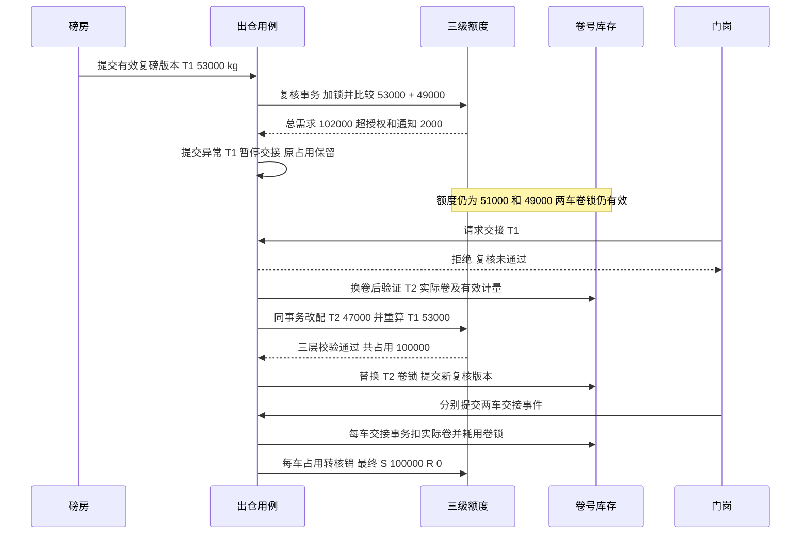
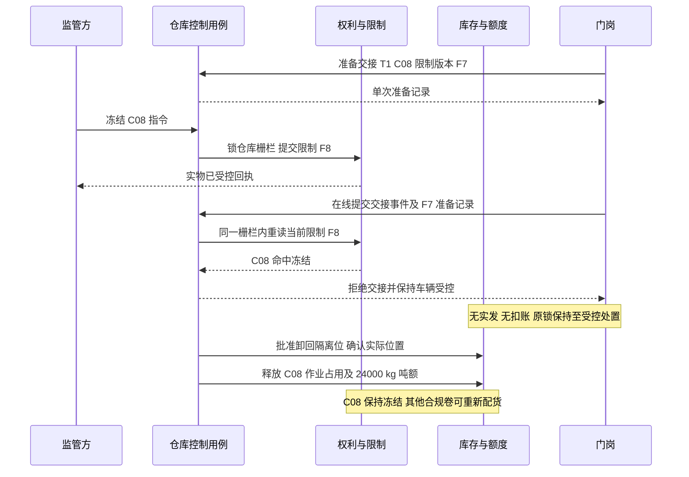

# 一期钢卷控吨出仓详细设计

上位设计见[多品类仓储系统设计方案](多品类仓储系统设计方案.md)。本文用于开发评审。示例采用单仓、汽运、整卷、实重核销。重量按商品基础重量单位精确十进制存储，案例单位为 kg，100 t 即 100 000 kg。车辆允许载货量、最大总重及适用轴荷按现场及适用规则分别核验。

本文件描述按重量核销、按序列身份排他占用、按车交接的一种策略组合。上位模型的额度维度、库存身份粒度和交接批次由业务策略确定。

平台对象复用及工程归属见[大宗供应链仓储服务与平台集成设计](大宗供应链仓储服务与平台集成设计.md)。

## 1. 归属与上线边界

仓储履约拥有出仓通知、提货授权、车次配额和确认。库存拥有卷号、数量、位置和排他占用。货权监管拥有权利范围、版本和限制。计量拥有原始读数、有效磅单及分摊依据。门岗记录交接事件，出仓用例提交最终确认。仓库资料复用主数据模块公开能力，库存与货权数据归仓储业务上下文。当前已接通库存门禁、整卷配货、三级额度、复磅、门岗交接和交接冲销。实际接口及边界见第 7、8 节。

一期自动放行采用同数据库、本地事务及受控门岗。未来独立部署或第三方仓场景须沿用总体方案的控制权和回执约束，另行验证跨进程状态一致性。应用层定义输入和输出端口，领域实现状态与额度规则，持久化适配器实现定向锁及固定查询，事务适配器负责提交。跨模块通过公开入口协作。仓储用例归 bulk-warehousing-service，由 monolith-app 统一装配。

## 2. 三级额度、卷号与状态

| 权威对象 | 控制范围 | 额度与状态 |
|---|---|---|
| 通知行 N | 仓库、权利主体、品规或批准的货物范围 | 上限 N.cap。草稿 → 生效 → 执行中 → 完成或短结。未开始可撤销，已有交接只能关闭未履约部分 |
| 授权行 A | 一条通知行下的提货人、有效期、权利版本及货物子集 | 上限 A.cap。待签 → 有效 → 暂停、核完、到期或撤销。签发、改版、撤销各自留痕 |
| 车次配额行 V | 一车内对应一个授权行。同车可有多个 V | 上限 V.cap。待配 → 已配 → 装载或复核中 → 待交接 → 已交接或取消。实装复核可阻断任一配额行及整车 |
| 卷号占用 | 以租户及库存身份为键，记录配额行、授权行、当前库位 | 有效、暂停、释放、耗用。暂停仍排他。即使已装车，卷仍在保管账上，位置可转装车暂存位 |

设每级 S 为已确认核销量，R 为已承诺且未核销的占用量。各级必须满足 S + R ≤ cap，实时剩余可配量为 cap − S − R。车次 R 由接受的整卷配货量汇总，复磅前采用受控卷重版本；复磅后采用已批准分摊。授权可先建立未派车吨位预留 U，派车时在同一事务中消耗 U 并增加 V.R，差额才改变 A.R。公式为 A.R = U + Σ V.R，N.R = Σ A.R，S 同理从确认汇总到上级。所有活动车次的配额上限 V.cap 是局部限制，车次配额本身不预扣 A.R。计划发车上限之和可以超过授权上限，实际占用不能超额。

通知另控制授权额度承诺。设各有效或可恢复的授权未核销承诺 C = A.cap − A.S。通知可新增签发量 = N.cap − N.S − Σ C。暂停时保留 C，到期或撤销并完成余量清理后 C 归零。清理前继续保留承诺。实际已出仍计入 N.S。通知层提前锁吨的一期入口直接生成默认授权并建立 U。授权增量先取得父级可签发额度，必要时先批准通知增量，联动更新时一次提交。减额必须覆盖历史实绩和仍有效占用。吨额容差不可暗增签发额度。

整卷按库存身份唯一锁定。预计吨位、实测净重、载货量和库存过账重量均存各自的口径和版本。出仓扣除卷号整个库存身份及其账面数量，核销采用交接批准的实重。若实重与库存账重不同，保存差异，不为已经发走的卷留下重量余额。合同要求实重校准库存时，先做有依据的差异调整，或者由交接事务显式生成校准和扣减两笔流水。

## 3. 数据与并发实现

| 表逻辑名 | 主要字段与约束 |
|---|---|
| 出仓通知及行 | UUID、单号、租户、仓库、货主、品规范围、cap、s、r、授权承诺、状态、版本 |
| 提货授权及行 | 通知行 FK、不可变签发版本、提货人、权利范围版本、到期时间、cap、s、r、u、状态、撤销原因 |
| 车次及配额 | 车次 UUID、车辆标识、驾驶及提货身份引用。在配额表唯一约束租户＋车次＋授权行。保存 cap、s、r、复核状态及版本 |
| 配货、当前卷锁、库存流水 | 配货明细记计划卷重及已采用分摊版本。当前卷锁主键为租户＋库存身份。释放或耗用删除当前锁并追加历史，带 lockId 防止旧请求误删新占用 |
| 计量分摊、复核异常 | 计量版本、装载行、净重校验和、分摊方法、尾差、复核输入版本。异常记录实际量、原占用、超额及处置 |
| 门岗交接、实发确认、额度流水 | 门岗交接号按仓库唯一，车次仅允许一次成功交接。确认按交接事件与配额行唯一。库存、货权、额度流水共享过账组并引用来源 |
| 幂等记录与 Outbox | 按可信租户、主体、操作和请求键唯一。请求摘要、结果、对象版本保存。事件含聚合 ID、版本及业务发生时间 |

各业务表和关系表使用可信租户复合外键等约束阻断跨租户关联。新表初次创建声明四个中文注释审计字段，账号 BINARY(16)、时间 TIMESTAMP(6)，数据库按 UTC 生成审计时间。业务时点和入账时点独立。确认、计量凭证和流水采用不可变版本。读模型返回明确的已出、占用、可配、尚可签发、车次实装及复核原因。

**统一锁顺序。** 所有写入按仓库控制栅栏 → 通知行 → 授权行 → 车次及配额行 → 权利账户 → 库存身份顺序加锁。同类多行按稳定 ID 排序，计划范围变化时从头重试。一期控制栅栏采用每个租户仓库一条预建行，配货、交接、过户、冻结、解除都先锁该行。跨仓范围使用排序后的仓库栅栏。此方案有意串行化单仓关键写入，换取冻结和交接的清晰顺序，吞吐量需压测。事务不等待人工、地磅或门机，不调用远端服务。权威数据在加锁后重读，读模型不参与判定。

| 命令 | 事务内写入与失败语义 |
|---|---|
| 签发、改版、撤销、短结 | 通知和授权额度及状态一起改。撤销立即禁用授权及待交接令牌。已装卷保留受控排他锁，待卸回并确认后成对清理吨位和卷锁，最后回收未用承诺。未装车按同一释放命令清理 |
| 预留或配货 | 验证三层额度、货权、限制和可发库存，写 U 或 V.R、上级汇总、配货明细、卷锁及额度流水。任何一个校验失败均不提交配货 |
| 磅单采集与实装复核 | 计量独立提交有效凭证。复核事务锁定三层额度及被涉及卷。新分摊全部通过时更新 R、版本和待交接资格。超额时提交复核异常并禁止整车交接，原有效 R 及卷锁保留。实际读数继续可查 |
| 换卷、卸回、撤车 | 扫描确认实物位置后，成对释放旧卷锁和额度，需要时同步锁新卷并按差额更新。改装后旧复核失效，重新取得适用计量和分摊。撤车保持历史 S |
| 冻结及过户 | 同仓栅栏内更新权威限制或权利版本，并记录令牌失效所需的版本。受影响作业可异步补标记，最终交接以权威状态当场裁决。解除仍需重新复核 |
| 交接 | 最终校验成功时，原子写实发确认、库存扣账、仓储权利账扣减、三级 R 转 S、卷锁耗用、交接回执和 Outbox。同车多授权行全部校验通过后一起提交 |

## 4. 接口与门岗协议

第一方使用 /api，合作接口单独定义 /v1 契约。以下命令携带请求幂等键和受控对象版本。服务端从可信身份获取租户、仓库权限及操作者；请求仅提供业务标识与期望版本。相同键和摘要返回已保存结果，同键异文报冲突。丢失响应时查询交接事件，再用同键重试。死锁或栅栏等待超时可有限重试完整事务，不重放外部动作。

| 方法与路径 | 输入与结果 |
|---|---|
| POST /api/outbound-notices/{id}:issue | 通知版本，批准范围和上限。返回生效版本 |
| POST /api/pickup-authorizations | 通知行、提货人、权利范围、时效、公斤上限。返回授权标识及版本 |
| POST /api/outbound-trips/{id}:allocate | 配额行、整卷 ID、预计卷重版本、预留引用。返回三级余额和配货版本 |
| POST /api/outbound-trips/{id}:review-weighing | 有效磅单版本、分摊行及车次版本。返回 APPROVED 或 HELD 以及分层超额或车辆原因 |
| POST /api/outbound-notices/{id}:reconcile-loads | 同一通知下的受影响车次、期望版本、换卷及卸回证据、重新计量及分摊版本。按合并后的每级净变化验证并原子提交，避免先改一车留下未受控状态 |
| POST /api/outbound-trips/{id}:prepare-handover | 绑定车次、实际卷、提货人、权利及限制版本、计量版本，签发短效单次准备记录 |
| POST /api/outbound-trips/{id}:handover | 门岗交接事件、准备记录和受控点现场证据。成功返回确认及过账组；冻结、过期、过户、配货变更均阻断 |
| GET /api/outbound-notices/{id} | 授权、车次、占用、实发及剩余额度。执行逐行及逐字段权限 |
| POST /api/stock-restrictions | 监管指令标识、作用范围、有效期、执行依据。返回已受控版本 |

门岗准备记录不打开道闸。经仓库确认的交接点由门岗在车辆受控时在线提交单次交接事件，成功后允许通行。冻结与交接按同一仓库栅栏的提交顺序裁定。交接已经提交但车辆未能通过时，挂起该车并凭门机事件、签收或现场复核确定去向。已接货但尚未驶离时，以经合同确认的交接点认定事实；确未交接时由复核岗发起受控冲销并恢复库存、权利、额度，再按当前限制判断可用性。网络故障和不确定状态下车保持受控。仓库若以实际越界为交接点，需工程化联锁和事件确认设计通过验收后才启用自动模式。

业务错误纳入平台统一错误契约，至少区分额度不足、卷已占用、权利版本过期、货物被冻结、计量已替换、车辆超限和对象版本冲突。越权响应按统一规则处理，避免通过错误细节泄露货物或货主信息。

## 5. 时序验证

### 复磅后两车合计超吨

一张通知 N 为 100 000 kg。授权 A 同为 100 000 kg，分车 T1 上限 55 000 kg、T2 上限 49 000 kg。两车原占用 51 000 和 49 000 kg。例中 T1 车辆载货上限为 54 000 kg，复磅后仍单独通过车辆校验。T2 假设现场有合规的 47 000 kg 整卷组合。

仅有 2 000 kg 余量而最小卷 3 000 kg 时，提交短结或批准至少 1 000 kg 的新增授权，并重新校验实际车辆条件。若 T1 在复磅前已经确认交接，新磅单进入已交接更正流程，保留原确认版本并处理追溯差异。

### 已配货卷在交接前冻结

卷 C08 为 24 000 kg，已锁卷和占吨，T1 已取得准备记录。监管冻结先于交接事务提交。

过户沿用同一并发机制。旧授权中货权版本过期时拒绝交接。过户只在货权账记转出、转入，卷号依原位保管。若交接事务先提交，监管回执标明已经交接并返回范围与时点，由监管流程决定后续追踪。

## 6. 声明、验收与实施顺序

| 完整声明条目 | 开发要求 |
|---|---|
| D01–D03 对象、操作、入口 | 通知、提货授权、出仓车次、计量及库存限制各由所属 Provider 唯一声明。额度流水、当前锁和确认作为所属对象主从资源。Controller 仅引用操作。专用机器入口声明可信调用方 |
| D04–D06 准入、行范围、字段 | 租户管理域及仓库、货主资源维度统一执行。调度、签发、计量、门岗、监管及更正授权分离。提货人身份、联系方式、监管依据逐字段评估读写、脱敏、导出及打印 |
| D07–D10 能力与运行接入 | 有打印需求的提货单和确认单使用平台契约，按权限重新读取采用版本。通知、授权、确认编号走统一编码。内部 UUID、流水及令牌不开放发号。标准签发采用专用业务命令；租户需要工作流审批时由公共运行端口绑定且复核回调。数据契约包含单位、状态、有效版本及受保护字段 |
| D11–D12 配置与验收 | 策略版本、岗位权限、签发范围、审计、幂等及事务边界按本文验证。实现提交前按真实差异核对现有 Provider，复用已声明对象。交付记录保存声明到页面或 API、公共运行及业务事务的正反向证据 |

先实现通知及额度签发，再实现卷号排他锁与预留转换，随后接通计量复核、冻结和受控交接，最后接通凭证及对账。验收覆盖以下可复现用例。

| 验收用例 | 预期证据 |
|---|---|
| 两车同卷并发及不同卷超吨 | 只有符合卷排他和三层余额的事务成功，库存和额度无孤立占用 |
| 复磅 102 000 kg 与车辆限载 | 超额时保留有效磅单及原占用，禁止交接。授权足额而车辆超限时仍拒绝 |
| 冻结先提交及交接先提交 | 分别观察拒绝且零扣账、正常过账且回执已交接。跨货主范围与旧授权均验证 |
| 撤车、换卷、短结与授权增量 | 实物归位后释放。剩余授权可支用量及父级可签发量与流水相符 |
| 故障、重试、冲销 | 过账中途失败全回滚。重试不重复扣账。门岗结果不明进入对账，批准冲销恢复相应数量和权利 |
| 权限与审计 | 无权限、跨租户、越权货主、伪造门岗事件及字段泄露均被拦截。真实数据库通过审计字段与事务验证 |

开发前由货主确认实重核销与增量审批规则，仓库确认最低计量精度、联合分摊、门岗交接点及关卡控制能力，监管方确认冻结范围、回执及在装货物处置。本文的验收表是实施标准，实际运行证据在功能交付时记录至 docs/validation。

## 7. 当前配货实现

库存门禁对已过账实收身份读取待检和质量结论、货权登记、所有活跃冻结及排他占用。仓库、库位和货主沿用主数据现行访问范围。结果为当次库存条件：实际配货必须在同事务重验。入仓库存总量及登记份额不因配货改变。

| 能力 | 当前实现 |
|---|---|
| 库存门禁 | GET /api/bulk-outbound-stock/{id}/eligibility，输出可配、待检、未登记、冻结或已占用 |
| 冻结与解除 | POST /api/bulk-stock-restrictions 与 /api/bulk-stock-restrictions:lift，指定证据与库存身份。可同时存在多个独立冻结 |
| 卷号与执行范围 | POST /api/bulk-stock-coils、/api/bulk-outbound-notices、/api/bulk-pickup-authorizations、/api/bulk-outbound-trips。核验主数据基础重量单位，整卷识别必须对应单一实收身份 |
| 未派车吨额 | POST /api/bulk-pickup-authorizations:pre-reserve。变更 U 时复核原值；实际派车优先转移 U，防止父级占用重复增加 |
| 整卷配货与撤配 | POST /api/bulk-coil-allocations 与 /api/bulk-coil-allocations:cancel。锁住仓库栅栏后依次锁通知、授权、车次和库存。配货与三级额度一并生效 |
| 关闭授权 | POST /api/bulk-pickup-authorizations:close。先撤配再回收未用额度及子授权承诺。关闭或到期授权禁止新配货 |
| 核验车辆限值 | POST /api/bulk-outbound-trips:verify-vehicle-limits。授权岗位录入车牌及凭证、载货和总重限值，单位须与通知一致。变更使旧复核失效 |
| 复磅重算 | POST /api/bulk-outbound-trips:review-weighing。毛重减皮重须等于分摊合计，实测卷集合须与活动配货一致。分别复核车辆净载、总重及三级额度。拦截时保存磅单、分摊及原因，保留原吨额占用和卷锁 |
| 门岗交接 | POST /api/bulk-outbound-trips:handover。采用当前批准复核，重新核验授权、实际车辆、提货人、全部装车卷、有效货权、冻结及卷锁。同事务写交接流水、扣库存和货权账面份额、耗用卷锁，按实测分摊将三级额度从占用转为已出 |

普通库存占用入口拒绝已绑定卷号的货物，带额度的配货须由整卷用例撤配。过账量用于初配，已批准实测量用于额度核销。整卷交出时扣全卷账面重量。账面 51 t、实测 53 t 时，库存和货权扣 51 t，三级额度核销 53 t，交接流水分别保留两个数值。

当前每仓同一车辆只允许一个有货车次。车次限载、有效磅单和门岗交接凭证均由授权岗位核验后提交。换卷采用撤配和新配，再登记适用的新复核。设备联锁、单独准备令牌、多授权共车及自动轴荷校验仍属后续能力。验证见[复磅与门岗交接检查](../../validation/大宗仓储出仓复磅与交接检查.md)。

## 8. 交接冲销与实际退回

| 场景 | 确认依据 | 库存、货权与三级额度 | 原车次 |
|---|---|---|---|
| 误确认，整车货物始终受原仓控制 | 冲销岗位以核实凭证确认未发生实际交出。已有真实退回验收时禁止使用该原因 | 按原交接账面恢复库存与货权，按原实测冲回通知、授权、车次的已出。授予原权限的授权尚未关闭时，同时恢复原卷锁及三级占用 | 旧复核失效。重新交接前须复磅及复核冻结。若授权已关闭，恢复实物与已出额度，保留授权关闭并终止原车次 |
| 已出仓后整车实际退回 | 先登记独立退回验收。接收岗位提交原卷、原库位及实际接管、权利、合格凭证，并具备相应质检及权利权限 | 同口径恢复账面量并冲回三级已出。原卷锁不复活，未用额度按当前授权状态可再次计划 | 终止原车次。若需再次出货，按当前库存及授权重新配货 |

第一方入口为 POST /api/bulk-coil-returns 和 POST /api/bulk-coil-handover-reversals。整车冲销从原交接流水取值，调用方不传恢复重量。同仓控制锁内重读原交接、额度与库存，全部写入同库事务。旧交接及重量保留，单独追加补偿记录，已冲销凭证不再作为放行依据。每笔原交接只允许一笔补偿。同键同内容重放返回原结果，异文或重复冲销拒绝。现有冻结独立保留，恢复后按当前限制评估可配资格。

整车验收冲销适用于同一整车全量返回原库位且质量、货权凭证齐备的场景。按卷分批实际退回采用第 9 节的独立流程。整车流程验证见[交接冲销检查](../../validation/大宗仓储钢卷交接冲销检查.md)。

## 9. 按卷分批退回

| 步骤 | 接口与约束 |
|---|---|
| 分批复接管及过账 | POST /api/bulk-coil-returns:post-coils。由有权岗位提交原交接、实际退回原卷、实际库位、接管及权利凭证。异库位或跨仓传实际接收位置快照。账面恢复量与实测冲回量均读取原逐卷交接行 |
| 上限与历史 | 仓库及三级额度锁内核验剩余活动交接行与车次已出余额一致。同一原交接卷只能冲回一次，未退卷的已出和交接行保持。原车次不再派货 |
| 待检放行 | POST /api/bulk-coil-returns:release-quality。按本批本卷登记新合格凭证并转出原账面待检量；首次入仓和之前返仓使用过的同卷凭证不能沿用 |
| 冻结及再配货 | 返仓和质量放行不解除冻结。待检与冻结均解除后，按新车次及当时的库存、权利和授权范围重新配货 |

同库事务写入本批退回、逐卷记录、库存待检、货权恢复和三级已出冲回。逐卷结束原交接活动标记，所有原卷返回后结束原交接活动状态。历史交接和金额原样保留。每批同键同内容重放返回原结果，异文及跨批重叠原卷被拒。整车冲销和按卷退回互斥。当前支持原卷返回同租户接收仓的实际库位并恢复原货主，货权争议走独立处置。按卷退回可以一次提交全部实退卷。验证见[分批退回检查](../../validation/大宗仓储钢卷分批退回检查.md)。

每个不同库位的退回明细提供原库存身份、目标库位 ID 和目标位置快照。快照包含仓库、库区、库位 UUID 及其各自版本，明细库位 ID 与快照一致。主数据公开解析复核可读范围、启用状态、父链和版本。跨仓返仓同时校验原仓及接收仓的现有主数据记录权限。沿用原库位的请求可只提供库位 ID。既有整车先验收再冲销接口仍沿用原库位契约，异库位或跨仓整车可用按卷入口提交全量。

退回过账写入实际库存位置与原账面恢复、货权恢复、三级已出冲回同事务。逐卷返仓凭证保留本次实际库位，原交接行持久化原出仓位置。后续可发、配货和再次出仓读取最新库存位置。历史交接的来源库位由原接管链按可信租户回填，历史未移位库存继续沿用接管快照。验证见[同仓异库位返仓检查](../../validation/大宗仓储钢卷同仓异库位返仓检查.md)。

## 10. 跨仓实际返仓

跨仓使用同一个按卷过账入口。每卷指定实际接收仓、库区及库位和版本，提交接管及货权依据。仓储按仓库 UUID 固定顺序取得原仓及各接收仓的控制锁，再锁定原通知、授权、车次和库存身份。业务归属变动期间等待原库存锁的其他操作重新核对仓库，归属已变化时拒绝旧范围下的操作。

原交接行保留该次实际出仓仓库及库位。接收凭证逐卷记录实际接收仓及库位。库存当前位置和卷号仓属同步转到接收仓，原入仓记录原样保留。账面恢复、货权份额恢复和原三级实测冲回与上述位置写入同一事务。卷号在接收仓重复时回滚整批。原出仓操作及未退卷的历史不被重写。

在接收仓复接管后全量待检。质量放行依据所选返仓批次及当前实际仓库、库位，仍复核原仓及接收仓准入。原冻结随库存身份继续生效，任何新的占用都基于当前仓库和位置。跨仓在途流程见第 11 节。跨租户货权转移与货权争议处置不由本入口处理。验证见[跨仓返仓检查](../../validation/大宗仓储钢卷跨仓返仓检查.md)。

## 11. 跨仓返仓在途

| 阶段 | 接口与状态 |
|---|---|
| 发运登记 | POST /api/bulk-coil-return-transits。原交接、目标仓、实际发运的原卷及凭证形成在途清单。每个原交接卷最多登记一次，发运时库存、货权与原实发额度保持 |
| 查询在途 | GET /api/bulk-coil-return-transits/{id}。返回原仓、原计划接收仓及逐卷实测和账面重量。逐卷返回当前接收仓、改仓编号、在途状态及接管或短损编号 |
| 实际接管 | POST /api/bulk-coil-returns:post-coils。按本批实际到货传原发运 ID、卷、接收库位快照及实际接管和权利凭证。目标库位所在仓必须匹配该卷当前有效接收仓 |
| 部分到货与差异 | 只核销本次实际到货卷。错卷、错仓及重复原卷被拒，未到卷保持待接管，不因此恢复库存、货权或额度 |

发运验证原仓与计划接收仓，接管验证原仓与当前有效接收仓及对应操作权限，沿用按仓库 UUID 排序的仓级控制锁。接管沿用库位解析，按原账面恢复目标仓库存与货权并进入待检，按原实测冲回原通知、提货授权及车次。同一事务的最后一步把已到卷关联到接管批次。暂未到卷保留发运清单中的待接管状态，短损须经第 12 节审批。当前没有自动结清，在途改仓见第 13 节。待检和有效冻结继续约束后续可发。

旧直接退回入口可处理未登记发运的卷。已经登记在途的卷只能按原发运清单接管，旧整车验收冲销流程也不能绕过在途。同键同内容重放发运时返回同一发运清单及当前进度。接管重放返回原接管批次。验证见[返仓在途检查](../../validation/大宗仓储钢卷返仓在途检查.md)。

## 12. 缺卷短损和结清后补到

| 阶段 | 操作及影响 |
|---|---|
| 暂未到货 | 继续显示 IN_TRANSIT。部分到货只接管实际到场原卷，其他卷始终保留各自状态 |
| 复核批准短损 | POST /api/bulk-coil-return-transits:settle-loss。按原发运和原卷提交稳定业务键、责任伙伴、批准凭证及原因。原账面与原实测重量从已过账的原交接逐卷取值，只供追溯。附加短损记录并把该卷置为 LOSS_SETTLED |
| 短损后实际补到 | 已结清卷的普通接管请求拒绝。POST /api/bulk-coil-return-transits:reopen-loss 凭独立复核依据引用原短损，保留原记录并追加重开凭证，使该卷回到 IN_TRANSIT |
| 获批后实际接管 | 沿用原发运和接收仓真实到货命令。接管入待检时按原账面恢复库存及货权、按原实测冲回三级已出，并核销该卷为 RECEIVED |

短损与重开仅改变在途状态，原实发已出、库存、货权保持。每卷的活动短损与实际接管互斥。短损在原仓和接收仓控制锁下审核，写入责任凭证和状态在同一事务，原发运及交接历史保持。相同业务键重放返回原结果，不能重新结清已接管卷或已存在活动短损的卷。此入口按整卷记短损；索赔结算和部分卷损耗不在本操作范围。验证见[返仓短损结清检查](../../validation/大宗仓储钢卷返仓短损结清检查.md)。

## 13. 逐卷在途改仓

POST /api/bulk-coil-return-transits:reroute-coil 接收稳定改单 UUID、发运 UUID、库存身份、改单前当前接收仓、新接收仓、批准凭证及原因。只有当前在途且无活动短损的卷可改仓，已接管卷不可改仓。已短损卷需先独立复核重开，才恢复在途资格。

改单岗位须具备独立批准权限，并通过原仓、发运计划接收仓、改仓前当前接收仓及新接收仓的主数据仓库范围检查。如果同一卷再次改仓，原计划接收仓与改仓前当前接收仓可能不同，两个范围均须校验。服务先按固定顺序锁定涉及仓库，再重新核验原卷状态和当前接收仓。批准记录和活动路由同事务提交。原发运计划及其他卷状态原样保存，库存、货权和原通知、授权、车次额度不发生变化。

在途查询保留原发运头，并逐卷返回当前接收仓和改单编号。完整清单要求读取范围覆盖其中的当前接收仓。原接收仓不能接管已经改仓的卷。新仓按实际库位接管时，沿用现有待检、权利及实测额度过账。短损和补到复核在锁内重新核对逐卷当前接收仓。验证见[在途改仓检查](../../validation/大宗仓储钢卷返仓在途改仓检查.md)。

## 14. 同仓整卷过户与两类余额

POST /api/bulk-coil-title-transfers 接收整卷库存身份、过户仓、原货主、目标货主、预期货权代次及已核验过户凭证。在仓库控制栅栏及库存行锁内，复核库存身份、仓库、位置、两货主和活动货权。冻结和有活动占用的卷需要先分别经授权解除冻结及撤配。过户提交一正一负等量货权分录和活动货主变更，物理库存、库位、卷号及原始入仓凭证保持。初始登记的代次为零，已有过户后使用应有当前代次。

授权签发和过户在租户内共享单调货权代次。签发保存当时可覆盖的最高代次。配货、复磅及放行按当前货主及卷的货权代次复核。即使旧授权的货主与转入方一致，签发后才取得的货权仍需新授权。旧授权在满足其其他范围时可以继续服务未过户的库存。过户过程不自动撤销其他单据，也不改变其额度账。

| 查询 | 筛选及结果 |
|---|---|
| 在库货权与库存可提量 | GET /api/bulk-warehouse-stock-balances。按 ownerId、warehouseId、productId 筛选，可补 identityId 指定规格或 SKU，按库存身份及单位分行。返回在库货权与根据当前货权、质量、冻结、占用和库位算出的可提量 |
| 提货授权单据余额 | GET /api/bulk-pickup-authorization-balances。相同范围筛选，按授权 UUID 续查。返回每张授权上限、占用、已出、未派车量、有效剩余额度及状态。关闭或过期的单据有效剩余额度为零 |

两个接口独立授权和读取。单据剩余额度是已签发单据的容量，卷是否能在该授权下配货继续以实际校验为准。示例过户后，A 的实物货权为空，旧授权仍可见 53 t 单据余额。B 的货权及库存可提量为 51 t，另有 3 t 待检时在库货权为 54 t、可提量仍为 51 t。验证见[过户与余额查询检查](../../validation/大宗仓储钢卷过户及余额查询检查.md)。

## 15. 仓储货权与额度工作区

租户入口为 /#/warehousing/coil-title，沿用 AppNexus 管理侧栏和原货权余额读取权限。筛选复用已授权的主数据货主、仓库、商品及真实规格和 SKU；品规空白时查看整个商品。工作区分开展示在库货权和可提量、可见在库钢卷、逐张提货授权额度。库存用于定位可过户的卷；单据仍按各自授权记录显示，不把账面货权推算成额度。库存卷及单据分别按服务端游标翻页。

工作区复用商品明细管理的 BusinessWorkspace、嵌入式 ManagementTable、ManagedDialog、现有错误浮层及账号操作指令。页壳传递 main-content，间距由现有工作区与多表容器控制。游标接口没有总数，因此表格分页槽使用现有按钮显示实际可用的上页和下页。在库钢卷入口按现行货权和可信仓、货主、商品及可选库存品规读取，返回卷号、库存重量、位置门禁状态及当前货权代次。冻结和占用行保留状态并禁用过户按钮。实际过户仍由服务端锁内复核。

过户弹窗固定已选库存行和转出方，使用已授权伙伴选项选择转入方，并填已批准凭证 UUID。确认后提交原货权代次，成功刷新原筛选范围，选择转入方可独立查看转入后的实物结果。相同请求在网络失败后重试沿用原幂等键。请求失败采用统一浮层，权限失败清除受影响的结果。浏览器证据见[仓储过户前端检查](../../validation/大宗仓储过户与额度前端检查.md)。

## 16. 整卷履约前端主线

租户工作区 /#/warehousing/coil-flow。沿用 BusinessWorkspace、ManagementTable、Element Plus 表单及应用壳导航。实际命令复用现有权限、受控 CSRF 和主数据版本。单卷操作顺序为入仓通知、签认接管、实收待检、确权、质检、绑定实际卷号、同仓过户、出仓通知、提货授权、车次、正向配货、车辆限载、复磅、门岗和同仓实际返仓。提交成功的平台业务 UUID 作为下一步引用。具有执行权限的操作员逐步填写现场凭证、数量和时点。复磅未批准不进入交接。

实收后以权威库存身份追溯。当前账面库存、待检量、在库货权及单据额度分别读取。历史包括入仓/接管、过户、出仓/授权、配货/车次、复磅、门岗和返仓。原库位和票据仍归原领域，前端不根据客户端提交历史伪造账务。查询整体历史在相同库存控制边界内读取，并核对记录涉及的历史仓库和货主权限。浏览器刷新后可输入库存身份重新读取单据。未提交的作业状态仅在当前页面持有。工作区专注单卷及同仓实际返仓主线，跨仓在途及批量异常仍使用原接口。见[整卷履约前端主线检查](../../validation/大宗仓储整卷履约前端主线检查.md)。

## 17. 跨仓返仓在途工作区

租户工作区 /#/warehousing/return-transit，沿用 AppNexus 应用壳、BusinessWorkspace、嵌入 ManagementTable、ManagedDialog 及统一错误浮层。登记发运使用原门岗交接、发运凭证、计划仓和实际逐卷库存身份。后续按发运编号查询，显示原计划与每卷当前路由。实际到货、短损结清、补到重开和改单各用原专用命令。角色权限决定按钮展示，真实范围、当前状态、路由及位置版本仍由服务端逐请求复核。

返仓收货弹窗选择实际到场仓及库位。错误仓的接管请求保留用户输入并显示路由拒绝。受权用户可看原通知、提货授权和车次的独立额度快照。发运及异常处置均不影响账务，新仓实际接管才恢复账面库存、权利并按原实测冲回。接管后可调用现有原卷追溯查询独立读取库存、待检和权利，前端不从在途状态推算账面。

由服务器返回发运依据、逐卷短损、补到重开、改单和实际接管历史。显示旧新仓、原因、单据编号、核实凭证及接管权利依据。涉及的历史仓库也按当前权限验证。页面刷新后仍可按原发运编号读取相同数据。见[跨仓返仓在途前端检查](../../validation/大宗仓储跨仓返仓在途前端检查.md)。

## 18. 从门岗交接发起跨仓返仓

同一履约批次可逐卷完成接管、实收待检、货权登记、质检放行和同仓过户。该页面的批次共用商品品规、收货位置、原货主和目标货主。出仓共用通知、提货授权与车次，逐卷配货、录入实测分摊，使用原整车毛重和皮重校验后统一交接。

门岗交接成功后或查看原卷的历史交接记录时，使用「发起返仓」进入跨仓返仓页。路由只传交接标识。应用服务依据原交接和当前库存、货权及在途关联返回可发运卷，数据读取使用现有发运权限及原仓、货主范围。系统预选当前候选卷，操作员可缩小范围，仍须填写实际接收仓及发运凭证。发运命令再次校验候选在本事务内的状态和两仓范围，候选查询不占用卷。

发运成功后页面保留在途编号，可刷新继续处理。按卷接管时复用原返仓过账，按原账面量恢复接收仓待检库存及货权，按原实测量冲回原通知、授权和车次额度。跟踪页展示原交接、逐卷状态、库存货权、原三级额度和逐卷凭证历史，可从原交接直接回到履约单据追溯。

### 返仓接管后的逐卷质检

已接管的原卷显示本次返仓的待检或已放行状态。质检员按接管批次和卷号提交质检凭证，沿用 `BulkCoilOutbound.release_returned_quality` 和入仓质量批准权限。跨仓场景按原交接与实际接收仓校验范围。已有质检凭证随所属接管行显示于逐卷凭证历史，一个接管批次中的不同卷各自放行。

质检提交只清除该卷本次待检数量并留下凭证。监管冻结、货权、库存账面量和原通知、授权、车次额度沿用各自状态。接收仓再发时按当前库存事实校验资格，并在接收仓新通知、授权和车次下配货。

### 已放行原卷的再次出仓

在返仓页按已放行卷发起新出仓。路由只带在途编号和原库存身份。履约页读取权威在途及库存追溯，确认该卷在对应实际接收仓有接管和放行凭证，同时用已授权的库存可发接口复核状态。接收仓、当前货主、当前品规、库存单位和卷号来自服务端，出仓通知由操作员在该上下文签发。冻结、待检、已占用或已出仓的卷不进入新签发流程。

新通知、提货授权和车次分别签发，原卷继续参与整卷锁定、车辆限载、复磅和门岗交接的既有后端校验。配货和交接依据当时状态重新校验，入口检查不产生占用。二次交接按新实测量核销新三级额度，按该卷账面量扣库存与货权。原返仓单的三级额度仍关联第一次出仓。原卷追溯可查看两次交接、两次复磅及中间接管，返仓关联入口提供逐卷质检凭证。

### 返仓卷的冻结和解除

跨仓在途页为已接管卷提供「监管记录」。读取使用专用查看权限，并按该库存身份的当前仓库、库位、货主和租户范围校验。获准操作的监管岗位在同一页面按凭证登记冻结，再从指定冻结记录发起解除。历史提供冻结编号、冻结凭证、解除凭证与只读的操作审计。解除需按原冻结编号提交，其他有效冻结继续拦截。

冻结和解除均沿用库存门禁的事务与库存锁，只改变监管事实。当最后一个有效冻结解除后，已放行卷仍须通过实时可发校验，方可进入已有新通知、提货授权、车次、配货、复磅和交接流程。每次新交接独立核销该次三级额度，监管操作和本次出仓均不重算此前出仓的额度。

### 复磅后、交接前收到冻结

返仓卷二次出仓进入门岗交接阶段后，可在独立浏览器标签页打开该卷的监管记录，当前履约页继续保留车次、复磅和门岗输入。深链接只选中同一发运中的已接管卷，监管页仍按现有查询、冻结和解除权限处理。

门岗提交始终按现行库存事实重新校验。复磅后到达的冻结使交接返回拒绝，原卷锁、原配货、三级有效占用、库存账和货权账均保持，后端没有登记交接。按指定冻结编号录入解除凭证后，原门岗页可以用同一车次、复磅和凭证重试。服务端重新核验有效期限、装载版本及货物状态。未改变的命令复用原幂等键，交接成功及同键重放只形成一笔过账。

### 冻结暂不能解除时撤销配货

返仓卷在门岗被有效冻结拦截后，有撤销配货权限的操作员可从原门岗页确认撤销。页面提交原配货编号、原车次与原库存身份。原服务在同一事务内释放该卷锁和三级有效占用，提升旧车次装载版本并清除当前复磅。原复磅仍可查阅，不能用于门岗交接。监管冻结、账面库存和货权由各自原记录继续维护。重复提交同一撤销不会再次释放额度。

撤销成功后，工作区保留原出仓通知、授权和被撤销配货的车次编号，清除执行中的旧车次、配货、复磅及交接上下文。监管页可在新标签页打开。解除后以当前库存可发校验及原授权的剩余额度建立新车次，新车次独立配货、复磅和交接。

### 撤销后的授权续办与旧车次追溯

撤销成功后，履约页在当前路由保留原提货授权及原卷标识。刷新时根据原发运确认是已接管且质量已放行的原卷，再读取服务器的授权续办上下文。监管查询另按库存监管查看权限获取冻结和解除凭证。浏览器不保存额度、占用、复磅有效性或监管状态作为依据。

续办投影来自原配货、库存占用释放时间、车次当前复磅指针、复磅历史和已交接明细。无交接的占用释放显示为撤销，旧复磅仍显示原编号和磅单凭证并标记失效。每个事件同时显示所属车次的当前占用、已出和上限。授权有效且原卷条件符合时回到建立新车次，建车前再次读取可发结论。冻结解除后可直接提交，无需重录通知、授权或卷号。新车次过账后同一链接仍可查旧车次和新交接。

### 续办车次执行中的刷新恢复

撤配后从原授权建立新车次时，在车次行登记原卷库存身份。关联由原仓控制锁、通知及授权行锁保护，确认原卷属于该授权的撤配历史并满足实时可发条件后写入。同一授权和原卷有未交接、未撤配的续办车次时，相同建车请求可重放，另一个建车编号被拒绝。普通车次保持现有用法。再次撤配时在原事务内关闭续办关联，旧车次和复磅继续保留。

续办读取返回该车次的已提交标识和下一步。空车从配货继续，已配货且未核验限载从核验继续，限载已核验且无当前有效复磅从复磅继续。当前复磅已批准且匹配装载版本、车次和实测占用时直接进入门岗交接。恢复只读原服务状态。门岗实际提交仍执行当前冻结、装载、授权及货权校验。交接完成后同一续办页保留历史，不再返回可执行车次。

### 从提货授权余额恢复车次

提货授权单据额度按行提供「续办与追溯」。候选卷由原授权的撤配事实查找同一仓中在配货前实际接管并已放行的返仓来源。查询按原卷标识分页，并复用现有授权余额、当前库存和原发运历史的权限与数据范围。仅保留用户有权读取的原卷、返仓来源和车次标识；页面路由根据这些标识直接打开原授权续办，无需原浏览器页面或手工复制编号。

候选里的当前可办状态来自原授权恢复用例。活动车次可以进入其已提交的下一步，已交接车次只能读取原授权和原卷历史。恢复入口重新校验当前状态和权限，完成后的旧撤配、失效复磅和新交接均保留在原授权历史。

### 同一提货授权的多卷多车续办

同一授权可以有多只返仓原卷，每只卷独立选择自己的活动车次或只读历史。续办弹窗按卷对照卷号、车次、车次占用和车次已出，列表上的授权余额仍汇总各车次。活动入口的车辆、吨位和按钮来自同一次授权恢复读取中的同一车次。某只卷已经交接，只影响该卷入口的状态，不影响另一只卷续办。

复磅按所属车次修改该车次及原通知、授权的占用。门岗按同一车次的实际装载校验卷号及复磅，成功后只把该车次的有效占用转为实发，原授权继续承接其他车次占用。授权恢复历史按库存身份返回，每卷的旧撤配和失效复磅均单独关联原车次。

### 同授权下撤销单车并换车

在一辆车已交接、另一辆车复磅后冻结时，撤销请求仍以受影响卷的配货编号和车次为范围。撤销只释放该卷的排他锁以及该车次和上级通知、授权中的相应占用，清除该车次的有效复磅，保留已交接车次的实发和交接。冻结及在库货权继续按原状态维护。

授权列表根据原卷的服务端恢复状态展示动作。已撤配且没有当前在办车次的卷显示「建立新车次」，在办车次显示「继续办理」，已交接卷显示「查看追溯」。解除冻结后，原授权下的新车次使用该卷新配货和新复磅，旧车次的配货撤销及失效凭证留在该卷历史中。
