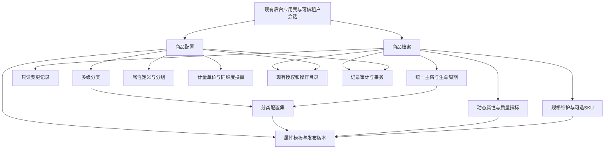

# 商品管理功能架构设计方案

日期：2026-11-17；版本：R2第二轮设计整改（新增规则均待评审）；状态：待评审建议；现状证据见01。所有新增行为均为设计，不代表已实现。

## 1. 范围与核心边界

商品作为独立主数据能力管理自身分类、档案、属性、规格、单位与变更。明确排除采购、销售、库存、合同、物流、结算、价格、客户/供应商映射和外部集成。质量属性只记录商品档案指标，不建检验任务、批次检测和质量判定流程。

商品形态 productForm：PHYSICAL 实物、SERVICE 服务；组合商品暂无证据，暂不发布 COMPOSITE 及组合明细。规格模式 specificationMode：STANDARD 标准、CUSTOM 自定义、NONE 无规格。两维独立，服务可有标准或自定义规格，不按形态推断模式。

Product 是统一商品主档，承担通常称为 SPU 的共性描述职责；不额外创建一张同义 SPU 表。Specification 是商品下面一条明确规格，承载标准组合或自定义说明。SKU 是可选独立编码身份，准确指向一条规格。推荐一规格最多一个 SKU；不因商品有规格而创建 SKU；NONE 直接使用商品主档，不允许伪造默认 SKU。若将来证实一规格需要多个编码，先定义编码类型再评审，不按假设放开一对多。

## 2. 功能架构



建议菜单树（保留主数据现有入口位置与商品路由，迁移后受控调整标题）：

```text
主数据
└─ 商品管理
   ├─ 商品档案       /master-data/product
   ├─ 商品分类       /master-data/product-category
   ├─ 属性管理       /master-data/product-attribute（含分组）
   ├─ 属性模板       /master-data/product-template（含版本）
   └─ 计量单位       /master-data/product-unit（含换算）
```

菜单是导航，不是授权来源；迁移旧菜单和自定义授权关系时保留标识或提供显式映射，不能仅插新菜单造成重复入口。

## 3. 分类、模板和版本

分类独立维护树和编码，不把品牌、具体商品或规格作为分类。模板独立维护四种用途 BASIC/SPEC/QUALITY/EXTENSION。一个分类配置集可为每种用途关联零或一个已发布模板版本，同一模板可复用于多个分类；需组合多个组时在同一个模板版本中编排，避免同用途多模板冲突。四种用途合并后按稳定attribute_id全局去重；品牌等固定字段统一在主档维护，首期不提供动态属性映射写入或重复定义，详见6.1。

分类每次调整模板关联形成不可变配置集 revision；商品选择分类时解析当前发布配置集并固定引用。分类移动、改名、停用或新配置发布都不改既有商品绑定。推荐不做隐式树继承；若有继承需求，可提供“复制父分类配置”作为编辑便利，但发布时固化显式结果。

属性定义采用稳定身份 + 不可变修订；模板版本固定引用某修订。发布后连名称、单位、枚举标签、校验规则都不原地覆盖，避免旧商品含义随配置变化。新定义修订不自动更新模板；新模板发布不自动更新分类；新分类配置发布不自动升级商品，三个动作各自有差异确认。

## 4. 方案比较

| 问题 | 选项及优缺点 | 推荐 |
|---|---|---|
| 分类与模板 | 分类内嵌属性简单但复用差；分类绑定模板当前版本易漂移；独立版本配置多一步发布但可审计 | 独立模板与分类配置集，引用确定版本 |
| 规格与SKU | 每规格强制SKU接口简单但生成无意义记录；规格兼任SKU字段少但身份与内容耦合；独立可选SKU多一表但语义清楚 | 规格与SKU独立，一对零或一 |
| 模板历史 | 原地覆盖省表但历史失真；商品全量复制模板独立但冗余大；不可变发布版可复用、迁移需明确 | 不可变定义修订与模板版本，商品固定引用 |
| 动态值 | 全JSON写入快但范围查询/约束弱；每分类独立表强类型但DDL频繁；类型化值表行数较多但统一查询 | 固定主档+类型化值表+有限JSON |
| 服务部署 | 新微服务隔离强但增加分布式事务与运维；继续共享通用CRUD开发快但耦合恶化；模块内专用领域服务最小改动 | 留在 master-data-service 内划分商品领域，保持公开边界 |
| 审核 | 接审批可控但需真实流程和权限；直接显式启用较轻且与现状接近 | 无审核基线，确认要求后才接现有能力 |

## 5. 技术组织与操作契约

后端建议在 master-data-service 内新增 product 子域：ProductApplicationService、CategoryService、AttributeService、TemplateService、UnitService 及固定 Controller/Repository；类名为建议，不在本阶段创建。用户已允许推翻旧商品功能，评审后直接替换旧商品Controller、DTO与页面实现，移除通用MasterDataService的PRODUCT分支；不保留双套商品执行器或运行时旧协议回退。其余主数据共用类型与分支不得整体删除，客商/仓库/地理能力须独立回归。保留Product对象语义与ID/历史不等于保留原实现。前端在 modules/master-data/src/product 内组织，apps/admin 只装配路由、HTTP 和错误翻译；跨包通过公开入口。

| 业务对象 | 建议真实操作 | 权限边界 |
|---|---|---|
| Product（稳定对象语义保留，旧实现可删除替换） | list/read/create/update/setStatus/previewStructure/migrateStructure/reviewLegacySpecification/readChanges/archiveDraft/restoreDraft | 沿用read/create/update/set_status；结构迁移新增独立权限 |
| ProductSpecification | list/create/update/setStatus/retire/createSku | 规格独立维护权限；所有操作复核父商品归属和状态 |
| ProductSku | setStatus | SKU停用不隐式停用商品或规格 |
| ProductCategory | list/create/update/setStatus/publishConfiguration | 分类维护与配置发布分开 |
| ProductAttribute | list/createRevision/publishRevision/setStatus | 读取不授予配置修改权 |
| ProductAttributeGroup | list/create/update/setStatus | 独立分组维护操作，发布模板保留组快照 |
| ProductTemplate | list/create/updateDraft/publish/retire | 发布与草稿编辑分权 |
| ProductUnit | list/create/update/setStatus/setConversion | 换算维护独立授权，商品读取可读必要单位选项 |

操作只在一处声明，接口引用不得重复登记；沿用 OperationBinding/BusinessObjectType 和统一 operation-decisions，不增加领域准入端点。审计记录属于原对象的只读资料，不建任意表全局查询器。详情读、变更读可共享 read 权限但保留不同 operationId；按钮绑定操作而非拼权限码。

建议固定 /api/master-data/product 前缀保留列表/新增/编辑，补 GET /{id}、GET /{id}/changes、POST /{id}/structure-preview（只读计算）、PUT /{id}/structure；其他对象采用明确固定资源路径。预览不写库，不代表后续执行已获授权或成功。规格/SKU命令携带父商品 version，结构变更使用单个聚合事务；禁止任意对象通用执行接口。详细参数见03/05，最终OpenAPI在评审后编制。

安全继续使用可信租户成员、AccessAuthorization、宿主Cookie/CSRF、no-store、绑定参数。接口忽略或拒绝客户端身份、审计和任意字段；所有关联ID检查同租户，撤权即时拒绝。新资源经受控权限迁移，普通角色不自动扩权。只接当前确实需要的能力，不登记审批/打印/通知空入口。

## 6. 第二轮整改：语义、版本和单位决策边界

### 6.1 四类属性归属（推荐模型，待确认D01）

| 用途 | 唯一值归属/值表 | 职责 | 边界 |
|---|---|---|---|
| BASIC | PRODUCT／md_product_attribute_value | 商品共性技术或描述属性 | 不重复固定主档字段、不参与组合 |
| SPEC | SPECIFICATION／md_product_spec_attribute_value | 商品下具体规格的区分值及规格补充信息 | 只有标记participates_combination的合规单值项参与标准组合 |
| QUALITY | PRODUCT／md_product_attribute_value | 商品档案声明的质量指标（如热值、纯度） | 不是规格检验、批次检测、测量记录或质量判定 |
| EXTENSION | PRODUCT／md_product_attribute_value | 不属于前三类的商品档案补充事实 | 不容纳采购、销售、库存等业务数据 |

推荐首期QUALITY仅归主档，范围明确且适配现有两类值表；备选是规格级质量项，更灵活但需混合用途路由、规格必填及历史迁移规则。本版不启用备选，不增加可自由配置的value_scope；若确认规格质量需求，必须同步重审模型、页面、筛选和状态规则，不能仅改一个开关。

同一配置集中跨四用途以attribute_id去重，即使引用不同revision也不得重复；发布事务生成配置项投影并由唯一键兜底，详见03§8.2。不同编码的同义属性无法仅凭ID自动识别，管理端应检索语义重复，并在发布审查中确认；不宣称数据库能理解自然语言。

商品编码、名称、简称、形态、分类、规格模式、品牌、产地、基础单位、条码、描述、状态与审计属于固定字段。品牌只存md_product.brand；保留语义编码集使用固定API字段名并识别其别名（如brand/品牌）。创建属性和发布模板时拒绝保留编码及已确认的同义定义。首期不做主档映射模板项；“品牌分组展示”只读取主档，不创建动态值。保留集不是可另建副本的模板字段清单。

### 6.2 完整版本引用链

推荐引用链为：`Product.category_config_id → CategoryConfig(id, revision_no) → CategoryTemplate(purpose, template_version_id) → TemplateVersion(template_id, version_no) → TemplateItem(attribute_id, attribute_revision_id) → AttributeRevision(attribute_id, revision_no)`。商品保存时同时固定 `category_id` 与 `category_config_id`，服务端校验配置属于该分类、四类用途各至多一个版本、版本均为已发布或历史可读状态。发布后配置、模板项、属性修订、枚举选项和单位快照不可原地修改；退役仅阻止新选，不影响已有商品读取。四用途为可空槽位，各至多一个模板版本，不强制配置四个空模板。分类配置本体只存发布结果；分类当前配置指针改变不编辑旧版本，已有绑定也不以“latest”重新解析。

分类或模板升级不是逐项替换：结构迁移必须在一个聚合事务中一次性切换完整配置集，重建全部当前值的配置引用并协调当前规格和SKU；退役规格保留其原配置引用，不强迫历史外键跟随商品当前配置，成功后递增 `structure_revision` 并追加快照。数据库使用带 `tenant_id` 的复合外键；数据库约束防止跨租户和直接错配，领域服务再校验用途、发布状态、重复语义和父子状态。

### 6.3 证据与推荐/待确认分离

以上为推荐逻辑模型，尚未获得业务批准。统一决策ID见README：D02推荐实物单位必填、服务可空（配置集service_unit_required可收紧）；D03关键结构变更先停用，普通资料/普通值不需要停用；D04分类深度8；D05草稿只归档不物理删除、30天仅作闲置提示；D06图片作为可选接入门槛，不阻塞核心；D07动态筛选限单配置集与3个条件；D08规格与SKU一对零或一。新增字段、操作和限制全部为设计建议。

## R3.1契约同步

本文件的V1契约同步[10 R3.1修订](10-商品管理R3.1契约修订说明.md)：草稿create仅code/name必填，模式由V1固定NONE，形态/配置/单位可空、已填始终合法；启用独立完整校验。status与新增structure_state正交，旧enabled=true映射历史启用但LEGACY_PENDING不属于完整新商品。结构预览/执行采用独立OpenAPI operationId、源version/structureRevision/config及固定目标四槽绑定，幂等请求结果与业务同事务，手动重放规则见10§3。旧规格original逐字保留并显式审查，不自动推NONE。发布四槽必须显式键/null，空配置集合法、零项模板不可发布。新增结构请求表和legacy字段纳入03逻辑全表审计约束、09的17表V1建议基线；均未实现或验证。


