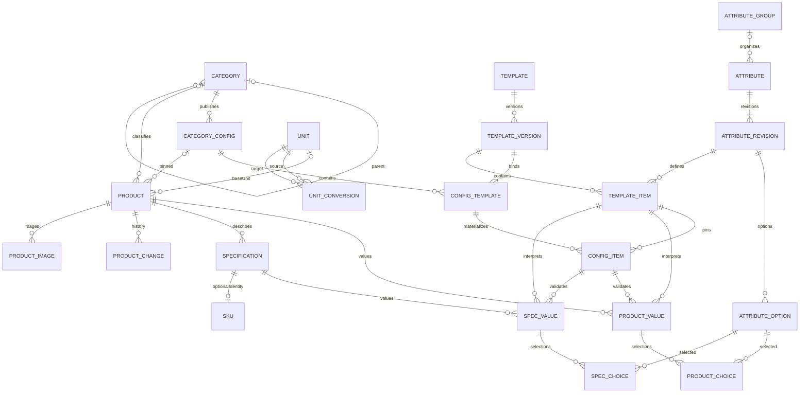

# 商品管理数据模型设计方案

日期：2026-11-17；版本：R2第二轮设计整改（新增规则均待评审）；状态：建议逻辑模型，不是可执行DDL。所有长度、容量和精度新增值是评审初值，实施前按样本和性能验证，不冒充既定业务限制。

## 1. 全表约定

下列每张自有表（包括发布关联、枚举、多选、快照、日志）首次 CREATE TABLE 都必须包含 id BINARY(16)、tenant_id BINARY(16)、created_by BINARY(16) NULL、created_at TIMESTAMP(6)、updated_by BINARY(16) NULL、updated_at TIMESTAMP(6)，并提供逐列中文注释。id由服务端生成UUID；账号来自可信认证上下文；时间由数据库UTC生成，不接受客户端输入。新记录时间由数据库初始化，已有历史未知时间仍NULL，不能回填迁移时刻。独立可变配置实体使用lock_version BIGINT默认0；md_product沿用version列名，API统一version。规格、SKU、属性值及图片隶属商品聚合，统一比较并推进商品version，不另设子级CAS版本。不可变发布子项和追加日志无独立CAS，但仍有四审计列，写入后禁止业务修改；模板/属性版本容器的state可PUBLISHED→RETIRED，只变状态和updated审计，内容与版本号仍不可变。分类配置本体只写已发布版本，不设原地编辑/退役状态；分类当前指针变化不销毁旧配置。

每表 PK(id)，并提供 UNIQUE(tenant_id,id) 用于复合外键；关联均带tenant_id的复合外键、ON DELETE RESTRICT，跨租户ID不可引用。账号审计不通过跨域外键读取账号表；名称通过已授权公开目录解析。本设计给出逻辑NULL/默认值与约束；实现前须核对MySQL CHECK、生成列、候选键及索引长度的实际DDL可执行性；本设计不更改V75/V83。

业务编码建议继承原64字符格式、租户内唯一、创建后不可修改。大小写等价沿用核实后的宿主排序规则，不擅自改变旧编码含义。编码不从分类路径派生，分类移动不改商品编码。SKU编码在本租户SKU空间唯一；商品编码与SKU编码属于不同对象域，所有引用必须携带对象类型，不设计裸码混合查找。

## 2. 核心关系

PRODUCT到CATEGORY的当前分类外键、规格值与SKU的父商品一致性等未全部画在ER中，以下约束表为权威补充。图中 CATEGORY_CONFIG 对 PRODUCT 可选仅用于未完成分类的草稿和迁移存量，不允许新商品绕过启用校验。

## 3. 核心表与字段建议

表名前缀沿用md_，以下以短表名说明完整新增名称；md_product保留原表和ID。每表均继承第1节全部公共字段，不因本表未重复书写而省略。

| 表 | 专有字段建议（中文含义、范围/缺省） | 关键约束 |
|---|---|---|
| md_product_category | code VARCHAR(64)必填；name VARCHAR(200)必填；parent_id可空根；enabled默认true；sort_order INT默认0；current_config_id可空未发布 | 同租户code唯一；父节点同租户；禁止自环及祖先环 |
| md_product_category_config | category_id必填；revision_no INT从1递增；display_path_snapshot VARCHAR(2000)保留发布时分类路径；service_unit_required BOOLEAN默认false（服务单位是否必填）；published_at数据库UTC | 同分类版本号唯一；发布即不可变；无模板也可发布空配置 |
| md_product_category_template | config_id、purpose、template_version_id必填 | UNIQUE(tenant_id,config_id,purpose)；用途必须与模板相符 |
| md_product_category_config_item | category_config_id、purpose、template_version_id、template_item_id、attribute_id、attribute_revision_id、data_type、owner_scope，均必填且服务端派生 | 发布时由绑定模板完整物化，UNIQUE(tenant_id,category_config_id,attribute_id)；不得手工增减，详见8.2；同样具备四审计列 |
| md_product_attribute_group | code、name；sort_order默认0；enabled默认true | 租户code唯一；分组无数据类型或值语义 |
| md_product_attribute | code；group_id可空；current_revision_id可空；enabled默认true | 稳定语义身份；已引用不得复用code表示另一含义 |
| md_product_attribute_revision | attribute_id、revision_no；name；data_type；unit_id可空；unit_code_snapshot/name_snapshot；numeric_scale可空0–12；validation_json；state=DRAFT/PUBLISHED/RETIRED；published_at（DRAFT为NULL，发布时数据库UTC） | UNIQUE(tenant_id,attribute_id,revision_no)；发布不可变；类型/单位改变必须新修订 |
| md_product_attribute_option | revision_id；option_code VARCHAR(64)；label VARCHAR(200)；sort_order默认0 | UNIQUE(tenant_id,revision_id,option_code)；标签随修订固定，不能删除旧选项 |
| md_product_template | code、name；purpose=BASIC/SPEC/QUALITY/EXTENSION；enabled默认true | 租户code唯一；用途创建后不改 |
| md_product_template_version | template_id、purpose（由模板派生）；version_no从1递增；state=DRAFT/PUBLISHED/RETIRED；description VARCHAR(1000)默认空；published_at可空 | 同模板版本号唯一；已发布/退役正文不可变，退役只是禁止新选 |
| md_product_template_item | template_version_id、attribute_id、attribute_revision_id、purpose、owner_scope、data_type；group_code/name_snapshot；sort_order；required默认false；searchable默认false；allow_custom默认false；participates_combination默认false | 同模板version中同attribute身份只能一次；BASIC/QUALITY/EXTENSION的owner_scope固定PRODUCT；SPEC固定SPECIFICATION；只有SPEC可参与组合 |
| md_product | 保留code/name/barcode/version及原审计；新增short_name VARCHAR(100)可空、category_id/category_config_id可空草稿、product_form、specification_mode、description TEXT可空、brand VARCHAR(200)可空、origin_text VARCHAR(200)可空、base_unit_id可NULL及base_unit_code_snapshot/base_unit_name_snapshot、status、structure_state（LEGACY_PENDING/INCOMPLETE/COMPLETE）、legacy_enabled_snapshot BOOLEAN可NULL、legacy_specification_original TEXT可NULL、legacy_specification_disposition可NULL、draft_archived_at TIMESTAMP(6)可NULL、structure_revision BIGINT默认0 | 新建草稿默认DRAFT、structure_state按校验计算；新启用要求COMPLETE；启用必须补全分类、配置、形态、模式；实物单位必填，服务按配置可空；迁移未确认的形态/模式允许NULL并阻止新结构操作 |
| md_product_specification | product_id、category_config_id（规格当时绑定配置）；mode=STANDARD/CUSTOM；name VARCHAR(200)可空；description VARCHAR(2000)可空；combination_canonical TEXT可空；combination_hash BINARY(32)可空；current_combination_hash BINARY(32)生成列（退役时NULL）；enabled默认true；display_order默认0；retired_structure_revision BIGINT可空 | 当前标准组合规范串非空且唯一（含当前停用规格）；退役不占当前唯一空间；自定义允许描述，但不得空记录；NONE禁止当前结构规格；退役记录保留 |
| md_product_sku | product_id、specification_id；code VARCHAR(64)；enabled默认true | 同租户code唯一；UNIQUE(tenant_id,specification_id)；同租户同商品复合外键保障父一致 |
| md_product_attribute_value | product_id、category_config_id、template_item_id、attribute_revision_id、owner_scope=PRODUCT；value_type；text_value VARCHAR(2000)、integer_value BIGINT、decimal_value DECIMAL(30,12)、boolean_value BOOLEAN、date_value DATE（均可空但按类型择一） | UNIQUE(tenant_id,product_id,template_item_id)；只能引用本商品固定模板中的非SPEC项 |
| md_product_spec_attribute_value | product_id、specification_id、category_config_id、template_item_id、attribute_revision_id、owner_scope=SPECIFICATION；同上类型值列 | UNIQUE(tenant_id,specification_id,template_item_id)；仅SPEC项；配置与规格捕获配置一致；当前规格必须与商品当前配置一致，退役规格保留原配置 |
| md_product_attribute_choice | value_id、attribute_revision_id、option_id可空、custom_text VARCHAR(2000)可空、choice_key VARCHAR(64) | 每行选项ID或自定义文本恰一；父值内choice_key唯一 |
| md_product_spec_attribute_choice | spec_value_id、attribute_revision_id、option_id/custom_text/choice_key同上 | 多选规范同上；标准组合参与项禁止自定义文本和多选 |
| md_product_unit | code、name；dimension_code VARCHAR(64)必填；precision_scale INT默认0范围0–12；enabled默认true | code唯一；维度/精度有引用后不可直接改；名称变更保留历史快照 |
| md_product_unit_conversion | from_unit_id、to_unit_id、dimension_code（两端相同）；factor DECIMAL(30,12)必填且>0；enabled默认true | 同租户源/目标唯一；不能同一单位；两端必须同维度 |
| md_product_image | product_id；file_id（类型按文件公开契约确定）；sort_order默认0；is_primary默认false；caption VARCHAR(200)可空 | 图片数量初建议10张；至多一张主图；文件租户授权需复核 |
| md_product_structure_request | 真实account_id、product_id、operation_code、request_key、payload_digest、result_product_version、result_structure_revision、change_id、result_json、completed_at、expires_at；继承全部公共四审计列 | 同tenant/account/product/operation/key唯一；与业务同事务；成功结果不可变；窗口7天设计建议，详见10§3 |
| md_product_change | product_id；event_type；from_version/to_version；before_snapshot_json/after_snapshot_json；reason VARCHAR(1000)可空；schema_version INT默认1；from_structure_revision/to_structure_revision BIGINT；配置与标签快照 | UNIQUE(tenant_id,product_id,to_version)；服务端同事务追加；不存凭据或临时下载URL |

组合哈希采用SHA-256仅用于索引，原规范串必须保留供复核；哈希相同且规范串不同应报冲突并诊断，不能静默判为相同。值归属用复合FK/CHECK兜底；跨项必填、状态和单位规则由领域服务在事务中验证，不能交给数据库CHECK或前端。品牌等固定字段只存主档，首期拒绝动态属性重复定义，不引入field_binding；保留字段语义审查见02§6.1。

## 4. 属性类型、值与JSON边界

| 编辑类型 | 持久化/校验 | 单位/规则 |
|---|---|---|
| TEXT | text_value；默认最多2000字符，可由修订设置更小上限 | 可设置长度及受限格式，不执行管理员脚本 |
| NUMBER | 映射DECIMAL，scale缺省6，可配置0–12 | 精确数值，禁止NaN/Infinity/指数隐式舍入 |
| INTEGER | integer_value，64位有符号范围 | API用十进制字符串，避免JS大整数丢精度 |
| DECIMAL | decimal_value，DECIMAL(30,12)；有效小数位不超过修订scale | API字符串，超精度拒绝，不静默四舍五入 |
| BOOLEAN | boolean_value | false是合法值，不按空值处理 |
| SINGLE_SELECT | 一个choice行 | 仅所引用修订的option；allow_custom时可替代为明确自定义文本 |
| MULTI_SELECT | 多个choice行，顺序无语义，去重 | 默认建议最多50项；不是逗号字符串 |
| DATE | DATE，ISO YYYY-MM-DD | 不转换时区；不是UTC时间点 |

“数值型”作为NUMBER编辑类型与DECIMAL共用精确数值存储，不另造浮点类型；INTEGER保留整数约束。单位只允许数值类型；范围min/max、是否含边界、scale及长度写入validation_json，并在发布时校验规则合法性。JSON仅存有限声明式元数据，不允许任意表达式、SQL、代码或无界正则。建议首期仅提供有限格式预设，确需正则须增加安全执行边界评审。

单/多选父值行不填标量列；choice必须与父项修订匹配；单选恰一、多选按最小/最大项数。可选空值采用无值行，不混用空字符串、NULL和“未填”；文本空白能否有效由修订规则明确，默认视作未填。零和false不缺失。

业务属性值不能以全部JSON作为权威存储。变更快照可使用JSON保留完整当时视图、模板/修订ID、单位/枚举显示值以及规格/SKU差异，供历史展示；查询当前商品始终基于结构化表，不能以快照绕过授权或回放任意写入。

## 5. 标准组合与可选SKU

参与组合项限SPEC用途且是单值、稳定可规范化类型（首期推荐单选、整数、小数、布尔；日期需明确需求后开放，文本和多选不参与）。STANDARD必须有至少一个组合项，保存的每条规格要填齐这些项；附加说明项不影响唯一性。按attribute稳定ID排序，包含修订ID、类型、规范值/稳定option_code生成规范串，小数去无意义尾零，顺序不影响组合。单位固定于修订，不接收任意显示单位参与签名。

CUSTOM可填同模板约束的结构化规格值与说明，完全按需新增，不执行笛卡尔积；仅描述的同名记录提示重复而非假定业务唯一。用户显式建立SKU时必须选择已保存、有效且非空规格，编码服务端唯一校验；不自动给所有规格编码。标准组合也可仅维护规格不建SKU。NONE不创建规格及SKU，商品主档即完整对象。

结构迁移退出的规格不物理删除：在retired_structure_revision记录退出时结构修订号，当前规格查询只选该列为NULL；所关联SKU保留编码和归属但不可有效使用，不回收编码。STANDARD/CUSTOM到NONE时必须显式退出全部当前规格并确认关联SKU影响。历史退役规格不允许恢复或重新绑定；current_combination_hash生成列仅在未退役STANDARD记录上等于combination_hash，其他为NULL，唯一键限定当前结构（包含停用规格）。新结构可显式创建与退役规格同组合的新记录，但必须新ID、新SKU编码并记录替代关系，不能恢复旧SKU身份。这样既满足NONE无当前规格，也不破坏SKU身份历史。

## 6. 单位和查询索引

通用换算仅显式同维度线性关系 q_target=q_source×factor；不存偏移、不自动走多跳路径、不自动生成反向关系。增加反向边时需校验往返系数在约定精度内一致；换算过程中采用BigDecimal，展示按目标精度，超精度的保存策略由属性规则决定，不能静默改值。质量与体积、箱与件、依赖商品密度/包装的换算不属于通用单位能力。件、箱可设不同计数维度，不能只因都是计数就默认可互换。factor已引用后停用旧关系再新增版本的需求需评审；本期不在属性读写中自动套用可变换算规则，商品值始终以定义单位存储。

推荐索引：

| 查询 | 索引/策略 |
|---|---|
| 商品列表 | (tenant_id,status,code,id)、(tenant_id,category_id,status,id)；按查询计划决定是否增加形态/模式组合，避免低基数全排列索引 |
| 分类子树 | (tenant_id,parent_id,sort_order,id)；初期邻接表+递归CTE，同租户限制与循环检测；树移位在租户级分类锁下串行 |
| 模板 | (tenant_id,template_id,state,version_no)、关联外键索引 |
| 规格/SKU | (tenant_id,product_id,enabled,id)、UNIQUE(tenant_id,product_id,current_combination_hash)、SKU编码唯一 |
| 数值/日期属性 | (tenant_id,template_item_id,decimal_value,product_id)、对应integer/date索引按真实可搜索项需求建立 |
| 枚举筛选 | choice(tenant_id,option_id,value_id)；先限定租户/模板，EXISTS避免多选导致商品分页重复 |
| 历史 | (tenant_id,product_id,to_version)倒序 |

keyword兼容旧含义；新增code/name分别筛选，编码支持精确/前缀，名称初期字面包含。大规模名称包含和文本属性检索先测量，不承诺B-tree解决、不提前引入搜索引擎。动态搜索只开放所选确定category_config_id的searchable项；首期不跨版本或跨配置合并，即便同类型同单位也不隐式合并。使用范围及操作符见8.4。

## 7. 历史和迁移兼容

md_product旧specification/unit原文迁移期保留为legacy只读字段；不把字符串当新单位外键。通过BusinessValueCatalog公开契约导出本租户单位稳定值，形成显式映射；歧义/未知单位进入待确认，禁止按显示名模糊关联。独立单位上线后是唯一写源，旧product_unit停止商品用途维护或只读展示；受控迁移引用关系，不能跨模块直接改字典表，其他字典不受影响。

旧enabled=true/false仅映射历史ENABLED/DISABLED并设置structure_state=LEGACY_PENDING，不代表新启用校验通过；缺失分类、形态和模式保留未知，不伪造历史业务事实；标记“待完善结构”，允许原只读和停用操作，结构迁移/重新启用前必须补齐。旧规格原文放入legacy_specification，可由用户明确选择转成CUSTOM规格，或保留在主档历史备注；不能自动推断标准组合或创建SKU。旧创建和修改审计逐列原样保留NULL。

业务修订通过change快照保留旧分类配置及属性值；迁移时在一次事务中写新当前值并追加迁移前后快照，旧模板/定义/配置行不删除。字段删除只是退出新模板，不擦除旧快照。若未来需要按任意历史时刻结构化查询，才评估全量有效期值表；本期历史读取与对比以受控JSON快照足够，避免过度建设时态数据库。

## 8. 第二轮整改：完整性、属性语义和单位规则

### 8.1 属性语义与唯一归属

BASIC、QUALITY、EXTENSION只归商品主档；SPEC只归规格。采用固定purpose→owner_scope映射（PRODUCT/SPECIFICATION），不开放可配置value_scope。模板项和配置项保存这两个服务端派生字段并CHECK对应关系；值表以常量owner_scope约束去向。QUALITY只代表商品档案指标，不代表规格/批次检验；备选及保留字段处理见02§6.1。

### 8.2 复合外键、唯一键与三层职责

以下为建议键集合，不是可执行DDL。所有元组首列均为tenant_id。父表对被引用元组显式建立UNIQUE，不能依赖MySQL非唯一索引外键扩展。新增冗余标识只由服务端从发布链派生，不能由客户端分别指定。

| 引用约束 | 子元组 → 父候选唯一元组 |
|---|---|
| 分类配置归属 | config(T,category_id) → category(T,id)；UNIQUE config(T,category_id,id) |
| 商品分类一致 | product(T,category_id,category_config_id) → config(T,category_id,id)；category_config_id非NULL时category_id必非NULL；category_id可先选、配置未定仅限草稿 |
| 分类当前配置指针 | category(T,id,current_config_id) → config(T,category_id,id)，新分类先NULL后发布；不靠禁用FK插入 |
| 模板版本用途 | version(T,template_id,purpose) → template(T,id,purpose)；绑定(T,template_version_id,purpose) → version(T,id,purpose) |
| 模板项修订 | item(T,attribute_id,attribute_revision_id,data_type) → revision(T,attribute_id,id,data_type)；item(T,template_version_id,purpose) → version(T,id,purpose) |
| 配置项属于绑定版本 | config_item(T,category_config_id,purpose,template_version_id) → binding(T,config_id,purpose,template_version_id) |
| 配置项固定模板项 | config_item(T,template_version_id,template_item_id,purpose,attribute_id,attribute_revision_id,data_type,owner_scope) → item对应唯一元组；两表CHECK均强制SPEC→SPECIFICATION，其余→PRODUCT |
| 跨四模板语义唯一 | UNIQUE config_item(T,category_config_id,attribute_id)；模板项UNIQUE(T,template_version_id,attribute_id) |
| 主档值固定配置 | value(T,product_id,category_config_id) → product(T,id,category_config_id) |
| 值固定模板/修订/类型 | 两类value(T,category_config_id,template_item_id,attribute_revision_id,value_type,owner_scope) → config_item对应唯一元组；CHECK主档owner_scope=PRODUCT、规格owner_scope=SPECIFICATION |
| 规格与商品/旧配置 | specification(T,product_id) → product(T,id)；specification(T,category_config_id) → config(T,id)；不将历史规格FK指向商品“当前配置” |
| 规格值归属 | spec_value(T,product_id,specification_id,category_config_id) → specification(T,product_id,id,category_config_id) |
| SKU父子一致 | sku(T,product_id,specification_id) → specification(T,product_id,id)；UNIQUE sku(T,specification_id)，编码租户唯一 |
| 选项修订一致 | choice(T,value_id,attribute_revision_id) → value(T,id,attribute_revision_id)；choice(T,attribute_revision_id,option_id) → option(T,revision_id,id)，spec_choice同理 |
| 属性单位与换算 | revision(T,unit_id) → unit(T,id)；CHECK非数值类型unit_id为NULL、INTEGER的numeric_scale为0；conversion两端各用(T,unit_id,dimension_code)指向unit，CHECK两端不同且factor>0 |

T代表tenant_id。binding为md_product_category_template；config_item为md_product_category_config_item；表中简称只为阅读，不是另一套表。template_version需新增purpose作为受FK约束的用途冗余；配置项必须与绑定版本所有模板项逐项完全一致，发布事务全量生成，禁止遗漏/额外项。数据库唯一键阻断重复attribute_id，服务校验阻断“漏项”。候选键中的id仍保留全表约定主键；所有账号、时间及关联表四审计列不可省略。

| 规则 | 数据库 | 领域服务（最终权威） | 前端 |
|---|---|---|---|
| 多租户及父子归属 | 上述复合FK、RESTRICT、非空与唯一键 | 授权后读取并校验状态/父对象 | 只展示已授权候选，仍不作为授权依据 |
| 标量值互斥 | CHECK按value_type恰有一项正确标量非NULL；选项类型全部标量NULL；禁止“最多一个但全空”的标量行 | 解析值、拒绝空行/未知项；选项计数 | 类型匹配的控件、错误定位 |
| 必填完整性 | FK不能证明跨行必填 | 草稿允许缺值；启用校验所有主档必填及当前有效规格的SPEC必填；CUSTOM无规格时不强造值 | 必填星号和提示，0/false不判空 |
| 枚举 | option修订一致、每父值规范choice_key唯一；option_id/custom_text恰一 | 单选恰1、多选范围/去重/allow_custom、自定义规范化；当前版本不得引用另一修订选项 | 显式自定义入口，不自动新增枚举 |
| 数值与单位 | BIGINT/DECIMAL(30,12)、FK、scale范围CHECK；NUMBER/DECIMAL精度按修订约束 | 入库前BigDecimal检查整数18位上限、scale、min/max，拒绝数据库自动舍入；无隐式单位换算 | 十进制字符串、固定单位标签 |
| 当前/历史规格一致性 | 规格捕获配置与值表FK，当前组合唯一生成列 | 未退役规格配置必须等于商品当前配置，mode一致；退役不可改；NONE无当前规格 | 分开显示当前/历史，不把隐藏当退出 |
| 不可变发布内容 | RESTRICT保引用；FK本身不能禁止UPDATE | 限定写入口，发布后禁止改正文/关联/枚举；退役只改状态和updated审计 | 已发布只读，复制新草稿 |
| 启用与形态 | 可空单位、合法形态/状态CHECK | 按8.3及05矩阵决定是否可启用 | 规则跟随后端配置，不能单独放宽 |

迁移事务顺序：校验并锁定源/目标→构造旧快照→删除/重建当前值（保留未变逻辑项的创建审计）→标记退出规格退役，保留其旧值和旧配置→切换商品category_id/category_config_id及structure_revision→为保留规格重建目标配置值，或建立替代规格→校验当前结构完整性→追加after快照并提交。MySQL不支持延迟外键，旧主档值必须在切换父配置前撤下，目标值在切换后插入；同一事务外不可见中间状态。若任一步失败，数据、审计、版本和快照全部回滚。当前规格一致性是跨行规则，由服务最终检查；历史规格保留旧配置不是违规。

NUMBER/INTEGER/DECIMAL可带属性单位，其他类型禁止；无单位数值也合法（如比例，需声明定义）。unit.precision_scale表示通用显示/换算精度，不替代属性numeric_scale；两者不能在读取时相互覆盖。单位维度/精度有引用后不可改，名称变化用发布快照保留历史。基础单位与属性单位各自独立，不因商品基础单位改变就换算所有属性。

### 8.3 实物/服务基础单位方案比较

| 方案 | 优点 | 风险 | 建议 |
|---|---|---|---|
| A：所有商品必填 | 契约简单、列表统一 | 服务商品可能没有自然计量单位 | 不推荐默认采用 |
| B：实物必填、服务可空 | 符合商品形态差异，减少虚构“项/次” | 列表和下游读取需处理NULL；服务商品启用规则分支 | **推荐待确认** |
| C：服务强制“服务项”伪单位 | 查询简单 | 把占位文本当真实计量单位，污染单位维度 | 不推荐 |

推荐B：`product_form=PHYSICAL` 启用必须有 `base_unit_id`；`SERVICE` 可为空，但分类配置集service_unit_required=true时仍须填写。数据库 `base_unit_id` 可NULL，服务端按形态和固定配置集规则校验，前端仅在实物或配置集要求时标必填。若评审选择A，只需收紧启用校验和前端规则，不改变配置版本链；C不作为实施备选；若业务确认真实服务计量单位，可正常配置“次/小时”等单位，不能系统强造占位单位。service_unit_required为配置集固定字段规则，不产生动态属性值。

### 8.4 分类树、草稿及筛选参数（设计初值，待确认）

| 参数 | 建议值、单位、环境与效果 |
|---|---|
| 分类深度 | 全租户统一最大8层，根为1，发布/移动时检查目标祖先深度+子树高度；不是限制单次返回8条 |
| 树页容量 | 每层默认50节点、范围1–100，懒加载与分页；全树搜索由服务返回祖先路径，禁止浏览器一次取全树 |
| 闲置草稿 | 距updated_at达到30×24小时（UTC时长）仅标记“闲置”，不定时删除、不自动归档；NULL历史不猜测天数 |
| 草稿归档 | draft_archived_at数据库UTC、可空；仅DRAFT可人工归档/恢复，数据与编码都保留，不是第四生命周期状态 |
| 动态筛选 | 单次最多3个条件、一个category_config_id；AND语义；新接口参数见04§8.3；不跨版本合并 |
| 标准组合 | 沿用每商品500条的待压测初值；服务预计算，超出拒绝而非截断 |

分类使用邻接表、同租户递归CTE和(tenant_id,parent_id,sort_order,id)索引；迁移树时在租户级互斥下校验环及整个子树深度，失败回滚。查询只读，不持有写锁；节点与总数按实际查询，深度限制不代表性能已验收。性能基线与吞吐阈值需实施前实测，不预设必须增加搜索引擎或闭包表。

动态筛选初期支持INTEGER/NUMBER/DECIMAL的eq/gte/lte/between、DATE的eq/between、BOOLEAN的eq、枚举的eq/anyOf；范围检查类型一致。TEXT以及自定义枚举文本不开放动态筛选；发布searchable=true的TEXT项首期直接拒绝，不能显示无效入口；其他可搜索枚举仅查询标准选项，自定义文本不参与并在界面说明。枚举anyOf限同修订选项，条件间AND、同一anyOf内OR。SPEC条件必须在同一条未退役且enabled规格上同时成立，避免规格A/B各命中一半错误匹配；商品主档条件与该EXISTS用AND连接。已停用商品仍可查询，规格筛选默认仅有效规格并在页面注明；历史退役数据不参与。

草稿的归档和恢复沿用商品聚合CAS/审计/快照，独立操作Product.archiveDraft/restoreDraft，建议共享masterdata.product:manage_draft新权限；草稿默认租户内授权可见，创建人不构成额外访问权。物理删除、编码回收和自动清除文件都不纳入本次草稿策略。30天是提示阈值而非数据保留期限。

## R3.1契约同步

本文件的V1契约同步[10 R3.1修订](10-商品管理R3.1契约修订说明.md)：草稿create仅code/name必填，模式由V1固定NONE，形态/配置/单位可空、已填始终合法；启用独立完整校验。status与新增structure_state正交，旧enabled=true映射历史启用但LEGACY_PENDING不属于完整新商品。结构预览/执行采用独立OpenAPI operationId、源version/structureRevision/config及固定目标四槽绑定，幂等请求结果与业务同事务，手动重放规则见10§3。旧规格original逐字保留并显式审查，不自动推NONE。发布四槽必须显式键/null，空配置集合法、零项模板不可发布。新增结构请求表和legacy字段纳入03逻辑全表审计约束、09的17表V1建议基线；均未实现或验证。

