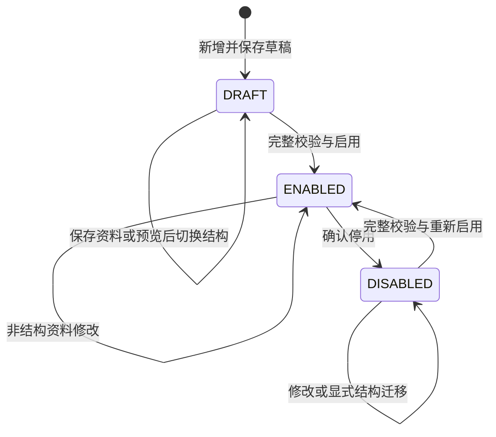
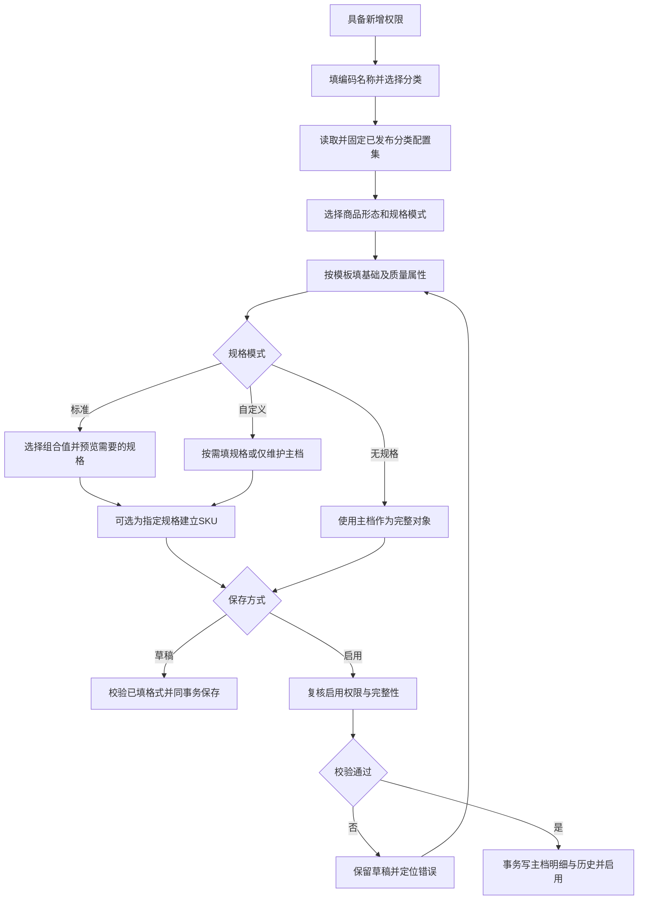
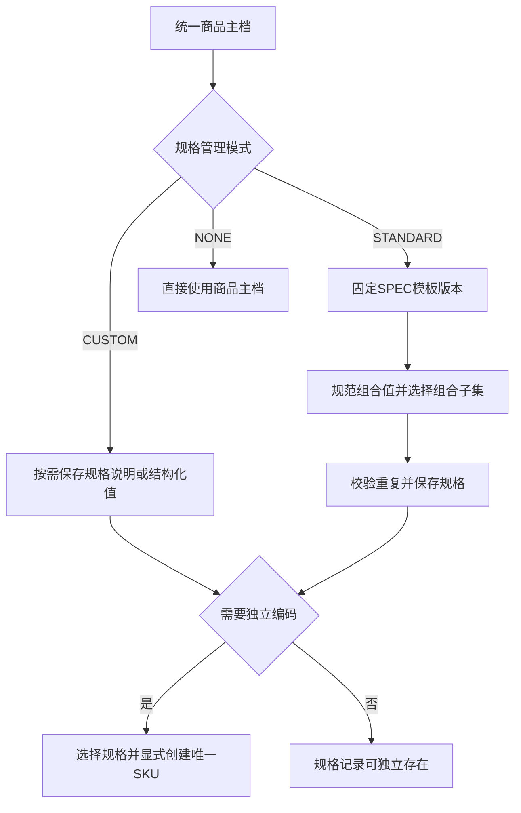

# 商品管理业务规则与状态流转说明

日期：2026-11-17；版本：R2第二轮设计整改（新增规则均待评审）；状态：评审建议。状态、限制和操作规则均待批准；现有商品只有enabled，不宣称已有以下状态机。

## 1. 商品生命周期

推荐DRAFT草稿、ENABLED已启用、DISABLED已停用。现有商品无审核要求或真实商品审批绑定证据，首期不增加PENDING_REVIEW；如果确认审核，后续必须明确提交、撤回、退回、审核权限、禁止自审规则及审批回调幂等，并接现有审批能力后才展示入口。

无永久删除/回草稿操作；草稿管理推荐人工归档/恢复，30天仅闲置提示，默认不执行定时清除，详见7.4。V1 create只建草稿，启用为后续独立setStatus命令，不提供单事务保存并启用。草稿required可缺、已填值始终合法，详见10§1。

| 操作 | 前置与结果 |
|---|---|
| 新建 | 编码/名称和已填值格式合法；默认DRAFT，不能指定审计或租户 |
| 编辑共性资料 | 名称、简称、描述、品牌、产地、图片与不改变含义的现有属性值可在启用态编辑；乐观锁及完整性校验；保存追加历史 |
| 分类/配置、规格模式、基础单位变更 | 推荐先停用；预览后显式迁移，完成必填与不兼容处置；不把普通名称改字当结构迁移 |
| 商品形态变更 | 按7.2矩阵，启用态先停用、一次性迁移；不能自动删规格 |
| 停用商品 | 保留全部明细；不批量改写子规格/SKU自身enabled，父状态决定有效可用性 |
| 重启用 | 当前记录完整且未归档；旧绑定退役仍允许保持，分类与非空单位须有效，实物单位必填、服务按固定配置可空；退役定义不允许新增选用 |
| 模板新发布 | 不触发商品状态或值变化；旧商品明确迁移才改变绑定 |

停用/退役配置的“新选用”和“已有引用保留”分开：模板版本RETIRED禁止新商品选择，但已有商品读取、普通修改可保持原绑定。商品迁移到目标时目标分类/配置/模板必须允许新选用；冻结于旧枚举的历史值可原样保持，不得新增为另一记录的新值。

## 2. 商品新增流程

用户尚未选择分类时可以保存不完整草稿，不进入模板读取步骤；以上图保留完整远期建档概念路径，V1的“启用”分支必须先完成create草稿事务再独立setStatus，不能一次POST跳过草稿。V1仅NONE。四槽均NULL的已发布空配置集合法；零项模板不可发布，未绑配置与读取失败均不等于空配置。

## 3. 标准与非标统一流程

“标准品/非标品”是使用场景描述，不新增standard_product与custom_product两张表。STANDARD允许只保存一组实际规格，也允许多组；不强制全量笛卡尔积。CUSTOM不强制规格记录和SKU；STANDARD启用前建议至少一条有效规格；NONE不能保存任何当前规格/SKU。历史退出的规格通过retired_structure_revision留存，SKU身份及编码不删除，变更快照保存当时视图，不代表当前有效记录。

同商品未退役结构中的同标准规范组合（含停用规格）不得重复新增，停用规格恢复用启用操作。结构退役不可恢复；新结构可显式建立同组合的新规格，但须新ID与新SKU编码，不沿用退役身份，唯一键使用current_combination_hash。模板升级会改变签名中的修订信息，但所有当前规格必须一次性迁到同一商品结构版本，不允许新旧签名混存绕过去重。

规格无SKU时可普通编辑，仍需父版本和完整校验；已有SKU的规格组合关键值或自定义语义变化可能改变独立编码含义，推荐禁止原地重写，需停用旧SKU/规格并建新规格及新SKU。只修正文案不改变规格含义时保留身份并记录差异。已有SKU无论启停都不改码、不重绑其他规格；停用编码不回收。

有效规格 = 商品ENABLED且structure_state=COMPLETE且规格未结构退役且规格enabled；有效SKU = 有效规格且SKU.enabled；父停用只阻断有效性，不改变各自状态。重新启用父商品时需要展示可能恢复有效的规格/SKU清单，并验证引用。规格停用同样不自动改变SKU.enabled，但界面明确“受上级停用影响”；重启用需确认恢复影响。多级状态只表示商品自身可用，不设计任何下游交易行为。

## 4. 模板和分类变更规则

- 分类树只表示导航与归属，不隐式继承模板。移动必须同租户、不能移到自身/后代；停用有启用后代时推荐阻止，提供逐项处理，不静默级联。已有商品允许只读和保留引用，新商品不可选停用分类；重启用须有效分类。
- 分类改名/移动不更新商品固定配置，详情提供当前与绑定时路径。分类模板关联变化发布新配置集；不能直接修改原发布关联行。
- 模板发布校验：稳定attribute_id不重复、修订已发布、用途一致、单位与类型匹配、单选/多选有有效选项或允许自定义、组合项符合类型边界、规则自洽、无主档保留语义冲突。发布版本号并发唯一；失败全回滚。
- 属性单位、类型、枚举名称或规则变化产生新修订；模板显式引用新修订才生效。分组名称和顺序在模板项固化，分组管理改名不影响已发布版展示。
- 分类配置发布对四类模板合并去重：同attribute_id即使不同修订也禁止重复，完整生成config_item投影；品牌等固定字段拒绝动态副本，QUALITY只属商品档案。
- 模板发布后不可删除字段或选项。退役禁止新选但保留读取。没有任何“管理员改模板后批量自动刷新商品”的后台任务。

迁移分三步：只读预览→用户补齐目标值/确认退出字段→服务端同事务重算并执行。只自动带入同稳定属性、同类型、同单位且满足目标规则的值；类型/单位变化不自动转换。旧枚举码在目标修订存在且含义未变才可带入；改码需要显式映射。已建商品结构迁移需补全目标必填再提交；DRAFT结构切换可保存未完整值但仍不能启用。退出字段需显式确认，迁移前完整快照不删除。目标配置或父商品版本变化返回409，重新预览，不能用旧预览无条件写入。

## 5. 并发、事务、幂等和参数

每次主档、属性、规格、SKU或图片变更都锁定/比较同一个商品version，并成功后加1、推进父updated审计；子项保留自身创建信息。批量规格保存为一次聚合命令，任何一项失败则全回滚，禁止部分SKU成功却返回整体失败。父商品查询及所有子项查询带同租户边界；不允许跨父ID替换。

分类发布/停用与商品选择、模板退役与商品新增的竞态应通过固定锁序和数据库行锁串行化：先配置资源（分类→配置→模板→属性→单位，按ID排序），再商品、规格/SKU；发布器遵循相同次序。事务中重读引用有效性，不能只读预览时校验。分类移动统一锁现有租户锚点行实现本租户分类树互斥（不为加锁创建无审计临时表），防止并发互相迁入形成环。最终实现需死锁反向测试，超时回滚不自动重放命令。

所有商品聚合写入同事务完成当前数据、字典/文件引用（仅限本地可事务的引用元数据）、商品变更和记录审计。外部文件上传不纳入数据库事务：先临时上传、保存时校验已授权文件引用、失败未引用临时文件由文件服务既有清理机制处理；若现有服务无此能力则先不交付图片写入。

R3.1结构迁移采用10§3的预览签名、source版本绑定及专用幂等请求表，与业务同事务提交；成功重放重新鉴权，不再执行旧CAS。普通create/update仍仅唯一/CAS保护，不宣称支持幂等键重放；写请求不自动重放。

| 参数 | 建议契约 |
|---|---|
| version | 当前非负CAS版本，修改必填；创建请求不传，服务端初始化0；与模板version_no及structure_revision不同 |
| structureRevision | 当前结构修订号，结构迁移必填，成功递增；普通资料/属性/SPEC值/SKU状态修改不改变 |
| categoryConfigId | 确定发布配置集UUID，不传“latest”；新选可用性服务端复核 |
| page/size | 页码1起默认1；容量默认20，1–100，列表/历史统一；真实total |
| preview组合上限 | 初建议每商品500条，仅预览/保存容量保护；超出提示缩小组合，不丢截尾数据，压测后确认 |
| reason | 结构迁移/停用建议必填，最多1000字符；普通文字修正可空；不得填凭据 |
| 属性整数/小数 | 十进制字符串，精度见03；单位来自发布修订，客户端不可另传单位改变含义 |
| audit/tenant/operator | 只读或拒绝输入；实际主体与UTC时间由服务端/数据库确定 |

这些是接口设计参数，不是本次新增环境变量或系统配置。实施引入配置化容量时，每个配置必须相邻中文说明单位、默认值、环境、生效条件与影响。

## 6. 异常场景

| 场景 | 服务端及页面处理 |
|---|---|
| 编码并发重复 | 唯一约束409；返回稳定冲突码，保留输入，不创建第二条 |
| 标准组合重复/哈希碰撞 | 对规范串复核；重复409；碰撞阻断并诊断，不合并数据 |
| 版本过期 | 409；事务及审计不推进，提供最新数据与草稿差异 |
| 分类、单位或目标模板提交前停用 | 再校验拒绝新选用；旧值原样保持按引用规则放行 |
| 已发布属性改类型/删除枚举 | 原版拒绝修改，创建新修订；旧商品继续按旧定义解释 |
| 模板升级新增必填 | DRAFT可留缺失；DISABLED结构迁移提交前须补齐，重新启用再验证 |
| 切分类旧值不兼容 | 明确处置/映射，取消可恢复；禁止静默清空 |
| NONE切换时存在规格/SKU | 不能仅隐藏；停用并迁移，旧编码不回收，历史保留 |
| 非法跨租户/跨商品明细ID | 授权后统一不可访问响应，不泄露存在性、不写日志正文中的他租户数据 |
| CSRF缺失/会话过期/撤权 | 宿主安全链拒绝；前端按401/403契约处理，不继续显示失去权限的旧正文 |
| 任一子项失败、死锁、审计写失败 | 整个聚合回滚；不宣称保存部分成功 |
| 请求写超时 | 按10§3读取核实，结构迁移可手动同key同载荷重放；禁止自动重发 |
| 历史账号或时间NULL | 显示“系统执行或历史未记录”/“历史未记录”，不伪造 |
| 文件无权或引用无效 | 拒绝关联，保留表单；临时文件按既有生命周期清理 |

商品变更快照由服务端已授权读取事实构造，不接受客户端提交before内容；同事务追加，不能修改日志来“撤销”。配置历史由不可变修订和现有平台操作审计共同提供；若现有审计不足记录配置发布原因，实施前补充明确事件契约，不冒充已有全量配置日志。

## 7. 第二轮整改：状态、修改规则和历史兼容

### 7.1 商品、规格、SKU分层状态

商品有效需ENABLED且structure_state=COMPLETE且未归档（归档仅限DRAFT）；规格有效需商品有效、规格未退役且enabled。商品状态推荐DRAFT/ENABLED/DISABLED；规格状态`enabled`加`retired_structure_revision`（当前/退役），SKU状态`enabled`。有效SKU必须同时满足商品ENABLED且structure_state=COMPLETE、规格未退役且enabled、SKU.enabled。父级停用不改写子级状态；重新启用商品前展示会恢复的规格/SKU并重新校验。规格退役后SKU编码和历史归属保留，不回收、不重新绑定。

### 7.2 明确操作边界（推荐待确认D03）

本矩阵是修改规则的唯一判定表；02定义对象，03落实字段/约束，04按本表投影交互。下列操作/新权限为设计建议，未批准或实现。所有写操作都复核租户、对象、状态和商品version，成功递增父version、同事务推进受影响记录审计并追加before/after快照；失败不推进。

| 变更 | ENABLED可否原地修改 | 停用与迁移要求 | operationId与权限建议 | structure_revision及历史 |
|---|---|---|---|---|
| 普通商品资料（名称/简称/品牌/产地/描述，图片契约接通后的引用） | 可以 | 不需停用，不是结构迁移 | Product.update／masterdata.product:update | 不变；普通资料差异 |
| BASIC/QUALITY/EXTENSION普通属性值，定义/类型/单位/归属不变 | 可以 | 不需停用；完整校验现有必填 | Product.update／masterdata.product:update | 不变；值差异含修订ID |
| 商品分类或完整category_config_id | 不可以 | ENABLED须先显式停用；DRAFT/DISABLED走完整配置迁移 | Product.migrateStructure／masterdata.product:migrate_structure；停用另需set_status | 加1；完整前后配置与退出字段 |
| 商品形态 | 不可以 | 同上，重核单位要求与模式；不造空值 | 同上 | 加1；旧/新形态与资料 |
| 规格模式 | 不可以，即使当前没有规格 | 同上；NONE迁入需退役所有当前规格，不删SKU历史 | 同上 | 加1；当前/退役规格差异 |
| 基础计量单位（包括同维度切换或服务NULL切换） | 不可以 | 统一先停用再迁移，不假设“同维度无语义变化”；不自动转换属性 | 同上 | 加1；单位ID与名称/编码快照 |
| SPEC非关键说明或附加值，组合及SKU身份含义不变 | 可以 | 不需停用 | ProductSpecification.update／masterdata.productspecification:update | 不变；规格差异 |
| SPEC关键值，无SKU（从未建立独立编码）且定义不变 | 可以 | 普通规格值修改，查重并验证SPEC必填；不是配置迁移 | 同上 | 不变；旧/新规范组合 |
| SPEC关键值，已有SKU（无论启停） | 禁止对旧规格原地改义 | ENABLED先停用；退役旧规格并新建替代规格/新SKU；旧码不回收 | migrateStructure+规格create/退役及createSku独立权限，任一缺失拒绝整体命令 | 加1；替代关系、旧/新SKU身份 |
| SKU.enabled | 可以（不代表当前有效） | 不需停用；父级阻断清楚展示 | ProductSku.setStatus／masterdata.productsku:set_status | 不变；自身状态与有效性原因 |
| SKU.code、product_id、specification_id | 所有状态都禁止 | 无更新入口；业务修正只能走上述替代流程，不把迁移权当改码权 | 新创建仍须ProductSpecification.createSku／masterdata.productspecification:create_sku | 旧身份不变；替代事件包含新旧ID |

ProductSpecification.create/setStatus/退役操作建议各有create/set_status/retire独立权限；退役属于结构变更，只能在DRAFT或DISABLED通过聚合迁移执行并推进structure_revision，不能在启用态绕过迁移单独退役；Product.migrateStructure聚合命令必须对实际副作用逐项复核，不能只凭迁移权隐式取得SKU创建或规格退役能力。Product.setStatus仍只用masterdata.product:set_status；不能用update/migrate_structure代替。Product.archiveDraft/restoreDraft建议共用masterdata.product:manage_draft，version受父CAS保护。

已保存DRAFT首次设置结构也使用迁移契约以保持并发和审计语义，但不要求先停用；首次create的选择只是建立初始结构，不虚构迁移历史。DISABLED无需再停用，迁移成功保持DISABLED，不自动重新启用。

推荐统一单位变更走迁移：相较“同维度可普通修改”，规则更保守但避免服务端猜测展示/数量语义；模板属性值修改仍可直接保存，不能把所有数值更正扩大为结构迁移。备选宽松单位策略需真实使用证据与无换算证明后另审。

### 7.3 历史快照展示与兼容

当前详情按商品固定配置链解释，退役模板/属性定义仍保留，不以“退役”当作“缺失”。历史快照包含schema_version、商品version、structure_revision、分类ID及当时路径、完整四用途版本槽（新快照四键必备，未绑定为NULL，旧schema缺键按适配显示未记录）、属性修订/值/单位/选项标签、当前及退出规格/SKU差异、事件类型与可信主体。原始快照只供授权读取，不接收客户端before正文，不作为可执行回滚指令。

建议快照schema_version=1首版，以后只新增只读适配器；新读程序必须保留既有版本适配。旧版缺失字段显示“历史未记录”，未知未来版本显示事件摘要与“此快照版本暂不支持详情”，不套最新模板、不崩整页、不泄露原始JSON调试信息。若历史定义缺失属于完整性异常，应告警并以快照显示值兜底，不把它误写成正常退役行为。

商品变更按to_version倒序分页，结构修订号只是过滤/标签，不是另一套独立分页游标。无真实旧事件时不合成历史操作；首次迁移事件可以保存当时原始状态，不伪造更早日期。

### 7.4 分类、草稿与筛选

分类最大深度建议8层（根1），移动时检查祖先深度+子树高度，环检测与同租户互斥同时进行；每层节点默认50、最大100，按需加载。数据量和深度参数待压测与业务确认，见03§8.4。

草稿为DRAFT，可不完整但已填格式必须合法；没有配置不能写动态值，没有形态不得启用。只有DRAFT可人工归档/恢复，draft_archived_at只作管理标志，不增加第四生命周期状态，归档后禁止普通编辑/启用。归档和恢复同事务记审计及历史，保留编码与明细。30天（UTC时长达到30×24小时）只是闲置提示阈值；默认无自动清除任务，不物理删除、不回收编码。NULL历史时间不推断闲置；人工归档可随时进行，无需等30天。

推荐只归档方案：可恢复且保护历史；备选定期永久清理节约容量但需要保留期限、引用扫描、责任审计、文件清理及恢复策略。本版不实施备选，数据物理清理期限待未来单独批准，不能以“清理草稿”为由自动删库。

动态筛选按一个明确category_config_id执行、最多3条件、仅searchable支持类型，SPEC组合条件须同一条当前启用规格命中。非法或跨版本项直接拒绝，不静默忽略；不查快照/退役记录、不支持任意JSON和TEXT全文。规则与操作符见03§8.4、04§8.3。

### 7.5 单位规则

推荐实物商品启用必须有基础单位，服务商品可为空；固定配置集service_unit_required=true时，服务也必须填写。数据库允许NULL，服务端按product_form和固定配置集service_unit_required最终校验，前端动态标记。该推荐尚待确认，不能在实施前写成无条件必填。

## 8. R3.1契约对齐

10§1为V1草稿分级校验；10§2定义status与structure_state正交，旧true不等于新完整性通过。10§3替换原迁移未定义的版本/幂等/失败恢复；10§4旧规格original永久只读保留至单独收缩批准；10§5明确空配置与槽位。V1操作矩阵的ENABLED可编辑仅适用于COMPLETE，LEGACY_PENDING仅查看/停用/审查及停用后迁移。远期规格流程不属于V1接口。

