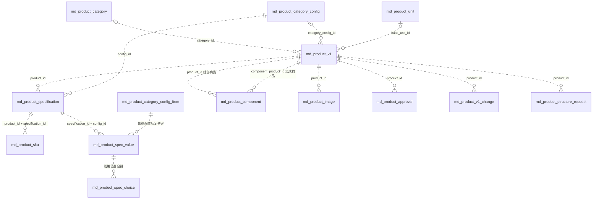
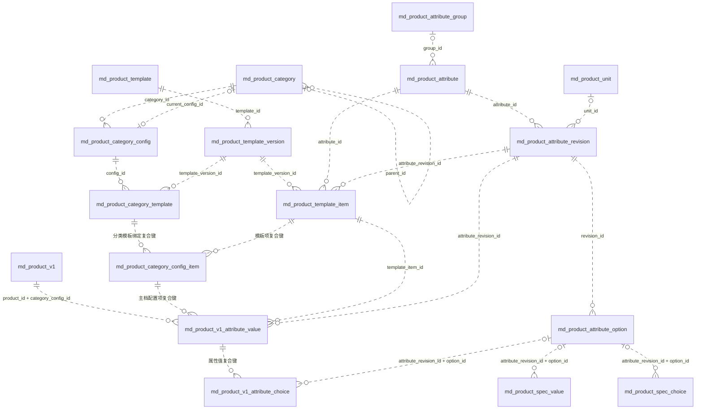

# 商品管理现行表关系

本文依据仓库中的 Flyway 迁移和商品持久化代码整理，覆盖主档、分类、模板、属性、规格、SKU、单位及附属记录。实际部署数据库的迁移状态未核验。

ER 图中的连线均对应数据库外键，均包含 `tenant_id`。连线标签只列主要关联列，关键复合外键另见下表。`||` 表示恰好一条，`|o` 或 `o|` 表示零或一条，`o{` 表示零到多条。基数按数据库约束标注。

## 商品主档、规格与 SKU

- `md_product_v1` 是当前商品主表。分类、固定配置和基础单位列在数据库中允许为空，业务填报要求取决于商品状态、形态和配置。
- SKU 同时保存商品和规格 ID，复合外键保证规格属于该商品。数据库允许一个规格关联多个 SKU，SKU 编码在租户内唯一。
- `md_product_component` 的两个商品字段均指向主表，表示组合商品与组成商品之间的多对多关系。同一组合商品和组成商品的配对在租户内唯一。

## 分类、模板与属性

分类的 `current_config_id` 指向当前发布配置。商品通过 `category_config_id` 固定自己使用的版本，规格通过 `config_id` 保存创建时使用的版本。配置经分类模板绑定选定模板版本，配置项再固定模板项、属性修订和数据类型。属性或规格使用自定义选项时，`option_id` 可以为空。

## 关键复合外键

| 约束 | 引用来源 | 引用目标 | 保证 |
|---|---|---|---|
| `fk_pc_current_config` | `md_product_category (tenant_id, id, current_config_id)` | `md_product_category_config (tenant_id, category_id, id)` | 当前配置属于该分类 |
| `fk_pv1_config_owner` | `md_product_v1 (tenant_id, category_id, category_config_id)` | `md_product_category_config (tenant_id, category_id, id)` | 商品配置属于商品所选分类 |
| `fk_pcci_binding` | `md_product_category_config_item (tenant_id, config_id, purpose, template_version_id)` | `md_product_category_template (tenant_id, config_id, purpose, template_version_id)` | 配置项来自该配置指定用途绑定的模板版本 |
| `fk_pcci_item` | `md_product_category_config_item (tenant_id, template_version_id, template_item_id, attribute_id, attribute_revision_id, data_type)` | `md_product_template_item (tenant_id, template_version_id, id, attribute_id, attribute_revision_id, data_type)` | 模板项、属性修订和数据类型与固定模板版本一致 |
| `fk_pv1av_config` | `md_product_v1_attribute_value (tenant_id, product_id, category_config_id)` | `md_product_v1 (tenant_id, id, category_config_id)` | 属性值使用其商品固定的配置 |
| `fk_pav_owner_scope` | `md_product_v1_attribute_value (tenant_id, category_config_id, template_item_id, attribute_revision_id, value_type, owner_scope)` | `md_product_category_config_item (tenant_id, config_id, template_item_id, attribute_revision_id, data_type, owner_scope)` | 主档属性值的模板项、修订、类型及归属范围与配置一致 |
| `fk_spec_value_parent` | `md_product_spec_value (tenant_id, specification_id, config_id)` | `md_product_specification (tenant_id, id, config_id)` | 规格值使用其规格固定的配置 |
| `fk_spec_value_config` | `md_product_spec_value (tenant_id, config_id, purpose, template_item_id, attribute_revision_id, value_type)` | `md_product_category_config_item (tenant_id, config_id, purpose, template_item_id, attribute_revision_id, data_type)` | 规格值匹配配置中的规格项和数据类型 |
| `fk_sku_owner` | `md_product_sku (tenant_id, product_id, specification_id)` | `md_product_specification (tenant_id, product_id, id)` | SKU 与规格属于同一商品 |

标准枚举选项另通过 `(tenant_id, attribute_revision_id, option_id)` 引用 `md_product_attribute_option (tenant_id, revision_id, id)`，确保选项属于固定修订。

## 单位及其他关联

| 关系 | 字段与实现 |
|---|---|
| 单位组 → 单位 | `md_product_unit (tenant_id, dimension_code)` 外键指向 `md_product_unit_group (tenant_id, code)` |
| 单位 → 单位换算 | `md_product_unit_conversion.source_unit_id` 与 `target_unit_id` 分别通过含租户的复合外键指向 `md_product_unit.id` |
| 商品 → 业务单位与包装 | 保存在 `md_product_v1.measurement_config` JSON 中。为空时只使用基础单位 |
| 商品 → 归属组织 | `md_product_v1.organization_id` 保存平台组织 ID，由服务端校验，迁移未声明物理外键 |
| 审批 → 工作流实例 | `md_product_approval.instance_id` 保存工作流公开实例 ID，迁移未声明物理外键 |
| 结构请求 → 变更记录 | `md_product_structure_request.change_id` 保存同事务追加的变更事件 ID，迁移未声明物理外键 |
| 分类并发控制 | `md_product_category_guard` 按租户保存并发控制记录 |
| 旧商品 → 当前主档 | 旧表 `md_product` 用于迁移，切换迁移按 `tenant_id` 和 `id` 与 `md_product_v1` 对账 |

## 仓库依据

- [V97__product_catalog_foundation](../../../backend/services/master-data-service/src/main/resources/db/migration/V97__product_catalog_foundation.sql)
- [V98__product_attribute_templates](../../../backend/services/master-data-service/src/main/resources/db/migration/V98__product_attribute_templates.sql)
- [V99__product_attribute_templates](../../../backend/services/master-data-service/src/main/resources/db/migration/V99__product_attribute_templates.sql)
- [V100__product_category_template_binding](../../../backend/services/master-data-service/src/main/resources/db/migration/V100__product_category_template_binding.sql)
- [V101__product_v1_master](../../../backend/services/master-data-service/src/main/resources/db/migration/V101__product_v1_master.sql)
- [V103__product_value_integrity](../../../backend/services/master-data-service/src/main/resources/db/migration/V103__product_value_integrity.sql)
- [V106__product_structure_requests](../../../backend/services/master-data-service/src/main/resources/db/migration/V106__product_structure_requests.sql)
- [V110__product_custom_choices](../../../backend/services/master-data-service/src/main/resources/db/migration/V110__product_custom_choices.sql)
- [V113__product_unit_conversion](../../../backend/services/master-data-service/src/main/resources/db/migration/V113__product_unit_conversion.sql)
- [V114__product_images](../../../backend/services/master-data-service/src/main/resources/db/migration/V114__product_images.sql)
- [V116__product_specifications_components](../../../backend/services/master-data-service/src/main/resources/db/migration/V116__product_specifications_components.sql)
- [V117__product_approval](../../../backend/services/master-data-service/src/main/resources/db/migration/V117__product_approval.sql)
- [V119__product_custom_specification_values](../../../backend/services/master-data-service/src/main/resources/db/migration/V119__product_custom_specification_values.sql)
- [V132__product_organization_ownership](../../../backend/services/master-data-service/src/main/resources/db/migration/V132__product_organization_ownership.sql)
- [V133__product_unit_groups](../../../backend/services/master-data-service/src/main/resources/db/migration/V133__product_unit_groups.sql)
- [V134__product_measurement](../../../backend/services/master-data-service/src/main/resources/db/migration/V134__product_measurement.sql)
- [V111 商品主档切换](../../../backend/services/master-data-service/src/main/java/db/migration/V111__product_single_writer_cutover.java)
