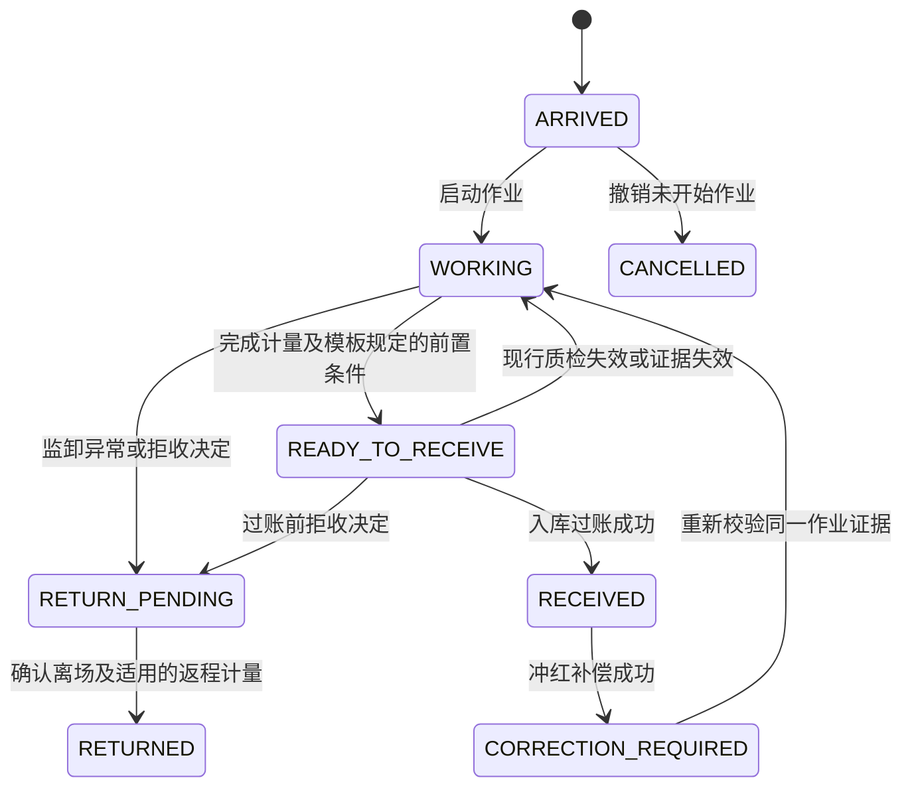
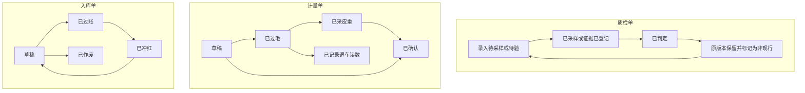

# 大宗仓储入库执行层 Phase 2

## 状态机

以下状态码用于领域设计。模板配置等待节点、操作顺序和门槛，应用层按实际事实执行状态迁移。队列阶段是下一条可执行工作提示，晚到的化验由质量队列跟进。报错保留当前状态和原审计值。





- **质检**。状态码为 `DRAFT / REGISTERED / DECIDED`，结论单独保存。盲检操作按统一字段保护仅返回样品识别和允许录入的指标。复检锁作业、保留已出具版本，在同一事务切换现行标记并登记新版本。关联历史入库或过皮依据保持原引用。质检失效时重算待办。若皮重证据已存在，保留历史采集事实，重新满足质量门槛后按模板决定复磅或复核。
- **计量**。状态码为 `DRAFT / GROSS_RECORDED / TARE_RECORDED / CONFIRMED / RETURN_RECORDED`。外部净重及理计从草稿凭验证证据直接确认。正常地磅先确认车次身份一致、正净重及读数稳定。若已作退车决定，授权操作可记录非正差重；该读数不生成实收净重。未达到模板的有效收货条件无法创建或过账入库单。
- **入库**。状态与 Phase 1 DDL 一致。冲红以原单为唯一来源追加反向业务流水，同时恢复该笔通知额度、更新原单为 `REVERSED` 并释放有效槽位。已移动、出库、被占用或受限制的库存按现有账务约束拒绝直接冲红，先进入有权限的处理流程。重开创建新草稿、新单号和原单引用；原单重量、凭证及过账时间保留。库内盘点差异由独立损溢单承担。
- **模板和一卡通**。模板草稿发布时校验策略键、允许的方法、字段、阈值及公式引用。同一租户按管理员确认的商品身份绑定优先，其次商品类目默认，缺失或多条同优先级时阻断创建。适用版本随作业固定，停用默认只限制新作业。绑卡、解绑分别核验现场岗位或受控设备身份，卡片只用于定位。设计以每作业保留一段发卡关系为基线；在途换卡方案采用追加绑定历史后再接入，原卡解绑必须同时解除后续设备采集许可。

### 策略规则

| 策略组合 | 过皮或定量 | 入库判定 |
|---|---|---|
| 先检后放行 + 差重 + 公式扣量 | 现行质检合格、监卸完成且无需退车 | 再验证质检及账面重量，固定公式输入、版本和输出 |
| 采样后放行 + 差重或外部净重 + 零扣量 | 采样登记即可定量；已有拒收结论时阻断 | 未出结果时入待检库存并发出暂估过账事件 |
| 文档外观放行 + 件数/重量 + 零扣量 | 地磅需验证读数，理计需验证抄码与合计件数 | 外观与 MTC、炉批核验通过后逐 LPN 入账；按模板校验磅差 |
| 经批准免检 | 允许空质检引用 | 仅模板明确批准的免检模式放行；记录适用版本和原因 |

### Java 策略契约

Java 骨架以完整源码维护。三个策略均显式接收 [UnloadingFact](../../backend/services/bulk-warehousing-service/src/main/java/com/appnexus/bulkwarehousing/domain/inboundexecution/UnloadingFact.java)，其中包含监卸结论、证据 UUID 和现场二次扣量。计量保留实重口径，门槛策略按模板使用监卸事实，扣量策略仅计入一次现场扣量。

- [MeteringStrategy](../../backend/services/bulk-warehousing-service/src/main/java/com/appnexus/bulkwarehousing/domain/inboundexecution/MeteringStrategy.java)
- [QualityGateStrategy](../../backend/services/bulk-warehousing-service/src/main/java/com/appnexus/bulkwarehousing/domain/inboundexecution/QualityGateStrategy.java)
- [DeductionCalculator](../../backend/services/bulk-warehousing-service/src/main/java/com/appnexus/bulkwarehousing/domain/inboundexecution/DeductionCalculator.java)

钢铁采用地磅实重时，[LPN 分摊规则](../../backend/services/bulk-warehousing-service/src/main/java/com/appnexus/bulkwarehousing/domain/inboundexecution/LpnWeightAllocation.java)按稳定明细 UUID 定序。前 N−1 行按总净重 × 本行理重 ÷ 总理重向下保留四位小数，末行获得总净重减去前序分配量的剩余重量。行理重、分摊净重均须为正，保存原理重与分摊快照；前端排序和导入顺序不影响结果。库存单位换算另走主数据已授权版本。
### TypeScript 骨架

该骨架供 Phase 3 接口契约和 Phase 4 工作台使用。采用服务端十进制字符串和已投影事实，权限从服务端操作能力读取。动态卡片后续使用现有 Element Plus 组件及全局应用壳。

```ts
/** API 精确十进制字符串。重量以千克表示，最多四位小数。 */
export type DecimalString = string;

/** 当前工作台主队列。并行质量待办由质检列表承接。 */
export type QueueStage =
  | "WAIT_QUALITY" | "WAIT_GROSS" | "UNLOADING" | "WAIT_TARE" | "WAIT_RECEIPT";

/** 服务端投影的表单字段；未授权字段不进入响应。 */
export interface WorkbenchField {
  key: string;
  labelKey: string;
  control: "text" | "decimal" | "select" | "attachment";
  readOnly: boolean;
  required: boolean;
}

/** 统一操作模型下当前用户允许执行的命令。提交时仍需服务端复核。 */
export interface AllowedOperation {
  operationId: string;
  recordId: string;
  expectedVersion: string;
}

/** 同一对象的表单字段和值经过统一投影。 */
export interface WorkbenchCard {
  objectType: string;
  fields: readonly WorkbenchField[];
  values: Readonly<Record<string, unknown>>;
  allowedOperations: readonly AllowedOperation[];
}

/** 算账条模式由有效模板决定；成员仅包含授权后可见的事实。 */
export type WorkbenchTotals =
  | { mode: "DEDUCTION"; physicalNetKg?: DecimalString; deductionKg?: DecimalString; accountingKg?: DecimalString }
  | { mode: "DUAL_MEASUREMENT"; actualNetKg?: DecimalString; theoreticalKg?: DecimalString; varianceRatio?: DecimalString }
  | { mode: "PENDING_LAB"; physicalNetKg?: DecimalString; awaitingLab?: boolean };
```

## Phase 3 实现约定

已开始实现内部过账计算 [PrepareInboundPostingService](../../backend/services/bulk-warehousing-service/src/main/java/com/appnexus/bulkwarehousing/application/inboundexecution/PrepareInboundPostingService.java)。用例重算入账门槛、原始计量、扣量守恒及钢铁地磅实重分摊，后续受控事务使用该结果写入单据和库存。当前只编译和验证内部计算，HTTP 端点尚未接线。

[ExecuteReceiptService](../../backend/services/bulk-warehousing-service/src/main/java/com/appnexus/bulkwarehousing/application/inboundexecution/ExecuteReceiptService.java) 实现过账和冲红共用的事务编排。事务内每次重新解析授权，并先经仓储锁定作业和目标单据，再核对事务回执；重放校验客户端版本、目标及操作组成的请求摘要。首次执行检查作业与目标版本及目标状态，完成业务写入后在同事务登记回执。统一授权、带锁仓储和库存/Outbox 写入作为生产接线依赖，当前验证使用独立 MySQL 实例和测试适配。

1. **命令和权限**。唯一 Provider 分别声明门岗发卡与解绑、监卸退车、三单、模板、授权聚合、冲红重开和实验室回填。通知和库存总览沿用既有 Provider。写入入口执行统一操作准入、行范围和字段保护；监卸、计量、放行、过账及冲红按操作独立授权。按可信租户锁作业及所影响通知行、证据和库存记录，所有入口保持确定的锁顺序。
2. **计量证据**。可信设备的 `tenant/source/eventId` 记录唯一身份和原始内容摘要，人工导入须有独立操作、来源凭证和审计。同身份同内容幂等复用，不一致拒绝。需要被多车分摊的外部报告按证据根聚合锁定，明确分摊总量、原版本及作业覆盖。计量策略拒绝前后车次切换、失效卡片、时间顺序错误、未稳定和证据重复占用。快照保留采集事实；在 Phase 3 迁移中补齐证据归属和分摊持久化。
3. **冲红与重开**。锁定作业和原库存明细，用原入库单 ID 作为补偿幂等根。独立补偿操作须校验库存仍可按原身份和权属回退，原单状态、额度和库存冲减同事务。重开验证上一有效原单确实已冲红、计量与质检事实仍适用。补偿流水结构需与当前库存账适配，生成列只约束有效入库单的唯一性。
4. **批次质量事件**。在实验室确认事务中发布版本化质量结果和覆盖关系，事件含租户、作业与质检版本、源样品、时间及指标单位。消费端按事件 ID 幂等，并对同一作业和目标批次使用版本单调校验。化验回写仅更新命中批次的质量属性，将对应待检库存转为正常或质量冻结，并在同一事务写入后续事件。原入库数量、重量快照、通知额度和已完成的 InboundTask 状态保持原值。正常质量状态仍须经过独立的货权和库存限制判断。若同一库存批次含多车，保留各车检测和覆盖量，通过已批准的聚合规则生成批次级属性。结果先于过账到达时直接使用现行结果，过账先到时从来源行追踪待检库存。并发、迟到、已冲红和跨租户目标必须按真实关联验证，ERP 独立计算价格。
5. **平台接入**。统一发号、打印、审批、授权和 Outbox 经现有公开契约接通。对象、操作和数据权限由所属业务对象唯一 Provider 声明，Controller 引用操作，运行层执行范围与字段保护。按现有 API 生命周期规范维护第一方 `/api` 契约及稳定错误码。

## 工程落位与交付检查

以仓库的[开发规范入口](../development/README.md)及其专项规范为准。后端沿用 `backend/services/bulk-warehousing-service`，由现有 `backend/applications/monolith-app` 组合装配；业务 SQL 迁移归仓储服务的 `src/main/resources/db/migration`，版本在组合应用的全仓迁移序列中查重。

| 位置（以 `com.appnexus.bulkwarehousing` 为根） | 职责及命名 |
|---|---|
| `api.inboundexecution` | 公开 `<业务职责>UseCase` 和稳定的用例入参及结果 |
| `application.inboundexecution` | `<业务职责>Service`、`<业务对象>Repository`、`<业务职责>Queries` 和必要事务端口 |
| `domain.inboundexecution` | 状态、门槛、计量和扣重规则，仅依赖 JDK |
| `adapter.web.inboundexecution` | `<业务职责>Controller`、`<操作>Request`、`<业务职责>Response`。仅调用公开用例 |
| `adapter.persistence.inboundexecution` | `MyBatis<端口职责>`、`<存储职责>Mapper`、`<业务对象>Po`。承接固定 SQL、记录锁和映射 |
| `adapter.integration.inboundexecution`、`bootstrap` | 前者承接对象声明和对侧公开契约桥接，后者以 `<业务职责>Configuration` 装配 |

按实际实现创建包，中文 `package-info.java` 描述职责、依赖、公开边界和实际接入状态。技术名称反映实现职责。新业务对象执行 D01–D12；来源通知和库存总览复用现有 Provider，逐项复核实际差异和契约版本。

前端业务组件、表单与领域类型归现有 `frontend/modules/warehousing`（`@appnexus/warehousing`），经该包公开导出。参照现有库存总览，`frontend/apps/admin/src/views/warehousing` 负责薄路由宿主、会话 HTTP 适配和应用装配，业务组件通过类型化 API 端口消费第一方接口。页面宿主沿用既有 kebab-case 文件命名，Vue 业务组件沿用 PascalCase。三栏作为应用壳内的页面内容，复用 `@appnexus/ui`、`@appnexus/icons` 和 Element Plus；表单权限读取实际操作能力，统一处理错误、审计、编码及国际化。采用单根页面宿主透传应用壳布局属性与 `main-content`。

后端交付验证包括实际组合装配、架构与包说明门禁、真实 MySQL 迁移和审计、对象声明运行接入及正反向权限和业务回归。前端除类型检查和构建外，通过真实路由验证应用壳布局宿主、计算样式、全局间距动态继承、主题和视口。适用项以 `docs/validation` 的实际证据为准。

### Phase 3 并发和读写边界

- **写入顺序。** 先执行统一准入，在受控事务中按可信租户和 `task_id` 锁作业，再复核行范围、目标单据归属和字段保护。所有状态转换、过账、冲红与复检切换均检查调用方看到的作业及目标单据版本。过账与冲红在版本冲突检查之前查已提交回执，回执必须匹配同一租户、作业、操作、单据和规范化请求摘要。仅在授权仍有效且摘要相同的情况下返回原结果。异键不得重复作用于同一单据；错误、锁冲突及回滚均不能留下回执或推进库存。
- **读模型。** 工作台只提供 GET 队列、状态计数和作业详情聚合。计数复用队列的授权范围和筛选条件，右栏风控与算账事实按所属单据权限投影。盲检状态下依据当前统一操作与字段权限在后端构建最小响应；车牌、司机、供应商及可反查身份的引用、附件和原始快照均不返回给盲检主体。筛选、排序和聚合也不使用该主体被禁止的字段。所有编辑、复检、过账和冲红进入三单各自的命令 API。

  已接入首个读入口 `GET /api/bulk-inbound-workbench/queue`，归作业对象的 `BulkInboundTask.read_workbench_queue`。队列和计数限当前明确获准的租户范围与有效来源通知。队列按 UUID 排他游标分页；阶段筛选只影响队列，计数用于全部页签。以预备盲检投影读取作业 UUID、阶段和起始时间，所有主体均不返回车辆、司机、货主或供应关联。按岗位展开非盲检字段、三单详情及风控和算账聚合仍待各对象独立权限接通。V187 只登记此操作，无前端路由或菜单。

  独立质检命令 `POST /api/bulk-inbound-quality-orders:register-sample` 归 `BulkInboundQualityOrder.register_sample`。首次采样提交作业当前版本；复检须另提交现行质检 ID 和行版本，并要求现行质检已判定。事务先锁作业，再核对来源通知并锁定现行质检；旧版本归档与新条码登记一并提交。作业版本递增，待入库作业在采样后返回质检门槛。编码和条码各自由数据库执行租户唯一校验。V188 登记独立命令权限，角色由统一授权中心配置。

  实验室数值判定 `POST /api/bulk-inbound-quality-orders/{id}:decide` 归 `BulkInboundQualityOrder.decide_quality`，V189 独立登记权限。只处理尚未过账、当前已采样的版本，客户端提交作业及质检行版本和实测值，结论由服务端计算。模板 `definition.qualityMetrics` 按稳定指标键维护 `unit`、`minimum`、`maximum`、`acceptMinimum`、`acceptMaximum`。没有默认规则，全部必填，整数或小数最多 18 位有效数字和 8 位小数。可接受区间必须位于物理范围内，均含端点。超出物理范围拒绝写入，物理有效但超出合格区间的结果记为不合格。快照固定模板 UUID、版本、规则单位和实测值。该命令适用于数值检验策略，钢铁的外观/MTC 和煤炭过账后的实验室事件另走各自受控链路。

  独立外部计量命令 `POST /api/bulk-inbound-metering-orders:register-external` 归 `BulkInboundMeteringOrder.register_external`。当前处理人工复核的轨道衡和水尺整单净重，作业模板必须为 `EXTERNAL_NET` 或 `SCALE_OR_EXTERNAL` 且采用 `SAMPLED` 门槛。租户、来源类型和凭证标识组成唯一认领键，标识忽略 ASCII 大小写，当前一份整单凭证只供一个作业使用。人工复核与设备直连有不同证据来源；共享报告分摊、直接设备接入和差重过磅另行实现。作业锁下从当前质检记录读取采样和结论，未采样或已拒收不能确认。确认后的计量单及作业待入库标记同一事务提交。千克净重的 HTTP 契约使用精确十进制字符串，最多 14 位整数和 4 位小数。

  独立散货草稿命令 `POST /api/bulk-inbound-receipt-orders:create-bulk-draft` 归 `BulkWarehouseReceiptOrder.create_bulk_draft`。首条实现适用于外部整单实重、散货、零扣量和采样门槛。作业锁下选择同一通知的单行，复核现行质检、已确认计量和作业/计量版本，从计量记录读取公斤净重，从主数据核验仓、区、位、货主、商品和 `KILOGRAM`。基础单位不为千克时须提供受控换算规则及版本。草稿主从表与队列作业版本同事务，按通知行剩余额度预检，草稿不占用额度也不写库存，过账时须重新核对。

  入库原单的 `{id}:post` 与 `{id}:reverse` 分别由 `BulkWarehouseReceiptOrder.post` 和 `BulkWarehouseReceiptOrder.reverse` 接入。调用提交作业版本、单据版本及 `Idempotency-Key`。外部计量、单行零扣量散货按采样门槛重验当前同版质检；已采样待化验可暂估过账，已拒收阻断，已合格可正常过账。通知累计、库存写入、原单、作业、回执及 `INBOUND_RECEIPT_POSTED` Outbox 引用在同一事务提交。冲红限原量仍在原库位、无待检量、发出量、货权和后续库存更新的单笔库存。保留原量并标记冲红时点，库存总览排除历史冲红量。重开使用新单号及同作业最近冲红原单的 `replacesReceiptId`。

  散货地磅实重采用 `record-gross`、保管员 `confirm-unloading` 与 `record-tare` 的独立接口。人工复核的同站点票据带原票号、UTC 实测时点和公斤读数，票号在租户和站点范围内唯一，毛重和皮重共用该约束。皮重必须晚于毛重，允许退车皮重等于或大于毛重且净重为空。强检策略需监卸与当前质检合格才可正常过皮，现场扣重保存为独立事实。采样型零扣量散货用同作业双票的正净重进入暂估或合格入库。强检品类的公式扣量入库及设备直连为剩余接入范围。

  钢铁采用三条独立命令 `inspect-steel`、`confirm-steel`、`create-steel-draft` 再走统一入库过账。核验只接受当前检验员从平台授权附件入口可读的 `inbound-task:<UUID>` 下已可用的质保书与独立外观照片，核验员确认炉批和报告一致性，钢铁无采样伪数据。双计量使用已发布 `DUAL` 策略，`definition.maxVarianceRatio` 必填，取值 0–1，表示绝对相对磅差上限（0.05 表示 5%）。`requireBothWeights` 缺省为 false，选择实重时仍必须有同站点、时序有效的双票。钢铁库存要求零扣量、现行检验合格、件数等于 LPN 明细、各行理重合计等于已确认理重且炉批一致。实重按稳定行 UUID 占比分摊，末行承接四位小数尾差。逐行重验仓储引用与额度，在同一过账事务对原仓内在库 LPN 去重。钢铁初轮不开放多行库存冲红。

  `GET /api/bulk-inbound-workbench/tasks/{id}` 提供只读聚合。基础查询只返回作业版本、阶段、状态、盲检和监卸。质检、计量、入库卡片逐块调用各自统一操作，缺权时返回空对象，也不产出该卡片的汇总值。数值检验未判定阶段完全跳过身份查询；非盲检还需要独立身份读取权限，车牌、运单、司机和货主标识经平台统一字段保护。入库卡片从批次库存读取当前质量状态，LPN 行只投影显式字段。风险数据来自真实作业，设备未接入时无设备占位数值。
- **事件投递。** 共享 Outbox 在已领取事件后按固定类型分派到唯一消费者。权限失效和集成授权保持原有处理，仓储事件进入绑定系统操作的消费者。实验室为已完成作业的过账版本写判定并在同事务追加 `INBOUND_QUALITY_DECIDED`；该命令保留作业状态和版本。消费按实际收货行与现行质检版本定位同租户批次来源，锁定作业后只写库存的质量状态、版本、指标快照和质量保留量。合格解除保留，不合格标为质量冻结并保留受限数量。原过账快照、单据数量、通知额度及作业保持。库存按来源区分，不用一个检验结果覆盖同名称的其他批次。
