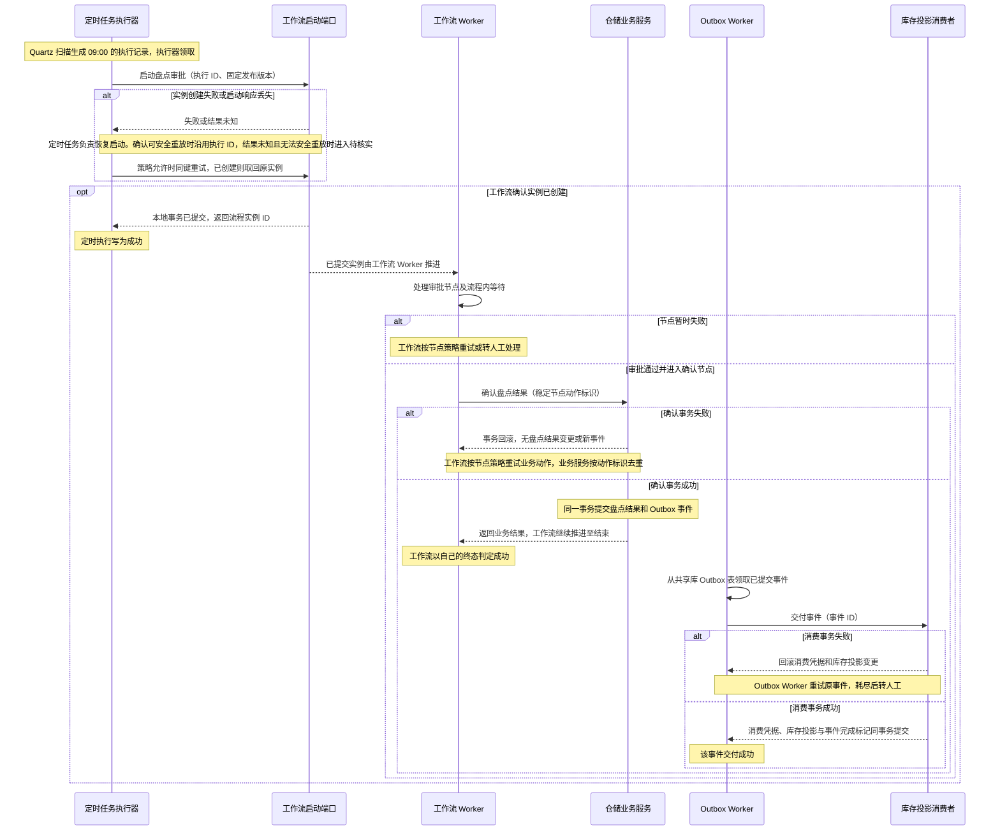

# 系统定时任务详细设计

状态：设计稿。适用于 AppNexus 应用内调度，供实现和验收评审。

## 1. 职责与部署

平台负责租户任务计划、触发、执行记录和运维操作。首版随现有组合应用部署。Quartz 使用共享数据库的 JDBC JobStore 和集群模式，各节点注册同一标识的固定扫描 Job，禁止同一 Job 并发扫描。Quartz 只保存扫描触发器，任务计划及执行结果以 AppNexus 数据库为准。Quartz 扫描触发器漏跑时跳过历史扫描，恢复后的扫描按应用的业务补跑策略判断到期计划。

扫描器短事务生成待执行记录，独立执行器分批领取并调用目标。扫描线程与业务执行线程独立设置容量，单租户大量任务不得占满执行容量。扫描周期、批大小、租约、续租频率及并发上限在实现时依据首批用例验证。首版计划按分钟配置。

平台调度通过公开应用端口对接业务动作和工作流。目标动作由所属对象的 Provider 声明及运行时接入，平台负责分派，业务模块负责业务校验、事务与结果。技术适配器负责 Quartz 和持久化接线。

## 2. 任务配置

系统管理提供任务计划和执行记录两个视图。计划编辑展示参数校验、时区和后续触发预览。执行记录展示计划时间、实际开始与结束、触发来源、状态、尝试次数、错误摘要和受权限保护的业务引用。

| 项目 | 首版设计 |
| --- | --- |
| 基本信息 | 租户、名称、说明、状态和配置修订号。新建为暂停，启用前校验完整配置。编辑、启停使用修订号检查并记录变更审计。 |
| 执行目标 | 选择已注册动作及其契约版本，或选择租户可用且允许定时启动的已发布流程版本。配置阶段和执行阶段均复核目标及授权。目标参数采用版本化结构校验。 |
| 指定时间 | 按任务时区指定一次未来时刻，执行或按规则跳过后清空下次触发时间。修改时间可重新安排未来触发。 |
| 固定间隔 | 指定起始时间和正整数分钟间隔，以起始时间对应的 UTC 时刻为锚点，按实际经过时间推进。 |
| Cron | 使用明确的 Quartz Cron 语法，限制到分钟粒度。以任务 IANA 时区计算。夏令时缺失的本地时刻跳过，重复的本地时刻取较早的 UTC 时刻。预览、推进和补跑使用同一计算逻辑。 |
| 超时与重试 | 受目标能力及部署上限约束，超时以秒计。默认零次自动重试，开启后配置有限次数和退避间隔。 |
| 并发与漏跑 | 每个任务最多一条活动执行。自动触发遇到活动执行时记录跳过，立即执行遇到活动执行时返回冲突。漏跑默认跳过，可启用窗口内补最近一次。 |
| 启停与编辑 | 暂停冻结自动触发，已生成执行及其重试继续处理。恢复和修改调度规则时，从生效时刻之后重新计算，暂停期间和旧规则的时刻不进入补跑。配置更新只影响随后生成的执行。 |

立即执行使用当前配置生成独立执行，允许用于暂停计划，不改变下次自动触发时间。运维重试继续原执行，使用原参数和幂等键，并重新校验权限与目标。业务日历、多次补跑及并行策略留待后续设计。

## 3. 数据模型

以下为逻辑模型，物理命名、索引和迁移版本在实施时确定。三个实体均有可信租户标识，同租户复合引用约束阻止跨租户关联。

| 实体 | 主要字段与约束 |
| --- | --- |
| 任务计划 | 计划 ID、租户、名称、启停状态、修订号、目标类型及标识、目标版本、参数、触发规则、时区、下次触发时间、漏跑窗口、超时与重试策略。按启用状态及下次触发时间建立到期扫描索引。 |
| 任务执行 | 执行 ID、租户、计划 ID、计划修订号、触发来源、原计划触发时间、生成时间、发起账号、配置快照、状态、可重试时间、租约期限及领取令牌、结果引用、错误或跳过原因。自动执行按租户、计划、原计划触发时间唯一。手动请求按租户、计划、发起账号和请求键去重。同计划活动执行由数据库约束保证唯一，可用可空生成列承载活动计划 ID，并建立租户与该列的唯一键。 |
| 执行尝试 | 租户、执行 ID、尝试序号、自动或人工重试来源、请求账号、开始结束时间、尝试结果、错误码及脱敏摘要。按租户、执行 ID、尝试序号唯一。 |

执行快照保存目标版本、参数、时区、原触发时刻和失败策略。补跑跳过可合并记录为一个时间区间，保存首末时刻及原因。结果保存类型和引用，访问目标记录仍需目标对象授权。

自有表建表时直接声明四个审计字段及中文列注释。账号用 BINARY(16)，时间用 TIMESTAMP(6)，数据库按 UTC 生成时间。无可信真人账号时审计账号允许 NULL，发起人和系统执行身份分别记录。Quartz 上游表按第三方边界管理。审计字段通过授权查询和前端只读展示。

## 4. 执行与状态流转

扫描器使用数据库当前时间作为一批扫描的判断基准。在同一短事务内锁定计划、复核状态与修订号、写入执行或跳过记录并推进下次触发时间。立即执行与扫描使用同一计划并发约束。执行器在短事务内领取并新增尝试记录，提交后调用目标，最后凭领取令牌条件更新执行结果。目标业务事务独立于调度领取事务。

| 状态 | 进入与退出条件 |
| --- | --- |
| 待领取 | 自动触发、补跑或立即执行创建。领取成功后进入执行中。 |
| 执行中 | 持有效租约，按需续租。成功进入成功，明确可重试失败进入待重试，确定失败且不可重试或次数耗尽进入失败。 |
| 待重试 | 到达退避时间后重新领取并新增尝试。该状态仍占用计划并发名额。 |
| 待核实 | 超时、租约到期或调用中断且结果未知，目标无法保证安全重放或安全重试次数已耗尽时进入。经目标侧确认已提交后归为成功，或在确认无进行中操作且未提交后归为失败。核实操作保留证据引用、操作人和原因。该状态仍占用并发名额。 |
| 成功 | 目标确认提交并返回引用，或按幂等键查得已成功。 |
| 失败 | 结果已确定且执行结束。对允许重试的失败，可经授权、并发检查和目标复核后转回待重试。 |
| 已跳过 | 漏跑规则或并发限制导致。保留原因，手动重做通过立即执行创建新记录。 |

执行器失去租约后，旧领取令牌无法更新状态。读取超时只表示调用方等待结束。自动恢复必须满足目标可安全重放，且目标侧能阻止旧尝试与新尝试产生并行业务副作用。否则进入待核实。成功、终态失败及跳过释放活动名额。告警以执行 ID 和失败状态变更去重，并关联执行详情。

## 5. 漏跑与幂等

- 正常迟到容忍窗口是部署级参数，其下限覆盖设计扫描周期及预期抖动。首版分钟粒度下，扫描与容忍窗口应通过实际延迟验证。按统一时钟判断，刚到期且在容忍窗口内的时刻视为正常触发。
- 一次扫描最多选中一个候选时刻。若存在正常到期时刻，优先选最近一次，其余到期时刻记跳过。若全部已超过正常迟到窗口，只有开启补跑且最近一次落在配置的补跑窗口内，才补该次。存在活动执行时，候选也记并发跳过。
- 处理后下次触发推进到扫描基准时间之后的首个计划时刻。补跑保留原计划时刻和时区。例如 03:00 补 02:00 的库存汇总，营业日期仍按 02:00 的计划上下文计算。
- 发送同一手动请求时复用请求键。相同键和相同请求意图返回已有执行，键相同而意图不同返回冲突。重试复用原执行 ID，修订号或参数变化不会覆盖历史快照。
- 业务端按可信租户、目标操作和执行 ID 去重。幂等凭据与业务写入在同一事务落库，重放返回原结果引用。库存等动作还应按自身业务唯一键防重复，因为不同执行 ID 可能针对同一营业日。流程启动端同样需要以执行 ID 原子去重并返回原实例。历史执行与业务幂等凭据的保留期须覆盖允许的最长重试和恢复范围。

## 6. 权限与对象声明

管理入口属于租户管理域。分别声明计划列表、详情、创建、编辑、启停、立即执行，以及执行列表、详情、重试和结果核实。查看目标、配置目标以及触发目标需要相应授权，列表、计数、详情、主从引用及写入统一执行可信租户谓词和适用的数据策略。跨租户 ID、越权目标或字段均拒绝。参数、日志和错误摘要按字段授权投影，密钥通过受控引用解析。

扫描和领取绑定固定的进程内系统操作。执行从数据库已领取记录解析租户和操作，检查当前租户、目标版本、调度能力及适用业务范围。人员授权用于管理和发起，后台运行使用租户明确绑定的目标范围，目标或绑定撤销后阻止新尝试。调度参数只允许结构化输入，动作映射由代码注册。

| 声明项 | 设计对应 |
| --- | --- |
| D01–D03 | 计划、执行由平台唯一声明，尝试作为执行子资源。实现时登记稳定对象标识、真实页面与 API 及固定后台入口。 |
| D04–D06 | 租户管理准入、进程内系统准入、租户范围、目标业务范围及字段保护分别接通真实查询与写入。 |
| D07–D08 | 调度目标复用所属对象 Provider 的版本化动作契约，流程启动接工作流公开协议。当前范围无打印及导出。 |
| D09 | 计划与执行用稳定内部标识，用户通过名称查找。无业务编码字段和发号入口。 |
| D10–D11 | 平台 Provider 声明管理及机器操作，适配器接入实际执行。目标由原 Provider 校验和处理，按本设计落实租约、版本、事务及幂等。 |
| D12 | 实现时追踪声明到真实运行，逐项记录受影响对象、版本迁移、正反向证据及未验证项。 |

## 7. 工作流与 Outbox 交接

| 入口 | 交接承诺 |
| --- | --- |
| 定时任务 → 业务动作 | 传入执行 ID、可信租户、动作及版本、参数快照和计划时刻。业务提交后返回结果引用。 |
| 定时任务 → 工作流 | 通过工作流公开启动入口，传入已发布版本、可信租户、受控变量及执行 ID。工作流幂等创建实例并返回实例 ID，定时执行记成功。流程节点、内部计时、等待、恢复和最终状态由现有工作流 Worker 管理，流程失败从实例详情追踪。 |
| 业务动作 → Outbox | 业务动作需要发布事件时，业务变更与 Outbox 事件同事务提交。现有 Outbox Worker 继续按事件类型、租户和租约处理投递与消费。事件投递重试由 Outbox 管理，定时执行结果以业务提交为准。 |

三个入口的触发依据分别是计划时刻、流程运行条件、已提交的业务事件。现有固定 Worker 保持独立生命周期。

### 7.1 仓库盘点交接时序

示例为每天 09:00 发起仓库盘点审批，审批通过后由仓储模块确认盘点结果，并通过 Outbox 交付盘点结果已确认事件。盘点动作及事件均为设计示例，接入前须确认真实业务契约和消费者。

流程完结与 Outbox 消费可独立推进。盘点确认事务提交后，事件即可被领取。流程未走到确认节点、审批驳回或确认事务回滚时，无本次盘点确认事件。已成功的定时执行保留实例引用，流程失败由工作流处理，事件交付失败由 Outbox 处理。

## 8. 现有代码复核与接入缺口

2026-11-24 对当前工作区进行静态复核。以下区分已有实现、接入缺口和待验证事项。

### 8.1 工作流版本绑定

**引擎和审批绑定路径已有固定版本能力，通用定时启动入口待补。** 普通启动的请求体与运行时入口接收业务对象、用途及入口能力，未提供可直接指定流程定义与版本的参数。无审批绑定时，查询使用定义当前的已发布指针。已有 startBound 路径通过 verifyApproval 校验业务对象审批绑定，按绑定版本查询并核对定义 ID，随后启动选中版本对应的 Flowable 定义 ID。该路径受对象绑定和业务事实校验约束。Mapper 的显式版本分支按版本号查找启用定义，版本发布资格还依赖上游可信绑定校验。 [WorkflowRuntime](../../backend/services/workflow-service/core/src/main/java/com/appnexus/workflow/application/WorkflowRuntime.java#L285) · [WorkflowRecordMapper](../../backend/services/workflow-service/adapters/flowable/src/main/java/com/appnexus/workflow/adapter/persistence/WorkflowRecordMapper.java#L268) · [FlowableEngineCommands](../../backend/services/workflow-service/adapters/flowable/src/main/java/com/appnexus/workflow/adapter/flowable/FlowableEngineCommands.java#L19)

实施时由工作流公开应用端口接收可信租户、定义 ID、不可变发布版本及执行 ID，复用固定定义 ID 启动。配置与首次启动均验证定义启用、版本确已发布且仍允许定时启动，并校验对象入口、变量契约和业务范围。发布新版本不自动移动既有计划。测试旧版仍可启动、新版发布不漂移、未发布版本和跨租户版本拒绝、定义停用后禁止新启动。

### 8.2 工作流启动幂等

**已有事务性请求重放，尚无独立于人员身份的定时执行 ID 语义。** mutate 在同一事务注册并锁定 wf_request，按租户、账号和请求 ID 定位，校验包含人员、组织与命令参数的指纹，已有响应则直接返回。首次执行在该事务中创建工作流记录、按固定定义启动引擎、绑定引擎实例并写回响应。Flowable 装配使用同一数据源及事务管理器。实例活动唯一键用于屏蔽同业务对象同用途的并行发起，结束时会释放，定时执行重试必须使用持久幂等记录。 [请求幂等](../../backend/services/workflow-service/core/src/main/java/com/appnexus/workflow/application/WorkflowRuntime.java#L999) · [引擎事务装配](../../backend/services/workflow-service/adapters/flowable/src/main/java/com/appnexus/workflow/adapter/flowable/WorkflowEngineConfiguration.java#L94) · [活动唯一键](../../backend/services/workflow-service/adapters/flowable/src/main/resources/db/migration/V48__workflow_application.sql#L19)

实施时为受信调度入口提供按租户、固定操作及执行 ID 去重的契约，可复用现有事务幂等机制并扩展机器主体作用域。使用固定版本和规范化输入的指纹识别冲突，记录与实例创建同事务提交。当前授权仍须复核。已提交的同键请求在授权允许时返回原实例，停用后禁止首次创建，结果核实可经受控只读入口查询原实例。验证并发同键、同键异参、引擎创建失败整体回滚、提交后响应丢失及流程已结束后重放。现有人员请求路径继续保留原语义。

### 8.3 Outbox 事务交接

**已有同库原子交接，可复用。首个定时动作仍需验证实际接线。** ReliableEvents.publish 使用 MANDATORY 事务传播。入库收货过账在 ExecuteReceiptService 的仓储事务内调用业务写入回调，回调内发布 INBOUND_RECEIPT_POSTED，同一执行的重放路径在回调前返回已保存结果。AuthorityEventWorker 按事件类型分派，ReliableEvents.consume 在同一事务检查租约和租户，写入消费去重、执行同库副作用并更新事件完成状态。现有测试源码覆盖事务外发布拒绝与回滚后无事件。 [发布与消费事务](../../backend/services/platform-service/adapters/security/src/main/java/com/appnexus/platform/security/ReliableEvents.java#L32) · [过账发布](../../backend/services/bulk-warehousing-service/src/main/java/com/appnexus/bulkwarehousing/application/inboundexecution/PostInboundReceiptService.java#L50) · [过账重放路径](../../backend/services/bulk-warehousing-service/src/main/java/com/appnexus/bulkwarehousing/application/inboundexecution/ExecuteReceiptService.java#L72) · [现有事务测试](../../backend/applications/monolith-app/src/test/java/com/appnexus/platform/ReliableEventsTest.java#L92)

- 发布为每次调用生成新事件 ID，消费去重按事件处理。选定的定时业务动作须把执行幂等凭据、业务写入和事件追加放在同一事务，命中重放时直接返回原结果。定时执行状态回写在后续事务，提交后崩溃依赖目标重放收敛。
- 业务事件契约当前只声明入库过账和质量判定。首个动作若需要新事件，须补契约、发布接线和真实消费者。现有本地消费者回调适用于同库可回滚副作用。若需外部投递，另行定义可靠交付与接收端幂等。
- 针对首个定时发布动作验证业务回滚无事件、Outbox 追加失败时业务回滚、业务提交但定时状态未回写时重放仅保留一条对应事件、消费失败可独立重试。事件失败不回退已成功的定时执行。若需从执行页面定位投递状态，另补受权限保护的事件引用，现有通用交接未定义执行 ID 与事件 ID 的关联。

## 9. 分布式部署与故障恢复

仓库当前采用模块化单体。首版支持同一组合应用多副本共库部署。独立部署是演进方案，启用前需要验证远程契约、服务身份和恢复能力。 [模块归属与命名规范](../development/模块归属与命名规范.md)

| 部署形态 | 调度归属 | 目标与事件 |
| --- | --- | --- |
| 组合应用多副本、共享数据库 | 调度副本加入同一个 Quartz JDBC 集群。计划和执行共用平台数据库，各副本按租约领取。 | 通过进程内公开端口调用目标。工作流与 Outbox 保留各自 Worker、事务和租约。 |
| 调度独立部署、目标服务分库 | 一个调度部署单元拥有对应计划、执行账本和 Quartz JobStore。组合应用的扫描与领取入口在切换时关闭。 | 通过目标服务的内部命令与结果查询接口交接。工作流实例和业务事件由各自写入方在本地事务提交。 |

### 9.1 多副本共库

Quartz 集群节点使用相同调度器名称和 JobStore、唯一实例 ID 及同步时钟。同一环境只装配一个逻辑扫描 Job。执行器以数据库时间判断到期与租约有效性。生成记录和推进计划在同一事务提交，业务调用在领取事务结束后发起。数据库故障时停止新的扫描和领取，由恢复后的扫描按漏跑策略推进。 [Quartz 集群配置](https://www.quartz-scheduler.org/documentation/quartz-2.4.x/configuration/ConfigJDBCJobStoreClustering.html)

租约用于协调领取和保护状态回写。实例失联、滚动发布或续租失败时，旧进程可能仍在执行业务。新领取必须满足目标支持同键安全重放，目标侧以幂等记录或业务锁串行化同键副作用。退出中的实例停止领取，并尝试在发布终止宽限内完成已领工作。发布期间保留对在途配置快照和目标契约版本的兼容。

### 9.2 跨服务调用与事务

首阶段远程接入可采用内部命令请求加结果查询。调度器提交领取后发送命令，传递执行 ID、目标与版本、计划时刻、时区和受控参数。目标验证服务身份和固定操作授权，从可信服务上下文验证租户及目标范围，校验请求与幂等指纹，限制并记录调用主体。调度员账号用于审计及发起准入。执行身份由目标服务校验，不从请求参数推断。

| 提交边界 | 持久化事实 |
| --- | --- |
| 调度库 | 计划推进、待执行记录及领取状态。目标确认完成后，以当前领取令牌单独写回结果。 |
| 目标业务库 | 幂等凭据、业务写入、原结果引用及必要的本地 Outbox 事件同事务提交。工作流启动在工作流库内原子保存幂等结果和实例。 |
| 事件消费 | 发布服务的 Outbox 负责其本地事件交付。跨库消费者在自己的库中原子保存消费凭据及本地副作用，成功后确认交付。现有同库 Outbox Worker 的事务回调只用于本地副作用，跨库或外部交付需要补投递与确认机制。 |

命令以目标确认已提交为定时执行成功。连接超时、节点切换或响应丢失时，通过受控接口按租户、固定操作和执行 ID 查询目标结果。查到已提交即回填原引用。暂时查不到时按未知结果处理，因为调用可能仍在途。只有已验证目标能处理并发同键重放且仍有重试次数时，才以同键再次请求，其余进入待核实。调度侧单独写入执行成功，目标侧幂等覆盖两次提交之间的故障窗口。

工作流远程成功的交接点仍是实例创建提交。工作流不可用时按启动目标的重试规则恢复。流程推进失败由工作流处理。业务事件投递失败归发布方 Outbox 重试或人工处理，业务动作重放命中幂等记录时不重复追加事件。

### 9.3 部署切换与验收

调度独立部署切换前冻结计划配置，停止旧部署扫描和领取并等待在途执行完成或进入核实流程。保留计划 ID、下次触发时间、执行 ID 与快照，通过新部署接管同一账本，或在停写窗口完整迁移并核对后接管。新节点启用后按原游标及漏跑策略恢复，同一账本运行期间只允许一方拥有调度权。Quartz 固定扫描触发器在新部署初始化。目标侧的原幂等记录须随目标服务迁移保留。

共库形态验收双节点扫描、进程失联、过期令牌写回拒绝及滚动升级。跨服务形态增加调用前断网、目标提交后丢响应、结果查询不可用、跨租户服务调用拒绝、事件重复投递、消费提交后确认丢失及迁移接管验证。对每个场景核对调度执行、工作流实例或业务结果、Outbox 事件的数量和关联。

## 10. 首版多副本共库实施方案

### 10.1 装配与生命周期

| 组件 | 装配和职责 |
| --- | --- |
| 应用装配 | 在 monolith-app 组合根装配平台调度应用服务、MyBatis 持久化适配器、Quartz 适配器和业务目标适配器。HTTP 管理入口委托平台应用服务，工作流及业务模块通过各自公开端口接入。 |
| 数据库 | 所有副本使用同一 MySQL 主库。Flyway 先完成计划、执行、尝试和 Quartz 上游表的迁移，再启动后台组件。禁用应用启动时重新初始化 Quartz 表。平台执行账本使用既有事务装配，工作流启动使用工作流现有的同库事务管理。 |
| Quartz 调度 | 各调度副本加入同一逻辑集群，使用不同实例 ID。以固定 JobKey 和 TriggerKey 幂等初始化周期扫描，遇到并行注册冲突时复读并校验既有定义。运行期只扫描计划，集群触发器漏跑按跳过处理。 |
| 执行器 | 每个启用执行的副本装配独立领取循环和有界执行线程池。领取循环按空闲执行槽计算批量，提交领取后立即分派。续租和过期恢复各用短事务与独立调度线程，避免业务线程阻塞时无法续租。 |
| 生命周期 | 管理 API、扫描和执行职责可独立启用。首版默认同一批副本运行相同职责。启动时校验数据库迁移和目标注册后才开放扫描与领取。停机先停止本节点扫描和领取，已领任务在宽限期内继续续租并尝试完成，超过宽限后交由租约恢复。 |

建议联调起点为扫描每 5 秒、空闲领取每 1 秒、租约 30 秒、续租每 10 秒、过期扫描每 5 秒，每节点 4 个业务执行槽，每轮计划扫描最多 100 条。正常迟到容忍窗口建议从 15 秒起测。它们是联调候选值，按数据库往返时间、滚动发布与触发延迟实测确定生产值。执行器单次领取数不得超过该节点已预留的空闲槽位。调度启用前检查统一系统准入，监控扫描延迟、最老待领时间、租约过期、待核实数量和线程池饱和。

### 10.2 去重与事务顺序

1. **生成执行。** 以数据库时间为扫描基准，在短事务按下次触发时间、计划 ID 排序，用 FOR UPDATE SKIP LOCKED 分批锁计划。锁内复读启停、版本和游标，按规则写执行或跳过记录，并推进游标。事务失败整体回滚。自动触发唯一键是最后一道重复生成保护。立即执行使用同一计划行锁和活动唯一约束，重复请求键优先返回已有结果。
2. **领取执行。** 在独立短事务中，按可领取时间及执行 ID 排序，用 FOR UPDATE SKIP LOCKED 选取到期的待领取、待重试记录。锁内复核状态和到期时间，写执行中、新领取令牌、节点标识及租约期限，并插入本次尝试。同一事务提交后才分派。候选索引以状态、可领取时间和 ID 建立，恢复按状态、租约期限和 ID 扫描。
3. **处理与写回。** 开始调用前由执行器复核领取仍有效及目标准入。续租、尝试结束及结果回写均绑定执行 ID、执行中状态、当前令牌和未到期租约。回写执行与结束尝试同事务。条件更新影响零行时视作已失去领取权，旧节点不再尝试回写。目标调用在领取事务之外，用固定执行 ID 提交业务事务。
4. **约束竞争范围。** 扫描、立即执行和人工重试涉及计划活动名额时，统一先锁计划，再操作执行记录。领取、续租和过期恢复只锁执行记录。活动唯一键覆盖待领取、执行中、待重试、待核实。锁冲突允许重做短事务，复用原触发时间或手动请求键。目标业务调用的重试遵循执行状态机。

领取互斥只保证同一时刻由一份有效租约授权处理。宕机恢复可能再次调用目标，业务副作用由目标侧同键去重。Quartz 的扫描协调、执行器的领取互斥和目标侧幂等分别覆盖三个不同的提交边界。

### 10.3 宕机恢复

| 故障窗口 | 恢复动作与预期结果 |
| --- | --- |
| 扫描事务提交前宕机 | 数据库释放锁并回滚，下一轮按原游标扫描。若已提交，执行与新游标同时可见。 |
| 领取提交后、目标调用前宕机 | 过期恢复器锁定执行，复核令牌和租约已过期，结束旧尝试。单凭领取记录无法确认请求是否已发出，后续按结果未知处理。 |
| 执行中失联或续租失败 | 过期恢复器条件更新，在同一事务结束旧尝试并安排待重试或待核实。支持安全同键重放且尚有预算才自动重试，旧令牌随后无法续租或写回。 |
| 目标提交后、执行结果写回前宕机 | 安全重试沿用执行 ID，目标返回原结果引用。无法安全重试的目标由运维通过可信结果核实路径确认，恢复后只补写调度状态。 |
| 所有副本或数据库不可用 | 停止生成和领取。恢复后先让过期扫描和正常领取收敛，再按数据库时间执行计划补跑规则。检查待核实和积压指标。 |

过期恢复与正常状态回写按同一执行行互斥，并用数据库时间复核有效期。每次领取计入尝试预算，待核实继续占用活动名额。遇到目标长期不可达，恢复流程保留原快照及错误记录，供后续核实。计划漏跑只处理尚未生成执行的计划时刻，已生成记录由执行恢复路径处理。

### 10.4 接入验收

使用两个组合应用实例和同一真实 MySQL 库，开启 Quartz 集群及真实执行端口。通过确定的故障注入点终止任一实例，并核对计划游标、执行行、尝试、目标结果和事件数量。验收记录保留执行 ID、节点与事务结果。

| 验收项 | 通过标准 |
| --- | --- |
| 扫描与领取 | 同一时刻跨节点并发扫描只落一条自动执行，游标推进一次。同执行同一轮仅有一个领取成功。不同任务可分散到两节点，线程池满时不超额领取。 |
| 宕机与租约 | 分别在扫描提交前、领取提交后、业务提交后宕机。验证回滚、租约接管、旧令牌写回拒绝及单一业务结果。目标结果未知且无法安全重放时进入待核实，后续执行受活动名额限制。 |
| 工作流版本与权限 | 配置并运行已发布版本，发布新版后旧计划仍启动原版本。拒绝未发布、跨租户及停用目标。通过真实定时机器入口和目标范围校验。 |
| 工作流原子幂等 | 并发同键或提交后宕机重试只创建一条工作流实例和一条 Flowable 实例，返回同一引用。同键异参拒绝，引擎失败时实例及幂等结果共同回滚。实例结束后同键仍返回原结果，后续流程失败在工作流侧追踪。 |
| 业务与 Outbox 提交 | 选一个真实已注册业务动作，注入业务异常与 Outbox 追加异常，验证业务变更、执行幂等记录和事件一起回滚。业务提交后杀节点并重试，原业务结果和对应 Outbox 事件各保留一份。 |
| Outbox 独立恢复 | 注入现有 Worker 消费失败，验证消费凭据与同库副作用共同回滚，原事件驱动重试。事件失败期间定时执行仍保留业务成功结果。恢复后消费者只提交一次副作用。 |
| 滚动发布与停机补跑 | 重启一个副本时另一个继续扫描和领取，全停恢复按原计划时刻执行窗口内补跑。暂停或规则变更前的时刻按既定规则处理，已生成执行不被补跑重复生成。 |

工作流固定版本机器入口、执行 ID 幂等能力及首个业务动作的真实事务接线分别按第 8 节补齐后验收。本节为实施和测试设计，联调期间在 docs/validation 留存结果。

## 11. 首版实施任务清单

按 1 至 8 实施并验收。工作流和 Outbox 是领取与恢复验收后的两个独立接入任务，可以并行开发，双副本联调须等两条接入链路均通过。各步骤的验收通过后开放其依赖的运行能力。以下均为待实施、待验证项。

| 顺序与任务 | 前置与实施范围 | 验收标准及留存证据 |
| --- | --- | --- |
| 1. 确认首批目标与声明 | 选定一个真实工作流启动场景和一个需发布 Outbox 事件的真实业务动作。明确负责模块、公开端口、目标契约、租户范围、字段保护、执行 ID 和结果引用。按 D01–D12 核对计划、执行、尝试子资源及受影响目标的原 Provider。确认 Quartz 依赖、上游建表脚本和迁移边界。 | 留存对象和操作对照、现状缺口、版本与迁移依据、业务结果和事件计数口径。确认哪些目标具备安全重放能力，以及其他目标的核实路径。 |
| 2. 数据库迁移 | 完成 1 后，由 Flyway 管理计划、执行、尝试及 Quartz 上游表。建立跨租户引用约束、触发与请求去重键、活动唯一键、到期和过期扫描索引。自有表在创建时声明四个审计字段。记录后续目标端幂等表的归属，若需迁移由对应接入任务执行。 | 在真实 MySQL 验证空库初始化和存量库升级。运行全表审计字段检查，验证同租户主从引用、跨租户引用拒绝、重复自动触发或手动请求拒绝、同计划第二条活动执行拒绝。核对扫描索引执行计划及第二个副本启动时保留既有 Quartz 数据。 |
| 3. 计划管理与 Quartz 装配 | 完成 2 后，在组合根装配管理入口、统一准入、计划计算、持久化和 Quartz 固定扫描 Job。执行器暂不开放。迁移成功后以固定身份幂等注册扫描触发器。扫描事务同时写执行及推进计划游标。 | 双副本同时启动只形成一个逻辑 Job 和 Trigger。同一计划时刻只落一条执行，扫描事务回滚后游标保持原值。验证预览与落库时刻一致，启停、时区、停机窗口内外补跑及未授权访问符合设计。留存 Quartz 注册、计划游标和执行行证据。 |
| 4. 执行领取与恢复 | 完成 3 后，装配有界执行池、短事务领取、尝试记录、续租、状态回写和过期恢复。使用可控测试目标验证故障点，生产目标入口待各自接入验收通过再启用。 | 双副本竞争同一执行只产生一个有效领取。同节点领取不超空闲槽。领取提交后终止进程，验证尝试结束、租约接管及旧令牌无法续租或回写。验证安全重试保留执行 ID，耗尽次数或无法安全重放且结果未知时进入待核实。留存两节点日志、状态和尝试记录。 |
| 5. 工作流接入 | 完成 4 后，由工作流提供固定发布版本的机器启动入口和执行 ID 原子去重。需要数据库变更时先完成工作流本地迁移，再开放入口。 | 发布新版后原计划仍启动原版本。未发布、停用、跨租户和越权目标被拒绝。同键并发、提交后断点及实例结束后重放均返回同一实例，工作流记录和引擎实例各一条。同键异参被拒绝，引擎失败时实例与幂等结果共同回滚。留存版本、目标实例和事务证据。 |
| 6. 业务动作与 Outbox 接入 | 完成 4 后，由业务模块接入真实动作。使用本库事务原子保存执行幂等凭据、业务变更和 Outbox 事件，接入现有 Worker。若目标需要新事件，先完成契约、发布和消费者接线。 | 注入业务失败与事件追加失败，验证三者共同回滚。业务提交后终止执行节点，同键重试只返回原结果且对应事件仍为一条。消费失败时消费凭据和本地副作用回滚，重试成功后只提交一份副作用，定时执行保留业务成功结果。留存业务、事件和消费记录。 |
| 7. 双副本端到端与发布验证 | 5、6 均通过后，使用两个组合应用实例和同一真实 MySQL 库运行第 10 节场景。补齐越权、字段保护、滚动发布、全停恢复与运行指标验证。按实测整定扫描、租约和执行池参数。 | 故障注入覆盖扫描提交前、领取后及目标提交后的宕机。核对执行、工作流实例、业务结果与 Outbox 事件的数量和关联。验证运行指标可定位积压及待核实执行，发布停机流程可交接有效租约。留存节点、执行 ID、测量值及部署条件。 |
| 8. 交付并启用 | 完成 7 后，复核实际差异和声明同步，检查适用门禁、界面与全局布局、审计和运维操作。先完成迁移并核验，再启用扫描及执行职责，最后由授权人员启用首批计划。 | 在 docs/validation 逐项记录适用性、实际证据、结果及未验证项。验证能暂停计划和停止后台领取，在途执行仍可按租约恢复。适用项全部通过后标记完成交付。 |

实际实施时按任务记录所用版本、环境、命令或故障注入点、预期、实测结果和证据路径。端到端验收中的对账以同一个执行 ID 串联尝试记录、目标幂等凭据和目标结果。需要关联 Outbox 时保留可核验的事件 ID。

## 12. 交付记录

设计评审后，按第 10 节选一个真实业务动作及一个可定时启动流程。验证配置预览与实际触发一致、时区和夏令时边界、暂停恢复、单次计划、停机窗口内外补跑、双实例去重及手动触发冲突。注入业务提交后崩溃和租约到期，验证同键重放、旧执行器写回拒绝及未知结果处理。验证跨租户、撤权、越权目标和字段泄漏的反向用例，以及工作流后续失败、Outbox 投递失败各自在所属模块闭环。

实施交付时在 docs/validation 逐项留存权限、真实数据库审计字段检查、声明同步、浏览器布局和运行恢复证据。本稿的逻辑表名、状态及策略用于评审，运行参数、物理迁移和实测证据在实施阶段确定。

## 参考

- [平台总体设计](平台总体设计.md#已确认定时任务服务)
- [工作流服务详细设计](工作流服务详细设计.md)
- [业务对象完整声明规范](../development/业务对象完整声明规范.md)
- [Quartz JDBC JobStore 集群配置](https://www.quartz-scheduler.org/documentation/quartz-2.4.x/configuration/ConfigJDBCJobStoreClustering.html)
